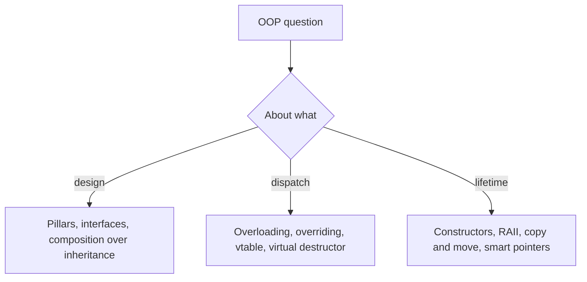

## The hook

The OOP round often starts gently: "What are the four pillars?" Then it speeds up: "Why a virtual destructor? What is a vtable? Shallow or deep copy? unique_ptr or shared_ptr? Can a constructor be virtual?" Each question has a two-sentence answer and a trap, and the interviewer is listening for whether you know the trap.

This article is the rapid-fire round: each question with a crisp answer, the pitfall, and a link to the full article in this track if you want depth. Predict which of these is a trick question: "Can a constructor be virtual?" or "Can a destructor be virtual?" (The first: constructors cannot be virtual; destructors often must be.)

## The intuition

:::analogy
**A rapid-fire quiz round**: the host asks, you answer in a sentence or two, and points go to precision, not length. The best teams have not memorised paragraphs; they know the one idea behind each answer, so they can say it simply and handle the follow-up.
:::

## Let's build it up

### The pillars

**Q: What are the four pillars of OOP?** Encapsulation (hide data behind operations that keep it valid), abstraction (expose what an object does, not how), inheritance (reuse and extend a base type in an is-a relationship), and polymorphism (one interface, many behaviours). Trap: giving definitions without an example; always add one, such as a BankAccount whose balance can only change through deposit and withdraw. Details: [A Capsule That Protects the Medicine Inside](article:cs-core-encapsulation-access).

**Q: Encapsulation versus abstraction?** Encapsulation is the mechanism (private data, public operations); abstraction is the design goal (a simple interface hiding complexity). Encapsulation is one way to achieve abstraction.

**Q: Class versus object; struct versus class?** A class is a type; an object is an instance in memory. struct and class differ only in default access (public versus private). Details: [A Cookie Cutter and Its Cookies](article:cs-core-classes-objects).

### Inheritance and polymorphism

**Q: Overloading versus overriding?** Overloading: same name, different parameters, same scope, chosen at compile time. Overriding: a derived class replaces a base **virtual** function with the same signature, chosen at run time. Trap: a same-named derived function without virtual merely hides the base one. Details: [One Remote Controlling Different TVs](article:cs-core-polymorphism).

**Q: How do virtual functions work?** Each polymorphic class has a vtable of function pointers; each object has a hidden vptr to its class's vtable; a virtual call looks up the slot at run time, which is **[[dynamic dispatch]]**. Details: [A Switchboard That Routes Calls by Caller Type](article:cs-core-virtual-functions-vtable).

**Q: Why a virtual destructor?** Deleting a derived object through a base pointer otherwise skips the derived destructor (formally undefined behaviour), leaking whatever it owns. Any class with virtual functions should have one.

**Q: Can a constructor be virtual? Can it call virtual functions?** No, it cannot be virtual: the object's type is being built. It can call virtual functions, but they dispatch to the class under construction, not to derived classes.

**Q: Constructor and destructor order with inheritance?** Base constructors first, then members, then the derived body; destructors in exactly the reverse order. Details: [Children Inheriting Family Traits](article:cs-core-inheritance).

**Q: What is object slicing?** Copying a derived object into a base object by value keeps only the base part, so virtual calls on the copy run base versions. Pass polymorphic objects by reference or pointer. That is **[[object slicing]]**.

**Q: Abstract class versus interface?** An abstract class has at least one pure virtual function and cannot be instantiated; it may hold data and code. An interface (a C++ convention) has only pure virtual functions. Details: [A Job Description Versus the Person Hired](article:cs-core-abstract-interfaces).

**Q: What is the diamond problem?** Two bases sharing a common base give the derived class two copies of it; virtual inheritance shares one. Details: [Two Parents Inheriting From the Same Grandparent](article:cs-core-diamond-problem).

### Objects, copies and memory

**Q: Shallow versus deep copy?** Shallow copies pointers, so two objects share (and double-delete) one resource; deep copies the resource. A class owning a raw resource needs its own copy operations: the **[[rule of five]]**. Details: [Photocopying a File Versus Handing Over the Original](article:cs-core-copy-move-semantics).

**Q: What does std::move do?** Only casts to an rvalue reference, allowing a move constructor or move assignment to steal resources; the move itself happens in those functions.

**Q: What is RAII?** Acquire a resource in a constructor and release it in the destructor, so cleanup happens on every exit path, including exceptions. Details: [A Hotel Room Cleaned Automatically When You Check Out](article:cs-core-constructors-raii).

**Q: unique_ptr versus shared_ptr versus weak_ptr?** unique_ptr: single owner, move-only, zero overhead. shared_ptr: shared ownership with a reference count. weak_ptr: non-owning observer used to break cycles. Details: [A Library Book With One Borrower Versus a Shared Document](article:cs-core-smart-pointers).

**Q: new versus malloc?** new allocates and constructs, returns a typed pointer and throws on failure; malloc returns raw memory and null on failure. Pair new with delete, new[] with delete[], malloc with free.

**Q: What are static members and friends?** Static members belong to the class (one copy, no this); friends are functions or classes explicitly allowed to access private members.

:::insight
Most OOP interview questions reduce to three ideas: design (hide data, depend on interfaces, prefer composition unless is-a holds), dispatch (overloads are chosen at compile time, virtual overrides at run time through the vtable), and lifetime (constructors and destructors bracket every object, so RAII, copy and move rules and smart pointers follow).
:::

## A tiny example

The question that combines three traps: `Base* p = new Derived; p->speak(); delete p;` where speak is virtual but ~Base is not. What happens? speak dispatches correctly to Derived::speak, but delete runs only ~Base (formally undefined behaviour), so whatever Derived owns leaks. Fix: `virtual ~Base() = default;`, or better, hold it in `unique_ptr<Base>` with the virtual destructor in place.

:::warning
Common misconception: "polymorphism means inheritance." Inheritance is one way to get run-time polymorphism, but overloading, templates and operator overloading are polymorphism too, at compile time. Interviewers often follow up with exactly this distinction.
:::

:::try-this
Answer in two sentences each, then check against the article: "Why prefer composition over inheritance?" and "When would you use shared_ptr?" (Composition couples classes less and lets parts be swapped, while inheritance exposes the base's details and only fits true is-a relationships. Use shared_ptr only when several parts of the program must keep one object alive and no single owner is clear; default to unique_ptr.)
:::

### Interview follow-ups

**"Explain the SOLID principles briefly."** Single responsibility, open/closed, Liskov substitution, interface segregation, dependency inversion, covered in [Lego Bricks With Standard Studs](article:system-design-oop-solid).

**"What is the size of an empty class?"** At least 1 byte, so distinct objects have distinct addresses.

**"Can you overload a function by return type alone?"** No; calls are resolved by argument types.

## Where you'll see this again

Machine-coding and low-level design rounds turn these answers into code, such as [Design a Parking Lot](article:system-design-parking-lot). The pointer and output questions that often accompany this round are in [Street Addresses Versus the Houses at Them](article:cs-core-pointers-output-questions).

## Key takeaways

- The four pillars are encapsulation, abstraction, inheritance and polymorphism, and each answer lands better with a short example.
- Overloading is resolved at compile time from argument types, while overriding virtual functions is resolved at run time through the vtable.
- A polymorphic base class needs a virtual destructor, constructors cannot be virtual, and copying a derived object by value slices it.
- Shallow copies share resources and cause double frees, so classes owning resources follow the rule of five or, better, the rule of zero.
- unique_ptr is the default owner, shared_ptr is for genuinely shared lifetimes, and weak_ptr breaks reference cycles.
