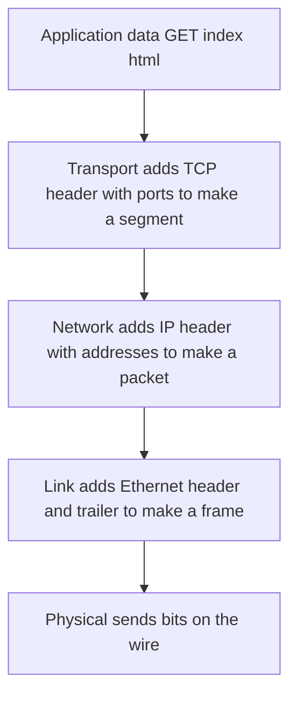

## The hook

You type a web address and press Enter. Your laptop's Wi-Fi radio does not know what a web page is. The web browser does not know what a radio wave is. The router in your hostel does not care whether the bytes are a video or a password. Yet the request arrives, intact, at a server across the world.

It works because the job is split into layers, each solving one problem and trusting the others with the rest. Interviewers ask about this in nearly every networking round, usually as "explain the OSI model", and the follow-up question is always about what actually happens to the bytes. Predict how many headers your request is wrapped in by the time it leaves your laptop. (Three, plus a trailer: TCP, IP and Ethernet or Wi-Fi.)

## The intuition

:::analogy
**Sending a parcel through layers of packaging.** You write a letter (the data), put it in an envelope addressed to a person in a company (the program), put that in a courier box with a street address (the computer), and the courier puts the box in a van labelled for the next depot (the next hop). Each handler reads only their own label. At the destination, the layers come off in reverse.
:::

## Let's build it up

### The seven OSI layers and the four TCP/IP layers

| OSI layer | Job | Data unit | Examples | TCP/IP layer |
|---|---|---|---|---|
| 7 Application | What the program wants to say | message | HTTP, DNS, SMTP | Application |
| 6 Presentation | Encoding, encryption, compression | | TLS, JPEG, UTF-8 | Application |
| 5 Session | Opening and managing conversations | | session resumption | Application |
| 4 Transport | Process-to-process delivery, reliability, ports | segment / datagram | TCP, UDP | Transport |
| 3 Network | Host-to-host delivery across networks, routing | packet | IP, ICMP | Internet |
| 2 Data link | Delivery to the next device on the same link, MAC addresses | frame | Ethernet, Wi-Fi | Link |
| 1 Physical | Bits as signals | bits | cables, radio | Link |

The **[[layer|layers]]** each offer one service upward. The transport layer says "deliver these bytes to port 443 on that host"; the network layer says "get this packet to that IP address"; the link layer says "get this frame to the next box".

Wait, why does the internet use four layers when everyone teaches seven? OSI was designed as a complete protocol suite by a standards committee; TCP/IP was built and deployed first and won. Today OSI survives mainly as vocabulary: "layer 4 load balancer" means it looks at TCP/UDP ports, "layer 7" means it reads HTTP.

### Devices by layer

| Device | Layer | Looks at |
|---|---|---|
| Hub (obsolete) | 1 | nothing; repeats bits |
| Switch | 2 | MAC addresses |
| Router | 3 | IP addresses |
| Layer 4 load balancer | 4 | IP addresses and ports |
| Layer 7 load balancer, API gateway | 7 | HTTP paths, headers, cookies |

### Encapsulation

On the way down, each layer adds its header: **[[encapsulation]]**. On the way up, each layer removes its own and passes the rest up. The **[[protocol data unit]]** changes name as it goes:

The **[[port]]** in the TCP header picks the program (443 for HTTPS); the IP header's addresses pick the computer; the Ethernet header's MAC addresses pick the next device on this link, and change at every router hop while the IP addresses stay the same.

:::insight
Each layer solves one problem and speaks only to its peer layer on the other side, using the layer below as a delivery service. That separation lets Wi-Fi be swapped for fibre, or HTTP/1.1 for HTTP/2, without touching the other layers.
:::

## A tiny example

A 100-byte HTTP request, sent over Ethernet with the minimum header sizes:

| Layer adds | Bytes added | Running total |
|---|---|---|
| Application data | 100 | 100 |
| TCP header | 20 | 120 |
| IPv4 header | 20 | 140 |
| Ethernet header and trailer | 14 + 4 | 158 |

Headers are 58 of the 158 bytes, over a third. For large transfers the ratio improves: with a 1500-byte **[[MTU]]**, each packet carries up to 1500 − 20 − 20 = 1460 bytes of TCP data, so headers are a small fraction.

:::warning
Common misconception: "the MAC address identifies the destination server across the internet." MAC addresses only matter on the local link. At each router, the frame is unwrapped and a new frame is built with new MAC addresses for the next hop; only the IP addresses travel end to end (apart from changes made by NAT).
:::

:::try-this
Which layer's header does each device read: a switch forwarding a frame, a router choosing the next hop, and a web server deciding which program gets the request? (Switch: data link, the destination MAC. Router: network, the destination IP. Server: transport, the destination port, then the application reads the HTTP request itself.)
:::

### Interview follow-ups

**"Where does TLS fit?"** Between TCP and HTTP: in OSI terms it does presentation-layer work (encryption), and in TCP/IP it is part of the application layer.

**"Why layer at all?"** Each layer can change independently, be implemented by different vendors, and be reasoned about on its own, at the cost of some header overhead and duplicated functions.

**"What is a PDU at each layer?"** Message or data at the application layer, segment (TCP) or datagram (UDP) at transport, packet at network, frame at data link, bits at physical.

## Where you'll see this again

Every networking topic in this track sits on one of these layers: TCP's reliability at transport, IP addressing and routing at network, ARP and switches at data link. The system-design view of the same stack is in [Registered Post or Shouting Across the Street?](article:system-design-networking-essentials), and a full request's journey is in [Everything That Happens Before a Page Appears](article:system-design-client-server-http).

## Key takeaways

- The OSI model has seven layers while the deployed TCP/IP stack has four, merging OSI's application, presentation and session layers into one.
- The transport layer delivers data between programs using ports, the network layer delivers packets between hosts using IP addresses, and the data link layer delivers frames to the next device using MAC addresses.
- Encapsulation adds a header at each layer on the way down and removes it on the way up, so a 100-byte request becomes a 158-byte Ethernet frame.
- Switches work at layer 2, routers at layer 3, and load balancers at layer 4 or layer 7 depending on what they inspect.
- MAC addresses change at every hop while IP addresses travel end to end, which is why layers can be replaced independently.
