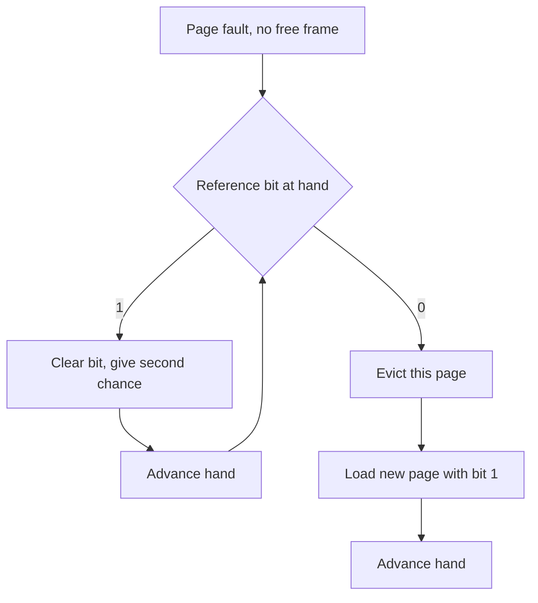

## The hook

A puzzle first, one that surprised the people who first ran into it. A program runs with 3 frames of memory and causes 9 page faults. You give it 4 frames, a third more memory, and run exactly the same program on exactly the same input.

It now causes **10** page faults.

More memory, more disk trips. No bug, no randomness. The cause is the rule the system used to decide which page to throw out, and by the end you will be able to reproduce the puzzle by hand, explain why some rules can never do this, and count faults for every policy an exam can throw at you.

## The intuition

:::analogy
Back at the library desk from the last article. Your desk holds **three books**, and you need a fourth. One book has to **go back to the shelf**. Which one? You could return the one you **brought first**, however much you are still using it. You could return the one you **have not opened for the longest time**. If you had a crystal ball, you would return the one you **will not need again for the longest time**. Or you could tap each book in turn and return the first one you have not touched since your last round of tapping. Each of these habits is a page replacement policy.
:::

| Habit at the desk | Policy | Needs to know |
|---|---|---|
| Return the book that arrived first | FIFO | Arrival order |
| Return the book unused for longest | [[LRU]] | When each page was last used |
| Return the book needed farthest in the future | [[Optimal replacement]], also called OPT or MIN | The future |
| Tap books in a circle, return the first untouched one | CLOCK, or [[second chance]] | One [[reference bit]] per page |

The whole subject is one question: how well does each habit guess which book you will not need soon?

## How it works

### The tool: a reference string

To compare policies fairly, write down the pages a process touches, in order. That is a [[reference string]]. Count the faults each policy causes with a fixed number of frames. Every frame starts empty, so the first touch of each page is always a fault, whatever the policy.

The running example for this whole article, with **3 frames**:

**1, 2, 3, 1, 4, 1, 2, 4, 3, 1, 4, 1**

Page 1 is clearly the busiest. Remember that.

Before reading on, predict the order of the four policies from fewest faults to most.

### FIFO: first in, first out

FIFO evicts the page that has been in memory longest, using a simple queue of arrival order. No hardware help needed.

| Step | Page | Frames after | Fault | Evicted |
|---|---|---|---|---|
| 1 | 1 | 1 | yes | |
| 2 | 2 | 1 2 | yes | |
| 3 | 3 | 1 2 3 | yes | |
| 4 | 1 | 1 2 3 | hit | |
| 5 | 4 | 4 2 3 | yes | 1 |
| 6 | 1 | 4 1 3 | yes | 2 |
| 7 | 2 | 4 1 2 | yes | 3 |
| 8 | 4 | 4 1 2 | hit | |
| 9 | 3 | 3 1 2 | yes | 4 |
| 10 | 1 | 3 1 2 | hit | |
| 11 | 4 | 3 4 2 | yes | 1 |
| 12 | 1 | 3 4 1 | yes | 2 |

**FIFO: 9 faults.** Look at step 5. Page 1 had been used one step earlier, and FIFO threw it out anyway, because it *arrived* first. One step later, the process needed it back. FIFO measures age, not usefulness. Step 11 makes the same mistake again.

### Optimal: the crystal ball

Optimal evicts the page whose next use is farthest away, or that will never be used again.

| Step | Page | Frames after | Fault | Evicted, and why |
|---|---|---|---|---|
| 1 to 3 | 1, 2, 3 | 1 2 3 | 3 faults | |
| 4 | 1 | 1 2 3 | hit | |
| 5 | 4 | 1 2 4 | yes | 3: next used at step 9, later than 1 (step 6) and 2 (step 7) |
| 6 to 8 | 1, 2, 4 | 1 2 4 | 3 hits | |
| 9 | 3 | 1 3 4 | yes | 2: never used again |
| 10 to 12 | 1, 4, 1 | 1 3 4 | 3 hits | |

**Optimal: 5 faults**, and no policy can do better on this string with 3 frames. Three of those five are the unavoidable first touches of pages 1, 2 and 3.

The catch is obvious: the kernel cannot see the future. Optimal is useful as a **yardstick**: run it offline on a recorded reference string, and you know how much room any real policy has left to improve.

### LRU: the past as a forecast

LRU bets that the near future looks like the recent past, and evicts the page whose last use is oldest. It is Optimal run backwards in time.

| Step | Page | Frames after | Fault | Evicted, and when each page was last used |
|---|---|---|---|---|
| 1 to 3 | 1, 2, 3 | 1 2 3 | 3 faults | |
| 4 | 1 | 1 2 3 | hit | |
| 5 | 4 | 1 4 3 | yes | 2: last used at step 2; 1 at 4, 3 at 3 |
| 6 | 1 | 1 4 3 | hit | |
| 7 | 2 | 1 4 2 | yes | 3: last used at step 3 |
| 8 | 4 | 1 4 2 | hit | |
| 9 | 3 | 3 4 2 | yes | 1: last used at step 6; 4 at 8, 2 at 7 |
| 10 | 1 | 3 4 1 | yes | 2: last used at step 7 |
| 11 | 4 | 3 4 1 | hit | |
| 12 | 1 | 3 4 1 | hit | |

**LRU: 7 faults.** It kept page 1 at step 5, where FIFO did not. It is not perfect: at step 9 it evicted page 1, which came back at step 10, because the recent past did not predict that particular moment.

Wait, why is LRU so much better than FIFO here, when both only look at the past? Because LRU looks at the right part of the past. FIFO remembers when a page **arrived**; LRU remembers when it was last **used**, and use is what locality, from [A Desk That Holds Only Today's Books](article:cs-core-virtual-memory), is about.

### Implementing LRU is the hard part

Exact LRU needs to know, at every eviction, which page was least recently used. Two classic ways:

- **Timestamps**: stamp each page table entry with a clock value on every access; evict the smallest stamp. Every memory access writes a timestamp, and eviction searches every entry.
- **A stack or list**: move a page to the top on every access; evict from the bottom. That is the hash map plus doubly linked list from [The Desk That Keeps Your Latest Books on Top](article:dsa-lru-cache), which is perfect for a software cache.

For page replacement, both are far too slow: the update would have to happen on *every memory access*, billions per second, in hardware. So real systems approximate LRU with something much cheaper: the reference bit.

### CLOCK: LRU on a budget

Hardware sets a page's **reference bit** whenever the page is accessed. That is all the help the kernel gets. CLOCK arranges the frames in a circle with a **hand** pointing at one of them.

```pseudo
on page fault, when no frame is free:
    loop:
        if frame[hand].reference_bit == 1:
            frame[hand].reference_bit = 0     # second chance: spare it this time
            hand = next(hand)
        else:
            victim = frame[hand]              # not used since the hand last passed
            break
    load the new page into victim's frame, with reference_bit = 1
    hand = next(hand)
on a hit:
    hardware sets reference_bit = 1
```



In desk terms: you walk around the desk tapping books. A book you opened since your last lap gets its mark wiped and stays. The first book with no mark goes back to the shelf.

Here is the running string under CLOCK. R is the reference bit; the hand column shows where the hand points after the step.

| Step | Page | Frame 0 | Frame 1 | Frame 2 | Hand | Fault | Evicted |
|---|---|---|---|---|---|---|---|
| 1 | 1 | 1, R1 | | | 1 | yes | |
| 2 | 2 | 1, R1 | 2, R1 | | 2 | yes | |
| 3 | 3 | 1, R1 | 2, R1 | 3, R1 | 0 | yes | |
| 4 | 1 | 1, R1 | 2, R1 | 3, R1 | 0 | hit | |
| 5 | 4 | 4, R1 | 2, R0 | 3, R0 | 1 | yes | 1, after a full lap clearing every bit |
| 6 | 1 | 4, R1 | 1, R1 | 3, R0 | 2 | yes | 2 |
| 7 | 2 | 4, R1 | 1, R1 | 2, R1 | 0 | yes | 3 |
| 8 | 4 | 4, R1 | 1, R1 | 2, R1 | 0 | hit | |
| 9 | 3 | 3, R1 | 1, R0 | 2, R0 | 1 | yes | 4, after another full lap |
| 10 | 1 | 3, R1 | 1, R1 | 2, R0 | 1 | hit | |
| 11 | 4 | 3, R1 | 1, R0 | 4, R1 | 0 | yes | 2: page 1 got its second chance |
| 12 | 1 | 3, R1 | 1, R1 | 4, R1 | 0 | hit | |

**CLOCK: 8 faults.** Two moments tell the story. At step 5, every bit was set, so the hand cleared all three and came back to frame 0: when every page looks recently used, CLOCK has no information and **degrades to FIFO**. At step 11, page 1's bit was set from step 10, so CLOCK spared it and evicted page 2 instead, exactly where FIFO threw page 1 out and paid for it at step 12.

:::insight
FIFO uses arrival time, LRU uses last-use time, and CLOCK uses one bit that says "used recently or not". One bit is a crude memory of the past, but it is enough to stop the worst FIFO mistake: evicting a page that is in active use.
:::

### All four, side by side

| Policy | Faults with 3 frames | Needs | Used in practice |
|---|---|---|---|
| Optimal | 5 | The future | Only as a benchmark |
| LRU | 7 | Last-use time of every page | Exactly, in software caches; approximated for pages |
| CLOCK | 8 | One reference bit per page | Yes, in many variants |
| FIFO | 9 | Arrival order | Rarely on its own |

The ordering Optimal ≤ LRU ≤ CLOCK ≤ FIFO is typical but not a law. On unusual strings, LRU can lose to FIFO; the only guarantee is that nothing beats Optimal.

:::try-this
Reference string 5, 6, 7, 5, 8, 6 with 3 frames. Count the faults under FIFO and under LRU. (FIFO: 5, 6, 7 fault; 5 hits; 8 evicts 5; 6 hits: 4 faults. LRU: 5, 6, 7 fault; 5 hits; 8 evicts 6, the least recently used; 6 faults again, evicting 7: 5 faults. Here FIFO wins, because LRU's guess about page 6 was wrong.)
:::

### Belady's anomaly: more frames, more faults

Now the puzzle from the hook. Use the reference string

**1, 2, 3, 4, 1, 2, 5, 1, 2, 3, 4, 5**

which is the standard example of the effect. Run FIFO with **3 frames**:

| Step | 1 | 2 | 3 | 4 | 1 | 2 | 5 | 1 | 2 | 3 | 4 | 5 |
|---|---|---|---|---|---|---|---|---|---|---|---|---|
| Frames after | 1 | 1 2 | 1 2 3 | 4 2 3 | 4 1 3 | 4 1 2 | 5 1 2 | 5 1 2 | 5 1 2 | 5 3 2 | 5 3 4 | 5 3 4 |
| Fault | F | F | F | F | F | F | F | hit | hit | F | F | hit |

**9 faults.** Now predict 4 frames. Most people say 7 or 8.

| Step | 1 | 2 | 3 | 4 | 1 | 2 | 5 | 1 | 2 | 3 | 4 | 5 |
|---|---|---|---|---|---|---|---|---|---|---|---|---|
| Frames after | 1 | 1 2 | 1 2 3 | 1 2 3 4 | 1 2 3 4 | 1 2 3 4 | 5 2 3 4 | 5 1 3 4 | 5 1 2 4 | 5 1 2 3 | 4 1 2 3 | 4 5 2 3 |
| Fault | F | F | F | F | hit | hit | F | F | F | F | F | F |

**10 faults.** With the extra frame, pages 1 and 2 survive long enough to hit at steps 5 and 6, but that keeps the queue order unlucky: when 5 arrives, the oldest page is 1, which is needed next, then 2, then 3, then 4, then 5, each evicted just before its turn. That is [[Belady's anomaly]], described by László Belady and colleagues in 1969.

Run LRU on the same string and the anomaly disappears: **10 faults with 3 frames, 8 with 4**. Optimal gives 7 and 6.

### Why LRU and Optimal are immune

Think about what LRU keeps. With n frames, it holds the n most recently used pages. With n + 1 frames, it holds the n + 1 most recently used pages, which always **includes** the n. So any reference that hits with n frames also hits with n + 1. More frames can only turn faults into hits, never hits into faults.

Optimal has the same property, with "most recently used" replaced by "needed soonest". Policies with this inclusion property are called [[stack algorithm|stack algorithms]], and no stack algorithm can show Belady's anomaly.

FIFO has no such property. The pages FIFO holds depend on arrival history, and with a different number of frames the arrival history itself changes, as the two tables show: the 4-frame run's frames are not a superset of the 3-frame run's at step 7 (it holds 5, 2, 3, 4, while the 3-frame run holds 5, 1, 2).

:::warning
Common misconception: "Belady's anomaly means more memory can make any algorithm slower." It only affects policies that are not stack algorithms: FIFO, and FIFO-like policies such as second chance, which also goes from 9 to 10 faults on this string when a newly loaded page starts with its bit set. LRU and Optimal can never fault more with more frames.
:::

### Making CLOCK smarter: the dirty bit

Evicting a **dirty** page costs a disk write before the read, roughly doubling the fault cost, as you saw with the effective access time in the previous article. The enhanced second-chance algorithm looks at two bits, reference and dirty, and prefers victims in this order:

| Class | Referenced | Dirty | Meaning | Eviction preference |
|---|---|---|---|---|
| 1 | 0 | 0 | Not recently used, clean | Best victim: drop it for free |
| 2 | 0 | 1 | Not recently used, but must be written first | Next |
| 3 | 1 | 0 | Recently used, clean | Likely needed again soon |
| 4 | 1 | 1 | Recently used and dirty | Worst victim |

Other refinements: the **aging** algorithm keeps a few history bits per page, shifting the reference bit in at regular intervals, so the kernel can rank pages by how recently they were used, not just "yes or no". **Page buffering** keeps a pool of free frames ready and writes dirty pages to disk in the background, so a fault rarely waits for a write.

### The code

A compact simulator for all four policies, which prints the fault counts traced above:

```cpp
#include <bits/stdc++.h>
using namespace std;

// Count page faults for one policy. frames[i] holds a page or -1.
int simulate(const vector<int>& refs, int n, const string& policy) {
    vector<int> frames(n, -1), stamp(n, 0), ref(n, 0);
    int faults = 0, hand = 0;                        // hand: next FIFO victim, or the CLOCK hand
    for (int t = 0; t < (int)refs.size(); t++) {
        int p = refs[t];
        int at = find(frames.begin(), frames.end(), p) - frames.begin();
        if (at < n) { stamp[at] = t; ref[at] = 1; continue; }        // hit
        faults++;
        int v = find(frames.begin(), frames.end(), -1) - frames.begin();   // a free frame?
        if (v == n) {
            if (policy == "FIFO") { v = hand; hand = (hand + 1) % n; }
            else if (policy == "LRU") v = min_element(stamp.begin(), stamp.end()) - stamp.begin();
            else if (policy == "OPT") {                                     // farthest next use
                int far = -1;
                for (int i = 0; i < n; i++) {
                    int nxt = find(refs.begin() + t + 1, refs.end(), frames[i]) - refs.begin();
                    if (nxt > far) { far = nxt; v = i; }
                }
            } else {                                                        // CLOCK
                while (ref[hand]) { ref[hand] = 0; hand = (hand + 1) % n; }
                v = hand; hand = (hand + 1) % n;
            }
        } else if (policy == "FIFO" || policy == "CLOCK") hand = (v + 1) % n;
        frames[v] = p; stamp[v] = t; ref[v] = 1;
    }
    return faults;
}

int main() {
    vector<int> s = {1, 2, 3, 1, 4, 1, 2, 4, 3, 1, 4, 1};
    for (string pol : {"FIFO", "LRU", "OPT", "CLOCK"})
        cout << pol << " with 3 frames: " << simulate(s, 3, pol) << " faults\n";  // 9, 7, 5, 8
    vector<int> b = {1, 2, 3, 4, 1, 2, 5, 1, 2, 3, 4, 5};
    for (int n : {3, 4})
        cout << "Belady string, FIFO, " << n << " frames: " << simulate(b, n, "FIFO")
             << ", LRU: " << simulate(b, n, "LRU") << "\n";                     // 9 then 10; 10 then 8
}
```

It prints 9, 7, 5 and 8 faults for the running string, then FIFO going from 9 to 10 and LRU from 10 to 8 on the anomaly string. Each step scans the frames, so it costs $O(n)$ per reference, and the Optimal look-ahead adds a scan of the remaining string; fine for exam-sized inputs, not for a kernel.

## Trade-offs

| Policy | Faults | Bookkeeping per access | Bookkeeping per fault | Belady's anomaly |
|---|---|---|---|---|
| Optimal | Fewest possible | None, but needs the future | Look ahead | No |
| LRU, exact | Usually close to Optimal | Update a timestamp or list on every access | Find the oldest | No |
| CLOCK | Usually close to LRU | Hardware sets one bit | Sweep the hand | Possible |
| Enhanced CLOCK | Fewer expensive dirty evictions | Hardware sets two bits | Up to several sweeps | Possible |
| FIFO | Often the most | None | Pop the queue | Yes |

The real trade-off is information against cost. More precise knowledge of the past gives better guesses, but every bit of tracking happens on the hottest path in the whole machine.

## What can go wrong

- **Forgetting the cold-start faults.** The first touch of every page is a fault for every policy. On a string with k distinct pages, no policy can do better than k faults.
- **Evicting the wrong page in LRU traces.** Look at the *last use* of each resident page, not the first.
- **Breaking ties inconsistently in Optimal.** When several pages are never used again, any of them is a correct choice and the count is the same, but state the rule you use.
- **Forgetting that CLOCK gives a fresh page its bit set.** Conventions differ between textbooks; follow the one the question states.
- **Claiming LRU always beats FIFO.** It usually does, but not on every string, as the try-this showed.
- **Ignoring dirty pages.** Two policies with equal fault counts can differ by a factor of two in disk traffic if one keeps evicting dirty pages.
- **Treating replacement as the cure for thrashing.** If the working sets do not fit, every policy faults constantly; the fix is fewer processes or more memory.

### Interview follow-ups

**"Count the page faults for this reference string with 3 frames under FIFO, LRU and Optimal."** Trace a table of frames per step. Mark the first touch of each page as a fault. FIFO evicts the earliest arrival, LRU the oldest last use, Optimal the farthest next use. For 1, 2, 3, 1, 4, 1, 2, 4, 3, 1, 4, 1: FIFO 9, LRU 7, Optimal 5.

**"What is Belady's anomaly, and which algorithms suffer from it?"** More frames causing more faults on the same reference string. FIFO and FIFO-like policies such as second chance can show it. LRU and Optimal cannot, because they are stack algorithms: the pages held with n frames are always a subset of those held with n + 1.

**"Why don't operating systems implement exact LRU for pages?"** It needs an update on every memory access, which is billions of times per second and would have to be done in hardware. Approximations based on a reference bit, such as CLOCK and aging, give most of the benefit for almost no per-access cost.

**"How does the CLOCK algorithm work?"** Frames sit in a circle with a hand. On a fault, if the page at the hand has its reference bit set, clear it and advance; otherwise evict it. Pages used since the hand last passed survive one more lap.

**"In enhanced second chance, which page is the best victim?"** One that is neither referenced nor dirty: it has not been used recently and can be dropped without a disk write.

## In the real world

- **Operating system kernels** use LRU approximations built on reference bits. Linux, for example, keeps pages on active and inactive lists and moves them between the two based on whether they have been referenced.
- **Databases** manage their own buffer pools with LRU variants, often with tweaks so that one large table scan does not flush every useful page.
- **Software caches** such as in-memory key-value stores can afford exact LRU, or approximate it by sampling, because they control every access. The data structure is in [The Desk That Keeps Your Latest Books on Top](article:dsa-lru-cache), and frequency-based eviction is in [A Shop Shelf Sorted by Sales](article:dsa-lfu-cache).
- **Distributed caches** face the same question at fleet scale, along with new problems like stampedes, in [When the Bakery Reopens](article:system-design-cache-problems).

That closes the loop on memory. You started with odd-sized cars on a kerb, cut programs into pages, translated addresses through tables and a TLB, kept only the working set on the desk, and now know which book to send back. Every one of those layers sits between your program and the RAM chips in [The Hotel Manager Every Program Secretly Reports To](article:cs-core-what-an-os-does). The same questions, which data to keep close and which to evict, come back in every caching layer of the systems you will design.

## Further reading

- *Operating Systems: Three Easy Pieces*, the chapter on swapping policies, which compares these policies on several workloads.
- *Operating System Concepts* by Silberschatz, Galvin and Gagne, the virtual memory chapter on page replacement.
- [The Desk That Keeps Your Latest Books on Top](article:dsa-lru-cache), to build the exact LRU cache that a kernel cannot afford but your own code can.
- L. A. Belady, R. A. Nelson and G. S. Shedler, "An Anomaly in Space-Time Characteristics of Certain Programs Running in a Paging Machine", Communications of the ACM, 1969.

## Key takeaways

- Page replacement policies are compared by counting faults on a reference string with a fixed number of frames, and every policy pays one fault for the first touch of each page.
- FIFO evicts the oldest arrival, LRU the page unused for longest, and Optimal the page needed farthest in the future, which gives the fewest possible faults but cannot be implemented without knowing the future.
- Belady's anomaly, more frames causing more faults, can occur with FIFO and FIFO-like policies but never with LRU or Optimal, because those are stack algorithms whose resident pages with n frames are a subset of those with n + 1.
- Exact LRU is too expensive for page replacement, so systems approximate it with a hardware reference bit, as in the CLOCK algorithm, which spares any page used since the hand last passed.
- Preferring clean, unreferenced pages as victims avoids costly disk writes, which is why the enhanced second-chance algorithm looks at both the reference bit and the dirty bit.
