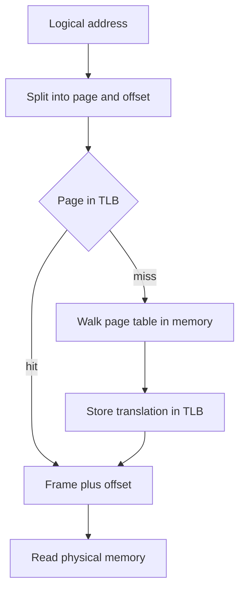

## The hook

The last article ended with a bus that refused to be cut in half. Paging cuts it anyway: every program is chopped into equal pieces, and any piece can go into any free slot of memory. External fragmentation disappears.

But now every single memory access, every load, every store, every instruction fetch, needs a lookup: "where did piece 3 go?" That lookup lives in a table in memory. So each memory access turns into two. Your shiny CPU should run at roughly half speed.

It does not, and the reason is a tiny cache that most programmers never hear about, holding perhaps a few dozen entries. By the end you will translate addresses by hand, size page tables, and compute exactly how much that tiny cache saves.

## The intuition

:::analogy
Picture a library where every book is split into **chapters of exactly 20 pages**, and each chapter can be stored in **any free slot** on any shelf. To read "chapter 3, line 140" of your book, you look up chapter 3 in the book's **index card**, which says "shelf slot 9". You walk to slot 9 and read line 140. The line number never changes; only the chapter number gets swapped for a shelf position. And because walking to the index cabinet is slow, you keep a **sticky note on your desk** with the last few chapter-to-shelf lookups you made.
:::

| In the library | In paging |
|---|---|
| A chapter of fixed size | A [[page]] of the process |
| A shelf slot of the same size | A [[frame]] of physical memory |
| The book's index card | The process's [[page table]] |
| Chapter number | Page number: the high bits of the address |
| Line within the chapter | [[Offset]]: the low bits, unchanged by translation |
| The sticky note of recent lookups | The [[TLB]] |

Two things fall straight out of the picture. Any chapter fits any slot, because they are the same size, so there are no awkward gaps. And the price is a lookup on every read, which is why the sticky note matters so much.

## How it works

### Splitting an address

With a page size of $2^d$ bytes, an address splits cleanly into two parts:

$$\text{page number} = \lfloor \text{address} / 2^d \rfloor \qquad \text{offset} = \text{address} \bmod 2^d$$

In plain words: the page number is how many whole pages fit before the address, and the offset is how far into that page you are. Because the page size is a power of two, this is just "the top bits" and "the bottom $d$ bits". No division happens in hardware.

For 32-bit addresses and 4 KB pages: 4 KB is $2^{12}$ bytes, so the **offset is 12 bits** and the **page number is the other 20 bits**. That allows $2^{20}$, about a million, pages.

In hexadecimal, each digit is 4 bits, so with 4 KB pages the last **three hex digits are the offset** and everything before them is the page number. That trick makes translation by hand quick.

### Translating by hand

A process has this page table (4 KB pages):

| Page | Frame | Valid |
|---|---|---|
| 0 | 5 | yes |
| 1 | 2 | yes |
| 2 | none | no |
| 3 | 9 | yes |
| 4 | 7 | yes |

Predict the physical address for logical `0x00003A7C` before reading the table.

| Logical address | Page number | Offset | Frame | Physical address |
|---|---|---|---|---|
| 0x00003A7C | 0x3 = 3 | 0xA7C = 2684 | 9 | 0x00009A7C |
| 0x00001004 | 1 | 0x004 = 4 | 2 | 0x00002004 |
| 0x00004FFF | 4 | 0xFFF = 4095, the last byte of the page | 7 | 0x00007FFF |
| 0x00002010 | 2 | 0x010 | invalid | Trap to the kernel |
| 0x00005000 | 5, past the end of the table | 0 | none | Trap to the kernel |

The physical address is just the frame number glued onto the unchanged offset: frame 9 and offset A7C give 9A7C. In library terms, chapter 3 became slot 9, and line A7C stayed line A7C.

:::try-this
Page size 1024 bytes and the same page table. Translate the decimal logical address 5000. (5000 divided by 1024 is 4 remainder 904, so page 4, offset 904. Page 4 is in frame 7, so the physical address is 7 × 1024 + 904 = 7168 + 904 = 8072.)
:::

### What a page table entry holds

Each entry is more than a frame number. Typical bits:

| Bit | Meaning | Used by |
|---|---|---|
| Valid or present | This page is mapped and in memory | Any access to an invalid page traps |
| Read, write, execute | Allowed kinds of access | Writing to read-only code traps |
| User or kernel | Whether user mode may touch it | Protects kernel memory |
| Referenced, also called accessed | Set by hardware on any access | Page replacement decisions |
| Dirty | Set by hardware on a write | Knowing whether a page must be saved before reuse |

Protection now happens per page instead of per process. Two processes can even map the **same frame**, for example the read-only code of a shared library, so it sits in memory once.

### What paging fixes, and what it costs

Any free frame fits any page, so **external fragmentation is gone**. Internal fragmentation comes back, in a small dose: a process rarely fills its last page. An 18,000-byte process with 4 KB pages needs 5 pages, which is 20,480 bytes, wasting 2,480 bytes. On average, the waste is about half a page per memory region.

The other cost is the table itself. Predict its size for 32-bit addresses, 4 KB pages and 4-byte entries.

It is $2^{20}$ entries × 4 bytes = **4 MB per process**, even for a program that uses only a few megabytes of memory, because the flat table needs a slot for every possible page. With a hundred processes, that is 400 MB of page tables, almost all of it saying "not valid".

### Multi-level page tables: an index of indexes

The fix is to page the page table. Split the 20-bit page number into two 10-bit parts:

| Bits | 31 to 22 | 21 to 12 | 11 to 0 |
|---|---|---|---|
| Role | Index into the outer table | Index into an inner table | Offset |
| Size | 10 bits, 1024 entries | 10 bits, 1024 entries | 12 bits |

Each inner table has 1024 entries × 4 bytes = exactly 4 KB, one page. Inner tables are created only for regions the process actually uses; the outer entry for an empty region simply says "not valid". A small program needs the 4 KB outer table plus a few inner tables, not 4 MB.

Translate `0x00403A7C` with this layout: the top 10 bits are 1, the next 10 bits are 3, and the offset is 0xA7C. So: outer entry 1 points to an inner table; entry 3 of that inner table gives the frame; append offset A7C.

In library terms, the index card for a huge book is replaced by a card that says which drawer holds the card for each part of the book.

Wait, why does this matter for 64-bit machines? Because a flat table for a 64-bit address space is absurd. On x86-64, the commonly used 48-bit virtual addresses split into four 9-bit indexes plus a 12-bit offset: 4 × 9 + 12 = 48. Each level's table has $2^9 = 512$ entries of 8 bytes, which is again exactly 4 KB. Newer processors add a fifth level for larger address spaces.

Here is the catch: every level is one more memory read. With four levels, a lookup that misses every cache costs four reads to walk the table plus one for the data. Which brings back the sticky note.

### The TLB: the sticky note on your desk

The TLB is a small hardware cache of recent page-to-frame translations, checked on every access, in parallel and very fast. On a **hit**, the frame comes straight out of the TLB and no page table read is needed. On a **miss**, the hardware (on x86) or the kernel (on some other architectures, such as MIPS) walks the page table, then stores the translation in the TLB for next time.

Why does such a small cache work? Locality. A loop over an array touches the same few pages thousands of times, and code runs from the same few pages over and over. Translating one 4 KB page once serves every access to its 4096 bytes.

How much memory a TLB covers is its **reach**: entries × page size. With 64 entries and 4 KB pages, the reach is 64 × 4 KB = 256 KB. With 2 MB "huge pages", the same 64 entries cover 64 × 2 MB = 128 MB, which is why databases and virtual machines like huge pages.

### Effective access time, step by step

Assume, for illustration, that a memory access takes $m = 100$ ns and a TLB lookup takes $t = 20$ ns, with a single-level page table.

- **TLB hit**: look up the TLB, then read the data. Cost $t + m = 120$ ns.
- **TLB miss**: look up the TLB, read the page table entry, then read the data. Cost $t + 2m = 220$ ns.

With hit ratio $h$, the [[effective access time]] is the weighted average:

$$\text{EAT} = h\,(t + m) + (1 - h)\,(t + 2m)$$

Here $h$ is the fraction of accesses that hit the TLB, $t$ is the TLB lookup time, $m$ is one memory access, and the extra $m$ on a miss is the page table read.

Before looking at the table, guess the EAT at a 98 percent hit ratio.

| Hit ratio h | Hit part h × 120 | Miss part (1 − h) × 220 | EAT | Slowdown vs 100 ns |
|---|---|---|---|---|
| 0.80 | 96 | 44 | 140 ns | 40 percent |
| 0.90 | 108 | 22 | 130 ns | 30 percent |
| 0.98 | 117.6 | 4.4 | 122 ns | 22 percent |
| 0.99 | 118.8 | 2.2 | 121 ns | 21 percent |

At high hit ratios, the remaining slowdown is mostly the 20 ns TLB lookup on every access, not the misses. Real CPUs hide much of the lookup by doing it in parallel with other work, which is why some textbooks drop $t$ and write EAT $= h \cdot m + (1 - h) \cdot 2m$, giving 120 ns at $h = 0.8$ and 102 ns at $h = 0.98$. In an exam, use whichever model the question states, and say which one you are using.

Now with a **four-level** table, a miss costs $t + 5m = 520$ ns. At $h = 0.98$: $0.98 \times 120 + 0.02 \times 520 = 117.6 + 10.4 = 128$ ns. Deeper tables make misses expensive, so a high hit ratio matters even more.

A common reverse question: what hit ratio gives an EAT of 130 ns in the single-level model? Solve $120h + 220(1 - h) = 130$, so $220 - 100h = 130$ and $h = 0.9$.

:::insight
Paging makes every memory access need a translation, and the TLB makes that translation nearly free by remembering recent ones. Locality is what makes a TLB of a few dozen entries enough for most programs.
:::

### Context switches and the TLB

TLB entries say "page 3 is in frame 9", but page 3 of process A and page 3 of process B are different pages. On a context switch, the kernel must either **flush** the TLB, so the new process starts with every access missing, or tag each entry with an **address-space identifier**, ASID (called PCID on x86), so entries from several processes can coexist safely. Tagging avoids the burst of misses after every switch, one reason a context switch between threads of the same process, which share a page table, is cheaper, as you saw in [Separate Houses or Roommates?](article:cs-core-processes-threads)

When the kernel changes a mapping, it must also invalidate the stale TLB entry, and on a multicore machine, tell the other cores to do the same. That cross-core "TLB shootdown" is a real cost of operations like freeing memory.

:::warning
Common misconception: "the TLB caches data, like the L1 cache." The TLB caches **translations**, page number to frame number, not the bytes in memory. A TLB hit tells you where the data is; the data itself may still be in a cache or in RAM.
:::

### Other shapes of page table

- **Hashed page tables**: hash the page number into a table of chains. Used for large, sparse address spaces.
- **Inverted page tables**: one entry per physical frame, saying which process and page occupy it. The table's size depends on RAM, not on the address space, but a lookup needs a search or a hash, and sharing pages is awkward.

## Trade-offs

| Choice | You gain | You give up |
|---|---|---|
| Paging instead of contiguous blocks | No external fragmentation, easy sharing and protection per page | Page tables in memory, translation on every access, a little internal fragmentation |
| Bigger pages | Smaller page tables, larger TLB reach | More internal fragmentation, coarser protection, slower to move between memory and disk |
| Smaller pages | Less waste, finer control | Bigger tables, more TLB misses |
| Flat page table | One memory read per miss | Huge table per process, mostly empty |
| Multi-level page table | Memory only for the regions in use | One extra memory read per level on a TLB miss |
| Bigger TLB | Higher hit ratio | Slower lookup and more chip area |
| ASID tags | No flush on context switch | More bits per entry, and the kernel must manage the identifiers |

## What can go wrong

- **Getting the bit split wrong.** The offset width comes from the page size, not the memory size: 4 KB means 12 bits, whatever the RAM.
- **Forgetting the TLB lookup time in EAT**, or adding it when the question says to ignore it. State your model.
- **Counting one memory access for a TLB miss.** A miss costs one page table access per level, plus the data access.
- **Ignoring the page table's own size.** "32-bit addresses, 4 KB pages, 4-byte entries" means a 4 MB flat table per process, a favourite exam number.
- **Stale TLB entries.** Changing a page table entry without invalidating the TLB lets a process keep using the old frame.
- **TLB thrashing.** A program that strides across more pages than the TLB covers, such as walking down a column of a huge row-major matrix, misses on almost every access.

### Interview follow-ups

**"How many entries does a single-level page table have for a 32-bit address space with 4 KB pages, and how big is it?"** $2^{32} / 2^{12} = 2^{20}$ entries. At 4 bytes each, $2^{22}$ bytes = 4 MB per process.

**"What is the effective access time for an 80 percent TLB hit ratio, 20 ns TLB and 100 ns memory?"** Hit: 120 ns. Miss: 220 ns. EAT = 0.8 × 120 + 0.2 × 220 = 140 ns.

**"Why do we need multi-level page tables, and what do they cost?"** A flat table reserves an entry for every possible page, which wastes megabytes per process when most of the address space is unused. A tree only allocates inner tables for used regions. The cost is one extra memory read per level on a TLB miss, which the TLB mostly hides.

**"What happens to the TLB on a context switch?"** Either it is flushed, so the new process's first accesses all miss, or entries are tagged with an address-space identifier, so entries from different processes coexist and no flush is needed.

**"Does paging have internal or external fragmentation?"** Internal only, in the last page of each region, averaging about half a page. Any free frame can hold any page, so there is no external fragmentation.

## In the real world

- **x86-64** uses four-level page tables for 48-bit virtual addresses, with 4 KB pages plus 2 MB and 1 GB huge pages, a hardware page table walker, and PCID tags to avoid flushing the TLB.
- **Linux** offers huge pages to applications such as databases and virtual machines that touch large amounts of memory, mainly to increase TLB reach.
- **Shared libraries** are mapped into many processes at once, so their code occupies one set of frames in RAM.
- **Virtual machines** add a second layer of translation, from guest physical to host physical, which hardware supports with nested page tables; a TLB miss then gets even more expensive, so hit ratio matters even more.
- For the cost of one memory access compared with a cache hit, see [If a CPU Cycle Took One Second](article:system-design-latency-numbers).

Paging chops a program into equal pieces that mean nothing to the program. But a program thinks in meaningful parts: code, a stack that grows, a heap that grows, global data. What if memory were divided along those lines instead? That is [A Binder With Chapters of Every Length](article:cs-core-segmentation).

## Further reading

- *Operating Systems: Three Easy Pieces*, the chapters on paging, TLBs and smaller page tables.
- *Operating System Concepts* by Silberschatz, Galvin and Gagne, the main memory chapter on paging and the structure of the page table.
- The Intel 64 and IA-32 Architectures Software Developer's Manual, Volume 3, the chapter on paging.

## Key takeaways

- Paging splits logical memory into fixed-size pages and physical memory into frames of the same size, so any page fits any free frame and external fragmentation disappears.
- A logical address splits into a page number, the high bits, and an offset, the low bits set by the page size, and translation replaces the page number with a frame number while keeping the offset.
- A flat page table needs one entry per possible page, about 4 MB per process for 32-bit addresses and 4 KB pages, which is why real systems use multi-level tables that only allocate the parts in use.
- The TLB caches recent translations, and with hit ratio h the effective access time is h times the hit cost plus 1 minus h times the miss cost, where a miss adds one memory read per page table level.
- On a context switch the TLB must be flushed or its entries tagged with an address-space identifier, because the same page number means different frames in different processes.
