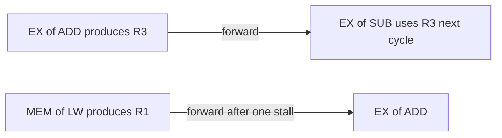

## The hook

A laundry has a washer, a dryer and a folding table. Doing one load completely before starting the next leaves two machines idle at any moment. Start the second wash while the first is drying, and the third while the second dries and the first is folded, and three loads are in progress at once. No single load finishes faster, but loads come out far more often.

Processors do the same with instructions, and the hard part is the same as in the laundry: what if load two needs something from load one that is not finished yet? Predict how many extra cycles a 5-stage pipeline needs, beyond the first instruction, to finish 100 instructions with no hiccups. (99: one instruction completes every cycle once the pipeline is full.)

## The intuition

:::analogy
**An assembly line for instructions.** Each station does one step and passes the item on, so every station is busy with a different item at the same time. The line stops only when a station needs a part that has not arrived yet, when the line was building the wrong model and must be cleared, or when two stations need the same tool at once.
:::

## How it works

### The five classic stages

| Stage | Work |
|---|---|
| IF | instruction fetch from the instruction cache |
| ID | decode and read registers |
| EX | execute in the ALU, or compute an address |
| MEM | access data memory (loads and stores) |
| WB | write the result back to the register file |

Each **[[pipeline stage]]** takes one cycle. Once full, one instruction finishes per cycle.

### The speed-up formula

For n instructions and k stages, ignoring hazards:

| Design | Cycles |
|---|---|
| Not pipelined, k cycles each | n × k |
| Pipelined | k + (n − 1) |

With k = 5 and n = 100: 500 versus 104 cycles, a speed-up of about 4.81, approaching k as n grows. Latency per instruction does not improve; throughput does.

### Hazards

A **[[hazard]]** stops the next instruction from advancing:

- **Data hazard**: an instruction needs a result an earlier one has not produced yet (read after write).
- **Control hazard**: after a branch, the processor does not yet know which instruction comes next.
- **Structural hazard**: two instructions need the same hardware in the same cycle (for example, one memory port for both instructions and data).

### A data hazard, traced cycle by cycle

```pseudo
I1: LW  R1, 0(R2)      // load R1 from memory
I2: ADD R3, R1, R4     // needs R1
I3: SUB R5, R3, R6     // needs R3
```

Without forwarding, an instruction must wait until the value is written back (assuming registers are written in the first half of a cycle and read in the second):

| Cycle | 1 | 2 | 3 | 4 | 5 | 6 | 7 | 8 | 9 | 10 | 11 |
|---|---|---|---|---|---|---|---|---|---|---|---|
| I1 LW | IF | ID | EX | MEM | WB | | | | | | |
| I2 ADD | | IF | stall | stall | ID | EX | MEM | WB | | | |
| I3 SUB | | | IF | stall | stall | stall | stall | ID | EX | MEM | WB |

11 cycles. With **[[forwarding]]**, results travel straight from the EX/MEM or MEM/WB pipeline registers to the ALU input:

| Cycle | 1 | 2 | 3 | 4 | 5 | 6 | 7 | 8 |
|---|---|---|---|---|---|---|---|---|
| I1 LW | IF | ID | EX | MEM | WB | | | |
| I2 ADD | | IF | ID | stall | EX | MEM | WB | |
| I3 SUB | | | IF | stall | ID | EX | MEM | WB |

8 cycles. ADD to SUB needs no **[[stall]]** at all (the ALU result is forwarded), but the load still costs one. Wait, why can forwarding not remove the load's stall too? The loaded value exists only at the end of MEM (cycle 4), while ADD wanted it at the start of its EX in cycle 4. Data cannot travel backwards in time, so one bubble is unavoidable: the **load-use hazard**. Compilers hide it by scheduling an independent instruction into that slot.



### Control hazards and branch prediction

A branch's outcome is known only after it executes, but the pipeline must fetch something every cycle. Options: stall until it is known (slow), always guess "not taken", or use **[[branch prediction]]**: hardware that remembers each branch's recent behaviour and predicts it. A wrong guess flushes the wrongly fetched instructions, costing several cycles in deep pipelines, which is why sorted data, with predictable branches, can make a loop noticeably faster than shuffled data.

:::insight
Pipelining overlaps the stages of consecutive instructions, so throughput approaches one instruction per cycle and the speed-up approaches the number of stages. Hazards break the overlap: forwarding removes most data stalls except the one after a load, branch prediction keeps the pipeline fed past branches, and duplicated hardware removes structural conflicts.
:::

## Trade-offs

| Choice | Gain | Cost |
|---|---|---|
| More, shorter stages | Higher clock frequency | Bigger misprediction penalty, more pipeline-register overhead |
| Forwarding paths | Removes most data stalls | Extra wiring and control logic |
| Better branch predictors | Fewer flushes | Chip area and power |
| Separate instruction and data caches | No structural hazard on memory | More hardware |

:::warning
Common misconception: "a 5-stage pipeline makes each instruction 5 times faster." Each instruction still takes 5 cycles from fetch to write-back (often slightly more, due to pipeline registers). What improves is throughput: once the pipeline is full, one instruction completes every cycle.
:::

:::try-this
A non-pipelined processor takes 10 ns per instruction. A 5-stage pipeline splits that into stages of 2 ns, plus 0.2 ns of pipeline-register overhead per stage. What is the throughput speed-up for a long program with no hazards? (The pipelined clock is 2.2 ns, one instruction per cycle once full, against 10 ns per instruction: 10 / 2.2 ≈ 4.5x, not 5x, because of the register overhead.)
:::

## What can go wrong

- **Counting stalls without stating assumptions** (forwarding or not, split-cycle register file), which changes exam answers.
- **Ignoring the load-use stall** even with forwarding.
- **Unpredictable branches in hot loops**, causing frequent flushes.
- **Assuming pipelining reduces latency** rather than increasing throughput.

### Interview follow-ups

**"What is superscalar execution?"** Issuing more than one instruction per cycle using several parallel pipelines.

**"What is out-of-order execution?"** Executing later independent instructions while an earlier one waits, then committing results in program order.

**"Why are branchless techniques sometimes faster?"** Conditional moves or arithmetic avoid mispredictions on unpredictable data.

## In the real world

Every modern processor is pipelined, superscalar and out of order, with branch predictors that are right the vast majority of the time on typical code. The caches that feed the IF and MEM stages are in [Tools on Your Belt, on the Bench and in the Shed](article:cs-core-memory-hierarchy).

## Further reading

- David Patterson and John Hennessy, *Computer Organization and Design*, chapter on the processor and pipelining.
- Agner Fog's optimisation manuals, on branch prediction and microarchitecture.

## Key takeaways

- A pipeline splits instruction execution into stages such as IF, ID, EX, MEM and WB, so different instructions occupy different stages at the same time.
- With k stages and n instructions, the pipeline needs k + n − 1 cycles instead of n × k, so 100 instructions on 5 stages take 104 cycles, about 4.8 times faster.
- Data, control and structural hazards stall the pipeline, and in the traced example forwarding cut 11 cycles to 8.
- Forwarding removes most data stalls, but a value loaded from memory arrives one cycle too late for the next instruction, which costs one stall.
- Branch prediction keeps fetching past branches and pays a flush when it guesses wrong, so pipelining raises throughput rather than reducing each instruction's latency.
