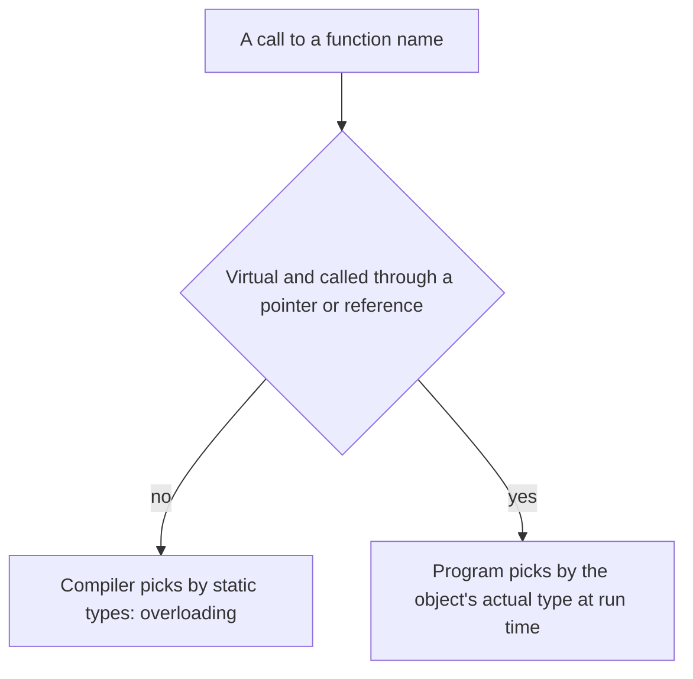

## The hook

A drawing app keeps a list of shapes: squares, circles, triangles, and next month, stars. To redraw the screen, it loops over the list and asks each one for its area and its outline. If that loop contains `if (type == SQUARE) … else if (type == CIRCLE) …`, every new shape means editing the loop, and every place like it, in the whole codebase.

Polymorphism removes the `if` chain: the loop says "area, please" and each shape answers in its own way. C++ offers it in two flavours, decided at different moments, and interviewers love asking which is which. Predict when the choice is made for `area(2, 5)` versus `shape->area()`. (Compile time for the first; run time for the second.)

## The intuition

:::analogy
**One remote controls different TVs.** The power button means "turn on" for every brand, but each TV does it its own way. Some remotes are programmed for one model when you buy them (decided in advance: compile time); a universal remote detects the TV it is pointing at as you press (decided on the spot: run time).
:::

## How it works

**[[Polymorphism]]** means one name, many behaviours.

| Kind | Mechanism | Decided |
|---|---|---|
| Compile-time (static) | function overloading, operator overloading, templates | by the compiler, from static types |
| Run-time (dynamic) | virtual functions overridden in derived classes | while running, from the object's actual type |

### One program, three forms

Read the code once and predict the four output lines before checking the comments. Then hold one question for later: what would you have to change in `main` to support a new Triangle shape? (The answer, nothing at all, is the point of the last section.)

```cpp
#include <iostream>
#include <memory>
#include <vector>
using namespace std;

// Compile-time polymorphism 1: function overloading (chosen by argument types)
int area(int side) { return side * side; }
int area(int w, int h) { return w * h; }
double area(double r) { return 3.14159 * r * r; }

// Compile-time polymorphism 2: operator overloading
struct Vec2 {
    int x, y;
    Vec2 operator+(const Vec2& o) const { return {x + o.x, y + o.y}; }
    bool operator==(const Vec2& o) const { return x == o.x && y == o.y; }
};
ostream& operator<<(ostream& os, const Vec2& v) { return os << "(" << v.x << "," << v.y << ")"; }

// Run-time polymorphism: virtual functions overridden in derived classes
struct Shape {
    virtual double area() const = 0;
    virtual const char* name() const { return "shape"; }
    virtual ~Shape() = default;
};
struct Square : Shape {
    double s;
    explicit Square(double s) : s(s) {}
    double area() const override { return s * s; }
    const char* name() const override { return "square"; }
};
struct Circle : Shape {
    double r;
    explicit Circle(double r) : r(r) {}
    double area() const override { return 3.14159 * r * r; }
    const char* name() const override { return "circle"; }
};

int main() {
    cout << area(3) << " " << area(2, 5) << " " << area(1.0) << "\n";    // 9 10 3.14159
    Vec2 a{1, 2}, b{3, 4};
    cout << a + b << " " << (a + b == Vec2{4, 6}) << "\n";                // (4,6) 1
    vector<unique_ptr<Shape>> shapes;
    shapes.push_back(make_unique<Square>(2));
    shapes.push_back(make_unique<Circle>(1));
    for (const auto& s : shapes) cout << s->name() << " " << s->area() << "\n";  // square 4, circle 3.14159
}
```

### Function overloading

**[[Function overloading|Overloads]]** share a name but differ in the number or types of parameters. The compiler picks the best match: an exact match beats a promotion (such as char to int), which beats a conversion (such as int to double). If two candidates tie, the call is ambiguous and fails to compile. Return type is not part of the choice, so overloads cannot differ only by return type.

### Operator overloading

**[[Operator overloading]]** lets `a + b` mean vector addition and `cout << v` print a Vec2. Guidelines: keep the operator's usual meaning, make operators that do not modify their operands const, and implement `<<` as a non-member, because its left operand is the stream. A few operators cannot be overloaded: `::`, `.`, `.*` and `?:`.

### Overriding and dynamic dispatch

**[[Overriding]]** replaces a base-class **virtual** function with a derived version of the same signature. A call through a base pointer or reference then runs the version for the object's actual type: **[[dynamic dispatch]]**. In the loop, `s->area()` printed 4 for the Square and 3.14159 for the Circle with no if statement. So, to answer the earlier question: adding a Triangle or a Star needs no change to the loop; you only write the new class.

Wait, what does the `override` keyword add if the function would override anyway? It asks the compiler to check. If you misspell the name or forget a `const`, a function without `override` silently becomes a new, unrelated function that never gets called; with `override`, it is a compile error.

### Overloading versus overriding

| | Overloading | Overriding |
|---|---|---|
| Where | same scope | base and derived classes |
| Signature | must differ | must match |
| virtual needed | no | yes |
| Resolved | compile time | run time |
| Purpose | same idea for different argument types | different behaviour for different object types |



:::insight
Compile-time polymorphism (overloading, operators, templates) lets one name work for many types, chosen by the compiler from static types at no run-time cost. Run-time polymorphism (virtual functions plus overriding) lets one call do different things depending on the object's actual type, which is how code can handle types that did not exist when it was written.
:::

## Trade-offs

| Form | Gain | Cost |
|---|---|---|
| Overloading | Readable call sites | Tricky resolution rules, ambiguous calls |
| Operator overloading | Natural syntax for maths types | Surprising if the meaning is not obvious |
| Templates | Generic code with no run-time cost | Longer compile times, verbose errors |
| Virtual functions | Open for new types without changing callers | An indirect call per invocation, objects usually on the heap |

:::warning
Common misconception: "overloading a function in a derived class overrides the base version." A derived function with the same name but different parameters is an overload in the derived scope that *hides* the base function, and without virtual and a matching signature nothing is overridden. Mark intended overrides with `override` so the compiler catches mismatches.
:::

:::try-this
Given `void print(int)` and `void print(double)`, which runs for `print('A')`, `print(2.5f)` and `print(2L)`? (print('A') calls print(int): char to int is a promotion. print(2.5f) calls print(double): float to double is a promotion. print(2L) is ambiguous: long to int and long to double are both conversions, so it fails to compile.)
:::

## What can go wrong

- **Missing virtual** on a function meant to be overridden, so base versions run.
- **Signature mismatch** (a missing const) creating a new function instead of an override.
- **Ambiguous overloads** after adding a new overload.
- **Operators with surprising meanings**, such as + that modifies its left operand.
- **Object slicing**: passing a derived object by value as a base loses its overrides.

### Interview follow-ups

**"Is templates' polymorphism compile-time or run-time?"** Compile-time: each type gets its own instantiation, sometimes called parametric polymorphism.

**"How is run-time dispatch implemented?"** Usually with a per-class table of function pointers (the vtable) and a hidden pointer in each object, the subject of the next article.

**"Can constructors be overloaded? Can they be virtual?"** They can be overloaded; they cannot be virtual.

## In the real world

The standard library overloads operators for strings, iterators and streams, and frameworks use virtual functions for plug-in points such as handlers and renderers. The inheritance that overriding depends on is in [Children Inheriting Family Traits](article:cs-core-inheritance).

## Further reading

- Bjarne Stroustrup, *A Tour of C++*, chapters on classes and templates.
- The C++ Core Guidelines, rules C.128 (use override) and C.160 to C.170 on overloading.

## Key takeaways

- Polymorphism lets one name or call work with many types, chosen either at compile time or at run time.
- Function overloading picks among same-named functions by argument types at compile time, and return type alone cannot distinguish overloads.
- Operator overloading defines operators for user-defined types and should keep their usual meaning.
- Overriding a virtual function lets a call through a base pointer or reference run the version for the object's actual type, which is dynamic dispatch.
- The override keyword makes the compiler check that a function really overrides a base virtual function.
