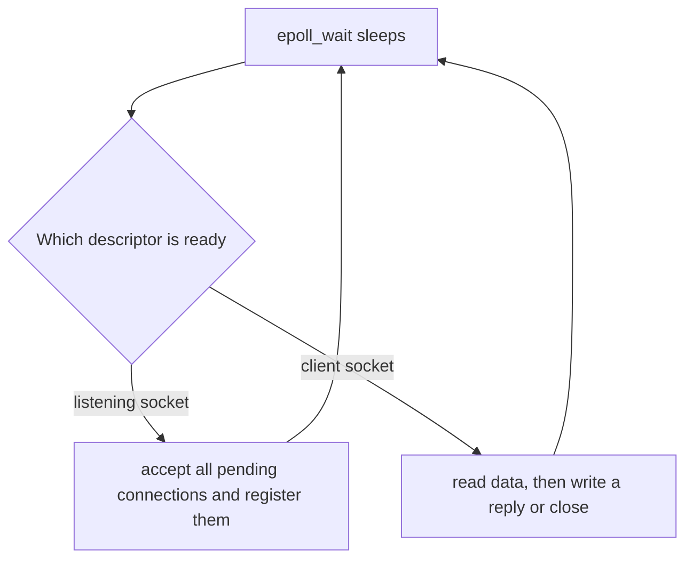

## The hook

A web server has one IP address and listens on one port, 443. Ten thousand browsers are connected to it at once, each in the middle of its own conversation. When a packet arrives for port 443, how does the kernel know which of the ten thousand conversations it belongs to? And how can one program even keep track of ten thousand connections without ten thousand threads?

The answers are the 5-tuple and the event loop: the idea behind nginx, Node.js and Redis serving huge numbers of clients with few threads. Predict how many threads the server in this article uses to talk to three clients at once. (One.)

## The intuition

:::analogy
An IP address is a building's street address; a port is an **apartment number in the building**. Letters for flat 443 all go to the same door, but each letter also carries a return address, so the resident can keep each correspondence separate. And instead of standing at the door waiting for one particular letter, a smart resident asks the porter: "wake me when any letter arrives, and tell me which ones."
:::

## How it works

### Ports and the 5-tuple

A **[[port]]** is a 16-bit number. Well-known ports (0 to 1023) are for standard services: 22 SSH, 53 DNS, 80 HTTP, 443 HTTPS. A client usually does not choose its port: the OS assigns an **[[ephemeral port]]** from a high range.

A TCP connection is identified by its **[[5-tuple]]**: (protocol, source IP, source port, destination IP, destination port). Three test clients connected to one local server on port 9090 were given ephemeral ports 50492, 50508 and 50514: same destination, three different tuples, three separate connections.

### The socket calls

A **[[socket]]** is the program's handle on a network endpoint, an ordinary file descriptor.

```pseudo
// server
s = socket(TCP)
bind(s, port 9090)          // claim the port
listen(s, backlog)          // start accepting handshakes; queue completed ones
loop:
    c = accept(s)           // take one completed connection: a NEW socket
    handle(c)               // read and write on c, then close(c)

// client
c = socket(TCP)
connect(c, server, 9090)    // OS picks an ephemeral port; TCP handshake happens here
write(c, request); read(c, reply); close(c)
```

The kernel completes the TCP handshakes itself and parks finished connections in the accept queue; `accept()` takes one and returns a **new** descriptor for that connection, while the listening socket keeps listening. Wait, if all of them are on port 9090, how does a reply on one accepted socket reach the right client? Each accepted socket is bound to its full 5-tuple, so the kernel matches every incoming packet against the tuples.

### Blocking versus non-blocking

By default, `accept()` and `read()` **block**: the thread sleeps until something happens. Thread-per-connection servers use this: simple code, but each thread costs memory and scheduling, and most of them sit idle waiting on slow clients.

With **[[non-blocking I/O]]**, a call that would wait instead returns immediately with "try again" (EAGAIN). That avoids sleeping, but asking every socket in a loop would burn CPU. What you need is a way to wait for *any* of many sockets.

### select, poll and epoll

| Interface | How it works | Cost per call with n watched descriptors |
|---|---|---|
| select | pass bitmaps of descriptors; the kernel marks the ready ones | O(n), plus a fixed limit (often 1024 descriptors) |
| poll | pass an array of descriptors | O(n), no fixed limit |
| **[[epoll]]** (Linux) | register descriptors once; wait returns only ready ones | O(ready), independent of idle connections |

BSD and macOS have kqueue, Windows has IOCP, and Linux also has io_uring for submitting I/O in batches.

### One thread, many clients

This echo server compiled and ran on Linux; three Python clients each sent a message and got their own echo back, all served by one thread:

```cpp
#include <arpa/inet.h>
#include <fcntl.h>
#include <netinet/in.h>
#include <sys/epoll.h>
#include <sys/socket.h>
#include <unistd.h>
#include <cstdio>

// One-thread echo server: epoll tells us which sockets are ready.
int main() {
    int listener = socket(AF_INET, SOCK_STREAM, 0);
    int yes = 1;
    setsockopt(listener, SOL_SOCKET, SO_REUSEADDR, &yes, sizeof yes);
    sockaddr_in addr{};
    addr.sin_family = AF_INET;
    addr.sin_port = htons(9090);
    addr.sin_addr.s_addr = htonl(INADDR_LOOPBACK);
    if (bind(listener, (sockaddr*)&addr, sizeof addr) < 0 || listen(listener, 128) < 0) {
        perror("bind/listen");
        return 1;
    }
    fcntl(listener, F_SETFL, O_NONBLOCK);

    int ep = epoll_create1(0);
    epoll_event ev{};
    ev.events = EPOLLIN;
    ev.data.fd = listener;
    epoll_ctl(ep, EPOLL_CTL_ADD, listener, &ev);

    epoll_event ready[64];
    while (true) {
        int n = epoll_wait(ep, ready, 64, -1);           // sleep until something is ready
        for (int i = 0; i < n; i++) {
            int fd = ready[i].data.fd;
            if (fd == listener) {                         // new connections are waiting
                int client;
                while ((client = accept(listener, nullptr, nullptr)) >= 0) {
                    fcntl(client, F_SETFL, O_NONBLOCK);
                    epoll_event cev{};
                    cev.events = EPOLLIN;
                    cev.data.fd = client;
                    epoll_ctl(ep, EPOLL_CTL_ADD, client, &cev);
                }
            } else {                                      // a client sent data or closed
                char buf[4096];
                ssize_t got = read(fd, buf, sizeof buf);
                if (got <= 0) {
                    close(fd);                            // closing also removes it from epoll
                } else {
                    if (write(fd, buf, got) < 0) close(fd);  // echo back (small messages)
                }
            }
        }
    }
}
```



:::insight
A port picks the program and the 5-tuple picks the connection, so one listening port serves any number of clients, each with its own accepted socket. Non-blocking sockets plus a readiness interface such as epoll let one thread wait on thousands of connections and handle only the ones with work, which is the event-loop design behind nginx, Redis and Node.js.
:::

## Trade-offs

| Design | Gain | Cost |
|---|---|---|
| Thread per connection, blocking | Simple, sequential code | Memory and scheduling overhead with many idle clients |
| Event loop with epoll | Thousands of connections per thread | Callback or state-machine code; one slow handler stalls all |
| Event loop per core | Uses all cores | Connections must be spread across loops |
| Thread pool behind an event loop | Slow work does not block the loop | Hand-off complexity |

:::warning
Common misconception: "a server can only handle 65,535 connections because there are 65,535 ports." That limit applies to one client IP connecting to one server address and port, since only the client's port varies. A server's connections differ by client address too, so its limit comes from memory and file descriptors, not port numbers.
:::

:::try-this
Your laptop opens two browser tabs to the same server at 203.0.113.10:443. Write plausible 5-tuples for both connections. (TCP, 192.168.1.5, 50492, 203.0.113.10, 443 and TCP, 192.168.1.5, 50508, 203.0.113.10, 443: everything matches except the ephemeral source port, which is enough to keep them apart.)
:::

## What can go wrong

- **"Address already in use"** when restarting a server while old connections sit in TIME_WAIT; SO_REUSEADDR allows rebinding.
- **Blocking calls inside an event loop**, freezing every client.
- **Partial reads and writes**: a read may return part of a message, and a non-blocking write may send only some bytes; real code buffers both.
- **Running out of file descriptors**: raise the per-process limit (ulimit -n) for busy servers.
- **A full accept backlog** dropping new connections under bursts.

### Interview follow-ups

**"What is the C10K problem?"** The challenge, named around 1999, of serving ten thousand concurrent connections on one machine, solved largely by event-driven I/O like epoll and kqueue.

**"Level-triggered or edge-triggered epoll?"** Level-triggered keeps reporting a descriptor while data remains; edge-triggered reports only new arrivals, so you must read until EAGAIN.

**"How do threading models relate?"** Event loops are a way of avoiding one kernel thread per connection, like the runtimes in [Workers Hired by a Contractor or Directly by the Company](article:cs-core-threading-models).

## In the real world

nginx, Redis, Node.js, Netty and Go's network poller all build on epoll on Linux. `ss -tlnp` lists listening sockets and their processes. The TCP connections these sockets carry are traced in [A Phone Call Where Both Sides Confirm They Can Hear](article:cs-core-tcp-deep-dive).

## Further reading

- W. Richard Stevens, Bill Fenner and Andrew Rudoff, *UNIX Network Programming, Volume 1*.
- Dan Kegel, "The C10K problem" (web page).

## Key takeaways

- A port identifies a program's endpoint on a host, and the 5-tuple of protocol, source address and port, and destination address and port identifies each connection.
- A server calls socket, bind and listen once, and each accept returns a new socket for one connection while the listening socket keeps listening.
- Blocking calls put a thread to sleep, which makes thread-per-connection servers simple but costly with many idle clients.
- Non-blocking sockets with select, poll or epoll let one thread wait for many connections, and epoll returns only the ready ones without scanning idle descriptors.
- Event-loop servers handle thousands of connections per thread but must never block inside a handler.
