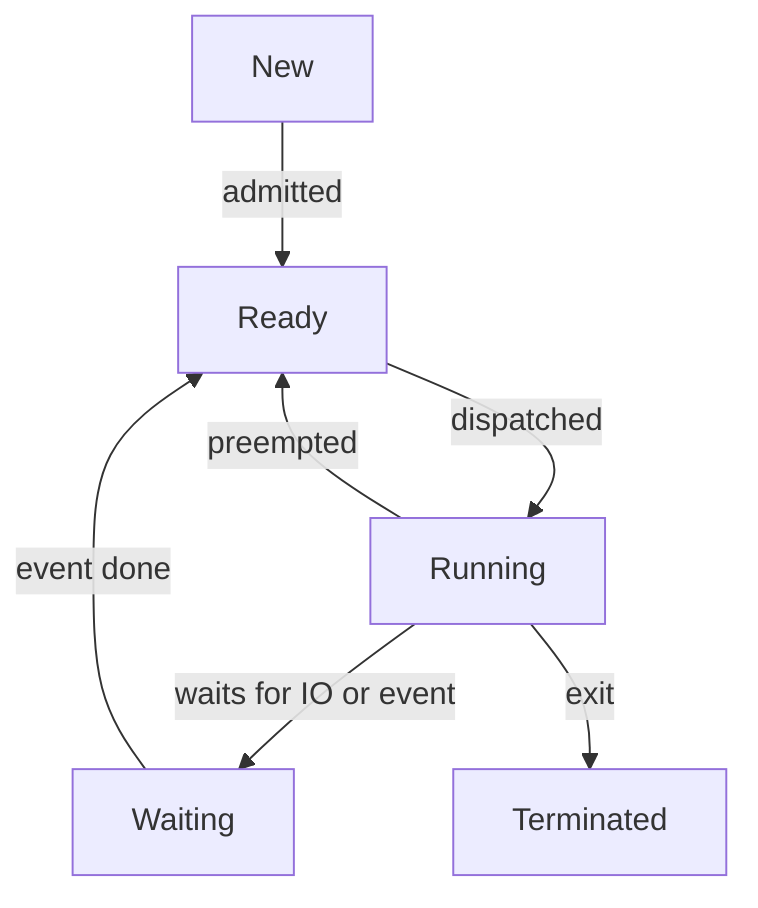

## The hook

Open a task manager on a laptop with 8 CPU cores and you will often see several hundred processes. Eight cores, hundreds of processes, and yet the machine feels idle.

So where are all those processes, if only eight can be on a CPU at any instant? And while you are looking, you may spot a strange one marked `Z`, a "zombie". You send it `kill -9`, the signal nobody can ignore, and it is still there.

Both puzzles have the same answer: a process spends almost all its life in states other than "running", and the kernel moves it between them with a very precise piece of bookkeeping. Let's watch it happen.

## The intuition

:::analogy
Think of a theatre with one stage and a cast of actors. Only one **actor is on stage** at a time. Others wait **in the wings**, costumed and ready to walk on. Some are **in the dressing room**, waiting for a costume to arrive; they could not go on even if the stage were free. When the **stage manager** calls an actor off between scenes, the actor scribbles a note of exactly where they were: the line, the pose, the prop in hand. When called back, they read the note and continue mid-sentence.
:::

| Theatre | Operating system |
|---|---|
| The stage | A CPU core |
| Actor on stage | The **running** process |
| Actors in the wings | **Ready** processes in the [[ready queue]] |
| Actors in the dressing room waiting for a costume | **[[Blocked]]** (waiting) processes, waiting for I/O or an event |
| The stage manager | The scheduler and the [[dispatcher]] |
| The actor's note of line, pose and prop | The saved CPU state in the process control block |
| Stepping off and on | A [[context switch]] |

So the hundreds of processes in your task manager are mostly in the dressing room, waiting for a key press, a network packet or a timer. Only the eight on stage are running.

## How it works

### The five states

- **New**: the process is being created. The kernel is building its PCB and address space.
- **Ready**: it could run right now; it just needs a CPU. It sits in the ready queue.
- **Running**: its instructions are executing on a core. At most one process per core is here.
- **Waiting** (or blocked): it asked for something slow, like a disk read, a network packet or a lock, and cannot continue until that arrives.
- **Terminated**: it has finished. The kernel is cleaning up, and a little record may remain until its parent reads the exit status.

Predict before reading on: can a process go straight from Waiting to Running when its disk read finishes?

No. Look at the arrows again. When the event arrives, the process moves to **Ready**, not Running.

Wait, why not straight onto the stage? Because someone else is on stage. The costume arriving does not mean the current scene ends; the actor goes to the wings and waits for the stage manager's call like everyone else.

### Every arrow, and what causes it

| Transition | Caused by | Who decides |
|---|---|---|
| New to Ready | Creation finished | Kernel |
| Ready to Running | The scheduler picks it | Scheduler, then dispatcher |
| Running to Ready | Timer interrupt, or a higher-priority process became ready ([[preemption]]) | Kernel, involuntarily for the process |
| Running to Waiting | It made a blocking call: read, sleep, lock a held mutex | The process itself, voluntarily |
| Waiting to Ready | The awaited event happened: I/O completed, lock released | Kernel, usually in an interrupt handler |
| Running to Terminated | It called exit, returned from main, or was killed | Process or kernel |

Notice the two very different ways to leave the stage. **Voluntary**: the actor walks off because they need a costume (Running to Waiting). **Involuntary**: the stage manager taps them on the shoulder because their time is up (Running to Ready). Linux even counts these separately per process, as voluntary and non-voluntary context switches in `/proc/<pid>/status`.

### How real systems name the states

Linux tools like `ps` and `top` show a one-letter state. They map onto the textbook model like this:

| Letter | Meaning | Textbook state |
|---|---|---|
| R | Running or runnable | Running or Ready (Linux does not distinguish them here) |
| S | Interruptible sleep | Waiting, can be woken by a signal |
| D | Uninterruptible sleep | Waiting, usually inside a disk or device operation; signals are deferred |
| T | Stopped, for example by Ctrl+Z or a debugger | A paused, suspended state |
| Z | Zombie | Terminated, not yet reaped |

### The zombie mystery, solved

When a process exits, the kernel frees its memory and files but keeps a tiny entry with its PID and exit status. Why keep anything? Because its parent may want to know how the child ended, and it asks with `wait()`. Until the parent asks, the leftover entry is a **[[zombie]]**.

Now the hook makes sense. `kill -9` asks the kernel to stop a process from running, but a zombie runs nothing; it is already dead. The fix is for the parent to call `wait()`. If the parent itself exits, the zombie is adopted by `init` (PID 1) or a designated reaper process, which reaps it.

The opposite case, a parent that exits while its child is still running, leaves an **orphan**. Orphans are fine: they are adopted the same way and carry on.

### The variant: suspended states

Some textbooks add two more states for when memory runs short and the kernel moves a whole process out to disk: **ready-suspended** and **blocked-suspended**. The idea is the same as the dressing room, just further away: an actor sent home for the night must be called back to the building before they can even wait in the wings.

### The context switch, step by step

Here is the actor scribbling their note. When the kernel switches from process A to process B on one core:

1. **Something hands control to the kernel**: a timer interrupt, a system call that blocks, or an I/O interrupt that wakes a higher-priority process.
2. **Save A's CPU state** into A's PCB (or its kernel stack): the program counter, stack pointer, general registers, status flags, and floating-point and vector registers if A used them.
3. **Update A's state**: Ready if preempted, Waiting if it blocked. Put it on the right queue.
4. **The scheduler picks B** from the ready queue.
5. **Switch the address space** if B is a different process: load B's page-table base into the memory-management unit. Threads of the same process skip this.
6. **Restore B's saved registers**, mark it Running, and return to user mode at B's saved program counter.

B continues mid-sentence, unaware it was ever off stage.

:::insight
A context switch is pure overhead: during it, no user work gets done. Its visible cost is saving and restoring registers and running the scheduler. Its hidden cost, often the larger one, is that B arrives to find the caches and the address-translation cache (the TLB) full of A's data, so B runs slowly until they warm up again.
:::

### A traced timeline

Three processes on one core. A does a little work then reads the disk; B and C are CPU-bound. Time units are abstract ticks, and the timer gives each process at most 3 ticks.

| Tick | Event | A | B | C |
|---|---|---|---|---|
| 0 | A dispatched | Running | Ready | Ready |
| 2 | A calls read on the disk, blocks | Waiting | Ready | Ready |
| 2 | B dispatched (switch 1) | Waiting | Running | Ready |
| 5 | Timer: B used its 3 ticks | Waiting | Ready | Ready |
| 5 | C dispatched (switch 2) | Waiting | Ready | Running |
| 6 | Disk interrupt: A's data arrived | **Ready** | Ready | Running |
| 8 | Timer: C used its 3 ticks; the queue is now B, A, C | Ready | Ready | Ready |
| 8 | B dispatched (switch 3) | Ready | Running | Ready |
| 11 | Timer: B used its 3 ticks | Ready | Ready | Ready |
| 11 | A dispatched (switch 4) | Running | Ready | Ready |

Look at tick 6. A's disk read finished, but A did not run until tick 11: B was already ahead of it in the queue. That gap is the Waiting-to-Ready-to-Running path from the diagram, and it is why a responsive interactive app wants the scheduler to favour processes that just woke up, which is a theme in [Who Sees the Doctor Next?](article:cs-core-cpu-scheduling)

:::try-this
In the same timeline, suppose the disk is slower and A's interrupt arrives at tick 9 instead of tick 6. What runs at tick 8, and when is A next dispatched if B and C keep using full 3-tick slices? (At tick 8 only B and C are ready, so B runs ticks 8 to 11. A becomes ready at tick 9 and joins the queue behind C, so C runs 11 to 14 and A is dispatched at tick 14.)
:::

## Trade-offs

### How often should the stage manager switch actors?

Switching often makes the system feel responsive, since everyone gets frequent turns. But every switch is overhead. Take an illustrative switch cost of 5 microseconds (a made-up round number; measure your own hardware):

| Time slice | Useful work per slice | Overhead share |
|---|---|---|
| 10 µs | 10 µs | 33% |
| 100 µs | 100 µs | about 4.8% |
| 1 ms | 1 ms | 0.5% |
| 10 ms | 10 ms | 0.05% |

The overhead share is switch cost divided by (slice plus switch cost). Predict the trade before reading: what do you lose with the 10 ms slice? Responsiveness. With many ready processes, each one waits for all the others' full slices before its next turn.

### Process switch versus thread switch

Switching between two threads of the **same** process skips step 5: no address-space change, so translation entries for that address space can stay useful. Switching between threads of **different** processes costs the same as a process switch. The question "is a thread switch cheaper?" therefore has the answer "only within one process".

:::warning
Common misconception: "a system call is a context switch." A system call is a **mode switch**: the same process crosses into kernel mode and back. A fast call like getting the current process id returns to the same process without any context switch. A context switch happens only when the kernel decides to run a *different* process or thread, for example because the call blocked.
:::

## What can go wrong

- **Zombie pile-up.** A server that forks children and never waits for them leaks process-table entries. Eventually it cannot create new processes. Fix: call `wait`/`waitpid`, or handle `SIGCHLD`.
- **Stuck in uninterruptible sleep.** A process in state D waiting on a hung disk or network file system ignores even `kill -9` until the operation returns. It is not a zombie; it is an actor locked in the dressing room.
- **Too many switches.** Hundreds of busy threads on a few cores spend a growing share of time switching and re-warming caches. Fewer threads, or an event loop, often fixes it.
- **Lost wakeups.** If a process checks "is the data here?", sees no, and the data arrives *before* it actually goes to sleep, it may sleep forever. Kernels and threading libraries avoid this by checking and sleeping atomically under a lock, a theme that returns in [A Key for One Room, a Bowl for the Car Park](article:cs-core-mutex-semaphore).
- **Starvation in the ready queue.** A process can be Ready forever if the scheduler keeps preferring others. That is a scheduling policy problem, solved with aging.

### Interview follow-ups

**"What exactly is saved in a context switch?"** The program counter, stack pointer, general-purpose registers, status flags and floating-point or vector registers, plus the kernel's own bookkeeping such as the kernel stack pointer. For a different process, the page-table base also changes. Memory contents are not copied; they stay where they are.

**"Why is the indirect cost of a context switch often bigger than the direct cost?"** The new process finds caches and the TLB filled with the old one's data, so its first many memory accesses miss. Some CPUs tag TLB entries with an address-space id so they need not all be flushed, which softens this.

**"What happens on a single core when a process waiting for I/O gets its data?"** The device raises an interrupt, the kernel's handler marks the process Ready and puts it on the ready queue. Whether it runs immediately depends on the scheduler: it may preempt the current process if its priority is higher, or wait its turn.

**"Difference between a zombie and an orphan?"** A zombie is dead but not yet reaped by its parent. An orphan is alive but its parent has died; it gets adopted and continues normally.

## In the real world

- `top` and `htop` show the state letter for each process, and the load average on Linux counts processes in R and in D state, so a pile of processes stuck on slow storage raises the load even with idle CPUs.
- Container and service managers act as the reaper of last resort inside their environment, which is why a container's first process must reap zombies or delegate to a small init.
- High-throughput servers cut context switches by using a few threads with non-blocking I/O, so a waiting connection does not need a whole blocked thread.

For a sense of how a microsecond of switching compares with a memory or network access, see [If a CPU Cycle Took One Second](article:system-design-latency-numbers).

The stage manager has one big decision left that we skipped: when three actors are waiting in the wings, *who goes next*? That choice changes waiting times dramatically, as you will compute by hand in [Who Sees the Doctor Next?](article:cs-core-cpu-scheduling)

## Further reading

- *Operating Systems: Three Easy Pieces*, the chapters on the process abstraction and on limited direct execution, which explain how the kernel regains control.
- The Linux manual pages for `ps(1)` (process state codes) and `wait(2)` (reaping children).

## Key takeaways

- A process moves between five states: new, ready, running, waiting and terminated, and only one process per core is running at any instant.
- When the event a waiting process needs arrives, it moves to ready, not straight to running, because the CPU may be busy with someone else.
- A context switch saves the running process's registers, program counter and stack pointer into its PCB, switches the address space if needed, and restores another process's saved state.
- The hidden cost of a context switch is cold caches and TLB, which is why switching too often wastes CPU time and why thread switches within one process are cheaper.
- A zombie is a dead process whose exit status has not been collected by its parent, so signals cannot remove it; the parent must call wait or exit so the zombie is adopted and reaped.
