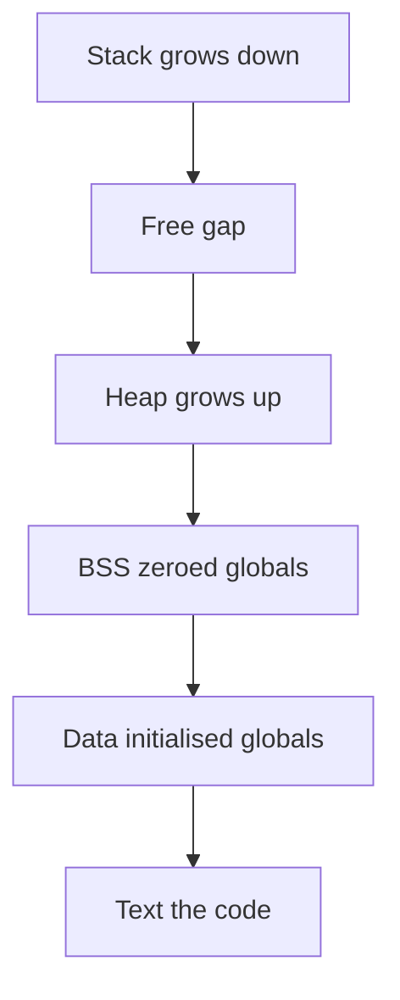

## The hook

One browser tab hits a bug and shows a sad-face "this page crashed" message. The other thirty-nine tabs keep playing music, scrolling and loading. Nothing else noticed.

Now the opposite story. A multiplayer game server runs every player's session as a thread inside one program. One thread dereferences a bad pointer, and every player on that server is disconnected at the same instant.

Same kind of bug, wildly different blast radius. The difference is one design decision: did each unit of work get its own house, or did they all move in as roommates? By the end you will know what each choice gives you, what it costs, and the trap where adding threads makes a program slower.

## The intuition

:::analogy
A **process** is a **separate house**. It has its own kitchen, its own fridge, its own locks and its own address. What happens inside one house does not touch the house next door, and if you want to send something to the neighbours, you must walk it over.

A **thread** is a **roommate** in one house. Roommates share the kitchen, the fridge and the front door. Each one still has their own bed and their own to-do list. Sharing is effortless (just leave it in the fridge), but one careless roommate can set the whole kitchen on fire.
:::

Map it to the machine:

| House | Machine |
|---|---|
| The house itself | A [[process]] and its private [[address space]] |
| Shared fridge and kitchen | Code, global data and the [[heap]], shared by all threads |
| Each roommate's own bed and to-do list | Each [[thread]]'s own [[stack]], registers and program counter |
| Walking a parcel to the neighbours | Inter-process communication through the kernel |
| One roommate starting a fire | One thread crashing kills the whole process |

## How it works

### A process: a program that is running

A program is a file on disk: instructions and some initial data. A process is that program **loaded and running**, with memory, open files and a current position in the code. Run the same program twice and you get two processes from one file.

Every process sees its own address space laid out the same way. Addresses grow upward from the bottom of this picture:



- **Text**: the machine code, usually read-only.
- **Data and BSS**: global and static variables (initialised ones in data, zero-initialised ones in BSS).
- **Heap**: memory from `new` or `malloc`, growing upward.
- **Stack**: function calls, locals and return addresses, growing downward from the top.

Wait, why does every process get addresses that look identical? Because they are fake, in the best sense. The kernel maps each process's addresses onto different pieces of physical RAM. Address `0x601040` in your editor and `0x601040` in your browser are different physical bytes. That mapping is what makes the houses separate.

### The kernel's file on each house: the PCB

The kernel tracks every process in a **[[process control block]]** (PCB). On Linux the structure is called `task_struct`, but every OS keeps the same kind of information:

| PCB field | Why the kernel needs it |
|---|---|
| Process id (PID) and parent id | To name it, signal it and let its parent wait for it |
| State: ready, running, waiting... | To know whether it can be scheduled |
| Saved registers and program counter | To resume it exactly where it stopped |
| Memory-management info (page tables) | To set up its private address space when it runs |
| Open file table | So file descriptor 3 means *its* file, not someone else's |
| Scheduling info: priority, CPU time used | So the scheduler can decide who goes next |
| Credentials: user id, permissions | So the kernel can check what it may access |

### A thread: one more roommate, same house

A thread is a separate path of execution through the same code and data. To run independently, a thread needs exactly the things that describe "where am I right now":

| Shared by all threads of a process | Private to each thread |
|---|---|
| Code (text) | Program counter |
| Global and static variables | Registers |
| Heap | Stack (locals, call chain) |
| Open files, sockets, current directory | Thread id, scheduling state |
| The address space mapping itself | Thread-local storage, if used |

That right column is small. That is why threads are cheap to create and switch between: no new address space, no new file table, just a stack and a register set. The kernel keeps a smaller per-thread record (sometimes called a thread control block) that points back to the shared process.

:::insight
A process is a unit of **ownership** (memory, files, permissions). A thread is a unit of **execution** (where the CPU is in the code). Every process has at least one thread; adding threads adds more "where am I" records, not more memory or files.
:::

### Kernel threads, user threads and the mapping between them

Threads can be managed in two places:

- **Kernel-level threads**: the kernel knows about each thread and schedules it on a core. If one blocks on I/O, the others keep running. Linux works this way: a thread is a task created with `clone()` and flags saying "share my memory and files".
- **User-level threads**: a library juggles many threads inside one kernel thread. Switching is very cheap (no kernel involved), but if one makes a blocking system call, they all stop, and they cannot use two cores at once.

Systems map them as **1:1** (each user thread is a kernel thread; Linux's standard pthreads), **N:1** (many user threads on one kernel thread), or **M:N** (many user threads multiplexed onto several kernel threads, the idea behind lightweight "green threads" or goroutine-style runtimes).

### Tracing who sees what

Here is the experiment that settles most interview confusion. Predict each answer before looking at the table. A global `int x = 10;`, and two versions of the program:

| Step | Version A: fork() a child process | Version B: create a thread |
|---|---|---|
| 1 | Parent: x = 10 | Main thread: x = 10 |
| 2 | `fork()`: child gets a copy of the address space | `std::thread` starts: same address space |
| 3 | Child sets x = 20 | New thread sets x = 20 |
| 4 | Child exits, parent waits for it | New thread finishes, main thread joins it |
| 5 | Parent reads x: **10** | Main thread reads x: **20** |

The child changed its own fridge. The roommate changed the shared one. Here is the same experiment as a program you can run on Linux (compile with `-pthread`):

```cpp
#include <bits/stdc++.h>
#include <sys/wait.h>
#include <unistd.h>
using namespace std;

int x = 10;  // a global: shared by threads, copied by fork

int main() {
    pid_t pid = fork();
    if (pid == 0) {          // child process
        x = 20;
        _exit(0);
    }
    waitpid(pid, nullptr, 0);
    cout << "after fork, parent sees x = " << x << "\n";    // 10

    x = 10;
    thread t([] { x = 20; });
    t.join();
    cout << "after thread, main sees x = " << x << "\n";    // 20
}
```

The thread version is safe here only because `join()` waits for the write to finish before the read. Without that ordering, two threads touching `x` at once is a race, which is the whole story of [Two People, One Spreadsheet Cell](article:cs-core-race-conditions).

## Trade-offs

| | Processes (separate houses) | Threads (roommates) |
|---|---|---|
| Isolation | Strong: a crash or memory bug stays inside | None: one bad pointer can corrupt or kill all threads |
| Sharing data | Needs IPC: pipes, sockets, shared memory | Free: just use the same variables |
| Creation cost | Higher: new address space, page tables, file table | Lower: new stack and register set |
| Switching cost | Higher: switching address spaces disturbs the TLB and caches | Lower: same address space stays loaded |
| Security boundary | Yes: different users and permissions possible | No: same permissions for all |
| Bugs to fear | Communication overhead and complexity | Races, deadlocks, corrupted shared state |

### Wait, aren't threads always faster?

Here is the trap that almost every OS interview probes. Guess: you split a job across 8 threads on an 8-core machine. Is it 8 times faster?

Almost never. Three reasons:

1. **Serial parts stay serial.** If 20% of the work cannot be split (reading input, merging results), **Amdahl's law** caps the speedup.

$$\text{speedup} = \frac{1}{s + \frac{1-s}{n}}$$

Here $s$ is the fraction of work that must run serially and $n$ is the number of cores. With $s = 0.2$:

| Cores $n$ | Speedup |
|---|---|
| 1 | 1.0x |
| 2 | 1.67x |
| 4 | 2.5x |
| 8 | 3.33x |
| 16 | 4.0x |
| unlimited | 5.0x |

2. **Shared things need locks.** When roommates queue for one bathroom, adding roommates adds waiting, not speed. Heavy lock contention can make a threaded program slower than the single-threaded one.

3. **More threads than cores means switching.** Beyond the core count, CPU-bound threads just take turns, and every switch costs time and cache warmth.

And one language-specific trap: in the standard CPython interpreter, a global interpreter lock lets only one thread execute Python bytecode at a time, so CPU-bound Python threads do not run in parallel. That is why Python users reach for multiple *processes* for CPU-heavy work. Threads still help there for I/O-bound work, where they spend most of their time waiting anyway.

:::warning
Common misconception: "threads are lighter, so a multithreaded design is always the faster one." Threads are cheaper to create and switch, but speed comes from work that can genuinely run in parallel without fighting over shared data. Serial sections, lock contention and oversubscription regularly make the threaded version slower. Measure.
:::

:::try-this
A job is 10% serial. You have 4 cores. What is the best speedup threads can give, and what is the ceiling with unlimited cores? (1 / (0.1 + 0.9 / 4) = 1 / 0.325, about 3.08x. With unlimited cores it is 1 / 0.1 = 10x.)
:::

## What can go wrong

- **One thread crashes, everyone dies.** A segmentation fault or an uncaught exception in any thread usually terminates the whole process. That is the game server from the hook.
- **Races on shared data.** Two roommates writing the same shopping list at once lose items. Every shared, mutable variable needs a rule: a lock, an atomic, or "only one thread ever touches it".
- **Too many threads.** Each thread reserves its own stack, often megabytes of virtual address space, and the scheduler has to juggle all of them. A design of "one thread per connection" can run out of memory or drown in switching at high connection counts.
- **fork in a multithreaded program.** After `fork()`, the child contains only a copy of the thread that called fork. If another thread was holding a lock at that moment, the lock stays locked forever in the child, with nobody left to release it. The safe pattern is to call `exec` right after `fork` in the child.
- **Leaked processes.** A child that exits but is never waited for stays in the process table as a zombie. More on that in [An Actor Stepping Off Stage](article:cs-core-process-states).

### Interview follow-ups

**"What exactly is shared between threads and what is not?"** Shared: code, globals, heap, open files, the address space. Private: stack, registers, program counter, thread id and thread-local storage. If you can name the private column and say *why* (each thread must be at its own point in the code), you have answered it.

**"When would you choose processes over threads?"** When isolation matters more than sharing: untrusted or crash-prone work (browser tabs rendering arbitrary pages), different permissions, or a runtime that cannot run threads in parallel. Choose threads when tasks share lots of data and you can keep the sharing disciplined.

**"Why is a thread switch cheaper than a process switch?"** Both save and restore registers. A process switch also changes the address space, which means loading new page tables and losing much of the TLB and cache warmth. Threads of one process skip that part.

**"Does the stack of one thread live in a different address space from another's?"** No. All stacks live in the same address space, at different addresses. A thread *can* read another thread's stack through a pointer; it is just a terrible idea, because that frame may vanish when the function returns.

**"What is the difference between concurrency and parallelism?"** Concurrency is structuring work as several tasks in progress at once, which works even on one core by switching. Parallelism is actually executing at the same instant on multiple cores. Threads give you concurrency always and parallelism only with spare cores.

## In the real world

- **Browsers** split work into multiple processes so that a crashing or compromised page is contained inside its own house, which is exactly the tab crash from the hook.
- **PostgreSQL** gives each client connection its own backend process, trading memory per connection for isolation; that is one reason connection poolers are common in front of it.
- **Event-driven servers** such as nginx run a small number of worker processes, each handling many connections without one thread per connection, to avoid the "too many threads" problem.
- **Python data pipelines** use multiple processes for CPU-heavy work and threads for waiting on network calls, following the trade-off above.

When you scale beyond one machine, the same question reappears one level up: many small servers or one big one, as in [One Stronger Horse or a Team of Horses?](article:system-design-vertical-horizontal). And for how long a context switch or a memory access takes compared to a disk read, see [If a CPU Cycle Took One Second](article:system-design-latency-numbers).

So far each roommate simply "runs". But a thread spends much of its life *not* running: waiting for a disk, waiting for its turn, or finished but not yet cleaned up. Those states, and what it costs to hand the CPU from one thread to another, are next in [An Actor Stepping Off Stage](article:cs-core-process-states).

## Further reading

- *Operating Systems: Three Easy Pieces* by Remzi and Andrea Arpaci-Dusseau, the chapters on the process abstraction and on threads. Free to read online.
- *Operating System Concepts* by Silberschatz, Galvin and Gagne, the chapters on processes and threads.
- The Linux manual pages for `fork(2)`, `clone(2)` and `pthreads(7)`.

## Key takeaways

- A process is a running program with its own private address space, open files and permissions, while a thread is one path of execution inside a process.
- Threads share code, globals, the heap and open files, but each thread has its own stack, registers and program counter.
- The kernel tracks each process in a process control block holding its id, state, saved registers, memory mapping, open files and scheduling information.
- Processes buy isolation at the cost of heavier creation, switching and communication; threads buy cheap sharing at the cost of races and shared failure.
- Threads are not automatically faster: serial work, lock contention and more threads than cores limit the speedup, as Amdahl's law shows.
