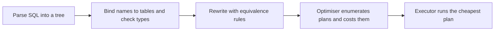

## The hook

You write one line of SQL: names of employees in department d7 earning more than 800. You never said *how* to find them. Should the database read all 100,000 employees and check each? Start from the 100 departments? Use an index, and which one?

On a test table built for this article, the same query had two very different plans, and the only change between them was one `CREATE INDEX`. SQL says *what* you want; a component called the optimiser decides *how*, and when it chooses badly, a query that should take milliseconds takes minutes. Predict what the optimiser needs to know to choose well. (How many rows each step will produce.)

## The intuition

:::analogy
You type a destination into **a sat-nav, and it chooses the fastest route**. It knows the road map (what plans are possible), traffic data (statistics about tables) and a cost for each road (estimated reads). It does not try every street in the city; it prunes bad options fast. Old traffic data sends you into a jam, and stale statistics do the same to a query.
:::

## How it works

### The pipeline



The parser checks syntax, binding checks that tables and columns exist, and the rewriter applies rules that never make things worse. The optimiser then picks among physical plans using a cost model.

### Rewrite rules: the free wins

Queries are trees of relational operations, and some rearrangements are always valid:

- **[[Selection pushdown]]**: filter before joining. Joining 100,000 employees with 100 departments and then filtering for d7 does far more work than filtering departments first.
- **Projection pushdown**: drop unneeded columns early so rows are smaller.
- **Join reordering**: joins are associative and commutative, so (A ⋈ B) ⋈ C can be computed as A ⋈ (B ⋈ C). With 5 tables there are already 120 left-deep orders, so optimisers use dynamic programming over subsets and prune.

### Costs come from estimates

The optimiser estimates the **[[selectivity]]** of each filter and the **[[cardinality estimate|cardinality]]** of each step from statistics (row counts, distinct values, histograms). On the test table:

| Condition | Rows matched (actual) | Selectivity |
|---|---|---|
| dept_id = 7 | 1,000 of 100,000 | 1% |
| salary > 800 | 19,900 of 100,000 | 19.9% |
| both, via the join on d7 | 200 | 0.2% |

### Join algorithms and their costs

Cost is measured in block reads; b is the number of blocks and n the number of rows. Take R with 10,000 rows in 400 blocks and S with 5,000 rows in 100 blocks:

| Algorithm | Idea | Cost formula | Example |
|---|---|---|---|
| Nested loop | for each row of R, scan S | b_R + n_R × b_S | 400 + 10,000 × 100 = 1,000,400 |
| Block nested loop | for each block of R, scan S | b_R + b_R × b_S | 400 + 400 × 100 = 40,400 |
| Same, S outer | smaller relation outside | b_S + b_S × b_R | 100 + 100 × 400 = 40,100 |
| Index nested loop | for each row of R, look up S through an index | b_R + n_R × (index lookup cost) | good when R is small after filters |
| Sort-merge | sort both on the key, merge | sort costs + b_R + b_S | 500 if both already sorted |
| **[[Hash join]]** | build a hash table on S, probe with R | about 3(b_R + b_S) with partitioning | 1,500; or 500 if S fits in memory |

Wait, why do nested loops survive if hash joins look so much cheaper? Nested loops handle any join condition (such as `r.a < s.b`), and an index nested loop is the best plan when the outer side is tiny after filtering, as in the plan below. Hash joins need an equality condition; sort-merge shines when inputs are already sorted or the output must be sorted.

### Reading a real plan

The query, run in SQLite on 100 departments and 100,000 employees:

```sql
EXPLAIN QUERY PLAN
SELECT e.name FROM emp e JOIN dept d ON e.dept_id = d.id
WHERE d.name = 'd7' AND e.salary > 800;
```

| Indexes available | Plan reported | Work done |
|---|---|---|
| primary keys only | `SCAN e`, then `SEARCH d USING INTEGER PRIMARY KEY` | read all 100,000 employees, look up each one's department |
| plus an index on emp(dept_id) | `SCAN d`, then `SEARCH e USING INDEX ix_emp_dept (dept_id=?)` | read 100 departments, find d7, fetch its 1,000 employees through the index, keep 200 |

The new index flipped the join order: departments became the outer side because now each department can find its employees cheaply. The optimiser made that choice from the statistics; the SQL did not change.

:::insight
SQL is declarative, so the same query can run in very different ways. The optimiser rewrites it with safe rules, estimates row counts from statistics, prices each candidate plan in disk reads, and picks the cheapest. Most slow queries come from a missing index or a bad row-count estimate, and EXPLAIN shows which.
:::

## Trade-offs

| Choice | Gain | Cost |
|---|---|---|
| Exhaustive plan search | Better plans | Planning time grows explosively with the number of joins |
| Heuristic or greedy search for many joins | Fast planning | Can miss the best plan |
| Detailed statistics and histograms | Better estimates | Must be collected and kept fresh (ANALYZE) |
| Plan caching for prepared statements | No repeated planning | A cached plan may suit some parameter values badly |

:::warning
Common misconception: "the order of tables in FROM and conditions in WHERE decides execution order." In a cost-based optimiser, it usually does not: the optimiser reorders joins and filters freely. Rewriting a query to "help" it often changes nothing; adding an index or refreshing statistics does.
:::

:::try-this
In the block nested-loop formula, R has 400 blocks and S has 100. If memory holds 102 blocks, S fits entirely, with one block for R and one for output. What is the cost now? (Read S once into memory, 100 blocks, then stream R once, 400 blocks: 500 block reads in total, the minimum possible, versus 40,100.)
:::

## What can go wrong

- **Stale statistics** after bulk loads, giving wrong row estimates and bad join orders.
- **Correlated columns** (city and pin code) whose combined selectivity the optimiser multiplies and badly underestimates.
- **Functions or type mismatches on indexed columns**, which hide the index from the optimiser.
- **Too many joins** pushing the optimiser into heuristics.
- **Parameter-sensitive cached plans**: fine for a rare value, terrible for a common one.

### Interview follow-ups

**"How do you debug a slow query?"** Run EXPLAIN (or EXPLAIN ANALYZE, which also executes it and shows actual row counts), look for full scans on large tables and for estimates far from actual counts, then add the right index or refresh statistics.

**"What is the difference between EXPLAIN and EXPLAIN ANALYZE in PostgreSQL?"** EXPLAIN shows the chosen plan with estimates; EXPLAIN ANALYZE runs the query and adds actual times and row counts.

**"Rule-based versus cost-based optimisation?"** Rule-based optimisers apply fixed preferences (always use an index if present); cost-based ones compare estimated costs, which handles cases where a full scan is cheaper.

## In the real world

PostgreSQL, MySQL, SQL Server and Oracle all use cost-based optimisers descended from IBM System R's design. The B+ tree indexes the plans above relied on are covered in [A Book Index Versus a Phone Directory](article:cs-core-db-indexing-cs).

## Further reading

- P. Griffiths Selinger and colleagues, "Access Path Selection in a Relational Database Management System" (SIGMOD, 1979).
- The PostgreSQL documentation chapter "Using EXPLAIN".

## Key takeaways

- A query is parsed, bound, rewritten with safe rules such as pushing filters down, then planned by a cost-based optimiser and executed.
- The optimiser estimates selectivity and row counts from statistics and prices each plan in disk reads, so stale statistics cause bad plans.
- Nested-loop joins handle any condition and suit small outer inputs with an index, hash joins are fast for equality joins, and sort-merge suits sorted inputs.
- Join order matters greatly, and putting the smaller input in the outer loop of a block nested-loop join reduces repeated reads.
- EXPLAIN shows the chosen plan, and on the test table one new index flipped the join order from scanning 100,000 employees to reading 100 departments.
