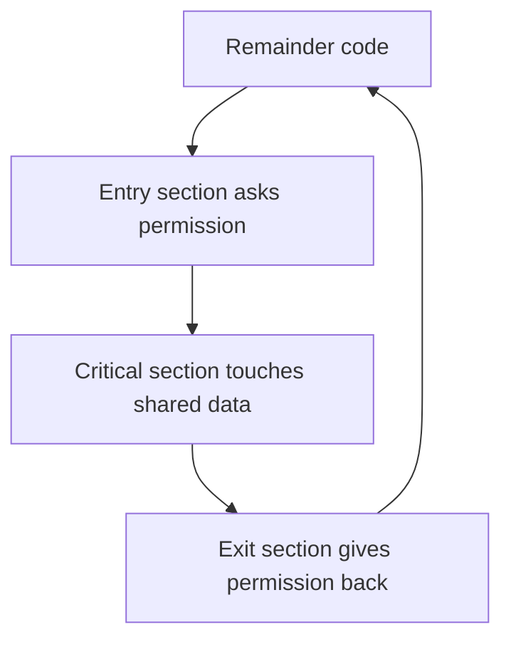

## The hook

Look at this ten-line program. Two threads share an integer `count = 0`. Each thread runs `count++` one million times. Then the program prints `count`.

Predict the output before reading on.

Two million is the obvious answer. Compiled without optimisation on a test machine, three runs printed 964,757, then 1,881,578, then 1,079,298. Different every time, and always short. Nothing crashed, no error was raised, and the bug is in a line that looks too simple to be wrong.

By the end you will be able to point at the exact instant an update gets lost, name the three rules any fix must satisfy, and write a correct lock with nothing but two shared variables.

## The intuition

:::analogy
Two shopkeepers keep the day's sales total in **one cell of a shared spreadsheet**, but each works on a copy that syncs when saved. The cell says 100. Asha makes a sale of 20: she reads 100, works out 120, and starts typing. Meanwhile Ravi makes a sale of 50: he also reads 100, works out 150, and saves. Then Asha saves 120. The cell says 120. Ravi's sale vanished, and neither of them did anything wrong on their own.
:::

That is a **[[race condition]]**: the result depends on who happens to read and write when. In code, the spreadsheet cell is a shared variable, and "read, work it out, save" is what `count++` really does.

`count++` looks like one step but compiles to three:

1. **Load** `count` from memory into a register.
2. **Add** 1 to the register.
3. **Store** the register back to `count`.

Another thread can run between any of these. Each thread has its own registers (its own copy of the spreadsheet), so a thread working from a stale load overwrites a newer value.

## How it works

### The lost update, step by step

Two threads, `count` starts at 5:

| Step | Thread A | Thread B | A's register | B's register | count in memory |
|---|---|---|---|---|---|
| 1 | load count | | 5 | | 5 |
| 2 | | load count | 5 | 5 | 5 |
| 3 | add 1 | | 6 | 5 | 5 |
| 4 | | add 1 | 6 | 6 | 5 |
| 5 | store | | 6 | 6 | **6** |
| 6 | | store | 6 | 6 | **6** |

Two increments, one effect. That is Ravi's sale disappearing.

### How likely is the bad ordering?

Each thread has 3 steps, so one possible run of both threads is one **[[interleaving]]** of 6 steps. There are $\binom{6}{3} = 20$ interleavings, since you choose which 3 of the 6 time slots belong to thread A.

Guess how many of the 20 produce the right answer, 7.

Only **2**. The final value is correct only if one thread's load comes after the other's store, which forces one thread to run all three steps before the other starts. Every other ordering, 18 of 20, loses an update. The real program usually looks correct only because a thread typically runs a whole time slice of increments before being interrupted; the bad windows are narrow, not rare in principle.

Wait, how bad can it get with a million increments each? Surprisingly, the final value can be as low as **2**. Here is the schedule:

| Phase | What happens | count |
|---|---|---|
| 1 | A loads 0, then is paused | 0 |
| 2 | B does all but its last increment | N − 1 |
| 3 | A adds 1 to its stale 0 and stores | **1** |
| 4 | B loads 1, then is paused | 1 |
| 5 | A finishes its remaining N − 1 increments | N |
| 6 | B adds 1 to its stale 1 and stores | **2** |

Wildly unlikely, but legal. A correct program must be correct under *every* interleaving the scheduler might choose, not just the likely ones.

### Three shapes every race takes

Lost updates are only one shape. Learn to spot all three:

| Shape | Pattern | Everyday example |
|---|---|---|
| Read-modify-write | Load, change, store, with a gap between | Counters, bank balances, "likes" |
| Check-then-act | "If X is free, take X", with a gap between the check and the take | Two users booking the last seat; "if the file does not exist, create it" |
| Publish without ordering | Write the data, then set a "ready" flag; the reader sees the flag before the data | Lazy initialisation, handing work to another thread |

The check-then-act shape is the one that bites databases and web backends, where it shows up as double bookings and duplicate payments. The database side of the story is [Several Cashiers, One Ledger](article:system-design-isolation-levels).

:::warning
Common misconception: "a race needs two threads writing at the same instant, so it is too rare to worry about." The writes do not need to be simultaneous; a thread just needs to be paused in the gap between its read and its write. The scheduler can pause a thread at any instruction, and on multicore machines the threads truly overlap. Rare in testing means intermittent in production.
:::

### The critical section problem

The fix is to make the dangerous code run by one thread at a time. That code is a **[[critical section]]**. Every thread wraps it the same way:



The whole problem is designing the entry and exit sections. Any correct design must satisfy three requirements, and interviewers expect all three by name:

1. **[[Mutual exclusion]]**: at most one thread is in the critical section at a time.
2. **Progress**: if nobody is in the critical section and some threads want in, one of them gets in, and the choice is made only by threads that want to enter. A thread doing something else cannot block the door.
3. **Bounded waiting**: once a thread asks to enter, there is a limit on how many times others can enter before it does. Nobody waits forever.

Plus a ground rule: make no assumptions about the relative speed of the threads or the number of CPUs.

In spreadsheet terms: only one shopkeeper may hold the cell at a time (mutual exclusion); if the cell is free and someone wants it, they get it, without waiting for permission from a shopkeeper who is out to lunch (progress); and nobody is skipped over forever (bounded waiting).

### Attempt 1: a "busy" flag

```pseudo
shared busy = false

entry:  while busy: wait
        busy = true
exit:   busy = false
```

Predict whether it works before reading on.

It does not. Checking `busy` and setting it is itself a check-then-act. Both threads can see `busy = false`, both leave the loop, both set it to true, both enter. We moved the race from the counter to the lock.

### Attempt 2: strict turns

```pseudo
shared turn = 0

thread i:
entry:  while turn != i: wait
exit:   turn = 1 - i
```

Mutual exclusion holds: `turn` can only name one thread. But if thread 1 finishes its work and never wants to enter again, thread 0 can enter once and then waits forever for a turn thread 1 will never hand back. A thread outside the critical section is blocking the door. **Progress fails.**

### Peterson's solution: intent plus politeness

Gary Peterson's 1981 algorithm combines the two ideas for two threads. Each thread announces its **intent** with a flag, then **politely gives the turn away** to the other.

```pseudo
shared wants[0..1] = false, false
shared turn

thread i (the other is j = 1 - i):
entry:  wants[i] = true      # I would like to enter
        turn = j             # but you go first if you want to
        while wants[j] and turn == j: wait
critical section
exit:   wants[i] = false     # I am done
```

Wait, why does giving the turn away make it work? Because `turn` can hold only one value. If both threads arrive together, both set their flags and both write `turn`, each naming the other. Whichever wrote last leaves `turn` pointing at its rival, so it waits. The earlier writer finds `turn` pointing at itself, so its loop ends and it enters.

Trace it with both threads arriving at once:

| Step | Thread 0 | Thread 1 | wants | turn | Outcome |
|---|---|---|---|---|---|
| 1 | wants[0] = true | | T, F | ? | |
| 2 | | wants[1] = true | T, T | ? | |
| 3 | turn = 1 | | T, T | 1 | |
| 4 | | turn = 0 | T, T | 0 | Thread 1 wrote last |
| 5 | checks: wants[1] and turn == 1? No | | T, T | 0 | **Thread 0 enters** |
| 6 | | checks: wants[0] and turn == 0? Yes | T, T | 0 | Thread 1 waits |
| 7 | exit: wants[0] = false | | F, T | 0 | |
| 8 | | checks: wants[0] is false | F, T | 0 | **Thread 1 enters** |

Now check all three requirements:

- **Mutual exclusion**: for both to be inside, each must have seen the other's loop condition false. With both flags true, that needs `turn == 0` and `turn == 1` at once. Impossible.
- **Progress**: if the other thread does not want in, its flag is false and you walk straight in. Nobody outside blocks you.
- **Bounded waiting**: when thread 1 is waiting and thread 0 leaves and tries again, thread 0 sets `turn = 1` on the way in, handing priority to thread 1. Thread 1 waits for at most one entry by thread 0.

:::insight
A correct lock needs a way to break ties that both threads agree on. Peterson's solution gets it from one shared variable that can only hold one value: whoever writes `turn` last loses the tie. Every later lock, from hardware instructions to database row locks, is a faster way of producing that one agreed winner.
:::

### Here is the catch: your laptop breaks Peterson's proof

The proof assumes that each thread's reads and writes happen in program order and that everyone sees them in that order. Modern hardware does not promise that. A CPU core may hold the store `wants[i] = true` in a private store buffer and let the later load of `wants[j]` go ahead first. Then both threads can read the other's flag as false and both enter. The compiler may reorder plain variable accesses too.

The fix is to tell both the compiler and the CPU not to reorder, with sequentially consistent atomic variables or explicit memory fences. With those, Peterson's lock works, as in the program below. In practice nobody uses Peterson's algorithm for real locks: it handles only two threads, it busy-waits, and hardware gives us something far better.

### What hardware gives you: atomic instructions

CPUs provide instructions that read and write a memory location as a single **[[atomic operation]]**, so no other core can slip in between:

- **Test-and-set**: set a location to true and return its old value, in one step.
- **Compare-and-swap (CAS)**: "if the location still holds the value I expect, replace it with the new value", in one step, reporting whether it succeeded.
- **Fetch-and-add**: add to a location and return the old value, in one step. This is `count++` done right.

Attempt 1 failed because the check and the set were separate. Test-and-set fuses them:

```pseudo
shared locked = false

entry:  while test_and_set(locked) == true: wait   # old value false means I got it
exit:   locked = false
```

Disabling interrupts is the other classic tool, and it only works in a limited setting: on a single core, inside the kernel. Disabling interrupts on one core does nothing to stop another core, and user programs are not allowed to do it.

### The code

Here are both fixes in one runnable C++17 program: Peterson's lock built from sequentially consistent atomics, and a hardware atomic counter. Compile with `-pthread`.

```cpp
#include <bits/stdc++.h>
using namespace std;

const int N = 1000000;

// Peterson's lock for two threads (ids 0 and 1). The atomics use sequentially
// consistent ordering, which stops the CPU and compiler from reordering the
// flag store past the loads in the while loop.
atomic<bool> wants[2] = {false, false};
atomic<int> turn{0};

void lock(int me) {
    int other = 1 - me;
    wants[me] = true;
    turn = other;                                  // politely let the other go first
    while (wants[other] && turn == other) { }      // busy-wait
}
void unlock(int me) { wants[me] = false; }

int main() {
    int plain = 0;                // protected by Peterson's lock
    atomic<int> counter{0};       // protected by hardware atomic increment

    auto work = [&](int me) {
        for (int i = 0; i < N; i++) {
            lock(me);
            plain++;              // critical section
            unlock(me);
            counter++;            // one indivisible read-modify-write
        }
    };
    thread a(work, 0), b(work, 1);
    a.join(); b.join();
    cout << "peterson: " << plain << ", atomic: " << counter << "\n";   // both 2000000
}
```

And the broken version from the hook, for contrast. It is a data race, so it is undefined behaviour, and the printed value changes from run to run and with optimisation settings:

```cpp partial
int count = 0;
auto work = [&] { for (int i = 0; i < 1000000; i++) count++; };   // data race
thread a(work), b(work);
a.join(); b.join();
cout << count << "\n";   // anything up to 2000000, often less
```

:::try-this
A ticket app runs `if (seats > 0) { seats = seats - 1; book(); }` on two threads at once with `seats = 1`. Write down an interleaving that books two people. (Thread A checks seats > 0: true. Thread B checks seats > 0: true. A sets seats to 0 and books. B sets seats to −1 and books. A check-then-act race: the check and the update must be in one critical section, or done as one atomic compare-and-swap.)
:::

## Trade-offs

| Tool | Gains | Costs |
|---|---|---|
| Atomic instruction on one variable | Fastest, no blocking | Covers only one variable; multi-variable invariants need a lock |
| Lock around a critical section | Protects any amount of code and data | Threads queue; risk of deadlock and contention |
| Busy-waiting entry (Peterson, test-and-set spin) | No sleep and wake overhead for very short waits | Burns CPU while waiting; terrible on one core |
| Not sharing at all (each thread owns its data, then combine) | No races, no waiting | Needs a final merge step; more memory |

Lock **granularity** is the next dial. One big lock around everything is easy to get right but makes threads queue. Many small locks let threads run in parallel but invite deadlocks and missed cases. Start coarse and split only where measurement shows contention.

## What can go wrong

- **Protecting the write but not the read.** Reading shared data outside the lock can see a half-updated structure. Every access, read or write, goes through the same lock.
- **`volatile` is not a lock.** In C and C++, `volatile` stops some compiler optimisations but makes no operation atomic and adds no ordering between threads. Use `std::atomic` or a mutex.
- **Time-of-check to time-of-use.** Checking a file's permissions and then opening it lets another process swap the file in between. Use operations that check and act together.
- **Heisenbugs.** Adding a print statement or a debugger changes timing and makes the race disappear. Use tools such as ThreadSanitizer (`-fsanitize=thread` in GCC and Clang) that detect data races directly.
- **Benign-looking flags.** A `bool done` set by one thread and polled by another is a data race in C++ unless it is atomic; the compiler may even hoist the read out of the loop, so the loop never ends.

### Interview follow-ups

**"Is `i++` atomic?"** Not for a plain variable: it is a load, an add and a store. Use `std::atomic<int>` (whose `++` is a single atomic read-modify-write) or protect it with a lock.

**"What is the difference between a race condition and a data race?"** A data race is a low-level fact: unsynchronised concurrent access to one memory location with at least one write. A race condition is a logic bug where timing changes the result. You can have a race condition with no data race (two properly atomic operations in a check-then-act) and a data race that happens not to change the result, though in C++ it is still undefined behaviour.

**"State the three requirements of a critical section solution."** Mutual exclusion, progress and bounded waiting, without assuming anything about thread speeds or CPU count. Be ready to show which one strict alternation breaks (progress).

**"Why does Peterson's algorithm work, and why is it not used in practice?"** Intent flags plus a single `turn` variable that breaks ties: the last writer of `turn` waits. It handles only two threads, busy-waits, and needs memory fences on modern hardware; atomic instructions and operating system locks are simpler and faster.

**"How would you avoid double booking the last seat in a web service with many servers?"** In-process locks do not span machines. Make the database do the check and the update atomically, for example a conditional update that decrements only if seats are still above zero and reports whether a row changed, or a unique constraint on the booking. See [Several Cashiers, One Ledger](article:system-design-isolation-levels) and [Pressing the Pay Button Twice Should Charge Once](article:system-design-stateless-idempotency).

## In the real world

- Thread sanitizers in compilers find data races in test runs by tracking which thread touched each memory location and whether any synchronisation ordered them.
- Databases face the same lost-update problem between transactions and solve it with locks, isolation levels or versioned rows, as in [Readers Never Wait for Writers](article:famous-algos-mvcc).
- Counters in high-throughput services are often kept per thread or per core and summed when read, avoiding a shared hot variable altogether.

The test-and-set loop above works, but it spins, burning a whole core while it waits. What if a waiting thread could go to sleep and be woken exactly when the lock frees up? And what if you need to allow three threads in at once, not one? That is [A Key for One Room, a Bowl for the Car Park](article:cs-core-mutex-semaphore).

## Further reading

- *Operating Systems: Three Easy Pieces*, the chapters on concurrency, locks and the problems with plain loads and stores.
- *Operating System Concepts* by Silberschatz, Galvin and Gagne, the synchronisation chapter, which presents the critical section requirements and Peterson's solution.
- The documentation for ThreadSanitizer in GCC or Clang.

## Key takeaways

- A race condition is a bug where the result depends on how threads interleave, and count++ races because it is a separate load, add and store.
- With two threads doing one increment each, only 2 of the 20 possible interleavings give the right answer, so correctness must hold for every interleaving, not the likely ones.
- Any solution to the critical section problem must provide mutual exclusion, progress and bounded waiting, without assuming anything about thread speeds.
- Peterson's solution uses intent flags and a single turn variable whose last writer waits, but on modern hardware it needs atomics or memory fences to stop reordering.
- Hardware atomic instructions such as test-and-set, compare-and-swap and fetch-and-add make a check and an update one indivisible step, which is the foundation of every practical lock.
