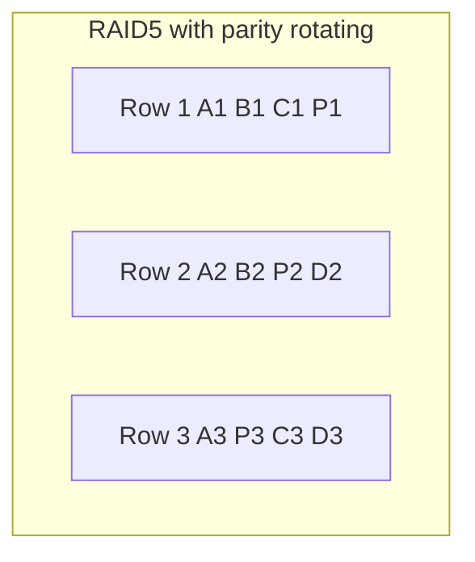

## The hook

Disks fail. In a server with dozens of them, a failure is not a question of if but of when. When one fails, two things can go wrong: the data on it is gone, and every program waiting on it stops.

RAID (redundant array of independent disks) combines several disks so that one failure loses nothing and the system keeps running. The cleverest version stores a single extra disk's worth of information and can still rebuild *any* failed disk. Predict the operation that makes that possible. (XOR: the parity of all the others.)

## The intuition

:::analogy
You must store a precious book. **Spread it across several shelves** and several readers can fetch pages at once (fast, but one collapsed shelf loses chapters). Keep a full photocopy on another shelf (safe, but twice the space). Or keep **backup pages**: one extra page per row that is a clever summary of the others, enough to rewrite any single lost page. RAID levels are these three ideas and their combinations.
:::

## How it works

### The three building blocks

- **[[Striping]]**: chunk 1 on disk A, chunk 2 on disk B, and so on. Reads and writes use all disks in parallel.
- **[[Mirroring]]**: every chunk written to two disks.
- **[[Parity]]**: for each row of chunks across the disks, store the XOR of the data chunks in one extra chunk.

### Parity, bit by bit

XOR has two useful properties: x ⊕ x = 0 and x ⊕ 0 = x. So if P = A ⊕ B ⊕ C, then any one of them equals the XOR of the other three.

| Block | Bits |
|---|---|
| A (disk 1) | 0110 |
| B (disk 2) | 1011 |
| C (disk 3) | 1100 |
| P = A ⊕ B ⊕ C (disk 4) | 0001 |
| disk 2 fails: A ⊕ C ⊕ P | 1011, the lost B |

Wait, why can parity recover only one failure? With two unknowns, one XOR equation cannot separate them. RAID 6 adds a second, independent parity (computed with Reed–Solomon-style arithmetic) so two failures are survivable.

### The levels

With n disks of size D:

| Level | Layout | Usable capacity | Failures survived | Notes |
|---|---|---|---|---|
| RAID 0 | striping only | n × D | 0 | fastest; any failure loses everything |
| RAID 1 | mirroring | D (for a 2-disk mirror) | 1 of the pair | fast reads, simple rebuild |
| RAID 5 | striping + one parity, rotated across disks | (n − 1) × D | 1 | needs at least 3 disks |
| RAID 6 | striping + two parities | (n − 2) × D | any 2 | needs at least 4 disks |
| RAID 10 | stripe across mirrored pairs | n × D / 2 | 1 per pair, at least 1 | fast writes, fast rebuild |

For four 2 TB disks: RAID 0 gives 8 TB, RAID 5 gives 6 TB, RAID 6 and RAID 10 give 4 TB.

RAID 5 rotates the parity across disks so that no single parity disk becomes a bottleneck (RAID 4 used a dedicated parity disk and suffered for it).

### The small-write penalty

Changing one block in RAID 5 means updating parity too. Without reading the whole row: new P = old P ⊕ old B ⊕ new B. That is 2 reads (old B, old P) plus 2 writes (new B, new P), so **4 disk operations per small write**, versus 2 for RAID 1 and 6 for RAID 6. Check with the table: changing B from 1011 to 0011 gives new P = 0001 ⊕ 1011 ⊕ 0011 = 1001, and recomputing A ⊕ new B ⊕ C directly also gives 1001.

### Rebuilds

When a disk fails, the array runs **degraded**: reads of the lost disk are recomputed from the others. A **[[rebuild]]** reads every surviving disk in full to reconstruct the replacement. On large disks this takes many hours, and a second failure, or an unreadable sector on a survivor, during that window loses data in RAID 5. That risk is why large arrays prefer RAID 6 or RAID 10.

:::insight
RAID trades capacity and write cost for speed and failure tolerance. Striping buys parallelism, mirroring buys simple redundancy, and XOR parity buys one disk of fault tolerance for the price of one disk, at the cost of a write penalty and long, risky rebuilds.
:::

## Trade-offs

| Need | Choose |
|---|---|
| Maximum speed, data is disposable (scratch space) | RAID 0 |
| Simple redundancy for two disks (boot drives) | RAID 1 |
| Capacity-efficient, read-heavy storage | RAID 5 (small disks) or RAID 6 (large disks) |
| Write-heavy databases needing redundancy | RAID 10 |

The **[[write penalty]]** per small logical write: RAID 0 is 1 operation, RAID 1 and 10 are 2, RAID 5 is 4, and RAID 6 is 6.

:::warning
Common misconception: "RAID is a backup." RAID keeps the system running when a disk dies, but an accidental `rm`, a software bug that corrupts files, or ransomware is written to every disk immediately. Backups keep older, separate copies; you need both.
:::

:::try-this
Six 4 TB disks. What is the usable capacity in RAID 5, RAID 6 and RAID 10, and how many failures can each survive? (RAID 5: 5 × 4 = 20 TB, 1 failure. RAID 6: 4 × 4 = 16 TB, any 2. RAID 10: three mirrored pairs, 12 TB, at least 1 and up to 3 if each failure hits a different pair.)
:::

## What can go wrong

- **A second failure during rebuild**, losing a RAID 5 array.
- **Disks from the same batch** failing close together.
- **Write-heavy workloads on RAID 5**, slowed by the parity penalty.
- **Treating RAID as backup** and losing data to deletion or corruption.
- **Hardware controller failures**, where a proprietary layout needs an identical controller to read the disks.

### Interview follow-ups

**"Hardware or software RAID?"** Hardware controllers offload work and may have battery-backed caches; software RAID (Linux md, ZFS) is flexible and portable. Both are common.

**"How do large distributed systems do this?"** Across machines rather than disks, with replication or erasure coding, the general form of parity, as in [Why a Stained QR Code Still Scans](article:famous-algos-reed-solomon).

**"Why is RAID 10 preferred for databases?"** Small random writes cost 2 operations instead of 4 or 6, and rebuilds copy from one mirror instead of reading every disk.

## In the real world

Servers, NAS boxes and storage arrays use RAID or its successors (ZFS RAID-Z, erasure-coded object stores). It sits beneath the file system described in [A Library Catalogue Pointing to the Shelves](article:cs-core-file-systems).

## Further reading

- David Patterson, Garth Gibson and Randy Katz, "A Case for Redundant Arrays of Inexpensive Disks (RAID)" (SIGMOD, 1988).
- Remzi and Andrea Arpaci-Dusseau, *Operating Systems: Three Easy Pieces*, chapter on RAID (free online).

## Key takeaways

- RAID combines disks using striping for speed, mirroring for simple redundancy, and XOR parity for capacity-efficient redundancy.
- Parity is the XOR of the data blocks in a row, so any single missing block equals the XOR of all the others.
- RAID 0 survives no failures, RAID 1 and RAID 5 survive one, RAID 6 survives any two, and RAID 10 survives one per mirrored pair.
- RAID 5 needs four disk operations per small write and long full-array rebuilds, which is why large arrays prefer RAID 6 or RAID 10.
- RAID protects against disk failure, not against deletion, corruption or ransomware, so it never replaces backups.
