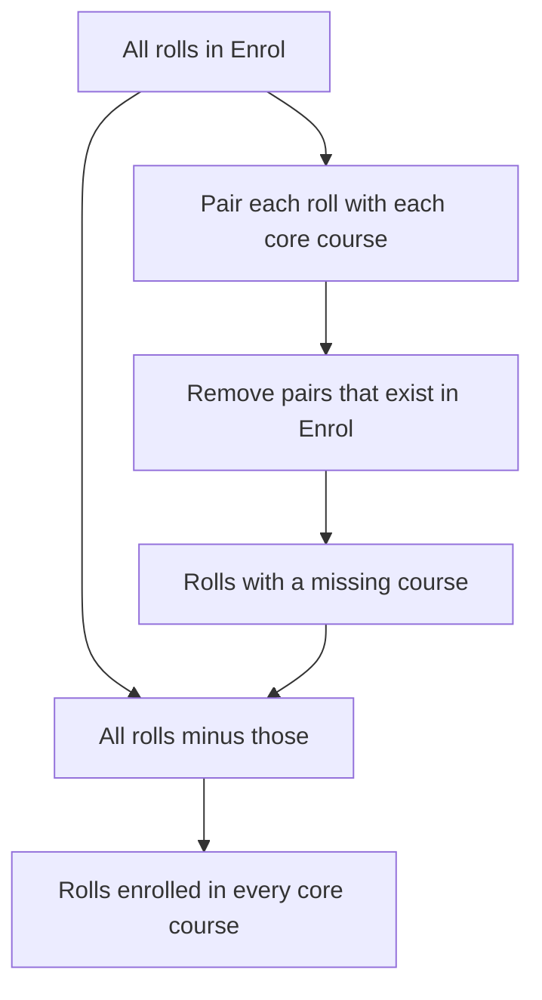

## The hook

"Find the students who have taken every core course." Try writing that in SQL right now. Most people get stuck: SQL has no FOR ALL keyword, and the standard answer uses a double NOT EXISTS that looks like a riddle.

In relational algebra the same question is one symbol: ÷. Relational algebra is the small set of operations underneath every SQL engine, and GATE-style exams and DBMS interviews ask about it directly. Learn its eight operations and you can read any query as a recipe of simple steps. Predict how "every" can be built from "not": (find students for whom *some* core course is *missing*, then remove them).

## The intuition

:::analogy
Relational algebra is a set of **recipes for combining tables**. Each step takes whole tables and produces a new table: sieve the rows (select), keep some columns (project), mix two bowls (union), take one bowl away from another (difference), pair everything up (product). Because every step outputs a table, steps chain together like a recipe.
:::

All results below were computed on this small database:

| Student: roll | name |
|---|---|
| 1 | Asha |
| 2 | Ravi |
| 3 | Meera |
| 4 | Kabir |

| Enrol: roll | course |
|---|---|
| 1 | DBMS |
| 1 | OS |
| 2 | DBMS |
| 3 | OS |
| 3 | DBMS |
| 3 | CN |

Core = {DBMS, OS}.

## How it works

### The unary operations

| Operation | Symbol | Example | Result | SQL |
|---|---|---|---|---|
| **[[Selection]]** | σ | σ course = 'OS' (Enrol) | (1, OS), (3, OS) | WHERE course = 'OS' |
| **[[Projection]]** | π | π roll (Enrol) | 1, 2, 3 | SELECT DISTINCT roll |
| Rename | ρ | ρ E2 (Enrol) | the same table, called E2 | AS E2 |

Projection on Enrol has six input rows but outputs three: duplicates disappear, because relations are sets. Rename matters when a table is joined with itself.

### The set operations

These need **union-compatible** tables (same number of columns with matching types).

| Operation | Example | Result |
|---|---|---|
| Union ∪ | π roll (σ course = 'CN' (Enrol)) ∪ {4} | 3, 4 |
| Difference − | π roll (Student) − π roll (Enrol) | 4: Kabir has no enrolments |
| Intersection ∩ | π roll (σ course='DBMS' (Enrol)) ∩ π roll (σ course='OS' (Enrol)) | 1, 3 |

Intersection is not basic: A ∩ B = A − (A − B).

### Product and joins

The **Cartesian product** Student × Enrol pairs every student with every enrolment: 4 × 6 = 24 rows, most of them meaningless (Asha paired with Ravi's enrolment). A **join** is a product followed by a selection that keeps the meaningful pairs:

- Theta join: R ⋈ condition S = σ condition (R × S).
- Equi join: a theta join whose condition uses only equality.
- **[[Natural join]]** R ⋈ S: equality on all same-named columns, keeping one copy of each.

π name (Student ⋈ σ course = 'OS' (Enrol)) gives Asha and Meera.

Outer joins (⟕, ⟖, ⟗) keep unmatched rows with NULLs, exactly like their SQL counterparts.

### Division: the "for every" operation

**[[Division]]** Enrol ÷ Core keeps each roll whose set of courses contains every core course. Wait, why can it be built from the basic operations? Because "has every course" means "is missing none":

| Step | Expression | Result |
|---|---|---|
| 1. All rolls | π roll (Enrol) | 1, 2, 3 |
| 2. Every roll paired with every core course | step 1 × Core | (1, DBMS), (1, OS), (2, DBMS), (2, OS), (3, DBMS), (3, OS) |
| 3. Pairs that should exist but do not | step 2 − Enrol | (2, OS) |
| 4. Rolls missing something | π roll (step 3) | 2 |
| 5. The answer | step 1 − step 4 | 1, 3 |

Asha and Meera have taken every core course. Meera's extra CN does not hurt; division asks for "at least all".

:::insight
Six operations are basic (select, project, rename, union, difference, product); intersection, joins and division are built from them. Every step outputs a table, so complex questions become chains of simple steps, and "for every" questions become "not missing any", which is division.
:::

## Trade-offs

| Aspect | Relational algebra | SQL |
|---|---|---|
| Style | Procedural: a sequence of operations | Declarative: describe the result |
| Duplicates | Sets: none | Bags: kept unless DISTINCT |
| Use | Theory, exams, internal plan representation | What people actually write |
| "For all" | Division, directly | Double NOT EXISTS or GROUP BY with a count |

The SQL for division, counting style: `SELECT roll FROM Enrol WHERE course IN ('DBMS','OS') GROUP BY roll HAVING COUNT(DISTINCT course) = 2`.

:::warning
Common misconception: "a join is a basic operation." In relational algebra it is a Cartesian product followed by a selection. That is also why forgetting a join condition in SQL silently produces a huge product: 24 rows here, millions on real tables.
:::

:::try-this
Write a relational algebra expression for "names of students enrolled in DBMS but not in OS", and predict the result. (π name (Student ⋈ (π roll (σ course='DBMS' (Enrol)) − π roll (σ course='OS' (Enrol))))). DBMS rolls are 1, 2, 3; OS rolls are 1, 3; the difference is 2, so the answer is Ravi.)
:::

## What can go wrong

- **Set operations on incompatible tables**, such as a union of a one-column and a two-column table.
- **Natural joins on accidentally shared column names** (two tables that both have a `name` column), joining on columns you did not intend.
- **Forgetting projection removes duplicates**, and miscounting rows in exam questions.
- **Writing division as a join**, which gives "at least one" instead of "all".

### Interview follow-ups

**"What is relational calculus?"** A declarative alternative: tuple and domain relational calculus describe what to retrieve using logic (∃, ∀). Safe calculus expressions have exactly the same power as relational algebra, a result due to Codd.

**"Why do databases still care about relational algebra?"** Query optimisers represent queries as algebra trees and rewrite them, for example pushing selections below joins.

**"How do you write division in SQL with NOT EXISTS?"** Students for whom there is no core course they have not taken: two nested NOT EXISTS subqueries.

## In the real world

Every SQL engine parses queries into an operator tree built from these operations before choosing a physical plan. The keys that make natural joins meaningful are in [ID Cards That Uniquely Identify People](article:cs-core-relational-keys), and the SQL that people actually write starts in [Asking a Well-Organised Spreadsheet Questions](article:cs-core-sql-basics).

## Further reading

- E. F. Codd, "A Relational Model of Data for Large Shared Data Banks" (Communications of the ACM, 1970).
- Silberschatz, Korth and Sudarshan, *Database System Concepts*, chapter on the relational model and formal query languages.

## Key takeaways

- Relational algebra is a set of operations that take tables and return a table, so queries become chains of simple steps.
- Selection keeps rows, projection keeps columns and removes duplicates, and rename lets a table be used twice.
- Union, difference and intersection need union-compatible tables, and intersection can be built from difference.
- A join is a Cartesian product followed by a selection, and the natural join matches all same-named columns.
- Division answers "for every" questions, and it can be built as all candidates minus those missing at least one required value.
