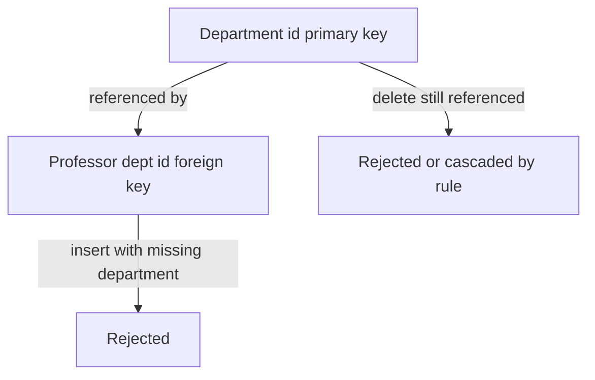

## The hook

A college database has two students named Priya Sharma in the same year. The exam cell enters marks by name. You can guess what happens: one Priya gets the other's grades.

People's names are not identifiers. Roll numbers, email addresses and Aadhaar numbers are. Databases make this idea precise with a small family of words that interviewers love to test: super key, candidate key, primary key, foreign key. Predict how many of those four a table with two unique columns has more than one of. (Super keys, by a lot: twelve, for a table of four columns.)

## The intuition

:::analogy
In a large college, **ID cards uniquely identify people**. Your roll number card identifies you; so does your official email. Either is enough. Your name plus your phone number might also be unique today, but nothing guarantees it. And when the library records a borrowed book, it writes your roll number, so the record always points at a real student.
:::

In the relational model, data lives in **relations** (tables) of **tuples** (rows) with **attributes** (columns). Keys are the ID cards; foreign keys are the library records pointing at them.

## How it works

Take `Students(roll_no, email, name, phone)`, where roll_no and email are each unique.

| Key type | Definition | Example |
|---|---|---|
| **[[Super key]]** | Any attribute set that is unique per row | {roll_no}, {roll_no, name}, {email, phone}, … |
| **[[Candidate key]]** | A minimal super key | {roll_no}, {email} |
| **[[Primary key]]** | The candidate key chosen as the identifier; unique and not null | roll_no |
| Alternate key | Candidate keys not chosen as primary | email |
| **[[Composite key]]** | A key with more than one attribute | (roll_no, course_id) in Enrolment |
| **[[Foreign key]]** | Columns matching a key in another table | Enrolment.roll_no → Students.roll_no |

Counting super keys: every subset containing roll_no or email is a super key. There are 2⁴ = 16 subsets of four attributes; the 4 subsets of {name, phone} (including the empty set) contain neither, so **12** subsets are super keys.

Wait, why bother with the word "minimal"? Because {roll_no, name} is unique only because roll_no already is; the name adds nothing. Candidate keys are the sets with no passengers.

### Integrity constraints

A database enforces:

- **Domain constraints**: types and checks (marks between 0 and 100).
- **Entity integrity**: primary keys are unique and never null.
- **[[Referential integrity]]**: foreign keys must point to existing rows.
- **Unique constraints** on alternate keys.

Running this in SQLite (with foreign keys on), with Department 1 'CSE' and a professor in department 1:

| Statement | Result |
|---|---|
| insert professor with dept_id 2 (no such department) | FOREIGN KEY constraint failed |
| delete department 1 while a professor references it (ON DELETE RESTRICT) | FOREIGN KEY constraint failed |
| insert department 2 named 'CSE' (name is UNIQUE) | UNIQUE constraint failed |

Foreign keys also choose what happens on delete or update of the referenced row: RESTRICT or NO ACTION (refuse), CASCADE (delete or update the referencing rows too), or SET NULL.

:::insight
A super key is anything unique, a candidate key is a minimal one, and the primary key is the candidate you pick; foreign keys point at keys in other tables. Declaring them lets the database refuse bad data instead of your application discovering it later.
:::

## Trade-offs

| Choice | Gain | Cost |
|---|---|---|
| Natural key (roll_no, email) | Meaningful, no extra column | Can change (emails do), may be long |
| Surrogate key (auto-increment or UUID) | Stable, compact, never changes | Meaningless; still need unique constraints on natural keys |
| ON DELETE CASCADE | Cleans up dependent rows automatically | One delete can remove far more than expected |
| ON DELETE RESTRICT | Prevents accidental orphan deletes | Deletes need explicit cleanup first |

:::warning
Common misconception: "a primary key and a unique key are the same thing." A table has one primary key, which can never be null and is the row's main identifier; it can have several unique keys, which some databases allow to contain nulls. Choosing a surrogate primary key does not remove the need for unique constraints on natural identifiers such as email.
:::

:::try-this
Enrolment(roll_no, course_id, semester, grade): a student may repeat a course in a later semester. What is a candidate key? (roll_no and course_id alone are not unique if the course is repeated, so the candidate key is (roll_no, course_id, semester). Each of roll_no and course_id is also a foreign key to its own table.)
:::

## What can go wrong

- **Names or mutable fields as keys**, causing collisions and painful updates.
- **No foreign keys declared**, letting orphan rows accumulate.
- **Cascade deletes** wiping large parts of the database unexpectedly.
- **Missing unique constraints** on natural identifiers when a surrogate primary key is used.
- **Composite keys in the wrong order** for queries, affecting index usefulness.

### Interview follow-ups

**"Can a foreign key be null?"** Yes, unless declared NOT NULL; a null means "no related row", such as a student without an advisor.

**"Can a foreign key reference a non-primary key?"** It can reference any column set with a unique constraint (a candidate key), not only the primary key.

**"What is a self-referencing foreign key?"** A foreign key to the same table, such as employee.manager_id → employee.id, used for hierarchies.

## In the real world

All relational databases (PostgreSQL, MySQL with InnoDB, SQL Server, Oracle, SQLite with foreign keys enabled) enforce primary keys, unique constraints and foreign keys. Turning an ER diagram into such tables is covered in [Drawing the Family Tree Before Writing the Addresses](article:cs-core-er-model).

## Further reading

- E. F. Codd, "A Relational Model of Data for Large Shared Data Banks" (Communications of the ACM, 1970).
- Silberschatz, Korth and Sudarshan, *Database System Concepts*, chapter on the relational model.

## Key takeaways

- A super key is any set of attributes unique per row; a candidate key is a minimal super key; the primary key is the chosen candidate key and cannot be null.
- Alternate keys are the candidate keys not chosen, and composite keys use several attributes, such as (roll_no, course_id, semester).
- Foreign keys link tables, and referential integrity guarantees every foreign key value refers to an existing row.
- Databases enforce domain, entity and referential integrity and unique constraints, rejecting bad data at write time.
- Choose carefully between natural and surrogate keys and between restrict, cascade and set-null delete rules.
