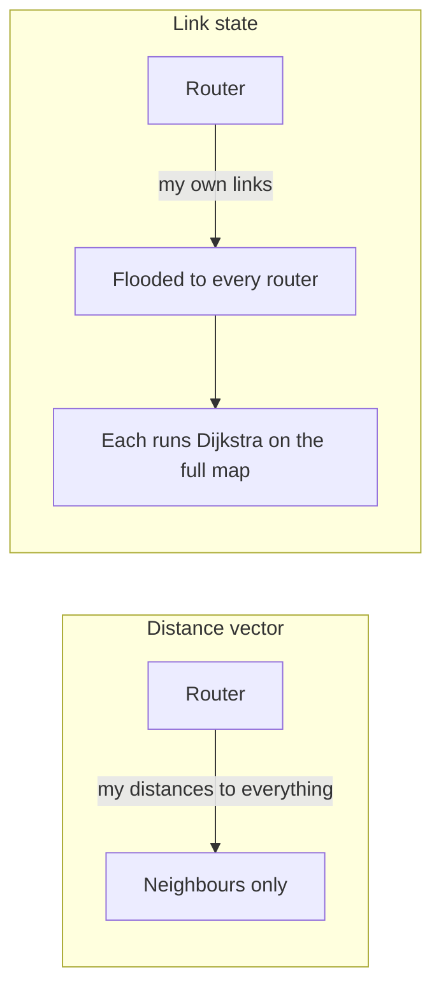

## The hook

A packet leaving your laptop for a server on another continent passes through a dozen or more routers. None of them knows the whole path. Each one looks at the destination address, picks a next hop from its table, and forgets the packet. Yet the hops add up to a sensible route, and when a cable is cut, traffic finds another way within seconds to minutes.

Someone has to fill those tables. There are two classic families of routing algorithms, and you already know their engines from graph algorithms: Bellman-Ford and Dijkstra. Predict the trade-off between them. (Sharing little information with neighbours is cheap but slow to notice disasters; sharing everything with everyone costs more but converges fast.)

## The intuition

:::analogy
Navigating a city, you can follow **road signs**: each junction tells you only "station, 3 km, this way", based on what the neighbouring junction told it. Or you can carry **a full city map** and plan the whole route yourself. Distance-vector routers follow road signs that neighbours keep updating; link-state routers each hold the full map.
:::

## How it works

A router forwards using its **[[routing table]]** with **[[longest prefix match]]**. Routing algorithms decide what goes in that table. Running example, four routers with link costs:

| Link | Cost |
|---|---|
| A–B | 1 |
| B–C | 2 |
| A–C | 5 |
| C–D | 1 |

### Distance vector (Bellman-Ford)

In **[[distance vector]]** routing, each router periodically sends its neighbours its current distance to every destination. On receiving a neighbour's vector, a router updates

distance(x, y) = min over neighbours n of [cost(x, n) + distance(n, y)]

Router A's table, with all routers updating in synchronous rounds (a small simulation):

| Round | to B | to C | to D |
|---|---|---|---|
| start (direct links only) | 1 | 5 | unknown |
| 1 | 1 | 3 (via B: 1 + 2) | 6 (via C: 5 + 1) |
| 2 | 1 | 3 | 4 (via B, whose distance to D is now 3) |
| 3 | 1 | 3 | 4 (no change: converged) |

Good news travels in rounds, one hop per round. RIP is the classic distance-vector protocol, using hop count with 16 meaning unreachable.

### Count to infinity

Bad news travels badly. Take a line A — B — C, cost 1 per link: B is 1 from A, C is 2 from A via B. Now the A–B link fails.

| Step | B's distance to A | C's distance to A | Why |
|---|---|---|---|
| before | 1 | 2 | normal |
| B updates | 3 | 2 | B hears C claim 2, believes it: 2 + 1 |
| C updates | 3 | 4 | C's route goes via B, which now says 3 |
| B updates | 5 | 4 | |
| C updates | 5 | 6 | |
| … | … | … | each pair of updates adds 2 |
| finally | 16 | 16 | RIP's "infinity": unreachable |

Wait, why would B believe C, when C's route to A runs through B itself? Because a distance vector carries only numbers, not paths; B cannot tell that C's 2 is its own old route reflected back. This is **[[count to infinity]]**. **Split horizon** (do not advertise a route back to the neighbour you learned it from) and **poisoned reverse** (advertise it back as infinity) fix two-router loops, but not every longer loop.

### Link state (Dijkstra)

In **[[link state]]** routing, each router floods a small advertisement of its own links (neighbours and costs) to every router. Every router then holds the same full map and runs Dijkstra from itself. From A on the example network:

| Step | Settled | Distance | Previous hop |
|---|---|---|---|
| 1 | A | 0 | |
| 2 | B | 1 | A |
| 3 | C | 3 | B |
| 4 | D | 4 | C |

So A's table sends traffic for C and D to next hop B. OSPF and IS-IS are link-state protocols used inside large networks. When a link fails, the routers at each end flood the change and everyone recomputes, with no counting.

### Between networks: BGP

The internet is made of tens of thousands of **[[autonomous system|autonomous systems]]**. Inside one, OSPF or IS-IS finds shortest paths. Between them, BGP is a **path-vector** protocol: routes carry the full list of autonomous systems they cross, which prevents loops, and each network chooses routes by business policy (customers, peers, providers), not just shortest distance.

:::insight
Distance-vector routers share their distance estimates with neighbours and update with Bellman-Ford: simple and cheap, but slow to react to failures and prone to counting to infinity. Link-state routers flood their own link facts to everyone and run Dijkstra on an identical map: more memory and messages, but fast, loop-free convergence. BGP adds paths and policy between networks.
:::

## Trade-offs

| | Distance vector (RIP) | Link state (OSPF) | Path vector (BGP) |
|---|---|---|---|
| Shares | distance vector with neighbours | own links with everyone | paths with neighbours |
| Computation | Bellman-Ford, distributed | Dijkstra at every router | policy-based selection |
| Convergence | slow; count to infinity | fast | can be slow, policy-driven |
| Scale | small networks | large networks, with areas | the whole internet |

:::warning
Common misconception: "routers compute the whole path for each packet." Routing protocols build tables in the background; forwarding a packet is just a longest-prefix-match lookup to choose the next hop. Each router decides only one hop.
:::

:::try-this
In the example network, the B–C link fails. Using link state, what is A's new distance to D, and its next hop? (Remaining links: A–B 1, A–C 5, C–D 1. The best path is A → C → D, distance 6, so the next hop becomes C.)
:::

## What can go wrong

- **Count to infinity** and temporary loops in distance-vector networks after failures.
- **Flapping links** causing constant recomputation; protocols dampen rapid changes.
- **BGP misconfiguration or hijacks**: a network announcing someone else's prefixes can pull their traffic away, which has caused large outages.
- **Mismatched costs** sending traffic over a slow link.

### Interview follow-ups

**"Which graph algorithms do routing protocols use?"** Bellman-Ford for distance vector, Dijkstra for link state, the same algorithms as in shortest-path problems.

**"Why does OSPF use areas?"** Flooding and Dijkstra over a huge map is expensive; areas keep detailed maps local and summarise between them.

**"What is a default route?"** 0.0.0.0/0, the prefix that matches everything and is used when nothing more specific does: "send it to the gateway".

## In the real world

`traceroute` reveals the hop-by-hop path, enterprise and ISP networks run OSPF or IS-IS internally, and BGP carries routes between all internet networks. Addressing, prefixes and the longest-match rule start in [Street Addresses With Postcodes](article:cs-core-ip-addressing).

## Further reading

- RFC 2328, "OSPF Version 2", and RFC 4271, "A Border Gateway Protocol 4 (BGP-4)".
- James Kurose and Keith Ross, *Computer Networking: A Top-Down Approach*, chapter on the network layer's control plane.

## Key takeaways

- Routers forward each packet with a longest-prefix-match lookup, and routing algorithms fill the tables used for that lookup.
- Distance-vector routing shares each router's distance estimates with its neighbours and updates them with Bellman-Ford, converging one hop per round.
- After a failure, distance-vector routers can count to infinity by trusting each other's stale routes, which split horizon and poisoned reverse only partly prevent.
- Link-state routing floods every router's link costs to all routers, each of which runs Dijkstra on the same full map and converges quickly.
- BGP connects autonomous systems with a path-vector protocol that carries full AS paths and chooses routes by policy.
