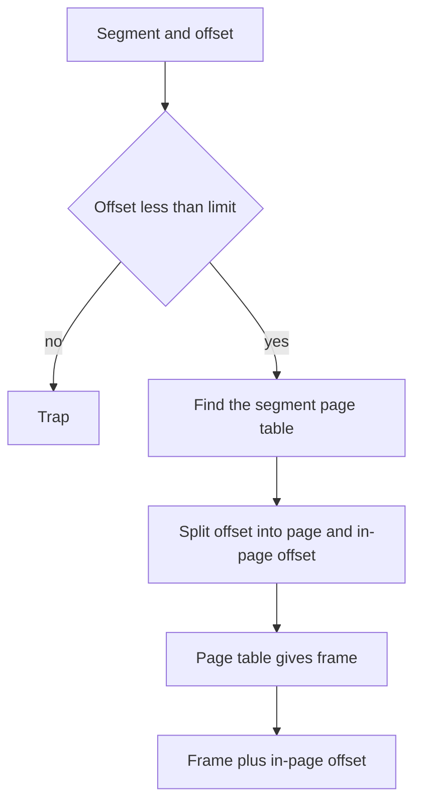

## The hook

Your C program dereferences a bad pointer, and the terminal prints `Segmentation fault`. You have seen it a hundred times. But on a modern 64-bit Linux machine, the memory system that caught you is built on pages, and segments barely exist. So why is the error named after segments?

Because there was a time, and on some machines there still is, when memory was carved up not into equal anonymous pages, but into meaningful pieces: this is the code, this is the stack, this is the heap. Touching outside your piece was a "segment violation", and the name stuck. We will come back to that name at the end, once you have seen what replaced segments on your own laptop.

That older idea is worth understanding, both because exams love its address translation, and because it shows exactly what paging gave up and why real systems tried to combine the two.

## The intuition

:::analogy
Think of a program as a **ring binder** of notes, divided by coloured tabs into **chapters of different lengths**: a long chapter of code, a short chapter of constants, a chapter of scratch notes that keeps growing, and a stack of sticky notes at the back. To find "chapter 2, page 47", you flip to the chapter 2 tab, check that chapter 2 actually has more than 47 pages, and count in. Each chapter can have its own rules: the code chapter is laminated so nobody writes on it, the scratch chapter is meant for writing.
:::

| In the binder | In segmentation |
|---|---|
| A chapter | A [[segment]]: code, data, heap or stack |
| The tab number | The segment number |
| Where the chapter starts on the shelf | The segment's base |
| How many pages the chapter has | The [[segment limit]] |
| "Chapter 2, page 47" | The logical address (segment, offset) |
| The list of tabs with start and length | The [[segment table]] |
| Laminated or writable | Protection bits per segment |

Paging, in [The Index That Tells You Which Shelf](article:cs-core-paging-tlb), cut every book into chapters of exactly the same length, chosen by the machine. Segmentation lets the chapters be as long as the content, chosen by the program's structure.

## How it works

### Two-part addresses

Under segmentation, every address your program uses is a pair: **(segment number, offset)**. The offset is a position inside that segment, counted from its start.

The process's segment table holds, for each segment, a base (where it starts in physical memory), a limit (its length) and protection bits. Translation is the base-and-limit check from [Parking Odd-Sized Cars Along One Kerb](article:cs-core-memory-basics), done once per segment instead of once per process:

```pseudo
translate(s, offset):
    if s >= number_of_segments: trap        # no such tab
    entry = segment_table[s]
    if offset >= entry.limit: trap          # past the end of the chapter
    if the access breaks entry.protection: trap
    return entry.base + offset
```

### Translating by hand

A process has four segments:

| Segment | Holds | Base | Limit | Protection |
|---|---|---|---|---|
| 0 | Code | 2000 | 1200 | Read, execute |
| 1 | Global data | 5200 | 800 | Read, write |
| 2 | Heap | 8000 | 1500 | Read, write |
| 3 | Stack | 3500 | 600 | Read, write |

Predict which of these traps before you check: (1, 800) or (3, 599)?

| Logical address | Check offset less than limit | Physical address |
|---|---|---|
| (0, 450) | 450 is less than 1200 | 2000 + 450 = 2450 |
| (2, 1499) | 1499 is less than 1500 | 8000 + 1499 = 9499 |
| (3, 599) | 599 is less than 600 | 3500 + 599 = 4099 |
| (1, 0) | 0 is less than 800 | 5200 |
| (1, 800) | 800 is not less than 800 | **Trap** |
| (2, 1500) | 1500 is not less than 1500 | **Trap** |

The two traps are the classic off-by-one: a segment of length 800 has offsets 0 to 799. In binder terms, chapter 1 has 800 pages, numbered from 0, so there is no page 800.

Now suppose you write to (0, 100). The offset is fine, but segment 0 is code and marked read and execute only, so the write traps. That is protection that matches meaning: the program's own instructions cannot be overwritten by a stray pointer.

### What segmentation does well

- **It matches how programs are structured.** The compiler and linker already think in code, data, heap and stack. Each gets its own segment and its own rules.
- **Protection per meaning.** Code is read and execute only, data is not executable, and every segment has an exact length, so overruns past the end are caught.
- **Sharing is natural.** Two processes running the same program can both point their code segment entry at the same physical block. One entry each, one copy in memory.
- **Growth per region.** A stack or heap segment can be extended by raising its limit, if there is free space after it.

### And what it brings back

Look at where the four segments sit in physical memory. Assume addresses below 2000 belong to the kernel and that memory for user processes ends at 9499:

| Physical range | Contents |
|---|---|
| 2000 to 3199 | Segment 0, code |
| 3200 to 3499 | Hole, 300 |
| 3500 to 4099 | Segment 3, stack |
| 4100 to 5199 | Hole, 1100 |
| 5200 to 5999 | Segment 1, data |
| 6000 to 7999 | Hole, 2000 |
| 8000 to 9499 | Segment 2, heap |

Variable-sized blocks, holes between them. This is the kerb from the memory basics article all over again. Segments come and go, holes form, and a 2500-byte segment may not fit even though 3400 bytes are free. Pure segmentation has **external fragmentation**, and needs first fit or best fit, and maybe compaction, to manage it.

Wait, why not just make your segments small to avoid that? Because the moment you make every segment the same small size, you have reinvented paging and lost the meaning that made segments useful.

:::warning
Common misconception: "segmentation has internal fragmentation because segments are big." Each segment gets exactly its own length, so nothing is wasted inside it. Its waste is external: holes between segments. Paging is the opposite, with a little internal waste in each last page and no external fragmentation.
:::

### Segmented paging: chapters made of equal pages

Here is the catch: you want the meaningful chapters, but you also want any piece to fit any gap. The natural fix keeps the chapters and stores each chapter's pages in any free frames. That is [[segmented paging]]. The segment table entry no longer points at a block of physical memory; it points at **that segment's own page table**.



Worked example, with 512-byte pages. Segment 2, the heap, is 1500 bytes long, so it needs ⌈1500 / 512⌉ = 3 pages. Its page table is **[11, 4, 17]**: page 0 in frame 11, page 1 in frame 4, page 2 in frame 17.

| Logical address | Limit check | Page = offset div 512 | In-page offset | Frame | Physical = frame × 512 + in-page offset |
|---|---|---|---|---|---|
| (2, 1300) | 1300 is less than 1500 | 2 | 276 | 17 | 8704 + 276 = 8980 |
| (2, 600) | OK | 1 | 88 | 4 | 2048 + 88 = 2136 |
| (2, 0) | OK | 0 | 0 | 11 | 5632 |
| (2, 1499) | OK | 2 | 475 | 17 | 8704 + 475 = 9179 |
| (2, 1500) | Not less than 1500 | | | | **Trap** |

You should notice two things. The limit check still happens first, so the segment's exact length is still enforced, even though page 2 has room up to offset 1535. And the last page wastes 3 × 512 − 1500 = 36 bytes: segmented paging trades external fragmentation for a little internal fragmentation, just as paging did.

:::try-this
Same segment 2, page size 512, page table [11, 4, 17]. Translate (2, 1023) and (2, 1024). (1023 is page 1, offset 511, in frame 4: 4 × 512 + 511 = 2559. 1024 is page 2, offset 0, in frame 17: 17 × 512 = 8704. One byte apart logically, thousands apart physically.)
:::

:::insight
Segmentation divides memory by meaning and paging divides it by size. Segmented paging uses segments for structure and protection, and pages inside each segment for placement, so it gets exact per-region protection without external fragmentation.
:::

### The x86 story: two stages, then one

32-bit x86 processors apply both stages in hardware. A logical address is a segment selector plus an offset. Segmentation turns it into a [[linear address]] using a segment descriptor from a descriptor table, and paging then turns the linear address into a physical address.

In practice, mainstream operating systems on 32-bit x86 set most segments to start at 0 and span the whole 4 GB, a "flat" model, so the linear address equals the offset and all real work is done by paging. In 64-bit mode, x86-64 made that official: the bases of the code, data and stack segments are treated as 0 and their limits are not checked. Two segment registers, FS and GS, keep a usable base address, and operating systems use them to point at per-thread or per-CPU data, such as thread-local storage.

So on your laptop, segments survive as a few special registers and a famous error message, while the protection that `Segmentation fault` reports is enforced by page table entries.

## Trade-offs

| | Paging | Pure segmentation | Segmented paging |
|---|---|---|---|
| Unit | Fixed-size page | Variable-size segment | Segment made of pages |
| Address seen by the program | One number | (segment, offset) | (segment, offset) |
| External fragmentation | None | Yes | None |
| Internal fragmentation | Last page of each region | None | Last page of each segment |
| Protection and sharing | Per page | Per meaningful region, naturally | Per segment, enforced through pages |
| Translation cost | Page table walk, TLB | One table lookup and a compare | Segment lookup plus page table walk |
| Used today | Everywhere | Rare | Historically on systems such as Multics and 32-bit x86; mostly flat today |

The honest summary is that paging won. Protection by meaning turned out to be achievable with page-level bits set according to region, which kept the hardware simple while operating systems tracked regions in software.

## What can go wrong

- **Off-by-one on the limit.** Legal offsets are 0 to limit − 1. Offset equal to the limit traps.
- **Edge case: what the limit field stores.** In the textbook model used here, the limit is the segment's length. Real x86 segment descriptors store the last valid offset instead, so the same segment's "limit" differs by one between the two conventions. Check which one a question uses.
- **Edge case: a segment that cannot grow.** If a heap segment needs to grow and the next physical block is taken, the growth fails unless the kernel moves the whole segment to a bigger hole, which is compaction again.
- **Adding the segment number instead of looking it up.** The segment number indexes the table; it is never part of the arithmetic.
- **Forgetting the limit check in segmented paging.** The segment length is checked before splitting into pages, so an offset inside the last page but past the segment's end still traps.
- **Expecting segmentation to cure fragmentation.** Pure segmentation has external fragmentation, like any variable-size scheme.
- **Reading "Segmentation fault" literally on modern systems.** It reports an invalid memory access, usually caught by a page table entry that is not present or does not allow the access.

### Interview follow-ups

**"What is the difference between paging and segmentation?"** Paging splits memory into fixed-size pages chosen by the hardware, with no external fragmentation and an address that is one number. Segmentation splits memory into variable-size logical units such as code and stack, with per-unit protection and an address that is a (segment, offset) pair, and it suffers external fragmentation.

**"Translate (segment 3, offset 250) given base 3500 and limit 600."** 250 is less than 600, so the address is legal, and the physical address is 3500 + 250 = 3750.

**"Why combine segmentation with paging?"** To keep segments' logical structure and protection while removing external fragmentation. Each segment gets its own page table, so its pages can go in any frames.

**"Does x86-64 use segmentation?"** Barely. In 64-bit mode, the code, data and stack segment bases are treated as 0 and limits are not checked, so translation is effectively paging only. FS and GS keep base addresses, which operating systems use for thread-local and per-CPU data.

**"Why is it called a segmentation fault on a paging system?"** The name comes from segment violations on older segmented systems. On modern Unix-like systems, the same signal reports any invalid memory access, including touching an unmapped page or writing to a read-only one.

## In the real world

- **Every process still has segments in spirit.** Linux tracks a process's address space as a set of regions, code, data, heap, stack and memory-mapped files, each with its own permissions, and implements them with pages.
- **Thread-local storage** on x86-64 uses the FS or GS base register to find each thread's private block of variables.
- **Multics**, the influential time-sharing system from the 1960s, combined segmentation with paging and was a major inspiration for Unix.
- **Embedded processors** without full paging hardware often have a memory protection unit that defines a handful of regions with base, size and permissions, which is segmentation-style protection without the translation.

Both paging and segmentation have so far assumed the whole program is in memory. But a program that is 4 GB on paper rarely touches more than a fraction of it at once. What if pages could stay on disk until the moment they are needed? That is [A Desk That Holds Only Today's Books](article:cs-core-virtual-memory).

## Further reading

- *Operating Systems: Three Easy Pieces*, the chapter on segmentation.
- *Operating System Concepts* by Silberschatz, Galvin and Gagne, the main memory chapter, including the Intel 32-bit and 64-bit architectures.
- The Intel 64 and IA-32 Architectures Software Developer's Manual, Volume 3, the chapters on protected-mode memory management and segmentation in 64-bit mode.

## Key takeaways

- Segmentation divides a program's address space into variable-length logical units such as code, data, heap and stack, and addresses memory as a (segment, offset) pair.
- The segment table gives each segment a base, a limit and protection bits, and translation traps if the offset is not less than the limit, otherwise it adds the base.
- Pure segmentation has no internal fragmentation but suffers external fragmentation, because variable-sized segments leave variable-sized holes.
- Segmented paging gives each segment its own page table, keeping per-segment structure and protection while letting pages go into any free frames.
- Modern x86-64 systems effectively use paging alone, keeping only FS and GS segment bases for per-thread and per-CPU data, though the name segmentation fault survives.
