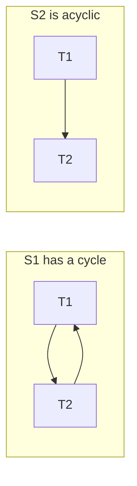

## The hook

In the last article, two transactions each read a balance of 100, added 10 and 20, and the result was 120 instead of 130. Running them one after the other would have been correct. Running them interleaved was fast, and wrong.

But not every interleaving is wrong. Most of the time, a database interleaves thousands of transactions and the results are perfect. So which interleavings are safe? There is a precise test, and it takes a minute on paper: draw a graph, look for a cycle. Predict what a cycle would mean. (That T1 must come before T2 and T2 must also come before T1: no one-at-a-time order explains the result.)

## The intuition

:::analogy
Two cooks share a kitchen, each following their own recipe, interleaving steps to save time. **Did the interleaved cooks still make the right dish?** The dish is right if it equals what some single cook, doing one recipe fully and then the other, would have produced. Steps on different pans can be shuffled freely; steps on the same pan, where at least one changes it, cannot.
:::

A schedule is **serializable** if its result equals some serial schedule's result. Serial schedules are correct by definition, so serializable ones are too.

## How it works

Notation: R1(A) means T1 reads A, W2(A) means T2 writes A.

### Conflicts: the steps you cannot swap

Two operations are **[[conflicting operations]]** if they come from different transactions, touch the same item, and at least one is a write:

| Pair | Conflict? | Why |
|---|---|---|
| R1(A), R2(A) | no | Reads change nothing |
| R1(A), W2(A) | yes | The read sees a different value depending on order |
| W1(A), R2(A) | yes | Same reason |
| W1(A), W2(A) | yes | The final value depends on who writes last |
| W1(A), W2(B) | no | Different items |

Non-conflicting neighbours can be swapped without changing anything. If swapping can turn a schedule into a serial one, the schedule is **[[conflict serializable]]**.

### The precedence graph test

Swapping by hand is slow. Instead, draw a **[[precedence graph]]**: a node per transaction and an edge Ti → Tj whenever an operation of Ti conflicts with a later operation of Tj. The schedule is conflict serializable if and only if the graph has **no cycle**, and any topological order of the graph is an equivalent serial order.

A program listed the edges for two schedules:

| Schedule | Edges | Verdict |
|---|---|---|
| S1: R1(A) R2(A) W1(A) W2(A) | T1 → T2 (R1(A) before W2(A)), T2 → T1 (R2(A) before W1(A)) | cycle: not serializable |
| S2: R1(A) W1(A) R2(A) R1(B) W2(A) W1(B) R2(B) W2(B) | T1 → T2 only | serializable, equivalent to T1 then T2 |

S1 is the lost update from the hook, now caught by a graph.

Wait, why does S2 interleave T1's work on B with T2's work on A and still count as serial? Because those steps touch different items; they could be slid past each other until all of T1 comes first.

### View serializability

**[[View serializable]]** is a weaker condition: each read sees the value from the same writer as in some serial schedule, and the final value of each item is written by the same transaction. Every conflict-serializable schedule is view serializable, but not the other way round.

The classic example: R1(A) W2(A) W1(A) W3(A). Its graph has the cycle T1 → T2 → T1, so it is not conflict serializable. Yet it is view equivalent to T1, T2, T3: T1 reads the initial A in both, and T3 writes the final A in both. The writes of T2 and T1 are **blind writes** (writes without a read), whose values nobody reads. Testing view serializability is NP-complete, which is why real systems aim for conflict serializability.

### Surviving aborts: recoverable, cascadeless, strict

Serializability assumes everyone commits. Aborts add another requirement.

| Property | Rule | Prevents |
|---|---|---|
| **[[Recoverable schedule|Recoverable]]** | If T2 reads from T1, T2 commits after T1 commits | Committing a result built on data that is later rolled back |
| **[[Cascadeless schedule|Cascadeless]]** | Read only committed data | One abort forcing a chain of aborts |
| Strict | Neither read nor overwrite an item until its last writer commits or aborts | Makes undo a simple restore of the old value |

Each row implies the one above it: strict implies cascadeless, which implies recoverable.

:::insight
Correctness of concurrent transactions has two parts. Serializability (no cycle in the precedence graph) makes the interleaving equivalent to some one-at-a-time order. Recoverability (and preferably strictness) makes aborts safe. Strict two-phase locking, coming next, delivers both.
:::

## Trade-offs

| Criterion | Allows | Practical? |
|---|---|---|
| Serial only | Nothing concurrent | Correct but slow |
| Conflict serializable | Interleavings with an acyclic graph | Yes; enforced by locking or validation |
| View serializable | Slightly more, using blind writes | Too expensive to test in general |
| Weaker isolation levels | Some non-serializable schedules | Common for speed; anomalies possible |

:::warning
Common misconception: "a serializable schedule must produce the same result as T1 then T2, in the order the transactions started." It must match *some* serial order, which may be T2 then T1. The topological order of the precedence graph tells you which.
:::

:::try-this
Schedule R1(A) W2(A) W3(A). Draw the graph and find the equivalent serial order. (Edges: T1 → T2 from R1(A) before W2(A), T1 → T3 from R1(A) before W3(A), and T2 → T3 from W2(A) before W3(A). No cycle, so the order is T1, T2, T3.)
:::

## What can go wrong

- **Counting read–read pairs as conflicts**, adding false edges and false cycles.
- **Drawing edges backwards**: the edge goes from the earlier operation's transaction to the later one's.
- **Forgetting recoverability**: a conflict-serializable schedule can still be unrecoverable.
- **Assuming the database is serializable** when it runs at read committed by default.

### Interview follow-ups

**"How does a database guarantee conflict serializability without drawing graphs at run time?"** With protocols such as two-phase locking or timestamp ordering, which only allow schedules whose graphs are acyclic.

**"What does PostgreSQL's SERIALIZABLE level do?"** It runs snapshot isolation and detects dangerous dependency patterns between transactions, aborting one with a serialization failure that the application retries. Isolation levels are compared in [Several Cashiers, One Ledger](article:system-design-isolation-levels).

**"Is every recoverable schedule cascadeless?"** No. T2 can read T1's uncommitted write and commit after T1 (recoverable), but if T1 aborts, T2 must abort too (a cascade).

## In the real world

Precedence graphs are a reasoning tool for exams and design reviews; engines enforce serializability with locking, timestamps or validation instead. The anomalies these rules prevent are traced in [A Bank Transfer That Happens Completely or Not at All](article:cs-core-transactions-acid).

## Further reading

- Bernstein, Hadzilacos and Goodman, *Concurrency Control and Recovery in Database Systems* (freely available from Microsoft Research).
- Silberschatz, Korth and Sudarshan, *Database System Concepts*, chapter on transactions.

## Key takeaways

- A schedule is serializable when its result equals that of some serial order, which may differ from the order the transactions started.
- Operations conflict when they are from different transactions, touch the same item and at least one writes; only conflicting pairs constrain the order.
- A schedule is conflict serializable exactly when its precedence graph has no cycle, and a topological order gives the equivalent serial schedule.
- View serializability allows a few more schedules through blind writes but is too expensive to test, so systems target conflict serializability.
- Recoverable schedules commit readers after writers, cascadeless ones read only committed data, and strict ones also delay overwrites, making aborts safe and simple.
