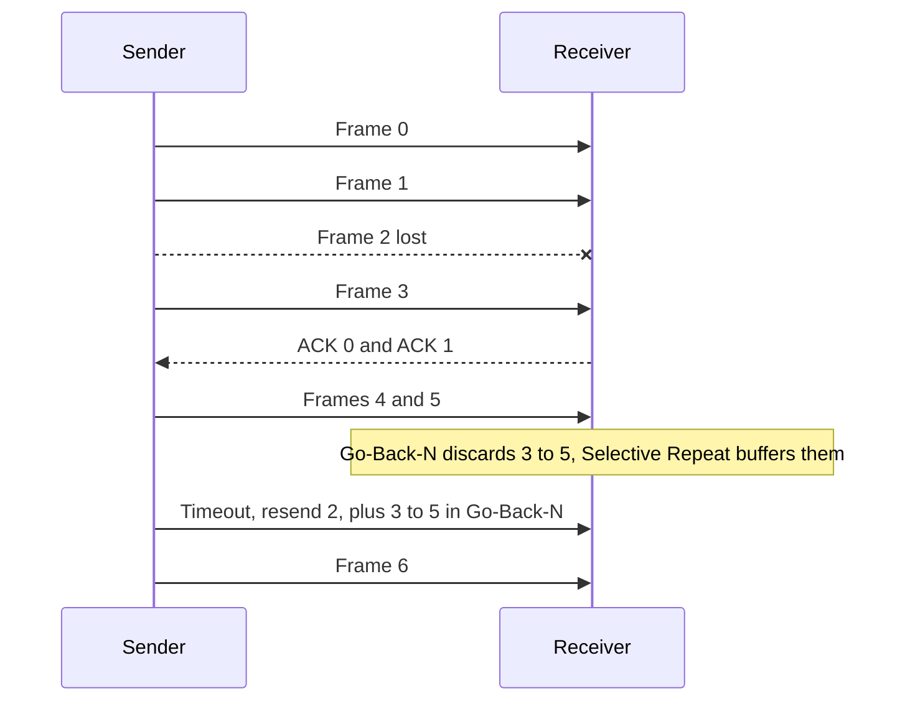

## The hook

A satellite link can carry data very fast, but a signal takes a long time to reach the satellite and come back. Send one frame, then wait for its acknowledgement before sending the next, and the link sits idle almost all the time: the frame is out in a few milliseconds, and then everyone waits for the round trip.

The cure is to keep sending while earlier frames are still on their way: a sliding window. How big a window, and what to do when one frame in the middle goes missing, are exactly what online assessments ask, always with numbers. Predict the utilisation of stop-and-wait when the propagation delay is 2.5 times the time to send one frame. (One sixth, about 17%.)

## The intuition

:::analogy
You are **sending numbered parcels and getting receipts back**. Sending one parcel and waiting for its receipt before posting the next wastes days. Instead, you keep up to W parcels in transit, posting a new one each time a receipt comes back, so the window of "posted but not yet confirmed" parcels slides forward. If parcel 2 goes missing, you either resend 2 and everything after it, or just 2.
:::

## How it works

### Why stop-and-wait wastes the link

Two times matter:

- **[[Transmission time]]** Tt = frame size / bandwidth: putting the bits on the wire.
- **[[Propagation delay]]** Tp = distance / signal speed: the bits travelling.

Stop-and-wait sends one frame (Tt), then waits for it to arrive (Tp) and the ACK to return (Tp, treating the ACK's own transmission time as negligible). With a = Tp / Tt, the useful fraction of each cycle is

**[[Utilisation]]** (stop-and-wait) = Tt / (Tt + 2Tp) = 1 / (1 + 2a)

**Worked number**: 1 Mbps link, 1000-byte frames, Tp = 20 ms.

| Quantity | Value |
|---|---|
| Tt = 8000 bits / 1,000,000 bps | 8 ms |
| a = Tp / Tt = 20 / 8 | 2.5 |
| Stop-and-wait utilisation = 1 / (1 + 5) | 16.7% |
| Effective throughput | about 167 kbps of a 1 Mbps link |

### Sliding windows

With a **[[window size]]** W, the sender can have W frames outstanding, and utilisation becomes min(1, W / (1 + 2a)):

| W | Utilisation |
|---|---|
| 1 | 16.7% |
| 3 | 50% |
| 6 | 100% |
| 8 | 100% |

To keep the link full you need W ≥ 1 + 2a = 6 frames: enough to cover one frame plus a full round trip. In bytes, that is roughly the **bandwidth-delay product**, 1 Mbps × 40 ms = 5000 bytes in flight.

Wait, so what happens when a frame in the middle of the window is lost? There are two schools.

### Go-Back-N versus Selective Repeat, one lost frame

Setup: window 4, frames 0 to 6, frame 2 lost on its first attempt, and frames 3, 4 and 5 are sent before frame 2's timer expires.

| | **[[Go-Back-N]]** | **[[Selective Repeat]]** |
|---|---|---|
| Receiver gets 3, 4, 5 after the gap | discards them, keeps acknowledging 1 | buffers them, acknowledges each |
| On timeout for 2 | resends 2, 3, 4, 5 | resends only 2 |
| Delivery to the upper layer | in order as they arrive again | 2 fills the gap, then 2 to 5 are delivered together |
| Total transmissions for 7 frames | 7 + 4 = **11** | 7 + 1 = **8** |
| ACKs | cumulative | individual |
| Receiver buffer | 1 frame | up to the window size |

Go-Back-N keeps the receiver trivial at the cost of resending good frames; Selective Repeat saves bandwidth at the cost of buffers and per-frame timers. On a lossy, long link, that difference is large.

### The sequence number trap

Sequence numbers wrap around: with k bits, they run 0 to 2^k − 1. The window must be small enough that the receiver can never mistake a retransmitted old frame for a new one.

| Protocol | Maximum window with k-bit sequence numbers | k = 3 |
|---|---|---|
| Stop-and-wait | 1 (k = 1 suffices) | 1 |
| Go-Back-N | 2^k − 1 | 7 |
| Selective Repeat | 2^(k−1) | 4 |

Why the limit, with k = 2 (numbers 0 to 3)? In Go-Back-N with W = 4, the sender sends 0, 1, 2, 3; all arrive, but all ACKs are lost. The receiver now expects frame 0 of the *next* round. The sender times out and resends the *old* 0, which the receiver accepts as new: duplicate data, silently. With W = 3, the receiver would be expecting 3, so the old 0 is recognised as a duplicate. Selective Repeat needs half the space because the receiver's window of acceptable numbers and the sender's possible retransmissions must not overlap.

:::insight
Utilisation is about keeping the pipe full: with a = Tp / Tt, stop-and-wait achieves 1 / (1 + 2a) and a window of 1 + 2a frames fills the link. After a loss, Go-Back-N resends everything from the lost frame on with a simple receiver, Selective Repeat resends only the lost frame with a buffering receiver, and both must keep the window small enough that wrapped sequence numbers stay unambiguous.
:::

## Trade-offs

| Protocol | Bandwidth on loss | Receiver complexity | Window limit |
|---|---|---|---|
| Stop-and-wait | resends one frame | minimal | 1 |
| Go-Back-N | resends from the loss onward | minimal, cumulative ACKs | 2^k − 1 |
| Selective Repeat | resends only lost frames | buffers and per-frame ACKs | 2^(k−1) |

:::warning
Common misconception: "a bigger window is always better." Beyond 1 + 2a frames the link is already full, so a bigger window adds nothing on a clean link, and on a lossy link Go-Back-N then resends even more frames per loss. The window must also respect the sequence-number limit.
:::

:::try-this
A 10 Mbps link, 1250-byte frames, propagation delay 5 ms. What is a, the stop-and-wait utilisation, and the smallest window for full utilisation? (Tt = 10,000 bits / 10 Mbps = 1 ms, so a = 5. Utilisation is 1 / 11 ≈ 9.1%. Full use needs W ≥ 1 + 2 × 5 = 11 frames, so 4-bit sequence numbers suffice for Go-Back-N, since 2⁴ − 1 = 15, while Selective Repeat needs 5 bits, since 2⁴ = 16 ≥ 11 but 2³ = 8 is too small.)
:::

## What can go wrong

- **Using the round trip as Tp** in formulas that already include 2Tp, doubling the delay.
- **Mixing bits and bytes** in Tt.
- **A window larger than the sequence space allows**, creating silent duplicates.
- **Ignoring ACK transmission time** when a question says to include it.
- **Go-Back-N on high-loss links**, wasting most of the capacity on resends.

### Interview follow-ups

**"Which does TCP use?"** A hybrid: cumulative ACKs like Go-Back-N, but receivers buffer out-of-order data and SACK lets the sender resend only missing ranges, like Selective Repeat; its window is in bytes, as in [A Phone Call Where Both Sides Confirm They Can Hear](article:cs-core-tcp-deep-dive).

**"What is piggybacking?"** Sending an ACK inside a data frame going the other way, saving separate ACK frames.

**"What is the bandwidth-delay product?"** Bandwidth × round-trip time: how much data must be in flight to keep a path full.

## In the real world

Link-layer protocols such as HDLC, transport protocols such as TCP and QUIC, and many file-transfer tools all use sliding windows. On long, fast paths, window scaling lets TCP keep megabytes in flight.

## Further reading

- Andrew Tanenbaum and David Wetherall, *Computer Networks*, chapter on the data link layer.
- James Kurose and Keith Ross, *Computer Networking: A Top-Down Approach*, section on reliable data transfer.

## Key takeaways

- Stop-and-wait utilisation is 1 / (1 + 2a), where a is propagation delay divided by transmission time, so long links waste most of their capacity.
- A sliding window of W frames gives utilisation min(1, W / (1 + 2a)), and 1 + 2a frames keep the link full.
- After a loss, Go-Back-N resends the lost frame and everything after it, while Selective Repeat resends only the lost frame and buffers out-of-order arrivals.
- With k-bit sequence numbers, Go-Back-N's window can be at most 2^k − 1 and Selective Repeat's at most 2^(k−1), so old and new frames are never confused.
- In the worked example, one loss cost Go-Back-N four extra transmissions and Selective Repeat one.
