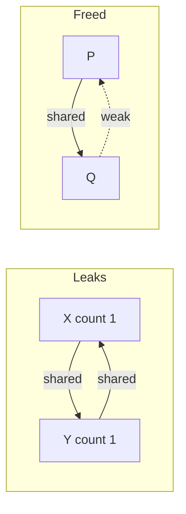

## The hook

In raw C++, every `new` must be matched by exactly one `delete`, on every path, by whoever "owns" the object, and nothing in the code says who that is. Forget the delete and memory leaks; do it twice and the program corrupts memory; do it too early and another part of the program reads freed memory. These three bugs have caused a large share of crashes and security holes in C and C++ software.

Smart pointers write the ownership rule into the type, and the compiler and destructors enforce it. Interviewers ask which one to use and why shared_ptr can still leak. Predict how two objects that each "share" the other can leak even though neither is ever deleted by hand. (Each keeps the other's reference count above zero forever.)

## The intuition

:::analogy
**A library book with one borrower**: exactly one person has it, they can hand it to someone else (and then no longer have it), and when the last holder is done it goes back. **A shared document** in an office has a sign-out sheet; it is archived only when the last person signs it back. A **visitor's note** saying "the document is in room 4" does not stop it being archived; you check it is still there before reading.
:::

## How it works

### unique_ptr: one owner

A **[[unique_ptr]]** is the sole owner. It cannot be copied (that would create two owners), only moved. When it is destroyed, it deletes the object. It costs nothing over a raw pointer in size or speed. Use `make_unique<T>(args)` to create one.

### shared_ptr: counted owners

A **[[shared_ptr]]** allows several owners. Each copy increments a **[[reference count]]** in a separate control block; each destruction decrements it; at zero, the object is deleted. The count is updated atomically, so copies are thread-safe (the pointed-to object is not automatically thread-safe). `make_shared` allocates the object and control block together.

### The demo

```cpp
#include <iostream>
#include <memory>
#include <string>
#include <utility>
using namespace std;

struct Book {
    string title;
    explicit Book(string t) : title(move(t)) { cout << "open " << title << "\n"; }
    ~Book() { cout << "free " << title << "\n"; }
};

struct Person {
    string name;
    shared_ptr<Person> friendStrong;   // strong link: keeps the other alive
    weak_ptr<Person> friendWeak;       // weak link: observes without owning
    explicit Person(string n) : name(move(n)) {}
    ~Person() { cout << "free " << name << "\n"; }
};

int main() {
    {
        unique_ptr<Book> mine = make_unique<Book>("DBMS");     // sole owner
        // unique_ptr<Book> copy = mine;                       // error: copy is deleted
        unique_ptr<Book> yours = move(mine);                   // ownership transferred
        cout << (mine == nullptr) << "\n";                     // 1
    }                                                          // free DBMS here
    {
        shared_ptr<Book> a = make_shared<Book>("OS");
        cout << a.use_count() << "\n";                         // 1
        {
            shared_ptr<Book> b = a;                            // shared ownership
            cout << a.use_count() << "\n";                     // 2
        }
        cout << a.use_count() << "\n";                         // 1
    }                                                          // free OS when count hits 0
    {
        auto x = make_shared<Person>("X"), y = make_shared<Person>("Y");
        x->friendStrong = y; y->friendStrong = x;              // cycle: never freed
    }
    cout << "after strong cycle\n";                            // no "free X", no "free Y"
    {
        auto p = make_shared<Person>("P"), q = make_shared<Person>("Q");
        p->friendStrong = q; q->friendWeak = p;                // one direction weak
        if (auto f = q->friendWeak.lock()) cout << "Q sees " << f->name << "\n";
    }                                                          // free P, free Q
    cout << "after weak link\n";
}
```

The output showed "free DBMS" at the end of the first block and "free OS" when the count reached zero, then **nothing** for X and Y, then "Q sees P", "free P", "free Q".

### Cycles, and weak_ptr



Wait, why were X and Y never freed? When the local variables x and y went away, each object's count fell from 2 to 1, but never to 0, because each object's own member still owned the other. No code can reach them any more, yet neither destructor will ever run.

A **[[weak_ptr]]** observes without owning: it does not increase the count. To use it, call `lock()`, which returns a shared_ptr if the object still exists, or an empty one if it has been freed. With Q's link to P weak, P's count dropped to 0 when p went out of scope, P was freed (releasing its strong link to Q), and then Q was freed. Typical uses: child-to-parent links in trees, observers, and caches.

:::insight
Smart pointers make **[[ownership]]** part of the type: unique_ptr for a single owner at zero cost, shared_ptr when ownership is truly shared, with a reference count that frees the object when the last owner goes, and weak_ptr for links that must not keep an object alive. Reference counting cannot free cycles on its own, so one direction of every cycle must be weak.
:::

## Trade-offs

| Pointer | Owns | Copyable | Cost | Use for |
|---|---|---|---|---|
| unique_ptr | yes, alone | no (move only) | same as a raw pointer | the default for heap objects |
| shared_ptr | yes, shared | yes | control block, atomic count updates | genuinely shared lifetimes |
| weak_ptr | no | yes | needs lock() to use | back-links, caches, observers |
| raw pointer or reference | no | yes | none | non-owning access to an object someone else owns |

:::warning
Common misconception: "use shared_ptr everywhere and memory management is solved." shared_ptr adds atomic count updates and a control block, hides who really owns what, and still leaks cycles. Prefer unique_ptr by default, pass plain references or raw pointers for non-owning access, and reach for shared_ptr only when several parts of the program must keep an object alive.
:::

:::try-this
A tree where each Node has `vector<shared_ptr<Node>> children` and `shared_ptr<Node> parent`. Is the tree ever freed, and how do you fix it? (No: every parent and child own each other, a cycle. Make parent a weak_ptr, or a raw pointer if children never outlive their parent, so destroying the root frees the whole tree.)
:::

## What can go wrong

- **Creating two shared_ptrs from the same raw pointer**, giving two control blocks and a double delete; use make_shared or enable_shared_from_this.
- **Cycles of shared_ptr**, silently leaking.
- **Using a weak_ptr without lock()** or ignoring an empty result.
- **Passing shared_ptr by value everywhere**, paying for atomic updates where a reference would do.
- **Mixing new with smart pointers** in ways that leak if an exception occurs between allocation and wrapping; prefer make_unique and make_shared.

### Interview follow-ups

**"How is shared_ptr implemented?"** A pointer to the object plus a pointer to a control block holding the strong count, the weak count and the deleter. The object is destroyed when the strong count hits zero; the control block, when both counts do.

**"Is shared_ptr thread-safe?"** Updating the count is; reading and writing the same shared_ptr variable from several threads, or the pointed-to object, needs synchronisation.

**"Why prefer make_unique and make_shared?"** They avoid naked new, are exception-safe, and make_shared does one allocation instead of two.

## In the real world

Modern C++ guidelines recommend never writing naked new and delete in application code: containers and unique_ptr cover most ownership, and shared_ptr covers the rest. The move operations unique_ptr depends on are explained in [Photocopying a File Versus Handing Over the Original](article:cs-core-copy-move-semantics).

## Further reading

- Scott Meyers, *Effective Modern C++*, chapter 4, "Smart Pointers".
- The C++ Core Guidelines, section R.20 onwards on smart pointers.

## Key takeaways

- A unique_ptr is the single owner of an object, cannot be copied but can be moved, and costs the same as a raw pointer.
- A shared_ptr allows several owners and deletes the object when its reference count, kept in a control block, drops to zero.
- Two objects holding shared_ptrs to each other keep both counts above zero forever, so they leak even though nothing references them.
- A weak_ptr observes a shared object without owning it, and lock() returns a usable shared_ptr only if the object still exists.
- Prefer unique_ptr by default, plain references for non-owning access, and shared_ptr only for genuinely shared lifetimes.
