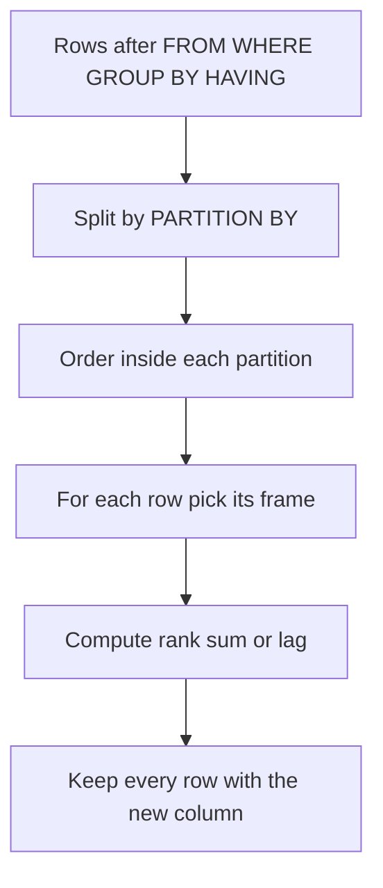

## The hook

"Show each employee with their rank inside their department." With only GROUP BY, you are stuck: grouping collapses employees into one row per department, and you lose the individuals. People write self joins that count "how many earn more than me", and the query becomes unreadable.

One feature turns this into two lines: window functions. They are behind most "top N per group", "running total" and "compared with yesterday" questions in SQL interviews. Predict how a database can rank rows without collapsing them. (It computes the answer over a window of related rows and writes it next to each row.)

## The intuition

:::analogy
A sports website shows **a leaderboard computed on the fly**: every player stays on the page, and next to each name appears their rank, their team's position and their score change since yesterday. Nobody merges players into one line per team; the extra columns are computed by looking at other rows.
:::

Results below come from running these queries on:

| id | name | dept | salary |
|---|---|---|---|
| 1 | Asha | Eng | 120 |
| 2 | Ravi | Eng | 90 |
| 3 | Meera | Sales | 70 |
| 4 | Kabir | Sales | 85 |
| 5 | Zoya | Eng | 150 |
| 6 | Neel | Eng | 120 |

## How it works

### Correlated subqueries

"Employees earning above their department's average":

```sql
SELECT name, salary, dept FROM emp e
WHERE salary > (SELECT AVG(salary) FROM emp WHERE dept = e.dept);
-- Kabir 85 Sales, Zoya 150 Eng   (averages: Eng 120, Sales 77.5)
```

The inner query refers to `e.dept`, so it is a **[[correlated subquery]]**, conceptually run once per outer row. Asha and Neel earn exactly 120, the Eng average, so they are not "above".

### CTEs: name your steps

A **[[CTE]]** (`WITH name AS (…)`) turns a nested query into readable steps:

```sql
WITH ranked AS (
  SELECT dept, name, salary,
         DENSE_RANK() OVER (PARTITION BY dept ORDER BY salary DESC) AS dr
  FROM emp
)
SELECT dept, name, salary FROM ranked WHERE dr = 1;
-- Eng Zoya 150 | Sales Kabir 85
```

Wait, why not filter `WHERE DENSE_RANK() … = 1` directly? Because window functions are computed in the SELECT step, after WHERE. Compute them in a CTE or subquery, then filter outside.

### Window functions

A **[[window function]]** has the form `function() OVER (PARTITION BY … ORDER BY … frame)`.

**Three ranking functions**, the most asked comparison:

| name | salary | ROW_NUMBER | RANK | DENSE_RANK |
|---|---|---|---|---|
| Zoya | 150 | 1 | 1 | 1 |
| Asha | 120 | 2 | 2 | 2 |
| Neel | 120 | 3 | 2 | 2 |
| Ravi | 90 | 4 | 4 | 3 |
| Kabir | 85 | 5 | 5 | 4 |
| Meera | 70 | 6 | 6 | 5 |

- ROW_NUMBER: always unique; ties broken arbitrarily (or by extra ORDER BY columns).
- RANK: ties share a rank, then a gap (2, 2, then 4).
- DENSE_RANK: ties share a rank, no gap (2, 2, then 3).

**[[PARTITION BY]]** restarts the window per group: `RANK() OVER (PARTITION BY dept ORDER BY salary DESC)` ranks Eng as Zoya 1, Asha 2, Neel 2, Ravi 4, and Sales as Kabir 1, Meera 2.

### Running totals and changes

| day | amount | SUM OVER (ORDER BY day) | amount − LAG(amount) |
|---|---|---|---|
| 1 | 100 | 100 | NULL |
| 2 | 150 | 250 | 50 |
| 3 | 80 | 330 | −70 |
| 4 | 200 | 530 | 120 |

With ORDER BY, the default **[[frame]]** runs from the first row of the partition to the current row, giving running totals. LAG and LEAD read the previous or next row.



:::insight
Window functions compute ranks, running totals and comparisons across related rows while keeping every row, which GROUP BY cannot do. Partition to restart per group, order to define ranking and running sums, and filter on the result in an outer query or CTE.
:::

## Trade-offs

| Technique | Best for | Watch out |
|---|---|---|
| Correlated subquery | Simple per-row comparisons | Can be slow on large tables without indexes |
| CTE | Readability, step-by-step logic | Some databases materialise CTEs, affecting performance |
| ROW_NUMBER | Picking exactly one row per group | Ties broken arbitrarily unless ordered fully |
| RANK / DENSE_RANK | "Top N per group" including ties | Know whether gaps are wanted |
| Running SUM with ORDER BY | Cumulative totals | Default frame semantics with duplicate order values differ by mode (ROWS vs RANGE) |

:::warning
Common misconception: "RANK and DENSE_RANK are the same." They differ right after ties: 1, 2, 2, 4 versus 1, 2, 2, 3. For "find the 2nd highest distinct salary", DENSE_RANK = 2 is correct; RANK = 2 may return nothing after a tie at the top, and ROW_NUMBER = 2 may return a duplicate of the highest.
:::

:::try-this
Using DENSE_RANK over the whole table, which salary is ranked 3rd, and who has it? (DENSE_RANK order is 150 (1), 120 (2), 90 (3). Ravi has the 3rd highest distinct salary, 90.)
:::

## What can go wrong

- **Filtering on a window function in WHERE**, an error; use an outer query or CTE.
- **ROW_NUMBER for ties**, silently dropping people with equal salaries in "top N".
- **Forgetting PARTITION BY**, ranking across all rows instead of per group.
- **Slow correlated subqueries** on large tables; rewrite as joins or window functions.
- **Unclear frames** in running totals with duplicate ORDER BY values.

### Interview follow-ups

**"Top 3 earners per department?"** CTE with DENSE_RANK() OVER (PARTITION BY dept ORDER BY salary DESC), then WHERE rank ≤ 3.

**"Day-over-day change?"** amount − LAG(amount) OVER (ORDER BY day).

**"Recursive CTEs?"** WITH RECURSIVE walks hierarchies, such as an employee's full management chain, by repeatedly joining the CTE to the table.

## In the real world

Window functions are supported by PostgreSQL, MySQL 8+, SQL Server, Oracle and SQLite (3.25+), and power analytics queries and reports everywhere. Joins, which these queries often build on, are in [Matching Guest Lists From Two Parties](article:cs-core-sql-joins).

## Further reading

- The PostgreSQL documentation, "Window Functions" tutorial.
- Markus Winand's site modern-sql.com on window functions and CTEs.

## Key takeaways

- Correlated subqueries compare each row with an aggregate computed for its own group, such as salary above the department average.
- CTEs name intermediate results, making multi-step queries readable, and let you filter on window function results.
- Window functions add computed columns over related rows without collapsing them, unlike GROUP BY.
- ROW_NUMBER is always unique, RANK leaves gaps after ties and DENSE_RANK does not; choose based on how ties should count.
- PARTITION BY restarts the window per group, and ORDER BY with the default frame gives running totals; LAG and LEAD compare neighbouring rows.
