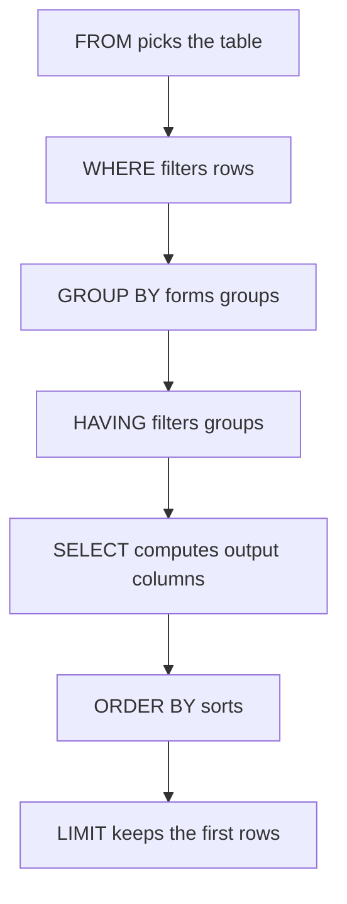

## The hook

An interviewer slides over a table of employees and asks three quick questions: who in engineering earns more than 100? What is the average salary per department? Which departments average more than 80?

The first two are easy. On the third, about half of candidates write `WHERE AVG(salary) > 80` and get an error, or quietly move the condition and get a different, wrong answer. The difference between WHERE and HAVING is the most common SQL interview trap, and it is all about the order in which a query runs. Predict that order before reading on. (It is not the order you type it in.)

## The intuition

:::analogy
SQL is **asking a well-organised spreadsheet questions**. You say which sheet (FROM), which rows to keep (WHERE), how to pile the rows into groups (GROUP BY), which piles to keep (HAVING), what to write on the summary card (SELECT), and how to sort the cards (ORDER BY). You describe the answer; the database decides how to compute it.
:::

All examples below run on this table, and every result was produced by actually executing the query.

| id | name | dept | salary | bonus |
|---|---|---|---|---|
| 1 | Asha | Eng | 120 | 10 |
| 2 | Ravi | Eng | 90 | NULL |
| 3 | Meera | Sales | 70 | 5 |
| 4 | Kabir | Sales | 85 | NULL |
| 5 | Zoya | Eng | 150 | 20 |
| 6 | Dev | HR | 60 | NULL |

## How it works

### Filtering and sorting

```sql
SELECT name, salary FROM emp
WHERE dept = 'Eng' AND salary > 100
ORDER BY salary DESC;
-- Zoya 150, Asha 120
```

`ORDER BY salary DESC LIMIT 2` gives the top two earners: Zoya 150, Asha 120.

### Aggregates and groups

**[[Aggregate function]]s** collapse rows; **[[GROUP BY]]** makes them per group:

```sql
SELECT dept, COUNT(*), AVG(salary), MAX(salary)
FROM emp GROUP BY dept ORDER BY dept;
-- Eng 3 120.0 150 | HR 1 60.0 60 | Sales 2 77.5 85
```

Rule: every column in SELECT must either be in GROUP BY or inside an aggregate. Otherwise "which name?" has no single answer per group.

### The logical order



That **[[logical query order]]** is the answer to the hook. It explains the trap: WHERE runs before groups exist, so it cannot refer to AVG(salary). **[[HAVING]]** runs after.

### WHERE versus HAVING, side by side

| Query | Result | Why |
|---|---|---|
| `GROUP BY dept HAVING AVG(salary) > 80` | Eng 120.0 | Groups formed from all rows; only Eng averages above 80 (Sales is 77.5) |
| `WHERE salary > 80 GROUP BY dept` | Eng 120.0, Sales 85.0 | Rows filtered first: Meera (70) and Dev (60) removed, so Sales now averages only Kabir's 85 |

Same-looking conditions, different questions: "departments whose average exceeds 80" versus "average of salaries above 80, per department".

### NULL

**[[NULL]]** means unknown, and comparisons with it are unknown, not true:

| Query | Result |
|---|---|
| `SELECT COUNT(*), COUNT(bonus), SUM(bonus), AVG(bonus) FROM emp` | 6, 3, 35, 11.67 |
| `WHERE bonus = NULL` | no rows |
| `WHERE bonus IS NULL` | Dev, Kabir, Ravi |

Wait, why is AVG(bonus) 11.67 and not 35 ÷ 6? Aggregates skip NULLs: the average is over the 3 known bonuses, 35 ÷ 3. If missing bonuses should count as zero, write `AVG(COALESCE(bonus, 0))`, which gives 35 ÷ 6 ≈ 5.83.

:::insight
SQL is evaluated FROM, WHERE, GROUP BY, HAVING, SELECT, ORDER BY, LIMIT. Filter rows with WHERE before grouping, filter groups with HAVING after, and remember that NULL is unknown: test it with IS NULL, and know that aggregates ignore it.
:::

## Trade-offs

| Habit | Why it helps |
|---|---|
| Filter in WHERE when possible | Fewer rows to group; indexes can help |
| Use HAVING only for aggregate conditions | Clearer and often faster |
| Select only needed columns | Less data read and sent |
| Be explicit about NULL with COALESCE or IS NULL | Avoids silent wrong results |
| Always ORDER BY when order matters | Without it, row order is not guaranteed |

:::warning
Common misconception: "rows come back in insertion order unless I sort them." Without ORDER BY, the database may return rows in any order, and it can change between runs as plans and storage change. LIMIT without ORDER BY returns arbitrary rows.
:::

:::try-this
Write a query for "departments with at least 2 employees, showing the number of employees with a bonus". Predict the result. (SELECT dept, COUNT(*) AS n, COUNT(bonus) AS with_bonus FROM emp GROUP BY dept HAVING COUNT(*) >= 2. Result: Eng 3 employees, 2 with bonus; Sales 2 employees, 1 with bonus. HR has only 1 employee and is filtered out by HAVING.)
:::

## What can go wrong

- **Aggregates in WHERE**, an error, or moving the condition and changing the meaning.
- **Non-grouped columns in SELECT**, which some databases reject and others silently fill with an arbitrary value.
- **= NULL instead of IS NULL**, returning nothing.
- **AVG over NULLs** when missing should mean zero.
- **Relying on default ordering** or using LIMIT without ORDER BY.

### Interview follow-ups

**"What is the difference between COUNT(*), COUNT(1) and COUNT(col)?"** COUNT(*) and COUNT(1) count rows; COUNT(col) counts non-NULL values of col. COUNT(DISTINCT col) counts distinct non-NULL values.

**"Can you use a column alias in WHERE?"** Generally no, because SELECT is evaluated after WHERE; repeat the expression or use a subquery or CTE. ORDER BY can use aliases because it runs after SELECT.

**"DELETE, TRUNCATE or DROP?"** DELETE removes chosen rows (logged, can use WHERE); TRUNCATE removes all rows quickly; DROP removes the table itself.

## In the real world

These clauses behave the same across relational databases, with small dialect differences (LIMIT versus TOP or FETCH FIRST). Joining tables is the next step; keys that make joins meaningful are in [ID Cards That Uniquely Identify People](article:cs-core-relational-keys).

## Further reading

- The SELECT documentation of PostgreSQL or SQLite.
- *SQL Antipatterns* by Bill Karwin, for common mistakes.

## Key takeaways

- A SELECT is evaluated as FROM, WHERE, GROUP BY, HAVING, SELECT, ORDER BY, LIMIT, which explains most SQL surprises.
- WHERE filters individual rows before grouping; HAVING filters groups using aggregates after grouping, and the two can give different answers.
- Every selected column must be grouped or aggregated when GROUP BY is used.
- NULL means unknown: compare with IS NULL, and remember COUNT(column), SUM and AVG skip NULLs.
- Row order is only guaranteed with ORDER BY, including when using LIMIT.
