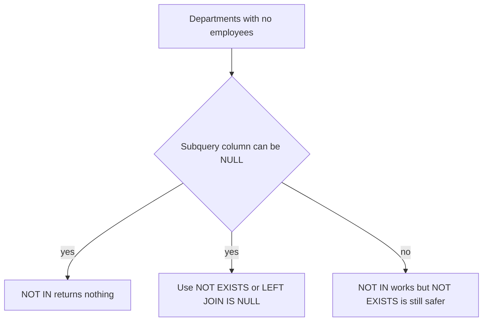

## The hook

"List every department and how many employees it has, including empty departments." You write an inner join with GROUP BY. HR, which has nobody yet, simply vanishes from the result. The interviewer waits.

"Now list departments with no employees." You write `WHERE id NOT IN (SELECT dept_id FROM emp)`. It returns nothing at all, even though HR is clearly empty. Predict why before reading on. (One NULL in a subquery is enough.)

Joins are where most real SQL lives, and where most interview SQL goes wrong.

## The intuition

:::analogy
Two families each wrote a guest list for a joint party. **Matching the guest lists** can mean different things: people on both lists (inner), everyone from our list with their match if any (left), everyone from both lists (full), or "who on our list is missing from theirs?" (anti). Same two lists, different questions.
:::

Every result below was produced by running the query on these tables:

| emp.id | name | dept_id | manager_id |
|---|---|---|---|
| 1 | Asha | 10 | NULL |
| 2 | Ravi | 10 | 1 |
| 3 | Meera | 20 | 1 |
| 4 | Kabir | NULL | 3 |

| dept.id | name |
|---|---|
| 10 | Eng |
| 20 | Sales |
| 30 | HR |

## How it works

### The join family

| Join | Query core | Result |
|---|---|---|
| [[Inner join]] | `emp e JOIN dept d ON e.dept_id = d.id` | Asha–Eng, Ravi–Eng, Meera–Sales |
| Left [[outer join]] | `emp e LEFT JOIN dept d ON …` | the three above, plus Kabir–NULL |
| Right outer join | `emp e RIGHT JOIN dept d ON …` | the three above, plus NULL–HR |
| Full outer join | `emp e FULL OUTER JOIN dept d ON …` | the three above, plus Kabir–NULL and NULL–HR |
| Cross join | `emp CROSS JOIN dept` | 4 × 3 = 12 rows |

Think of a join as: build all pairs, keep the pairs satisfying the ON condition, then (for outer joins) add back unmatched rows from the preserved side with NULLs.

### Self join

Employees and their managers live in the same table:

```sql
SELECT e.name, m.name AS manager
FROM emp e LEFT JOIN emp m ON e.manager_id = m.id;
-- Asha NULL | Ravi Asha | Meera Asha | Kabir Meera
```

A **[[self join]]** uses two aliases for one table. LEFT keeps Asha, who has no manager.

### Semi and anti joins

"Departments that have employees" is a **[[semi join]]**: keep each department once if any match exists.

```sql
SELECT d.name FROM dept d
WHERE EXISTS (SELECT 1 FROM emp e WHERE e.dept_id = d.id);   -- Eng, Sales
```

"Departments with no employees" is an **[[anti join]]**:

```sql
SELECT d.name FROM dept d
WHERE NOT EXISTS (SELECT 1 FROM emp e WHERE e.dept_id = d.id);  -- HR

SELECT d.name FROM dept d LEFT JOIN emp e ON e.dept_id = d.id
WHERE e.id IS NULL;                                              -- HR
```

### The NOT IN trap

`WHERE d.id NOT IN (SELECT dept_id FROM emp)` returned **no rows** on this data. Kabir's dept_id is NULL, so for HR the check is "30 ≠ 10 AND 30 ≠ 20 AND 30 ≠ NULL". The last part is unknown, so the whole condition is unknown, never true. That is the answer to the hook.



Wait, then why does a plain join ever drop rows silently too? Because an inner join only keeps pairs that match, so HR (no employees) disappears from "employees per department". Use `dept LEFT JOIN emp` with `COUNT(e.id)`, which counts 0 for HR.

:::insight
A join builds pairs of rows that satisfy a condition; outer joins add back unmatched rows with NULLs, self joins compare a table with itself, and semi and anti joins ask "is there a match?". For "no match" questions, prefer NOT EXISTS, because NOT IN breaks as soon as the subquery contains a NULL.
:::

## Trade-offs

| Need | Best tool | Watch out for |
|---|---|---|
| Matching rows only | INNER JOIN | Silently drops unmatched rows |
| Keep all of one side | LEFT JOIN | Filtering the right table in WHERE turns it back into an inner join; put such conditions in ON |
| Existence check | EXISTS | Joins can duplicate rows when there are many matches |
| Absence check | NOT EXISTS or LEFT JOIN … IS NULL | NOT IN with NULLs |
| Every combination | CROSS JOIN | Row counts multiply quickly |

:::warning
Common misconception: "joins are about Venn diagrams of overlapping rows." Venn diagrams mislead because joins produce pairs, not set overlaps: a department with 50 employees appears 50 times after an inner join. That is why counts after joins can be inflated, and why existence checks should use EXISTS.
:::

:::try-this
Write "every department with its employee count, including zero". Predict the output. (SELECT d.name, COUNT(e.id) FROM dept d LEFT JOIN emp e ON e.dept_id = d.id GROUP BY d.name. Result: Eng 2, HR 0, Sales 1. COUNT(e.id) counts only matched employees, so HR shows 0; COUNT(*) would wrongly show 1.)
:::

## What can go wrong

- **Losing rows** with an inner join where a left join was needed.
- **Turning a left join into an inner join** with a WHERE condition on the right table.
- **NOT IN with NULLs** returning nothing.
- **Duplicate rows** after joining to a "many" table, inflating sums and counts.
- **Accidental cross joins** from a missing join condition.

### Interview follow-ups

**"Find employees who earn more than their manager."** Self join: FROM emp e JOIN emp m ON e.manager_id = m.id WHERE e.salary > m.salary.

**"What is the difference between a condition in ON and in WHERE for a left join?"** ON decides which right-side rows match (unmatched left rows survive with NULLs); WHERE filters the final rows (and can remove the NULL-extended ones).

**"How does the database actually execute a join?"** With nested loops, hash joins or merge joins, chosen by the optimiser from table sizes and indexes, as covered in the query optimisation article.

## In the real world

Inner and left joins are by far the most common in application queries; anti joins power "find missing records" checks in data pipelines. The basics of filtering and grouping are in [Asking a Well-Organised Spreadsheet Questions](article:cs-core-sql-basics).

## Further reading

- The PostgreSQL or SQLite documentation on joined tables.
- Markus Winand, *SQL Performance Explained*, for how joins are executed.

## Key takeaways

- A join pairs rows that satisfy a condition; inner joins keep matches only, outer joins add unmatched rows from the preserved side with NULLs, and cross joins pair everything.
- Self joins compare rows of the same table using two aliases, such as employees and their managers.
- Semi joins (EXISTS) and anti joins (NOT EXISTS or LEFT JOIN … IS NULL) answer "has a match" and "has no match" without duplicating rows.
- NOT IN returns nothing if the subquery contains a NULL, so prefer NOT EXISTS for absence checks.
- To count including zeros, LEFT JOIN from the side you want to keep and count a column of the other side.
