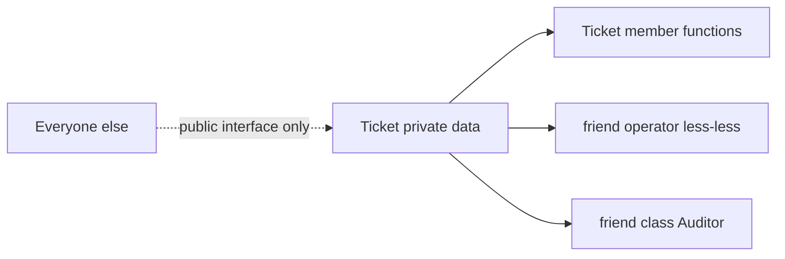

## The hook

A ticketing class needs every new ticket to get the next number: 1, 2, 3, and so on. Where does the counter live? Not in each ticket: each would start at zero. A global variable works, but then any code anywhere can reset it. And you want `cout << ticket` to print private details without making them public.

C++ has three small tools for exactly these situations: static members (one copy for the whole class), friends (a named exception to privacy), and const member functions (a promise not to modify). Predict what `Ticket::totalIssued()` returns before any ticket exists. (0, and you can call it without any object at all.)

## The intuition

:::analogy
An office has **a shared noticeboard**: one board on the wall, not one per desk. Everyone reads the same "next ticket number" from it, and the office manager can read it even when nobody is at their desk (static). A trusted auditor from outside is given a key to the filing cabinet (friend). And a visitor may look at your desk but promises not to move anything, though they can still sign the visitors' book (const, with a mutable log).
:::

## How it works

```cpp
#include <iostream>
#include <string>
using namespace std;

class Ticket {
    static int issued;                 // one counter shared by every Ticket
    int number;
    string holder;
    mutable int timesViewed = 0;       // may change even in const functions
public:
    explicit Ticket(string h) : number(++issued), holder(move(h)) {}
    static int totalIssued() { return issued; }       // no this: callable without an object
    int getNumber() const { ++timesViewed; return number; }   // const: promises not to change visible state
    int views() const { return timesViewed; }
    friend ostream& operator<<(ostream& os, const Ticket& t);  // a friend may read private members
    friend class Auditor;
};
int Ticket::issued = 0;                // the single definition of the static member

ostream& operator<<(ostream& os, const Ticket& t) {
    return os << "#" << t.number << " " << t.holder;
}

class Auditor {
public:
    static bool valid(const Ticket& t) { return t.number >= 1 && t.number <= Ticket::issued; }
};

int main() {
    cout << Ticket::totalIssued() << "\n";                   // 0
    Ticket a("Asha"), b("Ravi");
    const Ticket c("Meera");
    cout << a << " | " << b << " | " << c << "\n";           // #1 Asha | #2 Ravi | #3 Meera
    cout << Ticket::totalIssued() << " " << c.getNumber() << " " << c.getNumber() << " " << c.views() << "\n";  // 3 3 3 2
    cout << Auditor::valid(b) << "\n";                       // 1
}
```

### Static members

A **[[static data member]]** has exactly one copy, owned by the class. `issued` started at 0 and every constructor incremented the same variable, so the tickets got 1, 2 and 3. It must be defined once outside the class (`int Ticket::issued = 0;`), or declared `inline static` since C++17.

A **[[static member function]]** has no this pointer. You call it through the class (`Ticket::totalIssued()`), even before any object exists, and it can use only static members directly. Wait, then how does `Auditor::valid` read a ticket's private number? It receives the ticket as a parameter and is a friend, which brings us to the next tool.

### Friends

A **[[friend]]** is a function or class that the class names as trusted. `operator<<` cannot be a member of Ticket, because its left operand is the stream (`cout << t`), yet it needs private data; declaring it a friend solves both. `friend class Auditor;` lets every member of Auditor read Ticket's internals.

Friendship is granted, never taken: the class itself must declare it. It is not inherited, not transitive (a friend of a friend is not a friend) and not mutual.



### const member functions and mutable

A **[[const member function]]** promises not to change the object, and it is the only kind you can call on a const object such as `c`. Inside it, this points to const, so assigning to number would not compile. A **[[mutable]]** member is the deliberate exception for bookkeeping that does not change the object's meaningful value: `timesViewed` rose to 2 after two calls to `c.getNumber()`, even though c is const.

:::insight
Static members belong to the class, so there is one shared copy and static functions have no this. Friends are explicit, one-way grants of access for functions or classes that need private data but cannot be members, such as stream operators. const member functions promise not to modify the object, and mutable carves out invisible bookkeeping from that promise.
:::

## Trade-offs

| Tool | Gain | Cost |
|---|---|---|
| Static data | Shared state without a global | Hidden shared state; needs synchronisation across threads |
| Static functions | Utilities and factories tied to the class | Cannot be virtual; no access to instance data without an object |
| Friend | Lets closely related code see internals | Couples the friend to the class's representation |
| const correctness | Documents and enforces read-only use | Must be applied consistently, or const objects become unusable |
| mutable | Caching inside const functions | Abuse hides real state changes |

:::warning
Common misconception: "friend breaks encapsulation, so never use it." A friend is declared by the class itself, so the set of code that can touch the internals is still listed in one place. A friend operator<< is better encapsulation than adding public getters for every field just so printing can work.
:::

:::try-this
Two threads each create 1,000 Tickets at the same time. Can totalIssued() end up below 2,000, and how would you fix it? (Yes: ++issued is a read-modify-write race on shared static data, so increments can be lost. Make issued a std::atomic<int>, or protect it with a mutex.)
:::

## What can go wrong

- **Forgetting the out-of-class definition** of a static member, causing an "undefined reference" link error.
- **Data races on static members** shared across threads.
- **Static initialisation order** problems when one static depends on another in a different file.
- **Missing const on getters**, so they cannot be called on const objects or through const references.
- **Overusing friend**, spreading knowledge of the representation across many classes.

### Interview follow-ups

**"What is the difference between a static local variable and a static member?"** A static local belongs to one function and is initialised the first time control passes through it; a static member belongs to a class.

**"Can a static member function be virtual or const?"** Neither: both depend on having an object (this), which static functions lack.

**"What is the singleton pattern, and how does static help?"** A class with one instance, typically returned by a static function holding a function-local static object, which C++11 initialises thread-safely.

## In the real world

Static members implement counters, caches and factory functions; friend operator<< and operator== are standard idioms; const correctness is enforced throughout the standard library. Access control basics are in [A Capsule That Protects the Medicine Inside](article:cs-core-encapsulation-access).

## Further reading

- Bjarne Stroustrup, *The C++ Programming Language*, chapter on classes (static members, friends, const member functions).
- Scott Meyers, *Effective C++*, item 3, "Use const whenever possible".

## Key takeaways

- A static data member has one copy shared by all objects of the class and must be defined once outside the class or declared inline.
- A static member function has no this pointer, is called through the class name, and can use only static members directly.
- A friend function or class is explicitly granted access to private members, which suits stream operators that cannot be members.
- A const member function promises not to modify the object and is the only kind callable on const objects.
- mutable members may change inside const functions, which suits caches and counters that do not affect the object's meaningful value.
