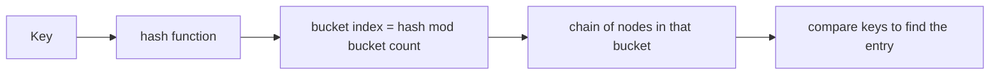

## The hook

A loop stores pointers to elements of a vector while adding more elements. It works in testing with ten items and crashes in production with a thousand. A program that counts words with `map` takes twice as long as a friend's with `unordered_map`. Another passes every test except one, where an `unordered_map` mysteriously slows to a crawl.

All three are explained by what is inside the containers. You do not need to implement them, but knowing roughly how they work tells you their costs and their traps, which is exactly what interviewers probe. Predict how many times a vector reallocates during 100 push_backs. (8, not 100.)

## The intuition

:::analogy
You can drive without knowing how an engine works, but **knowing how the engine works before a long trip** tells you how far a tank goes, which noises matter and what never to do. The STL containers are the engines of your C++ programs; a little knowledge of their insides predicts their speed and their failure modes.
:::

## How it works

Every number below was printed by a test program compiled with g++ and libstdc++:

```cpp
#include <iostream>
#include <map>
#include <unordered_map>
#include <vector>
using namespace std;

int main() {
    vector<int> v;
    size_t lastCap = 0;
    int reallocations = 0;
    for (int i = 0; i < 100; i++) {
        v.push_back(i);
        if (v.capacity() != lastCap) { cout << v.capacity() << " "; lastCap = v.capacity(); ++reallocations; }
    }
    cout << "| " << reallocations << " reallocations for 100 push_backs\n";  // 1 2 4 8 16 32 64 128 | 8

    vector<int> w = {1, 2, 3};
    const int* before = w.data();
    w.push_back(4);                       // capacity was 3: must reallocate
    cout << (before == w.data() ? "same buffer" : "moved buffer: old pointers and iterators are invalid") << "\n";

    map<int, char> m = {{30, 'c'}, {10, 'a'}, {20, 'b'}};
    for (auto& [k, val] : m) cout << k << val << " ";   // 10a 20b 30c: always sorted by key
    cout << "\n";

    unordered_map<int, int> h;
    cout << h.bucket_count() << " ";
    for (int i = 0; i < 100; i++) h[i] = i;
    cout << h.bucket_count() << " " << h.load_factor() << " " << h.max_load_factor() << "\n";  // 1 127 0.787402 1
}
```

### vector: a growing array

A vector holds a pointer to a contiguous buffer, a size and a **[[capacity]]**. When size reaches capacity, push_back allocates a bigger buffer (libstdc++ doubles it; other libraries use other factors such as 1.5), moves the elements over, and frees the old one. Capacities went 1, 2, 4, …, 128: only 8 reallocations for 100 insertions.

Wait, if each reallocation copies everything, how is push_back O(1)? Over n insertions, the copies total 1 + 2 + 4 + … + n/2 < n, so on average each push_back does a constant amount of copying: **[[amortised O(1)]]**. Call `reserve(n)` when you know the size, and there are no reallocations at all.

### Iterator invalidation

Reallocation moves elements to a new address. The test vector `w` had capacity 3, and pushing a fourth element changed `data()`: every old pointer, reference and iterator into it now dangles. That is the crash in the hook.

| Container | Invalidated by insertion | Invalidated by erase |
|---|---|---|
| vector | all, if it reallocates; otherwise those at or after the insertion point | those at or after the erased element |
| deque | all iterators (references stay valid when inserting at the ends) | depends on position |
| list, map, set | none | only the erased element |
| unordered_map | all iterators if it rehashes (references to elements stay valid) | only the erased element |

### map: a balanced search tree

`std::map` keeps keys sorted, and libstdc++ implements it as a **[[red-black tree]]**: each node holds one key-value pair plus parent and child pointers and a colour bit, and rebalancing keeps the height O(log n). So find, insert and erase cost O(log n), iteration visits keys in order (10, 20, 30 above, whatever the insertion order), and `lower_bound` answers range queries.

### unordered_map: buckets

`std::unordered_map` is a hash table: a key's hash picks a bucket, and each bucket holds a chain of nodes. Lookups are O(1) on average. When the **[[load factor]]** (elements per bucket) would exceed max_load_factor (1.0 by default), the table **rehashes** into more buckets: the empty map had 1 bucket, and after 100 insertions it had 127, a load factor of about 0.79.



The slow test case from the hook: if many keys land in the same bucket (a weak hash, or adversarial inputs designed against the standard hash), chains grow long and operations degrade towards O(n). Competitive programmers sometimes use a randomised custom hash for this reason.

:::insight
vector is a contiguous array that grows by reallocating, which makes push_back amortised O(1) but invalidates old pointers when it moves. map is a balanced tree: O(log n) and always sorted. unordered_map is a hash table: O(1) on average but unordered, with rehashing as it grows and slowdowns when many keys collide.
:::

## Trade-offs

| Container | Lookup | Insert | Ordered | Memory and cache behaviour |
|---|---|---|---|---|
| vector | O(n) unsorted, O(log n) if sorted with binary search | amortised O(1) at the end | by position | contiguous: excellent cache use |
| deque | O(1) by index | O(1) at both ends | by position | chunks of contiguous blocks |
| list | O(n) | O(1) anywhere with an iterator | by position | a node per element: poor locality |
| map / set | O(log n) | O(log n) | yes, by key | a node per element |
| unordered_map / set | O(1) average, O(n) worst | O(1) average | no | buckets plus nodes |

:::warning
Common misconception: "list is better than vector for frequent insertions." For most sizes, vector wins even with insertions in the middle, because shifting contiguous memory is fast and cache-friendly, while a list pays for a separate allocation and a cache miss per node. Reach for list only when you truly need stable iterators or splicing.
:::

:::try-this
You call `v.reserve(1000)` on an empty vector, then push_back 1,000 elements while keeping a pointer to v[0]. Is the pointer valid at the end? (Yes: reserve allocated room for 1,000 up front, so no push_back reallocated and the elements never moved. One more push_back, the 1,001st, would reallocate and invalidate it.)
:::

## What can go wrong

- **Holding pointers or iterators across push_back** without reserve.
- **Erasing inside a loop** without using the iterator erase returns.
- **operator[] on a map inserting** a default value when you only meant to check (use find or count).
- **Hash collisions** degrading unordered_map, sometimes deliberately triggered.
- **Using map where order is not needed**, paying O(log n) and pointer chasing for nothing.

### Interview follow-ups

**"Why does vector double rather than grow by a fixed amount?"** Growing by a constant k makes total copying O(n²/k); a constant factor keeps it O(n), so push_back stays amortised O(1).

**"What does std::sort use?"** Introsort in common implementations: quicksort that switches to heapsort if recursion gets too deep, and insertion sort for small ranges, guaranteeing O(n log n).

**"What is the difference between size and capacity, and what does shrink_to_fit do?"** Size is the number of elements; capacity is allocated room. shrink_to_fit is a non-binding request to reduce capacity to size.

## In the real world

Choosing the right container is one of the cheapest performance wins in C++; profiling often shows vector plus sorting beating node-based containers. The templates these containers are built from are in [A Recipe That Works for Any Fruit](article:cs-core-templates-basics), and hashing from the DSA side is in [The Notebook That Turns O(n²) Into O(n)](article:dsa-hashing-patterns).

## Further reading

- cppreference.com, container pages, including the iterator invalidation summary.
- Nicolai Josuttis, *The C++ Standard Library*, second edition.

## Key takeaways

- A vector stores elements contiguously and grows by reallocating to a larger buffer, which makes push_back amortised O(1); libstdc++ doubled capacity, needing 8 reallocations for 100 elements.
- Reallocation moves elements, so pointers, references and iterators into a vector are invalidated, unless reserve made enough room in advance.
- std::map is a balanced binary search tree, typically red-black, giving O(log n) operations and keys always in sorted order.
- std::unordered_map is a hash table of buckets with O(1) average operations, rehashing into more buckets when the load factor exceeds its maximum.
- Choose by access pattern: vector by default, map when order or range queries matter, and unordered_map for fast unordered lookups with a good hash.
