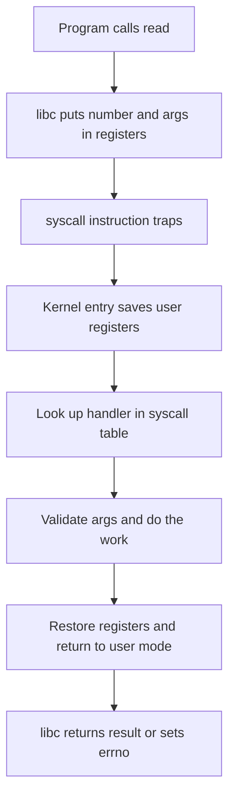
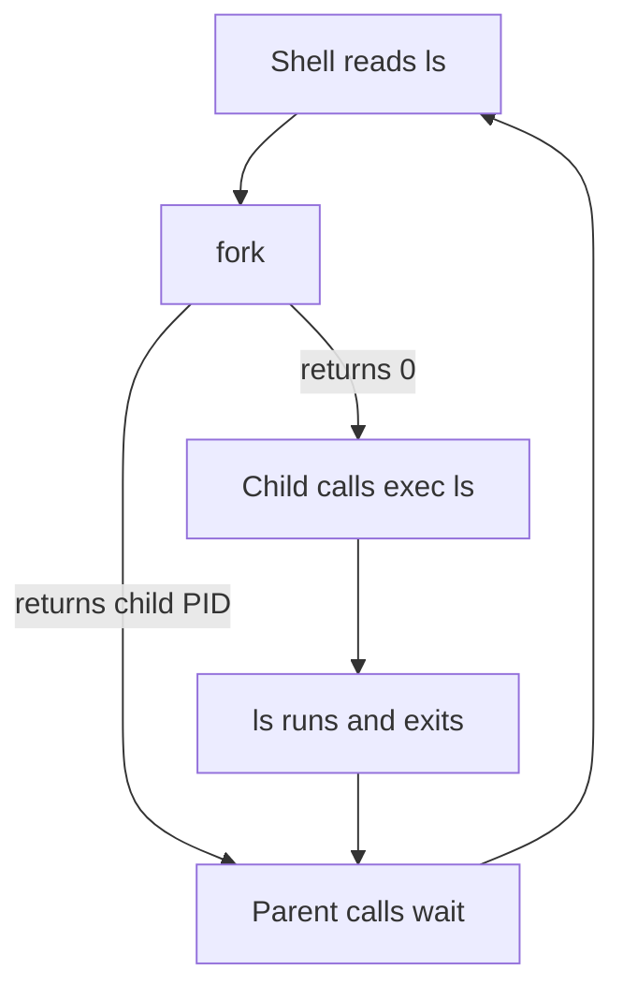

## The hook

Two programs copy the same 1 GiB file. Both are correct. One reads and writes a single byte at a time; the other moves 64 KiB per call. The second one finishes long before the first, and the gap is enormous.

Predict how many times each program asks the kernel for help. The one-byte version makes 2³⁰ reads and 2³⁰ writes: **2,147,483,648** requests. The 64 KiB version makes 16,384 of each: **32,768**. Same bytes, about 65,000 times fewer trips.

Why is a trip to the kernel so expensive that counting them predicts speed? And while we are at the counter: why does `fork` return twice, why does `exec` never return, and why does a stray `printf` sometimes print twice? One idea answers all of them.

## The intuition

:::analogy
You cannot walk into a **bank vault**. You go to the **teller's counter**, fill in a slip with a form number ("withdrawal") and the details, and slide it under the glass. The teller **checks your ID**, walks into the vault with keys you will never hold, brings back the cash, and slides it out. Every visit costs you a queue and a check, so you withdraw a week's money at once instead of one coin at a time.
:::

| Bank | Operating system |
|---|---|
| You, the customer | A program in user mode |
| The vault and its keys | Hardware and kernel memory, reachable only in kernel mode |
| The teller's counter, the only way in | The system call entry point |
| The slip's form number and details | The system call number and its arguments |
| Checking your ID and your account | The kernel validating arguments and permissions |
| Walking to the counter and back | The [[mode switch]] in and out |
| Withdrawing a week's money at once | Buffering: fewer, bigger calls |

## How it works

### Three ways into the kernel

The CPU enters kernel mode in only three ways, and interviewers like you to tell them apart:

| Kind | Caused by | Timing | Example |
|---|---|---|---|
| System call | The program asks deliberately | Synchronous, at that instruction | `read`, `write`, `fork` |
| Exception or fault | The current instruction went wrong or needs help | Synchronous, at that instruction | Page fault, divide by zero, invalid instruction |
| Interrupt | A device or the timer | Asynchronous, between any two instructions | Network packet arrived, timer tick, key press |

The first two are called **[[trap|traps]]**: the running instruction itself causes the jump. An interrupt arrives from outside, whatever the program happens to be doing.

### The trip across the counter

Here is what happens when your C++ program calls `read(fd, buf, 4096)` on Linux on an x86-64 machine:



1. The libc wrapper places the system call number in one register (`rax` on x86-64 Linux) and the arguments in others (`rdi`, `rsi`, `rdx` and so on).
2. It executes the `syscall` instruction. The CPU switches to kernel mode, switches to the kernel's own stack, and jumps to **one fixed address** the kernel registered at boot. The program cannot choose where to land.
3. The kernel saves the user registers and uses the number as an index into its **system call table** to find the handler.
4. The handler checks everything: is `fd` open in *this* process, does `buf` point into *this* process's writable memory? Then it copies data between kernel and user memory.
5. If the data is not ready, the process may block here, turning this into a context switch as well.
6. The kernel puts the result in `rax`, restores the user registers and returns to user mode. A negative result means an error; libc turns it into `-1` and sets `errno`.

Wait, why the fixed entry address? Because if a program could jump to any kernel address *while* switching to kernel mode, it could skip the ID check and land right inside the vault. One counter, one check, every time.

### Why each trip is expensive

The work itself might be tiny, like returning a process id. The overhead is in the crossing:

- **Two mode switches**, each flushing the CPU's pipeline of speculative work.
- **Saving and restoring registers**, and switching stacks.
- **Validating and copying** arguments, because the kernel must never trust a user pointer.
- **Cache and TLB disturbance**, as kernel code and data push out some of yours.
- **Security mitigations**: after the Meltdown family of CPU vulnerabilities, many kernels switch to a separate set of page tables on every entry and exit, which made the crossing noticeably more costly on affected hardware.

That is why counting system calls predicted the hook's winner. The total cost is roughly (number of calls × crossing cost) plus the real work, and only the first term changed.

:::insight
A system call is a function call that crosses a privilege boundary, and the crossing, not the work, usually dominates small calls. Fast programs make fewer, larger calls: buffered I/O, batch APIs, and mapping files into memory all exist to cut the number of trips.
:::

### Tricks that skip the counter

- **Buffering in user space**: `printf`, `fwrite` and C++ streams collect bytes and call `write` once per buffer.
- **The vDSO**: Linux maps a small piece of read-only kernel-provided code into every process so that calls like getting the current time can run entirely in user mode, with no trap.
- **Batching**: `readv`/`writev` move several buffers in one call; Linux's `io_uring` lets a program queue many I/O requests in shared memory rings and collect results with very few system calls.
- **Zero-copy**: `sendfile` moves file data to a socket inside the kernel, skipping the copy into user memory and back.

### fork, exec and wait: how every command you type runs

Process control is the most-asked family of system calls. A Unix shell runs `ls` with three of them:

- **[[fork]]** creates a child that is a copy of the shell.
- **[[exec]]** replaces the child's program with `ls`.
- **[[wait]]** makes the shell pause until `ls` finishes and collects its exit status.



### Tracing it

Predict before reading: how many times does `fork` return, and how many times does a successful `exec` return?

The shell has PID 100.

| Step | Process | Call | Result |
|---|---|---|---|
| 1 | 100 (shell) | `fork()` | Creates 101, a copy of the shell |
| 2 | 100 | `fork` returns **101** | "I am the parent, my child is 101" |
| 3 | 101 | `fork` returns **0** | "I am the child" |
| 4 | 100 | `waitpid(101)` | Blocks: shell goes to the waiting state |
| 5 | 101 | `execvp("ls", ...)` | Program replaced by `ls`; still PID 101; **never returns** |
| 6 | 101 (now ls) | `write(1, ...)` | Prints the file list |
| 7 | 101 | `exit(0)` | Becomes a zombie until reaped |
| 8 | 100 | `waitpid` returns 101, status 0 | Zombie reaped; shell prints the next prompt |

`fork` returns **twice**, once in each process, with different values. That is how the same line of code knows which side it is on. A successful `exec` returns **zero** times, because the code that called it no longer exists: the program has been replaced. If `exec` *does* return, it failed.

### Wait, why two calls instead of one "run this program"?

Because of the gap between them. After `fork` and before `exec`, the child is still running the shell's code, with the shell's file descriptors. That is exactly where the shell implements `ls > out.txt`: the child opens `out.txt`, moves it onto file descriptor 1, then calls `exec`. The new program writes to "standard output" without ever knowing it was redirected. Pipes (`ls | wc`) work the same way.

```pseudo
loop forever:
    line = read a command
    pid = fork()
    if pid == 0:                      # child
        if line has "> file":
            open file, make it file descriptor 1
        exec(program, args)           # only returns on failure
        print "command not found"; exit(127)
    else:                             # parent
        status = waitpid(pid)         # block until the child exits
```

Here is a real, runnable version of one round of that loop on Linux:

```cpp
#include <bits/stdc++.h>
#include <sys/wait.h>
#include <unistd.h>
using namespace std;

int main() {
    pid_t pid = fork();
    if (pid < 0) { perror("fork"); return 1; }
    if (pid == 0) {                                   // child
        execlp("echo", "echo", "hello from the child", (char*)nullptr);
        perror("exec");                               // reached only if exec failed
        _exit(127);
    }
    int status = 0;
    waitpid(pid, &status, 0);                         // parent waits and reaps
    if (WIFEXITED(status))
        cout << "child " << pid << " exited with " << WEXITSTATUS(status) << "\n";
}
```

### fork is lazy: copy-on-write

Copying a whole process's memory on every `fork`, only for `exec` to throw it away a microsecond later, would be absurd. So modern kernels do not copy. They use **[[copy-on-write]]**:

1. After `fork`, parent and child point at the **same physical pages**, all marked read-only.
2. Reading is free for both.
3. The first time either one **writes** to a page, the CPU raises a page fault. The kernel copies just that page, gives the writer its private copy marked writable, and resumes.

Try a quick count: the shell has 1,000 pages. The child writes to 3 of them while setting up redirection, then calls `exec`. Pages physically copied: **3**. The `exec` then drops all the child's mappings and loads `ls` fresh.

:::warning
Common misconception: "fork copies the entire address space, so it is always slow for big processes." With copy-on-write, fork copies the page tables and the kernel bookkeeping, not the memory itself. Pages are copied one at a time, only when someone writes. A large process can still pay for copying big page tables, which is why `vfork` and `posix_spawn` exist for the fork-then-exec pattern.
:::

### The puzzle every interviewer loves

```cpp partial
fork();
fork();
fork();
printf("hi\n");
```

How many lines? Each `fork` doubles the processes running the code after it: 1, then 2, then 4, then 8. So **8** lines, and with $n$ forks in a row, $2^n$ processes.

Now the trickier cousin. Here is a surprise waiting in user-space buffering:

```cpp partial
printf("A");      // no newline: "A" sits in this process's stdio buffer
fork();           // the child gets a copy of the buffer too
printf("B\n");
```

On a terminal this typically prints `AB` twice, not `A` once and `B` twice. The `A` was never written; it was sitting in the buffer that `fork` faithfully copied. Flush (`fflush(stdout)`) before forking to avoid it.

:::try-this
How many processes exist after `for (int i = 0; i < 4; i++) fork();` starting from one process, and how many of them are new? (Each iteration doubles the count, so 2⁴ = 16 processes in total, of which 15 are new.)
:::

## Trade-offs

| Approach | You gain | You give up |
|---|---|---|
| Many small system calls | Simplicity; each byte is handed over immediately | Speed: crossing cost per call |
| User-space buffering | Far fewer calls | Data sits in the buffer; a crash loses it, and readers see it later |
| fork then exec | Flexible setup between the two steps | Some cost for page tables, and subtle bugs in multithreaded parents |
| posix_spawn | One call, cheaper for large parents | Less flexibility than arbitrary code between fork and exec |
| Memory-mapped files | No read or write calls after setup | Page faults instead, and harder error handling |

The buffering row hides a durability trap. Even after `write` returns, data may sit in the kernel's page cache and not on disk yet. Databases call `fsync` to force it down, which is why logging every transaction safely is slow, the problem explored in [Write It in the Ledger Before You Hand Over the Cash](article:famous-algos-write-ahead-log).

## What can go wrong

- **Ignoring the return value.** System calls fail: files are missing, disks fill, permissions are denied. Every call returns `-1` and sets `errno` on failure in C. Check it.
- **Partial reads and writes.** `read` may return fewer bytes than you asked for, and `write` on a pipe or socket may write fewer than you gave it. Loop until done.
- **Interrupted calls.** A blocking call can return early with `EINTR` when a signal arrives. Retry it.
- **Forgetting `_exit` after a failed exec.** If `exec` fails and the child falls through into the parent's code, you now have two shells. Exit the child immediately.
- **Never calling wait.** Children become zombies and pile up, as in [An Actor Stepping Off Stage](article:cs-core-process-states).
- **Fork bombs.** A loop that forks without limit fills the process table. Systems cap processes per user for this reason.

### Interview follow-ups

**"What is the difference between a system call and a library call?"** A library call like `strlen` or `printf` is an ordinary function running in user mode. A system call crosses into the kernel. Many library calls make system calls internally (`printf` eventually calls `write`), and many never do (`strlen`).

**"Walk me through what happens on a system call."** Arguments and a call number go into registers; a trap instruction switches to kernel mode and jumps to a fixed entry; the kernel saves registers, dispatches through the system call table, validates arguments, does the work (possibly blocking), puts the result in a register and returns to user mode.

**"How does the kernel know which process made the call?"** It is the process currently running on that CPU. The kernel keeps a pointer to the current task's control block for each core, so the handler already knows whose file table and memory to use.

**"Why do fork and exec exist separately, and what does exec keep?"** The gap lets the child rearrange its file descriptors and environment. `exec` keeps the PID, the parent, open file descriptors (unless marked close-on-exec) and the current directory, and replaces code, data, heap and stack.

**"What is copy-on-write and where else is it used?"** Sharing pages read-only and copying one only on its first write. Beyond fork, the same idea powers snapshots in databases and file systems, and the shared-until-modified trick in [Readers Never Wait for Writers](article:famous-algos-mvcc).

## In the real world

- Tracing tools such as `strace` on Linux print every system call a program makes, and are the quickest way to see why a program is slow or what file it cannot find.
- Web servers serve static files with `sendfile` and batch socket work so each request costs few crossings.
- High-performance storage and networking code uses `io_uring` or similar batch interfaces to amortise the crossing over many operations.
- Language runtimes buffer output by default, which is why a crashing program sometimes loses its last log lines unless it flushes.

Now that processes can be created and can block, the kernel needs a policy for who gets the CPU next. You will compute it by hand in [Who Sees the Doctor Next?](article:cs-core-cpu-scheduling)

## Further reading

- *Operating Systems: Three Easy Pieces*, the chapters on the process API (fork, exec, wait) and on limited direct execution (traps and the system call table).
- The Linux manual pages `syscall(2)`, `fork(2)`, `execve(2)`, `wait(2)` and `vdso(7)`.

## Key takeaways

- A system call is a controlled trap into the kernel at a fixed entry point, where the kernel validates arguments, does privileged work and returns to user mode.
- System calls are expensive because of the crossing itself: two mode switches, saved registers, argument checks and cache disturbance, so fast programs make fewer, larger calls.
- fork returns twice, the child's PID in the parent and 0 in the child, while a successful exec never returns because it replaces the calling program.
- Shells fork, then set up redirection in the child, then exec, and the parent calls wait to collect the exit status and reap the zombie.
- Modern fork uses copy-on-write, so memory pages are shared read-only and copied only when one process writes to them.
