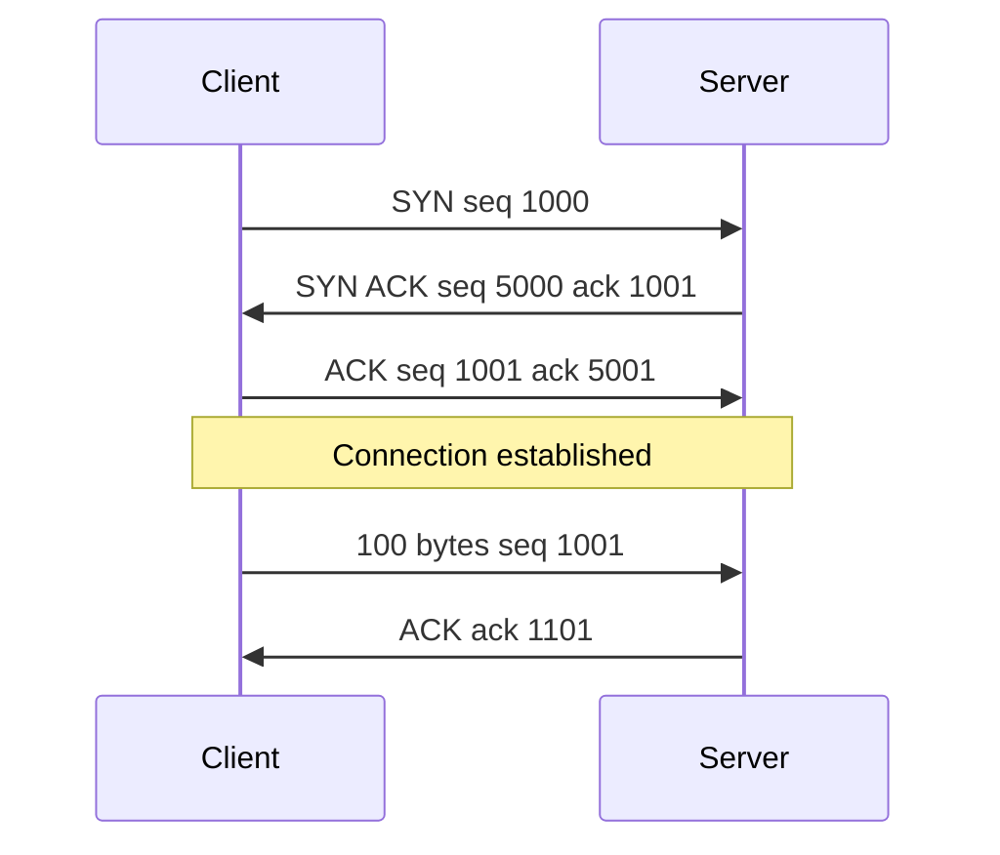

## The hook

The internet below TCP makes almost no promises. IP packets can be lost, duplicated, delayed, or arrive in a different order from the one they were sent in. And yet when you download a 2 GB file, every byte arrives, in order, exactly once.

TCP builds that guarantee out of a few numbers in each packet's header. Interviewers ask about it constantly: "explain the three-way handshake", "why TIME_WAIT?", "flow control versus congestion control". Each answer is short once you can trace the numbers. Predict what a TCP sequence number counts. (Bytes, not packets, starting from a random number.)

## The intuition

:::analogy
**A phone call where both sides confirm they can hear.** "Can you hear me?" "Yes, I can hear you. Can you hear me?" "Yes." Only then does the conversation begin. During the call, the listener says "got it" now and then, the speaker repeats anything that was missed, and at the end each side says goodbye separately, because one may still have something to say.
:::

## How it works

### Opening: the three-way handshake

Each side picks a random **initial sequence number** (ISN): here 1000 for the client and 5000 for the server. The SYN flag consumes one sequence number, so the client's first data byte is 1001.

Wait, why three messages and not two? Each side has to announce its ISN *and* hear it acknowledged. The SYN-ACK acknowledges the client's ISN and carries the server's; the final ACK is the only way the server learns that the client received the server's ISN. Random ISNs also keep stale packets from an old connection, and attackers guessing numbers, from being accepted.

### Data: sequence and acknowledgement numbers

The **[[sequence number]]** is the position of the first byte in the segment; the **[[acknowledgement number]]** is the next byte expected, which acknowledges everything before it.

| Segment | Sent by | Seq | Bytes | ACK sent back |
|---|---|---|---|---|
| A | client | 1001 | 1001 to 1100 (100 bytes) | 1101 |
| B | client | 1101 | 1101 to 1300 (200 bytes) | 1301 |
| C | client | 1301 | 1301 to 1400 (100 bytes) | 1401 |

If B is lost but C arrives, the receiver keeps C buffered and keeps sending ACK 1101 ("I still need byte 1101"). The sender retransmits B either when a **retransmission timeout** expires or, sooner, after **three duplicate ACKs** (fast retransmit). Once B arrives, the receiver acknowledges everything up to 1401 in one cumulative ACK.

### Flow control: the receive window

Every ACK carries a **[[receive window]]**: free space in the receiver's buffer. The sender may have at most that many unacknowledged bytes in flight. If the receiving app reads slowly, the window shrinks, and at 0 the sender stops and periodically probes until space opens. That is **[[flow control]]**.

Congestion control is a different limit, on the network rather than the receiver: the sender keeps a congestion window (cwnd), growing it while ACKs flow and cutting it on loss. The amount in flight is at most **min(rwnd, cwnd)**. The algorithms that set cwnd are covered in [How the Internet Avoids Gridlock](article:famous-algos-tcp-congestion-control).

### Closing: the four-way close and TIME_WAIT

TCP is full duplex, so each direction closes separately:

| Step | Message | State of the side that closes first |
|---|---|---|
| 1 | client sends FIN | FIN_WAIT_1 |
| 2 | server ACKs the FIN | FIN_WAIT_2 (server may still send data) |
| 3 | server sends its FIN when done | |
| 4 | client ACKs it | **[[TIME_WAIT]]**, then CLOSED |

The side that closes first waits in TIME_WAIT for twice the maximum segment lifetime (on Linux, a fixed 60 seconds). Two reasons: if the final ACK is lost, the server resends its FIN, and the client must still be there to answer; and delayed packets from this connection must die out before the same address and port pair is reused, or they could be mistaken for data in a new connection.

:::insight
TCP turns an unreliable packet service into a reliable byte stream using numbers: random initial sequence numbers agreed by a three-way handshake, byte-counting sequence numbers, cumulative acknowledgements with retransmission, and a receive window for flow control. Closing takes four messages because each direction finishes independently, and TIME_WAIT protects the next connection from the last one's leftovers.
:::

## Trade-offs

| Feature | Gain | Cost |
|---|---|---|
| Handshake | Both sides agree before sending data | One round trip before any data |
| Reliable, ordered delivery | Simple for applications | Head-of-line blocking: one lost segment delays all later data |
| Cumulative ACKs | Simple, robust to lost ACKs | Without SACK, the sender may not know exactly which segments arrived |
| TIME_WAIT | Safe reuse of ports | Busy clients can exhaust local ports with many short connections |
| Kernel implementation | Mature and fast | Slow to change; QUIC moved transport logic into user space |

:::warning
Common misconception: "flow control and congestion control are the same thing." Flow control uses the receiver's advertised window to avoid overflowing the receiver. Congestion control uses the sender's own estimate of network capacity to avoid overloading routers. A sender respects whichever is smaller.
:::

:::try-this
The server's ISN is 5000. After the handshake, it sends 300 bytes and then 200 bytes, and the client acknowledges each. What sequence numbers and ACK numbers appear? (The server's data starts at 5001: the first segment has seq 5001 covering 5001 to 5300, acknowledged with 5301; the second has seq 5301 covering 5301 to 5500, acknowledged with 5501.)
:::

## What can go wrong

- **SYN floods**: attackers send many SYNs and never complete the handshake, filling the server's half-open queue; SYN cookies defend against this.
- **Ports exhausted by TIME_WAIT** on clients opening many short connections; connection pooling and keep-alive avoid it.
- **Zero window stalls** when the receiving application stops reading.
- **Head-of-line blocking** making one lost packet stall a whole multiplexed HTTP/2 connection.
- **Nagle's algorithm with delayed ACKs** adding latency to small interactive writes; TCP_NODELAY disables Nagle.

### Interview follow-ups

**"What is the SYN backlog?"** The queue of half-open connections waiting for the final ACK; the accept queue holds completed connections waiting for the application to call accept().

**"What happens if the third ACK of the handshake is lost?"** The server retransmits its SYN-ACK; meanwhile, if the client sends data, that segment carries the ACK and completes the handshake anyway.

**"How is TCP different from UDP?"** UDP has no connection, no ordering, no retransmission and no flow control; it simply sends datagrams, as compared in [Registered Post or Shouting Across the Street?](article:system-design-networking-essentials).

## In the real world

Every HTTP/1.1 and HTTP/2 request, database connection and SSH session runs over TCP. Tools such as `ss -tan` show connection states, including TIME_WAIT, and Wireshark shows the sequence and ACK numbers traced above. The layers TCP sits between are in [Sending a Parcel Through Layers of Packaging](article:cs-core-osi-tcpip).

## Further reading

- RFC 9293, "Transmission Control Protocol (TCP)" (2022), the current consolidated specification.
- W. Richard Stevens, *TCP/IP Illustrated, Volume 1*.

## Key takeaways

- TCP opens a connection with SYN, SYN-ACK and ACK so both sides announce random initial sequence numbers and hear them acknowledged.
- Sequence numbers count bytes, the SYN consumes one number, and the acknowledgement number names the next byte expected, acknowledging everything before it.
- Lost segments are resent after a timeout or after three duplicate ACKs, and the receiver buffers out-of-order data until the gap is filled.
- Flow control uses the receiver's advertised window, congestion control uses the sender's congestion window, and the sender keeps at most the minimum of the two in flight.
- Closing takes four messages because each direction closes separately, and the side that closes first waits in TIME_WAIT to handle a lost final ACK and stray old packets.
