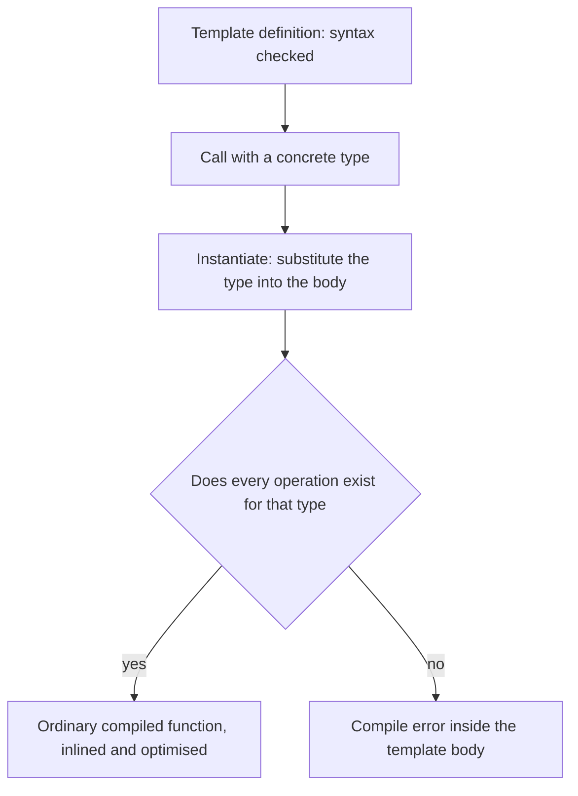

## The hook

You write a function to find the largest int in a vector. Then you need it for doubles. Then for strings. Copying the function three times means three copies of every future bug fix. Using `void*` and casts throws away type checking.

Templates let you write the function once with a placeholder type and let the compiler write the three versions for you, fully type-checked and as fast as hand-written code. The entire standard library, vector, map, sort, is built this way. Predict what happens if you call it with a type that cannot be compared with `<`. (A compile error, at the line where the template uses `<`.)

## The intuition

:::analogy
**A recipe that works for any fruit**: "peel the fruit, slice it, add sugar, bake". The recipe is not a pie; it becomes one when you choose a fruit. Choose apples and you get an apple pie, choose pears and you get a pear pie, each made specifically. Choose a fruit you cannot slice, and you find out the moment you try to follow the recipe.
:::

## How it works

```cpp
#include <iostream>
#include <string>
#include <vector>
using namespace std;

// Function template: one definition, the compiler generates a version per type used.
template <typename T>
T largest(const vector<T>& v) {
    T best = v[0];
    for (const T& x : v) if (best < x) best = x;
    return best;
}

// Class template with a non-type parameter.
template <typename T, int N>
class FixedStack {
    T items[N];
    int top = 0;
public:
    bool push(const T& x) { if (top == N) return false; items[top++] = x; return true; }
    T pop() { return items[--top]; }
    bool empty() const { return top == 0; }
    static constexpr int capacity() { return N; }
};

// Full specialisation: a different implementation for one specific type.
template <typename T> struct TypeName { static string get() { return "unknown"; } };
template <> struct TypeName<int> { static string get() { return "int"; } };
template <> struct TypeName<string> { static string get() { return "string"; } };

int main() {
    cout << largest(vector<int>{3, 9, 4}) << " "
         << largest(vector<string>{"pear", "apple", "zebra"}) << " "
         << largest(vector<double>{2.5, -1.0}) << "\n";                  // 9 zebra 2.5
    FixedStack<char, 3> s;
    cout << s.push('a') << s.push('b') << s.push('c') << s.push('d') << " " << s.capacity() << "\n";  // 1110 3
    while (!s.empty()) cout << s.pop();                                   // cba
    cout << "\n" << TypeName<int>::get() << " " << TypeName<string>::get() << " " << TypeName<double>::get() << "\n";  // int string unknown
}
```

### Function templates and deduction

`template <typename T>` introduces a type parameter. Calling `largest(vector<int>{...})` lets the compiler deduce T = int from the argument (**[[template argument deduction]]**) and **[[instantiation|instantiate]]** a real function `largest<int>`. The same template produced versions for int, string and double: 9, "zebra" and 2.5.

### Class templates and non-type parameters

`FixedStack<T, N>` takes a type and a compile-time value, a **[[non-type template parameter]]**. `FixedStack<char, 3>` and `FixedStack<char, 4>` are different types. The fourth push returned false, and the stack popped c, b, a.

### Specialisation

A **[[specialisation]]** gives a template a different definition for specific arguments. `TypeName<int>` and `TypeName<string>` use their own versions; `TypeName<double>` falls back to the general one ("unknown"). The standard library's `vector<bool>`, which packs bits, is a famous (and controversial) specialisation.

### How the compiler checks a template



Wait, why did the error for a struct without `<` point inside largest rather than at the call? Because a template is a recipe: the compiler checks that the *type* supports what the body does only when it instantiates the body with that type. C++20 concepts let a template state its requirements up front (`template <std::totally_ordered T>`), giving shorter, clearer errors at the call site.

:::insight
A template is a pattern from which the compiler generates a separate, fully typed function or class for each set of arguments you use. That gives generic code with no run-time cost, which is how the STL is built, at the price of longer compile times, larger binaries and errors that appear when a type lacks an operation the template needs.
:::

## Trade-offs

| Approach | Gain | Cost |
|---|---|---|
| Templates | Type-safe, fast generic code; decisions at compile time | Code bloat, slower compiles, long error messages, definitions must be visible (usually in headers) |
| Virtual functions | One compiled version, types chosen at run time | Indirect calls; types must share a base class |
| void* and casts (C style) | Works in C | No type safety |
| Copy-paste per type | Simple | Duplicated bugs and maintenance |

:::warning
Common misconception: "templates can be split into a .h declaration and a .cpp definition like normal functions." The compiler needs the template's full body wherever it instantiates it, so template definitions normally live in headers. Putting them in a .cpp file leads to "undefined reference" link errors unless every needed instantiation is declared explicitly.
:::

:::try-this
What does `largest(vector<string>{"Banana", "apple"})` return, and why might that surprise you? (It returns "apple": strings compare character codes, and lowercase 'a' has a higher code than uppercase 'B', so "apple" counts as larger. The template simply uses whatever `<` means for the type.)
:::

## What can go wrong

- **Huge error messages** from deep inside library templates when a type lacks an operation.
- **Template definitions in .cpp files**, causing link errors.
- **Code bloat** from many instantiations of large templates.
- **Unintended deduction**, such as `largest({1, 2.5})` failing because T cannot be both int and double.
- **Specialising after use**, which is ill-formed and confusing.

### Interview follow-ups

**"Templates versus virtual functions?"** Templates decide at compile time with no indirection; virtual functions decide at run time with one compiled version. Use templates for performance-critical generic code and virtual functions when the type set is open at run time.

**"What is partial specialisation?"** Specialising some parameters but not all, such as a version of `Pair<T, T>` for identical types; allowed for class templates, not for function templates.

**"What are concepts?"** C++20 named requirements on template parameters, checked at the call site.

## In the real world

The standard containers and algorithms are templates: `vector<T>`, `map<K, V>`, `sort(first, last)`. How several of them work inside is the subject of the STL internals article. Compile-time versus run-time polymorphism is compared in [One Remote Controlling Different TVs](article:cs-core-polymorphism).

## Further reading

- David Vandevoorde, Nicolai Josuttis and Douglas Gregor, *C++ Templates: The Complete Guide*, second edition.
- cppreference.com, pages on templates and constraints and concepts.

## Key takeaways

- A template is a pattern with type or value parameters from which the compiler generates a concrete function or class for each set of arguments used.
- Function templates usually deduce their type parameters from the call's arguments, while class templates take them explicitly, including compile-time values such as a capacity.
- A specialisation provides a different definition for specific arguments, and other arguments use the general template.
- A template body is checked against a real type only when instantiated, so a missing operation shows up as an error inside the template, which C++20 concepts make clearer.
- Templates give generic code with no run-time cost, at the price of compile time, binary size and definitions that must live in headers.
