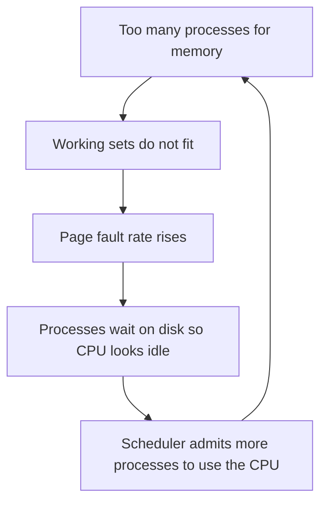

## The hook

A laptop with too many browser tabs open suddenly takes ten seconds to switch windows. The CPU monitor shows the processor mostly idle. The disk activity light is on solid. Nothing useful is happening, and yet the machine is working flat out.

That is thrashing, and the strange part is how sudden it is: the computer was fine a minute ago with one tab fewer. [A Desk That Holds Only Today's Books](article:cs-core-virtual-memory) introduced the idea. This article measures the cliff, explains why it is a cliff rather than a slope, and covers how operating systems pull back from the edge. Predict how many page faults one missing frame can add to a loop of 100 memory references. (95: from 5 faults to 100.)

## The intuition

:::analogy
**A juggler with too many balls drops all of them.** With five balls and five hands' worth of rhythm, everything flows. Add a sixth that the rhythm cannot hold, and the juggler does not drop just one ball: catching the falling one throws off the next catch, and soon every ball is on the floor. Memory behaves the same way when the pages a process is actively using no longer fit.
:::

## How it works

### The cliff, measured

A process loops over pages 1, 2, 3, 4, 5, twenty times: 100 references. A small LRU simulation counted the faults for each number of frames:

| Frames | Page faults |
|---|---|
| 6 | 5 |
| 5 | 5 |
| 4 | 100 |
| 3 | 100 |
| 2 | 100 |

Wait, why does losing one frame turn 5 faults into 100, not 6 or 10? With 4 frames, LRU evicts the least recently used page, which in a loop is always the page needed next. Every single reference faults. The loop's **working set** is 5 pages; anything less and the process does no useful work at all. That is the ball the juggler cannot hold.

### Why the system makes it worse

A naive long-term scheduler sees low CPU utilisation and raises the **[[degree of multiprogramming]]**. Each new process takes frames from the others, which pushes more of them over their own cliff. CPU utilisation climbs with the number of processes up to a point, then collapses. That collapse is **[[thrashing]]**.

### Cure 1: the working-set model

The **[[working-set model]]** gives each process the frames its working set needs (the distinct pages in its last Δ references) and suspends whole processes when the sum of working-set sizes exceeds the available frames.

The working set changes as a program moves between phases. For the string 1 2 3 2 1 4 4 4 5 6 5 6 with Δ = 4:

| After reference | Last 4 references | Working set | Size |
|---|---|---|---|
| 5 | 2 3 2 1 | {1, 2, 3} | 3 |
| 6 | 3 2 1 4 | {1, 2, 3, 4} | 4 |
| 8 | 1 4 4 4 | {1, 4} | 2 |
| 10 | 4 4 5 6 | {4, 5, 6} | 3 |
| 12 | 5 6 5 6 | {5, 6} | 2 |

The set swells at phase changes and shrinks inside a phase. Tracking it exactly is expensive, so kernels approximate it: a timer interrupt periodically copies and clears each page's reference bit, and a page counts as "in the working set" if it was referenced in any of the last few intervals.

### Cure 2: page-fault frequency

**[[Page-fault frequency]]** watches the symptom directly. Pick an upper and a lower bound on each process's fault rate:

- Above the upper bound: the process needs more frames; give it one.
- Below the lower bound: it has spare frames; take one away.
- No free frames to give: suspend some process and redistribute its frames.

It is simpler than tracking working sets and reacts to the thing that actually hurts.

### Local versus global replacement

With global replacement, a faulting process can evict any process's pages, so one thrashing process drags everyone down. **[[Local replacement]]** confines a process to its own frames, isolating the damage but possibly wasting frames elsewhere. Modern systems mostly use global replacement with per-group limits (such as Linux cgroup memory limits).

:::insight
Thrashing is a cliff, not a slope: once a process has fewer frames than its working set, nearly every reference can fault. The fix is never "more processes to use the idle CPU" but fewer processes, or more frames per process, guided by the working set or by the fault rate itself.
:::

## Trade-offs

| Approach | Gain | Cost |
|---|---|---|
| Working-set model | Admits only as many processes as truly fit | Estimating working sets costs timer work and bookkeeping; Δ is hard to choose |
| Page-fault frequency | Simple, reacts to real pain | Bounds need tuning; reacts after faults have already happened |
| Local replacement | One process cannot ruin others | Unused frames in one process cannot help another |
| Adding RAM or reducing load | Removes the cause | Costs money or capacity |

:::warning
Common misconception: "a better page-replacement algorithm fixes thrashing." When the working sets simply do not fit, every algorithm faults constantly; the simulation above faults on every reference with 4 frames. Replacement policy matters near the edge, but only reducing demand or adding memory fixes thrashing.
:::

:::try-this
For the reference string 1 2 3 2 1 4 4 4 5 6 5 6, what is the working set after reference 7 with Δ = 4, and why is it smaller than after reference 6? (The last four references are 2 1 4 4, so the working set is {1, 2, 4}, size 3. Page 3 has dropped out of the window: the program is leaving its first phase.)
:::

## What can go wrong

- **Overcommitting memory** on servers, then hitting a swap storm under load.
- **Containers with tight memory limits** thrashing inside their limit while the host looks healthy.
- **Huge sequential scans** (backups, analytics) evicting everyone's hot pages from the page cache.
- **Misreading the symptoms**: idle CPU plus a busy disk looks like an I/O problem, but the cause is memory.

### Interview follow-ups

**"How do you detect thrashing on Linux?"** High major-fault rates and swap-in/swap-out activity in vmstat, and, on recent kernels, high memory pressure in /proc/pressure/memory (pressure stall information).

**"What does Linux do when memory truly runs out?"** It reclaims page cache, swaps if configured, and as a last resort the out-of-memory killer terminates a process chosen by a badness score.

**"How do page replacement and thrashing relate?"** Replacement chooses which page to evict, as in [Which Book Goes Back on the Shelf?](article:cs-core-page-replacement); thrashing happens when no choice can help because too little memory is available.

## In the real world

Desktop slowdowns with too many tabs, database servers swapping under memory pressure, and containers killed for exceeding limits are all versions of this problem. Production servers often run with little or no swap so that memory exhaustion fails fast instead of thrashing slowly.

## Further reading

- Peter J. Denning, "The Working Set Model for Program Behavior" (Communications of the ACM, 1968).
- Remzi and Andrea Arpaci-Dusseau, *Operating Systems: Three Easy Pieces*, chapters on swapping policies (free online).

## Key takeaways

- Thrashing happens when the pages processes actively use do not fit in memory, so the system spends its time servicing page faults.
- It is a cliff: in the simulated loop over five pages, five frames caused 5 faults while four frames caused 100.
- A naive scheduler worsens thrashing by admitting more processes when the CPU looks idle, creating a feedback loop.
- The working-set model and page-fault-frequency control both cure it by lowering the degree of multiprogramming or moving frames to processes that need them.
- No replacement algorithm can fix thrashing when demand exceeds memory, so the real fixes are less load or more memory.
