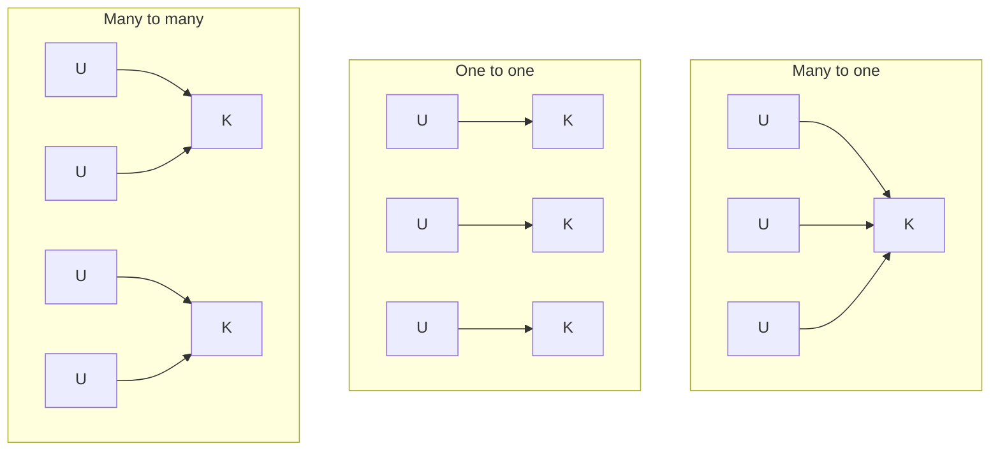

## The hook

A chat server holds 100,000 open connections. The simple design gives each connection its own thread. On a typical Linux setup, each thread reserves a stack of up to 8 MB by default (`ulimit -s` printed 8192 KB on the machine used for this article), and every thread is something the kernel must schedule. At 100,000 threads, that design starts to creak.

Go servers routinely run hundreds of thousands of goroutines, and Java added "virtual threads" for the same reason. Are those threads? Yes and no: it depends on who is doing the scheduling. Predict the trick. (Many cheap threads managed by the language runtime, run on a few real kernel threads.)

## The intuition

:::analogy
A company can have **workers hired directly by the company** (on the payroll, managed by HR, expensive to hire) or **workers hired by a contractor** who manages their own crew and tells the company only about the contractor. Kernel threads are payroll employees; user-level threads are the contractor's crew. The question is how many contractors (kernel threads) the crew (user threads) is spread across.
:::

The two kinds of thread were introduced in [Separate Houses or Roommates?](article:cs-core-processes-threads):

| | **[[Kernel thread]]** | **[[User-level thread]]** |
|---|---|---|
| Created and scheduled by | the OS kernel | a library or language runtime |
| Switch cost | a kernel entry and exit | a function call's worth of register saving |
| Kernel sees it | yes | no |
| Can run on multiple cores at once | yes | only through kernel threads underneath |

## How it works

### Three mappings



**[[Many-to-one model]]**: one kernel thread runs all the user threads. Switching is very cheap, but if any thread makes a blocking system call, the kernel blocks the only kernel thread, and every user thread stops. And since the kernel sees one thread, the process uses one core. Early Java "green threads" worked this way.

**[[One-to-one model]]**: each user thread has its own kernel thread. Blocking affects only that thread and threads run in parallel on many cores. The cost is a kernel object, a stack and scheduler work per thread. Linux pthreads (NPTL) and Windows threads use this model, and it is the default most programmers meet.

**[[Many-to-many model]]**: a runtime multiplexes M user threads over N kernel threads, usually about one per core. Go's scheduler runs goroutines this way, and Java's virtual threads mount on a small pool of carrier threads. The **two-level** variant also lets a specific user thread be bound to its own kernel thread.

Wait, if many-to-many is so good, how does it avoid the blocking problem of many-to-one? The runtime intercepts blocking operations. When a goroutine waits on the network, the runtime registers the socket with the OS's event mechanism (such as epoll) and parks the goroutine, freeing the kernel thread for others. For a system call that truly blocks, the runtime hands the kernel thread's other work to another kernel thread.

### Thread pools

Even with one-to-one threads, creating a thread per task wastes time and leaves the thread count unbounded. A **[[thread pool]]** fixes both:

```pseudo
pool = start W worker threads
each worker loops forever:
    task = queue.take()          // blocks while the queue is empty
    run(task)

submit(task): queue.put(task)    // returns immediately
```

W is typically about the number of cores for CPU-bound work, and larger for work that waits on I/O. The queue absorbs bursts; a bounded queue applies back-pressure when the system is overloaded.

:::insight
The threading model decides who schedules threads. Kernel threads give parallelism and independent blocking at a higher cost each; user threads are cheap to create and switch but need kernel threads underneath to use cores. Many-to-many runtimes, like Go's, get both by multiplexing many cheap threads onto about one kernel thread per core and parking threads that wait.
:::

## Trade-offs

| Model | Parallelism | Blocking call | Cost per thread | Example |
|---|---|---|---|---|
| Many-to-one | none | blocks all | very low | early Java green threads |
| One-to-one | full | blocks one | higher (kernel object, stack) | Linux pthreads, Windows threads |
| Many-to-many | full | runtime parks the thread | low | Go goroutines, Java virtual threads |
| Thread pool over one-to-one | bounded | blocks a worker | amortised | web servers, executors |

:::warning
Common misconception: "more threads means more speed." For CPU-bound work, threads beyond the number of cores only add context switches and cache misses. Extra threads help only when threads spend time waiting (on I/O, locks or the network).
:::

:::try-this
A server on an 8-core machine handles requests that each compute for 10 ms and then wait 90 ms for a database. Roughly how many worker threads keep the cores busy? (Each thread is busy only 10% of the time, so about 8 × (10 + 90) / 10 = 80 threads keep 8 cores busy. With pure computation and no waiting, 8 would suffice.)
:::

## What can go wrong

- **A blocking call in a many-to-one runtime**, freezing every thread in the process.
- **Unbounded thread creation** under load, exhausting memory and thrashing the scheduler.
- **Pool starvation**: tasks in a pool wait for other tasks queued behind them in the same pool, and everything deadlocks.
- **Pinning** in user-level runtimes: a virtual thread holding a lock across a blocking call can tie up its carrier thread.
- **Thread-local state** leaking between tasks that reuse the same pool thread.

### Interview follow-ups

**"Process versus thread versus coroutine?"** A process has its own address space; threads share one; coroutines are cooperative user-level routines that yield explicitly, scheduled by the program or runtime.

**"How would you size a thread pool?"** Roughly cores × (1 + wait time / compute time), then measure; CPU-bound pools use about the number of cores.

**"What does a thread pool look like in machine-coding rounds?"** A blocking queue plus workers with a shutdown flag, as built in [Concurrency in Machine Coding: Locks, Atomics and Thread Pools](article:system-design-concurrency-lld).

## In the real world

Linux and Windows schedule one-to-one kernel threads; Go and Erlang runtimes schedule many lightweight processes over a few kernel threads; Java offers both platform threads and virtual threads. Web servers, databases and job runners all use thread pools.

## Further reading

- Thomas Anderson and colleagues, "Scheduler Activations: Effective Kernel Support for the User-Level Management of Parallelism" (ACM TOCS, 1992).
- The Go runtime source and design notes on its scheduler (the G, M and P model).

## Key takeaways

- Kernel threads are scheduled by the OS and can run in parallel, while user-level threads are scheduled by a runtime and are much cheaper to create and switch.
- In the many-to-one model, a single blocking call blocks every thread and only one core is used.
- The one-to-one model, used by Linux pthreads, gives parallelism and independent blocking at a higher cost per thread.
- The many-to-many model, used by Go and Java virtual threads, multiplexes many cheap threads over roughly one kernel thread per core and parks threads that wait.
- Thread pools reuse a bounded set of workers fed by a queue, sized near the core count for computation and larger for waiting work.
