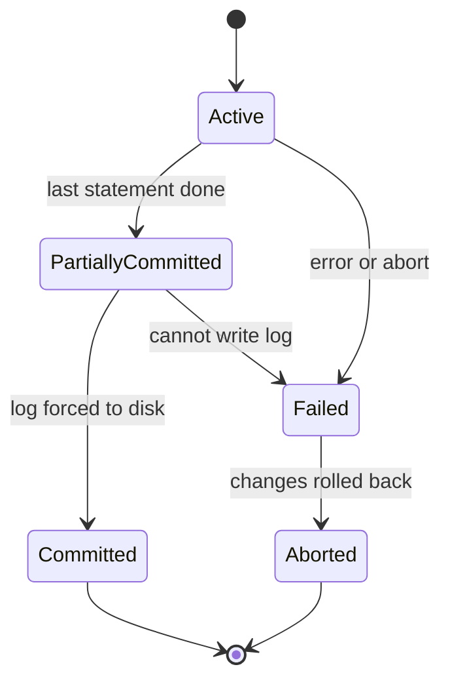

## The hook

You send ₹30 to a friend. The bank's database does two writes: take 30 from your account, add 30 to theirs. Now imagine the server loses power exactly between the two writes.

If the debit happened and the credit did not, ₹30 has vanished. If the credit happened first and the debit did not, the bank created ₹30 out of nothing. Neither is acceptable, and power cuts, crashes and errors happen all the time. Predict what a database must be able to do to make this safe. (Undo half-done work, and remember finished work, even across a crash.)

## The intuition

:::analogy
**A bank transfer must happen completely or not at all.** A good teller does not hand over cash until the withdrawal slip is stamped, never lets two customers fill in the same slip, and files a carbon copy before saying "done". A database transaction makes the same promises for any group of writes.
:::

A **[[transaction]]** is a group of operations treated as one unit: it ends with **commit** (make everything permanent) or **abort/rollback** (undo everything).

## How it works

### The four promises

| Letter | Promise | Who keeps it |
|---|---|---|
| **[[Atomicity]]** | All or nothing | Recovery: the undo log rolls back partial work |
| Consistency | Each transaction moves the database from one valid state to another | Constraints (keys, CHECKs) plus correct application logic |
| **[[Isolation]]** | Concurrent transactions do not see each other's half-finished work | Concurrency control: locks or multi-versioning |
| **[[Durability]]** | Committed work survives crashes | The write-ahead log forced to disk at commit, and recovery |

Wait, why does consistency depend on the application? The database can enforce "balance ≥ 0", but only your code knows that a transfer should debit and credit the same amount. A transaction that adds 30 and subtracts 20 is atomic, isolated and durable, and still wrong.

### Atomicity, run for real

In SQLite, with accounts A = 100 and B = 50 and a constraint `CHECK (bal >= 0)`, each transfer credits B first and then debits A:

| Transfer | What happened | Balances after |
|---|---|---|
| 30 from A to B | both updates succeed, COMMIT | A 70, B 80 |
| 200 from A to B | B credited to 280, then debit of A fails the CHECK, ROLLBACK | A 70, B 80 |

The second transfer's credit to B was really applied inside the transaction, and the rollback removed it. That is atomicity in one table.

### Transaction states

"Partially committed" means the last statement has run but the commit is not yet durable; the transaction becomes **committed** only when its log records reach stable storage. After an abort, the system may restart the transaction (if the failure was a deadlock or a timeout) or kill it (if the error was in its logic).

### Why interleaving is dangerous

Databases run many transactions at once for speed, so their operations interleave. The actual order is called a **[[schedule]]**. A serial schedule (one transaction after another) is always correct but slow; an interleaved schedule is fast but can produce anomalies:

| Anomaly | Story |
|---|---|
| **[[Lost update]]** | T1 and T2 both read balance 100. T1 writes 110 and T2 writes 120. The correct result is 130; T1's +10 is lost. |
| Dirty read | T2 reads T1's uncommitted write, then T1 aborts; T2 used a value that never existed. |
| Unrepeatable read | T1 reads a row twice and gets different values because T2 committed an update in between. |
| Phantom | T1 counts rows matching a condition twice and gets different counts because T2 inserted a matching row. |

The lost update, traced:

| Time | T1 (add 10) | T2 (add 20) | Stored balance |
|---|---|---|---|
| 1 | read 100 | | 100 |
| 2 | | read 100 | 100 |
| 3 | write 110 | | 110 |
| 4 | | write 120 | 120 |

:::insight
Atomicity and durability are about failures (crash, error) and are provided by logging and recovery. Isolation is about concurrency and is provided by locking or versioning. Consistency is the goal the other three protect, together with constraints and correct application logic.
:::

## Trade-offs

| Choice | Gain | Cost |
|---|---|---|
| Serial execution | Trivially correct | Very low throughput |
| Strong isolation (serializable) | No anomalies | More blocking or more aborted retries |
| Weaker isolation (read committed) | Higher concurrency | Allows unrepeatable reads and phantoms; application must cope |
| Flush log on every commit | True durability | A disk flush per commit; group commit batches them |
| Relaxed durability settings | Faster commits | The last moments of commits can be lost in a crash |

:::warning
Common misconception: "putting statements in a transaction prevents every concurrency bug." Under the default isolation level of many databases (often read committed), a read-then-write sequence such as "read balance, add 10, write" can still lose updates. Use an atomic update (`SET bal = bal + 10`), `SELECT … FOR UPDATE`, or a stricter isolation level.
:::

:::try-this
T1 transfers 50 from A to B. T2 computes A + B for an audit. A = 100 and B = 100 at the start. If T2 reads A after T1's debit but reads B before T1's credit, what total does the audit see? (A = 50 and B = 100, so the audit sees 150 instead of 200: money appears to vanish. Isolation forbids T2 from seeing T1's half-finished state.)
:::

## What can go wrong

- **Read-modify-write in application code** without locking, causing lost updates.
- **Long transactions** holding locks for seconds and blocking everyone.
- **Assuming consistency is automatic**, while business rules live only in application code.
- **Disabling durability** for speed without realising recent commits can vanish after a crash.
- **Not retrying** transactions aborted by deadlocks or serialization failures.

### Interview follow-ups

**"How is atomicity implemented?"** With a log: before changing data, record enough to undo it; on abort or after a crash, apply the undo records. The crash recovery article covers this in detail.

**"What are the isolation levels?"** Read uncommitted, read committed, repeatable read and serializable, each allowing fewer anomalies; they are compared in [Several Cashiers, One Ledger](article:system-design-isolation-levels).

**"How do distributed databases keep atomicity across machines?"** With protocols such as two-phase commit, where a coordinator asks every participant to prepare before telling them all to commit.

## In the real world

PostgreSQL, MySQL with InnoDB, Oracle, SQL Server and SQLite are all ACID databases, differing mainly in default isolation levels and how they implement them. The DBMS components named in the table above are introduced in [The Librarian and the Pile of Books](article:cs-core-dbms-intro). The next question is precise: which interleavings are safe? That is serializability.

## Further reading

- Jim Gray and Andreas Reuter, *Transaction Processing: Concepts and Techniques*.
- Silberschatz, Korth and Sudarshan, *Database System Concepts*, chapter on transactions.

## Key takeaways

- A transaction groups operations into one unit that either commits completely or is rolled back completely.
- Atomicity and durability protect against failures through logging and recovery, while isolation protects against concurrency through locking or versioning.
- Consistency depends on both database constraints and correct application logic, so a transaction can be atomic and still wrong.
- A transaction moves through active, partially committed, committed or failed, and aborted states, and is committed only once its log is on stable storage.
- Interleaved schedules can cause lost updates, dirty reads, unrepeatable reads and phantoms, which isolation levels prevent to different degrees.
