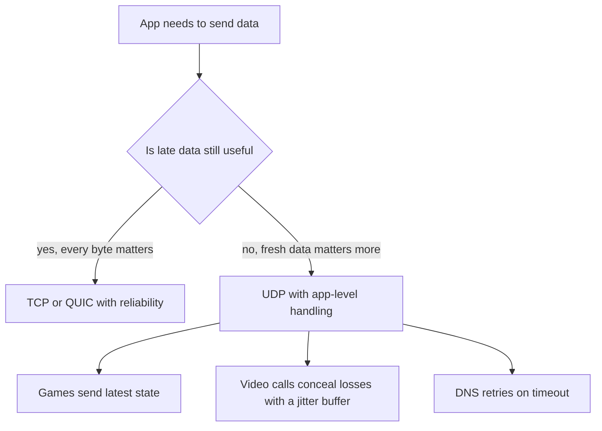

## The hook

In an online game, your character's position is sent twenty or more times a second. One update goes missing. Should the game stop everything, ask for that update again, and wait until it arrives before showing anything newer? By the time it comes back, it describes where you *were*.

TCP would do exactly that, because it promises every byte, in order. For a game, a video call or a DNS lookup, that promise costs more than it gives. UDP makes almost no promises at all, and that is its feature. Predict how big UDP's header is compared with TCP's minimum of 20 bytes. (8 bytes: two ports, a length and a checksum.)

## The intuition

:::analogy
**Postcards versus registered letters.** A registered letter is tracked, signed for and resent if lost: reliable, but slow and with paperwork. A postcard is just dropped in the box: no tracking, no confirmation, possibly lost or delivered out of order. Yet each postcard arrives as a whole card, never merged with another, and for a quick "arrived safely!" it is perfect.
:::

## How it works

### The whole header

| Field | Size |
|---|---|
| Source port | 2 bytes |
| Destination port | 2 bytes |
| Length (header plus data) | 2 bytes |
| Checksum | 2 bytes |

That is all you get: no sequence numbers, no acknowledgements, no window, no handshake. UDP adds ports (so the right program gets the data) and a checksum (so corrupted datagrams are dropped) on top of IP, and nothing more. The largest payload over IPv4 is 65,535 − 8 − 20 = 65,507 bytes, though anything above the path MTU (often around 1,500 bytes) is fragmented by IP, and losing one fragment loses the whole datagram.

### Connectionless

Being **[[connectionless]]** means your first packet already carries data. A DNS query is one datagram out and one back: a single round trip, with no handshake first. The server keeps no per-client state, so one server can answer huge numbers of clients cheaply.

### Message boundaries, tested

Here is a difference you will trip over the first time you write network code, and it explains a bug you may otherwise chase for hours. Three separate sends of "hello", "world" and "!" on one machine:

| Protocol | What the receiver got |
|---|---|
| UDP | three receives: b'hello', b'world', b'!' |
| TCP | one receive: b'helloworld!' |

If you expected three TCP reads, you are not alone. UDP keeps **[[message boundary|message boundaries]]**: one send is one **[[datagram]]**, received whole or not at all. TCP is a byte stream, so applications on TCP must add their own framing (length prefixes or delimiters) to find where messages end.

### TCP versus UDP

Keep one question in mind while reading this table, because the answer comes right after it: if UDP lacks all of these features, how does the newest version of HTTP run on top of it?

| | TCP | UDP |
|---|---|---|
| Connection | handshake first | none |
| Reliability | retransmits lost data | none |
| Ordering | in order | any order |
| Boundaries | byte stream | preserved per datagram |
| Flow and congestion control | built in | none (the app must behave) |
| Header | 20 to 60 bytes | 8 bytes |
| Typical uses | web, email, file transfer, databases | DNS, games, voice and video, QUIC, DHCP |

Wait, so how does HTTP/3 manage it? QUIC builds reliability, ordering, congestion control and encryption on top of UDP, in user space, per stream. A loss on one stream does not block the others, which removes TCP's **[[head-of-line blocking]]**, and its handshake is combined with TLS to save round trips.

:::insight
UDP is IP plus ports and a checksum: no connection, no ordering, no retransmission and no congestion control, but preserved message boundaries and minimal delay. Applications choose it when fresh data beats complete data, or when they want to build their own reliability, as QUIC does.
:::

## Trade-offs

| Need | UDP gives | The app must add |
|---|---|---|
| Low latency | No handshake, no waiting for retransmissions | Tolerance for loss |
| Real-time media | Fresh packets | A **[[jitter buffer]]**, loss concealment |
| Request-response (DNS) | One round trip | Timeouts and retries |
| Multicast and broadcast | Supported (TCP cannot) | Group management |
| Fairness on the network | Nothing | Its own congestion control |

:::warning
Common misconception: "UDP is faster than TCP, so it should be used for speed." UDP has less overhead and no waiting, but for bulk transfers where every byte matters, an application must rebuild retransmission and congestion control, and a careless UDP sender floods the network. TCP or QUIC is usually the right answer for file transfer.
:::

:::try-this
A DNS client sends a query over UDP and hears nothing for a while. What should it do, and why can it simply resend? (Retry after a timeout, possibly to another server. A DNS query has no side effects, so receiving it twice is harmless; that is what makes UDP's lack of reliability acceptable here.)
:::

## What can go wrong

- **Oversized datagrams** being fragmented and lost more often; keep payloads under the path MTU.
- **Assuming delivery or order** in application code built on UDP.
- **No congestion control** causing an app to swamp a link and hurt everyone else.
- **Amplification attacks**: spoofed small UDP requests that trigger large responses aimed at a victim (DNS and NTP have been abused this way).
- **Firewalls and NATs timing out** idle UDP mappings, requiring keep-alive packets.

### Interview follow-ups

**"Can UDP be reliable?"** The protocol is not, but applications add sequence numbers, acknowledgements and retransmission on top, as QUIC and many game engines do.

**"Why does DNS sometimes use TCP?"** For responses too large for a UDP message (such as zone transfers or big DNSSEC answers) the server sets a truncation flag and the client retries over TCP.

**"Is TCP's checksum stronger than UDP's?"** They use the same 16-bit one's complement checksum; neither is a cryptographic integrity check.

## In the real world

DNS, DHCP, NTP, video conferencing, online games, VPN protocols such as WireGuard, and HTTP/3 over QUIC all run on UDP. The reliable alternative it is compared with throughout is in [A Phone Call Where Both Sides Confirm They Can Hear](article:cs-core-tcp-deep-dive).

## Further reading

- RFC 768, "User Datagram Protocol" (1980), only three pages long.
- RFC 9000, "QUIC: A UDP-Based Multiplexed and Secure Transport" (2021).

## Key takeaways

- UDP adds only ports, a length and a checksum to IP, in an 8-byte header, with no connection, ordering, retransmission or congestion control.
- Each send is one datagram received whole or not at all, so message boundaries are preserved, unlike TCP's byte stream.
- Being connectionless lets the first packet carry data, which makes DNS a single round trip.
- Real-time applications prefer UDP because late data is useless, and they cope with loss using jitter buffers, concealment and fresh updates.
- Applications that need reliability over UDP, such as QUIC, build it themselves and avoid TCP's head-of-line blocking.
