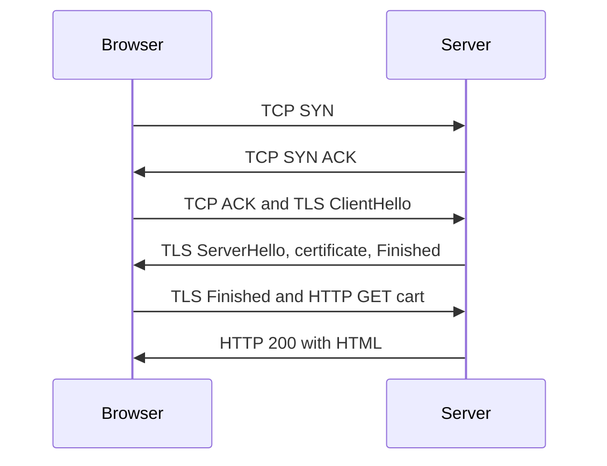

## The hook

"What happens when you type a URL into the browser and press Enter?" It may be the most famous interview question in computing, because there is no bottom to it. A fresher answer says "DNS, then HTTP". A strong answer walks every layer: caches, DNS, ARP, NAT, routing, TCP, TLS, HTTP, the server, and the browser painting pixels, and says what each step costs.

This article is that strong answer, built from the networks track, in order. The system-design view of the same journey, focused on servers and costs, is in [Everything That Happens Before a Page Appears](article:system-design-client-server-http). Predict the first thing that happens, before any packet leaves your laptop. (The browser checks whether it needs the network at all.)

## The intuition

:::analogy
Sending a letter across the world: you look up the address (DNS), hand the letter to your local post office (the gateway), it passes through sorting centres that each read only the city (routers), a phone call confirms someone is home to sign (TCP), the letter goes in a locked box only they can open (TLS), and the reply comes back the same way. **A letter's journey across the world and back** takes several trips, and each one costs time.
:::

## How it works

### 1. The browser thinks first

The browser parses `https://shop.example.com/cart`: scheme https (so port 443 and TLS), host shop.example.com, path /cart. It checks the HSTS list (sites that must only use HTTPS), the browser cache (a fresh cached copy means no network at all), and whether it already has an open connection to that host it can reuse.

### 2. DNS: name to address

The browser cache, the operating system cache and the hosts file are checked, then the configured resolver is asked. On a miss, the resolver walks root, TLD and authoritative servers, as in [A Phone Book With Local Copies Everywhere](article:cs-core-dns-cs). Result: an IP address, say 203.0.113.10.

### 3. Getting the first packet off the laptop

Is 203.0.113.10 on the laptop's own subnet? AND both addresses with the subnet mask: no, so the packet goes to the **[[default gateway]]**. The laptop needs the gateway's MAC address, so it broadcasts an **[[ARP]]** request ("who has 192.168.1.1?") and caches the reply. The frame is addressed to the router's MAC; the IP packet inside is addressed to the server.

### 4. Across the internet

The home router performs NAT, replacing the private source address with its public one and remembering the port mapping. Each router on the way looks up the destination in its routing table, decrements the packet's TTL, and forwards it inside a new frame for the next link. MAC addresses change at every hop; IP addresses do not.

### 5. The handshakes

TCP's three-way handshake opens the connection, as in [A Phone Call Where Both Sides Confirm They Can Hear](article:cs-core-tcp-deep-dive). TLS 1.3 then verifies the server's certificate for shop.example.com and agrees on keys in one more round trip. Only then is the HTTP request sent, encrypted.

### 6. The server side

The request typically reaches a load balancer, which may terminate TLS and forward it to one of many application servers. The application checks the session cookie, reads the cart from a cache or database, renders HTML or JSON, and sends a response: status 200, headers (content type, caching rules, cookies) and a body.

### 7. From bytes to pixels

The browser now follows the **[[critical rendering path]]**:

| Step | What happens |
|---|---|
| Parse HTML | Build the **[[DOM]]** tree; discover CSS, scripts and images, and request them (more DNS, connections and requests) |
| Parse CSS | Build the CSSOM: which styles apply to which elements |
| Run JavaScript | Scripts can change the DOM; by default, a script blocks parsing until it is fetched and run |
| Render tree | Combine DOM and CSSOM, keeping only visible elements |
| Layout | Compute each element's size and position |
| Paint and composite | Fill in pixels in layers and combine them on screen |

Wait, why does the page appear in pieces rather than all at once? Because each sub-resource is a new request, possibly to a new host with its own DNS lookup and handshakes. Browsers start painting as soon as they have enough (HTML and the CSS it needs) and fill in images and later content as they arrive.

### What it costs

With an illustrative **[[round trip time]]** of 50 ms and a DNS answer cached at the resolver:

| Step | Round trips | Time |
|---|---|---|
| DNS (laptop to resolver) | 1 | 50 ms |
| TCP handshake | 1 | 50 ms |
| TLS 1.3 handshake | 1 | 50 ms |
| HTTP request and first byte | 1 | 50 ms, plus server time |
| Total before HTML starts arriving | 4 | about 200 ms |

That is why reused connections, CDNs (shorter RTTs), TLS session resumption and HTTP/3 (combining transport and TLS setup) matter so much.

:::insight
Loading a page is a chain of layers, each costing round trips: the browser checks caches, DNS turns the name into an address, ARP and routing carry packets hop by hop with NAT at the edge, TCP and TLS each spend a round trip setting up, HTTP fetches the HTML, and the browser parses, lays out and paints, fetching more resources as it goes.
:::

## Trade-offs

| Technique | Saves | Cost |
|---|---|---|
| Browser and CDN caching | Whole requests or long round trips | Stale content if cache rules are wrong |
| Connection reuse (keep-alive, HTTP/2) | TCP and TLS handshakes | Server keeps connections open |
| TLS 1.3 and session resumption | Handshake round trips | Replay care for 0-RTT data |
| Deferring scripts | Faster first paint | Some interactivity appears later |
| DNS prefetch and preconnect hints | Setup time for known hosts | Wasted work if unused |

:::warning
Common misconception: "the request goes straight from my laptop to the server." It is handed hop to hop: to the home router (via its MAC), translated by NAT, then forwarded by many routers, each choosing only the next hop. No device on the way knows the full path in advance.
:::

:::try-this
You load the same page again a minute later and it appears almost instantly. List the steps that were skipped. (The DNS answer came from the browser or OS cache; the existing TCP and TLS connection was reused, or TLS was resumed; static files such as CSS, scripts and images came from the browser cache if their headers allowed it; often only the HTML or an API call went to the server.)
:::

## What can go wrong

- **DNS failures or slowness**, which look like "the site is down".
- **Certificate errors**: expired, wrong name, or an untrusted issuer, so the browser refuses.
- **Render-blocking scripts and styles**, delaying the first paint.
- **Too many third-party hosts**, each needing its own DNS lookup and handshakes.
- **Missing cache headers**, refetching unchanged files on every visit.

### Interview follow-ups

**"Where does ARP happen?"** Only on the local network, to find the next hop's MAC address; for remote servers that is the default gateway.

**"What does the load balancer do in this flow?"** It spreads requests across servers and often terminates TLS, as in [The Host Who Seats Every Guest](article:system-design-load-balancers).

**"How would you make this page load faster?"** Cache aggressively, use a CDN, reuse connections, reduce render-blocking resources, and compress and resize assets.

## In the real world

Browser developer tools show this whole timeline per request: DNS lookup, initial connection, TLS, waiting for the first byte, and content download. HTTPS and its versions are covered in [Ordering at a Counter With a Standard Form](article:cs-core-http-https).

## Further reading

- The "what happens when" repository by Alex Gaynor and contributors on GitHub, a community-written long answer.
- Ilya Grigorik, *High Performance Browser Networking* (free online).

## Key takeaways

- Before using the network, the browser parses the URL and checks HSTS, its cache and existing connections.
- DNS resolves the host name, then the laptop uses its subnet mask to decide the packet must go to the default gateway, whose MAC address it finds with ARP.
- NAT rewrites the private source address at the home router, and routers forward the packet hop by hop, changing MAC addresses but not IP addresses.
- TCP and TLS each spend a round trip setting up, so with a 50 ms RTT the first HTML byte arrives after roughly 200 ms plus server time.
- The browser builds the DOM and CSSOM, runs scripts, computes layout and paints, fetching further resources as it discovers them.
