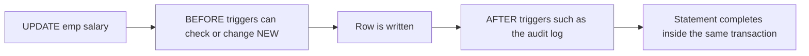

## The hook

HR wants three things from the employee database. A dashboard of headcount and average pay per department that is always current. A record of every salary change, who earned what before and after, that nobody can forget to write. And for interns, access to names and departments, but never salaries.

You could build all three in application code and hope every service remembers. Or you could ask the database to do it: a view for the dashboard and the intern access, a trigger for the salary record. Predict which of these could surprise a developer six months from now. (The trigger: it runs without anyone calling it.)

## The intuition

:::analogy
A **view is a saved search**: you name a query once, and every time you open it, it runs again on current data. A **trigger is an automatic alarm**: whenever a certain change happens, it goes off and does its job, whether or not anyone remembered it was there. A stored procedure is a **saved routine** you run by name.
:::

## How it works

Everything below was run in SQLite on emp(id, name, dept, salary) with Asha (Eng, 120), Ravi (Eng, 90) and Meera (Sales, 70).

### Views

```sql
CREATE VIEW dept_pay AS
SELECT dept, COUNT(*) AS n, AVG(salary) AS avg_sal FROM emp GROUP BY dept;
```

| Moment | SELECT * FROM dept_pay |
|---|---|
| before | Eng 2 105.0, Sales 1 70.0 |
| after raising Eng salaries by 10 | Eng 2 115.0, Sales 1 70.0 |

A **[[view]]** stores the query, not the rows, so it is always current. Uses: hiding complex joins behind a simple name, giving stable names when tables change, and **security** (grant interns a view of name and dept only).

Can you write to a view? Simple views over one table, with no aggregates, are updatable in many databases. Inserting into dept_pay failed with "cannot modify dept_pay because it is a view": an average has no single row to change. INSTEAD OF triggers can define what a write to a view should mean.

### Materialised views

A **[[materialised view]]** stores the result and is refreshed explicitly (`REFRESH MATERIALIZED VIEW` in PostgreSQL) or on a schedule. Reads are as fast as reading a table; the price is staleness between refreshes. Dashboards over large tables are the typical use.

### Triggers

```sql
CREATE TRIGGER log_raise AFTER UPDATE OF salary ON emp
WHEN NEW.salary <> OLD.salary
BEGIN
  INSERT INTO salary_log(emp_id, old, new) VALUES (OLD.id, OLD.salary, NEW.salary);
END;
```

After the raise, salary_log held (1, 120, 130) and (2, 90, 100). Renaming Asha afterwards added nothing, because the trigger watches only the salary column.

A **[[trigger]]** names an event (INSERT, UPDATE, DELETE), a timing (BEFORE, AFTER, or INSTEAD OF for views), a granularity (once per row or once per statement), and OLD and NEW to see the row before and after.



Wait, why does it matter that triggers run in the same transaction? Because if the UPDATE is rolled back, the audit row disappears too, which is exactly what you want: no log entry for a change that never happened.

### Stored procedures

A **[[stored procedure]]** packages several statements with parameters and control flow, and runs inside the database (PostgreSQL syntax, shown for shape):

```sql
CREATE PROCEDURE give_raise(p_dept TEXT, p_pct NUMERIC)
LANGUAGE SQL AS $$
  UPDATE emp SET salary = salary * (1 + p_pct / 100) WHERE dept = p_dept;
$$;
CALL give_raise('Eng', 10);
```

Benefits: fewer round trips for multi-step work, one place for logic shared by many applications, and permissions granted on the procedure rather than the tables. A **function** differs by returning a value and being usable inside queries.

:::insight
Views store queries and stay current; materialised views store results and need refreshing. Triggers run automatically inside the same transaction as the change that fired them, which makes them reliable for audit trails and invariants, and invisible to anyone reading the application code.
:::

## Trade-offs

| Tool | Good for | Cost |
|---|---|---|
| View | Simplifying queries, security, stable interfaces | Can hide expensive joins; stacked views get slow and opaque |
| Materialised view | Fast reads of heavy aggregates | Stale between refreshes; refresh cost |
| Trigger | Audit logs, invariants every writer must obey | Hidden side effects, harder debugging, slower writes |
| Stored procedure | Fewer round trips, shared logic near data | Harder to version, test and deploy than application code; ties you to one database's language |

:::warning
Common misconception: "a view makes queries faster because the result is saved." A normal view saves only the query text; selecting from it runs the full query each time, and wrapping views in views can make plans worse. Only a materialised view stores results.
:::

:::try-this
The trigger fires on `UPDATE OF salary` with `WHEN NEW.salary <> OLD.salary`. What gets logged by `UPDATE emp SET salary = salary WHERE id = 3`? (Nothing: the update touches the salary column, so the trigger considers firing, but the WHEN condition is false because the value did not change.)
:::

## What can go wrong

- **Trigger chains**: a trigger updates a table whose trigger updates another, creating behaviour nobody can follow, or infinite loops.
- **Business logic split** between application code and procedures, with neither team seeing the whole picture.
- **Stale materialised views** shown to users as live data.
- **Views over views** producing slow, hard-to-tune queries.
- **Per-row triggers on bulk loads**, multiplying the cost of large inserts.

### Interview follow-ups

**"Procedure versus function?"** Functions return a value and can appear in SELECT; procedures are invoked with CALL, may return nothing and, in some databases, can manage transactions.

**"Would you put business logic in stored procedures?"** Usually only for data-centred rules every writer must obey (audit, integrity) or performance-critical multi-step operations; most teams keep business logic in application code for testing and deployment reasons.

**"How else can you get an audit trail?"** Change data capture reads the database's log and streams changes elsewhere, with no trigger overhead on writes.

## In the real world

PostgreSQL, MySQL, SQL Server and Oracle support views, triggers and procedures; SQLite supports views and triggers but not stored procedures. Window functions often power the views in dashboards, as in [A Leaderboard Computed Inside the Query](article:cs-core-sql-advanced).

## Further reading

- The PostgreSQL documentation chapters "Views", "Triggers" and "CREATE PROCEDURE".
- The SQLite documentation for CREATE VIEW and CREATE TRIGGER.

## Key takeaways

- A view is a named query that runs on current data whenever it is selected, useful for simplicity, stable interfaces and restricting what users can see.
- A materialised view stores its result for fast reads and must be refreshed, so it can be stale.
- A trigger runs automatically before or after inserts, updates or deletes, inside the same transaction, which suits audit logs and invariants.
- Stored procedures run multi-step logic inside the database, saving round trips but making testing, versioning and portability harder.
- Hidden trigger side effects and logic split across layers are the main reasons teams use these tools sparingly.
