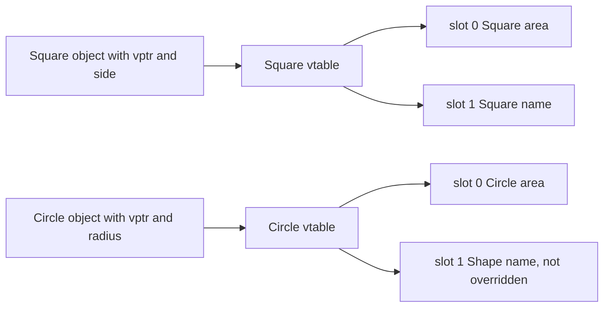

## The hook

`shape->area()` runs Square's area for a square and Circle's for a circle. But the compiler that translated that line had no idea which kind of shape would be there at run time; the list might be read from a file. So what instruction did it emit? It cannot be "jump to Square::area".

The answer is a small, elegant trick that nearly every C++ compiler uses, and interviewers ask about it constantly: the vtable. Understanding it also explains three bugs people hit in real code. Predict how many extra bytes an object pays for having virtual functions on a 64-bit machine. (One pointer, 8 bytes, plus any padding.)

## The intuition

:::analogy
An office has **a switchboard that routes calls by caller type**. Every employee's badge carries a code for their department. When someone calls "the help line", the switchboard looks up the caller's department code in a table and connects them to that department's help desk. The caller always dials the same number; the table decides who answers.
:::

## How it works

### vtable and vptr

For every class with virtual functions, the compiler builds one **[[vtable]]**: an array of function pointers, one slot per virtual function, each pointing to the version that class uses. Every object of such a class gets a hidden **[[vptr]]** pointing to its class's vtable.



A virtual call `p->area()` compiles to roughly:

```pseudo
table = p->vptr               // load the object's vtable pointer
fn    = table[slot_of_area]   // load the function pointer for area
fn(p)                         // call it, passing p as this
```

The slot number is fixed at compile time; only the table differs per class. That answers the hook: the compiler emits "call whatever is in slot 0 of this object's table".

### Seen for real

```cpp
#include <iostream>
using namespace std;

struct Plain   { int x; void f() {} };
struct Virtual { int x; virtual void f() {} };

struct Base {
    Base() { hello(); }                       // virtual call inside a constructor
    virtual void hello() const { cout << "Base::hello\n"; }
    virtual ~Base() { cout << "~Base\n"; }
};
struct Derived : Base {
    int* data = new int[100];
    void hello() const override { cout << "Derived::hello\n"; }
    ~Derived() override { delete[] data; cout << "~Derived frees its buffer\n"; }
};

int main() {
    cout << sizeof(Plain) << " " << sizeof(Virtual) << "\n";   // 4 16
    Base* p = new Derived;                    // Base::hello (during Base's constructor)
    p->hello();                               // Derived::hello: dynamic dispatch
    delete p;                                 // ~Derived frees its buffer, then ~Base
}
```

**Size**: Plain is 4 bytes, Virtual is 16: an 8-byte vptr plus the int, padded to a multiple of 8.

**Constructors**: Wait, why did constructing a Derived print Base::hello? Objects are built base-first, and while Base's constructor runs, the vptr points to *Base's* vtable; the Derived part does not exist yet, so calling Derived's version would touch uninitialised members. The vptr is switched to Derived's vtable only when Derived's constructor starts. The same happens in reverse during destruction.

### The virtual destructor rule

If a class is meant to be deleted through a base pointer, the base destructor must be **[[virtual destructor|virtual]]**. Above, `delete p` ran `~Derived` (freeing the buffer) and then `~Base`. A test with a non-virtual base destructor printed only the base destructor, and g++ -Wall warned: "deleting object of polymorphic class type … which has non-virtual destructor might cause undefined behavior". The derived buffer would leak, and formally the behaviour is undefined.

Rule of thumb: a class with any virtual function should have a public virtual destructor (or a protected non-virtual one, if deleting through a base pointer should be forbidden).

### Pure virtual functions and abstract classes

`virtual double area() const = 0;` declares a **[[pure virtual function]]**: the base provides no required implementation, and any class with one is an **[[abstract class]]** that cannot be instantiated. Derived classes must override every pure virtual function to become concrete. (A pure virtual function may still have a body, and a pure virtual destructor must have one, since it always runs.)

:::insight
Each polymorphic class has one vtable of function pointers and each object carries a hidden vptr to it, so a virtual call is two loads and an indirect call, with the slot chosen at compile time and the table chosen by the object. Constructors and destructors see only the part of the object that currently exists, and deleting through a base pointer requires a virtual destructor.
:::

## Trade-offs

| Aspect | Cost or limit |
|---|---|
| Memory | one vptr per object (8 bytes on 64-bit), one vtable per class |
| Speed | an indirect call that usually cannot be inlined; branch predictors make it cheap when the target is consistent |
| Flexibility | new derived classes work with old code unchanged |
| Devirtualisation | compilers can call directly when they know the exact type (for example, with final classes) |

:::warning
Common misconception: "every object has its own vtable." There is one vtable per class, shared by all its objects; each object has only a pointer to it. A million Square objects cost a million vptrs but just one Square vtable.
:::

:::try-this
Shape declares virtual area() and virtual name(); Circle overrides only area(). What does Circle's vtable contain, and what does `Shape* s = new Circle(1); s->name();` call? (Slot for area points to Circle::area; slot for name points to Shape::name, inherited unchanged. So s->name() runs Shape::name.)
:::

## What can go wrong

- **Missing virtual destructor**, leaking or corrupting resources owned by derived classes.
- **Calling virtual functions from constructors or destructors**, expecting derived behaviour.
- **Calling a pure virtual function** indirectly during construction, which typically aborts with "pure virtual method called".
- **Slicing**: copying a derived object into a base object by value, which makes it a plain base object with the base's vptr.
- **Accidental hiding** instead of overriding when the signature differs; use `override`.

### Interview follow-ups

**"Where is the vptr stored?"** Implementation-defined, but in common ABIs (such as the Itanium C++ ABI used by g++ and Clang) at the start of the object.

**"What happens with multiple inheritance?"** An object can contain several vptrs, one per polymorphic base subobject, and calls through the second base adjust the this pointer.

**"Can a virtual function be inline?"** It can be declared inline, but a call is inlined only when the compiler knows the exact type at that call site.

## In the real world

Plug-in systems, GUI frameworks and game engines rely on virtual dispatch for extension points; performance-critical code sometimes uses templates (static polymorphism) instead. The overriding rules this mechanism implements are in [One Remote Controlling Different TVs](article:cs-core-polymorphism).

## Further reading

- Stanley Lippman, *Inside the C++ Object Model*.
- The Itanium C++ ABI specification, section on virtual table layout.

## Key takeaways

- Each class with virtual functions has one vtable of function pointers, and each object has a hidden vptr pointing to its class's vtable.
- A virtual call loads the vptr, picks the function pointer at a slot fixed at compile time, and calls it, which is how the object's actual type decides the code.
- Virtual functions add a vptr to every object, so a class with one int grew from 4 to 16 bytes on a 64-bit build.
- During construction and destruction, virtual calls dispatch to the class currently being built or destroyed, not to more-derived classes.
- A polymorphic base class needs a virtual destructor, or deleting a derived object through a base pointer is undefined and typically skips the derived destructor.
