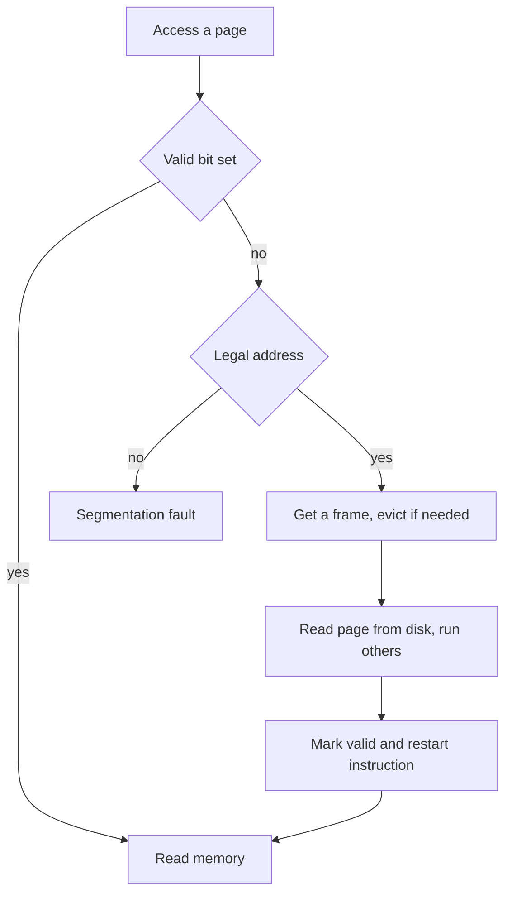

## The hook

Open a large application, the kind whose installed files take up gigabytes, and it is on screen in a second or two. Reading gigabytes from disk takes far longer than that. So it did not read them.

Now open forty more programs. Add up how much memory each one says it is using, and the total can exceed the RAM in your machine. Nothing crashes. Things might get a little slower.

Both tricks come from one idea: a program does not need all of its memory in RAM, only the part it is using right now. The rest can wait on disk. That idea is virtual memory, and the single event that makes it work, the page fault, is also the reason a machine sometimes grinds to a near halt.

## The intuition

:::analogy
You are studying in a library at a **small desk** that holds only a few books. Your reading list has fifty books, but you never need all fifty at once, only the three or four for the chapter you are on. The rest stay in the **stacks**, far away. When you reach for a book that is not on your desk, you stop, walk to the stacks, fetch it, and if the desk is full, **send one book back** first. Each fetch costs minutes, while turning a page on your desk costs seconds, so the whole plan only works if you rarely need a book that is not already on the desk.
:::

| In the library | In virtual memory |
|---|---|
| Your reading list | The process's virtual address space |
| The desk | Physical memory, the frames given to this process |
| The stacks | Disk: [[swap space]] and the program's files |
| A book on the desk | A page that is valid in the page table |
| Reaching for a book that is not there | A [[page fault]] |
| The walk to the stacks | Disk I/O, millions of times slower than a memory access |
| The few books you need for this chapter | The [[working set]] |
| Sending a book back to make room | Page replacement |

[[Virtual memory]] is the whole arrangement: the process sees the full reading list as if it were on its desk, and the kernel quietly moves books back and forth.

## How it works

### Demand paging: fetch on first touch

With [[demand paging]], nothing is loaded when a program starts. The kernel sets up the page table with every entry marked **not valid**, and records, for each page, where it can be found: in the executable file, in swap space, or nowhere yet because it is a fresh page that should start as zeros.

Then the program runs. Its very first instruction fetch faults. The kernel loads that page; the program continues until it touches the next missing page, and so on. Pages the program never touches, such as the code for a menu you never open, are never loaded at all. That is how the large application started in a second.

A common variant, **prepaging**, loads a few neighbouring pages along with the one that faulted, betting on locality. When the bet is right it saves faults; when it is wrong it wastes disk reads and frames.

The page table entry's valid bit, from [The Index That Tells You Which Shelf](article:cs-core-paging-tlb), now means two different things:

| Valid bit | Address is in the process's regions | Meaning |
|---|---|---|
| 1 | Yes | Page is in a frame; the access proceeds at memory speed |
| 0 | Yes | Page is legal but on disk or not yet created: a normal page fault |
| 0 | No | Illegal address: the process gets a segmentation fault |

### A page fault, step by step

Predict before reading: while the disk is fetching the page, what is the CPU doing?

| Step | Who | What happens |
|---|---|---|
| 1 | Process | Executes an instruction that touches page 7 |
| 2 | MMU | Finds the page 7 entry not valid and raises a page fault trap |
| 3 | Kernel | Checks that the address belongs to one of the process's regions; if not, sends a segmentation fault and stops here |
| 4 | Kernel | Finds a free frame, or chooses a victim page to evict, writing it to disk first if it is dirty |
| 5 | Kernel | Starts a disk read of page 7 into that frame, and marks the process as waiting |
| 6 | Scheduler | Runs **another process** during the read |
| 7 | Disk | Finishes and raises an interrupt |
| 8 | Kernel | Updates page 7's entry with the frame number and sets it valid; the process becomes ready |
| 9 | Process | Is scheduled again and **re-executes the same instruction**, which now succeeds |

The answer to the prediction: the CPU runs other processes. The faulting process moves to the waiting state you met in [An Actor Stepping Off Stage](article:cs-core-process-states), exactly as if it had asked to read a file.

Step 9 deserves a "wait, why?". The instruction that faulted did not finish, so the hardware must be able to restart it from the beginning as if nothing happened. For most instructions this is easy. For an instruction that copies a block of memory and faults halfway through, the hardware must either check all the pages up front or be able to undo partial work. Restartable instructions are a hardware requirement for demand paging.

### Where evicted pages go

Not every page needs swap space. It depends on what backs the page:

| Page type | Backed by | When evicted, if clean | When evicted, if dirty |
|---|---|---|---|
| Program code | The executable file | Just drop it; reread from the file later | Code is not written, so this does not arise |
| Memory-mapped file data | That file | Just drop it | Write it back to the file |
| Heap and stack | Nothing on disk | Fresh untouched pages are just zero-filled again | Write to **swap space** |

The **dirty bit** in the page table entry, set by hardware on any write, decides whether eviction costs one disk transfer (read the new page) or two (write the old one, then read the new one).

Linux also distinguishes **minor faults**, where the page is already in memory, for example in the file cache or shared with another process, and only the page table needs updating, from **major faults**, which need disk I/O. A minor fault costs microseconds; a major fault from a hard disk costs milliseconds.

### Effective access time with page faults

Here is the arithmetic that explains why page faults must be rare. Let $p$ be the probability that a memory access faults, $m$ the memory access time, and $F$ the time to service a fault. Then:

$$\text{EAT} = (1 - p)\,m + p\,F$$

In words: most accesses cost a memory access, and a fraction $p$ of them cost a whole fault instead.

Take some illustrative numbers: $m = 100$ ns, and $F = 8$ ms for a fault served from a hard disk, which is 8,000,000 ns. Before looking, guess how much slower memory becomes if just **one access in a thousand** faults.

| Fault rate p | (1 − p) × 100 ns | p × 8,000,000 ns | EAT | Slowdown |
|---|---|---|---|---|
| 1 in 1,000 | 99.9 | 8000 | 8099.9 ns | about 81 times |
| 1 in 10,000 | 99.99 | 800 | 899.99 ns | about 9 times |
| 1 in 1,000,000 | about 100 | 8 | about 108 ns | 8 percent |

One fault per thousand accesses makes the machine roughly **81 times slower**. The cost of a fault is so large that even a tiny fault rate dominates.

The reverse question appears in exams: what fault rate keeps the slowdown under 10 percent, an EAT below 110 ns?

$$100 + p\,(8{,}000{,}000 - 100) < 110 \quad\Rightarrow\quad p < \frac{10}{7{,}999{,}900} \approx 1.25 \times 10^{-6}$$

That is at most about **one fault in 800,000 accesses**. If the faulting page is also dirty, so the kernel must write a victim before reading, $F$ roughly doubles, and the bound gets tighter still. On a fast SSD, assume $F$ is closer to 0.1 ms; then one fault in a thousand gives about 200 ns, around twice as slow, painful but no longer catastrophic.

:::insight
Virtual memory works only because programs have locality: at any moment they use a small set of pages over and over. A page fault is millions of times slower than a memory access, so the system is fast exactly as long as each process's working set fits in its frames.
:::

### Locality and the working set

The desk works because you study one chapter at a time. Programs behave the same way: a loop runs the same code and touches the same data for thousands of iterations, then moves on. Peter Denning formalised this as the **working set**: the distinct pages referenced in the last $\Delta$ references.

Here is a reference string with window $\Delta = 4$:

| Time | 1 | 2 | 3 | 4 | 5 | 6 | 7 | 8 | 9 | 10 | 11 | 12 |
|---|---|---|---|---|---|---|---|---|---|---|---|---|
| Page referenced | 1 | 2 | 1 | 3 | 2 | 4 | 4 | 4 | 5 | 4 | 5 | 5 |
| Working set | 1 | 1 2 | 1 2 | 1 2 3 | 1 2 3 | 1 2 3 4 | 2 3 4 | 2 4 | 4 5 | 4 5 | 4 5 | 4 5 |
| Size | 1 | 2 | 2 | 3 | 3 | 4 | 3 | 2 | 2 | 2 | 2 | 2 |

The program has two phases: one around pages 1, 2 and 3, then one around pages 4 and 5. The working set briefly swells to 4 at the transition, then shrinks to 2. The size tells the kernel how many frames this process needs right now. With pure demand paging and enough frames, this string causes exactly 5 faults, one per distinct page, all on first touch.

### How many frames each process gets

The kernel must split the frames among processes. Two simple policies:

- **Equal allocation**: with 64 free frames and 2 processes, each gets 32.
- **Proportional allocation**: by size. A 20-page process and a 140-page process share 64 frames as 20/160 × 64 = **8** and 140/160 × 64 = **56**.

Every process also needs a minimum, set by the hardware: an instruction that touches several pages at once must be able to have all of them in memory at the same time, or it can never complete.

When a fault needs a victim, **local replacement** picks only among the faulting process's own frames, which keeps one process from hurting others. **Global replacement** picks from all frames, which uses memory better overall but lets a greedy process take frames from everyone else.

### Thrashing: the desk that is too small

Now squeeze. Give a process fewer frames than its working set. It faults, evicts a page it is still using, faults on that page a moment later, evicts another one it needs, and so on. Every desk swap sends back a book you are about to need.

Predict what a naive scheduler does next. It sees the CPU mostly idle, because every process is waiting for the disk, concludes the system is underloaded, and admits **more** processes. Each new process takes frames from the others, the fault rate climbs further, and CPU utilisation falls even more. That spiral is [[thrashing]].

| Degree of multiprogramming | What happens |
|---|---|
| Low | CPU is idle while processes wait for I/O; adding processes helps |
| Moderate | Working sets fit; CPU busy, few faults |
| Too high | Working sets no longer fit; faults explode, CPU utilisation collapses |

Ways out:

- **Working-set model**: keep each process's working set in memory; if the sum exceeds the available frames, suspend a whole process and swap it out until there is room.
- **Page-fault frequency control**: watch each process's fault rate. Above an upper bound, give it more frames; below a lower bound, take some away; if no frames are free, suspend a process.
- **Buy RAM**, or run fewer things at once. Sometimes the honest fix.

:::warning
Common misconception: "a page fault is an error." Most page faults are normal operation: the first touch of every page under demand paging, a copy-on-write, or a page coming back from swap. Only a fault on an address outside the process's regions, or one that breaks the page's protection, is an error, and that is what produces a segmentation fault.
:::

### Copy-on-write: the photocopy you never make

When a Unix process calls `fork()`, the child gets a copy of the parent's entire address space. Copying gigabytes for a child that will often call `exec()` and throw it all away a moment later would be wasteful.

With [[copy-on-write]], the kernel instead points both page tables at the same frames and marks them **read-only**. Both processes read happily. When either one writes, the write faults, the kernel copies just that one page, gives the writer its own copy marked writable, and restarts the instruction. A child that immediately calls `exec()` copies almost nothing. This is why `fork()` is cheaper than its definition suggests, which you met in [Separate Houses or Roommates?](article:cs-core-processes-threads)

:::try-this
A parent process has 1000 pages, all private, and calls fork. The child writes to 3 pages, and the parent writes to 2 other pages, then both keep running. With copy-on-write, how many page copies does the kernel make, and how many page faults are copy-on-write faults? (5 copies and 5 copy-on-write faults, one per page first written by either side. Without copy-on-write, fork would have copied all 1000 pages up front.)
:::

## Trade-offs

| Choice | You gain | You give up |
|---|---|---|
| Demand paging | Fast start, programs larger than RAM, untouched pages cost nothing | A fault on first touch of every page |
| Prepaging, loading likely pages in advance | Fewer faults at startup | Wasted I/O if the guesses are wrong |
| Swap space | More processes than RAM, idle pages out of the way | Disk space, and terrible slowness if active pages end up there |
| Larger pages | Fewer faults and smaller tables | More I/O per fault and more internal fragmentation |
| Local replacement | Processes are isolated from each other's behaviour | Some frames sit unused in quiet processes |
| Global replacement | Better use of total memory | One process's behaviour affects everyone's fault rate |
| Overcommitting memory | Many programs reserve memory they never use, so more can run | When they do use it, the system must kill something |

## What can go wrong

- **Thrashing.** Too many processes for the memory; the disk light is always on and nothing progresses. Reduce the load.
- **Swapping out latency-sensitive memory.** A database or a game whose hot pages get evicted stalls for milliseconds. Such programs often lock critical pages in memory.
- **Running out with overcommit.** Linux by default lets processes reserve more memory than exists; if they actually touch it all, the kernel's out-of-memory killer ends a process to free memory.
- **Bad access patterns.** Walking a huge matrix column by column, when it is stored row by row, touches a new page on almost every access.
- **Forgetting dirty pages in the cost.** Evicting a dirty page means a write before the read, so the fault costs about twice as much.
- **Mixing up the two faults.** A page fault on a legal address is routine; a segmentation fault is the special case of an illegal access.
- **Edge case: one instruction, several faults.** An instruction that straddles a page boundary, or copies from one page to another, can fault on each page in turn. That is why every process needs a minimum number of frames, or such an instruction could never complete.
- **Edge case: the kernel faulting on itself.** The page fault handler, the page tables it reads and pages that a device is transferring into are pinned in memory, so servicing a fault never requires another fault.

### Interview follow-ups

**"What happens, step by step, on a page fault?"** The MMU traps because the entry is not valid. The kernel checks the address is legal, finds a frame (evicting and possibly writing back a victim), starts the disk read and blocks the process while others run. When the read completes, it updates the page table, marks the process ready, and the faulting instruction is restarted.

**"Compute the effective access time with a page fault rate p."** EAT = (1 − p) × memory time + p × fault service time. With 100 ns memory, 8 ms faults and p = 0.001, that is 99.9 + 8000 = about 8.1 microseconds. Keeping the slowdown under 10 percent requires p below about one in 800,000.

**"What is thrashing, and how do you fix it?"** Processes have fewer frames than their working sets, so they spend their time faulting and CPU utilisation collapses. Fix it by reducing the degree of multiprogramming, using the working-set model or page-fault frequency control to give each process the frames it needs, or adding memory.

**"How does fork avoid copying the whole address space?"** Copy-on-write: parent and child share frames marked read-only, and a page is copied only when one of them writes to it.

**"What is the difference between a minor and a major page fault?"** A minor fault finds the page already in memory, such as in the file cache, and only fixes the page table. A major fault needs disk I/O and is thousands of times slower.

## In the real world

- **Every modern general-purpose OS** uses demand-paged virtual memory: executables are mapped from their files, heap and stack pages start as zero-filled pages on first touch, and `fork` uses copy-on-write.
- **Memory-mapped files** (`mmap`) turn file I/O into page faults: reading a mapped file faults its pages in, and dirty pages are written back to the file.
- **Linux** reports minor and major fault counts per process, and its out-of-memory killer handles the case where overcommitted memory runs out.
- **Phones** generally avoid swapping to their flash storage. Instead the OS compresses memory, asks apps to release what they can, and kills background apps when memory runs low, which is why an app you left a while ago sometimes restarts from scratch.
- How much slower a disk is than memory, on a human scale, is in [If a CPU Cycle Took One Second](article:system-design-latency-numbers).

One question has been waved away all along: when the desk is full, *which* book goes back to the stacks? Choose badly and you fetch it again a moment later. Choose well and faults become rare. And one obvious-sounding policy has a famous flaw: giving it a bigger desk can make it fault *more*. That is [Which Book Goes Back on the Shelf?](article:cs-core-page-replacement)

## Further reading

- *Operating Systems: Three Easy Pieces*, the chapters on swapping mechanisms and policies.
- *Operating System Concepts* by Silberschatz, Galvin and Gagne, the virtual memory chapter, including demand paging, copy-on-write and thrashing.
- Peter J. Denning, "The Working Set Model for Program Behavior", Communications of the ACM, 1968.

## Key takeaways

- Virtual memory separates the address space a process sees from physical memory, so only the pages in use need to be in RAM and the rest can live on disk.
- Demand paging loads a page only on first access, and a page fault on a legal address blocks the process during the disk read and then restarts the faulting instruction.
- Effective access time is (1 − p) times the memory time plus p times the fault service time, and because a fault costs millions of times more than an access, the fault rate must be tiny.
- Each process needs its working set, the pages it is actively using, in memory, and when the working sets together exceed memory the system thrashes.
- Copy-on-write lets fork share all pages read-only and copy only the pages that one side actually writes.
