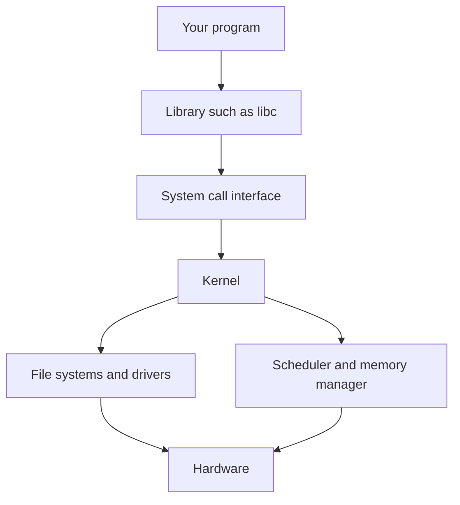

## The hook

Right now your laptop is running a browser with forty tabs, a music player, a chat app and a code editor. There is one set of RAM chips, one disk and a handful of CPU cores. Every one of those programs was written as if it owned the whole machine.

None of them asked the others for permission. None of them crashes when another one misbehaves. When your music player wants the speaker, it gets it, and the chat app still pings.

Who is keeping the peace? And why does an interviewer ask "what does an operating system actually do" as if the answer were not obvious?

## The intuition

:::analogy
Picture a busy **hotel manager**. Guests arrive wanting rooms, hot water, room service and the lift. The manager decides **who gets which room**, keeps a **master key** that no guest has, runs a **front desk** where guests make requests, and hands each guest a simple brochure ("press 0 for reception") so nobody needs to know where the boiler is. Every guest feels the hotel is run for them alone.
:::

The operating system is that hotel manager, and your programs are the guests. The manager has three jobs, and they map one to one:

| Hotel manager's job | Operating system's job | Example |
|---|---|---|
| Share out rooms, lifts and hot water fairly | **Resource manager** | Splits CPU time, RAM and disk between programs |
| Hand out a simple brochure instead of the boiler manual | **[[Abstraction]] layer** | Gives you "files" instead of disk sectors, "processes" instead of raw CPU |
| Keep the master key and stop guests entering each other's rooms | **Protector and referee** | Stops one program reading another's memory or wiping the disk |

Hold on to the hotel. Every hard idea below is one of these three jobs wearing a technical name.

## Let's build it up

### Job 1: the resource manager

A machine has a few genuinely scarce things: CPU time, memory, storage, and devices like the network card and the screen. The OS decides who gets how much, and when.

- **CPU**: dozens of programs want to run, but a core can run one instruction stream at a time. The OS runs each for a short slice and switches, so fast that it looks simultaneous.
- **Memory**: every program gets its own region, and the OS tracks which physical RAM belongs to whom.
- **Storage and devices**: two programs writing to the disk at once must not interleave their bytes into garbage. The OS queues and orders the requests.

Predict this before reading on. A single-core machine runs two programs, each stuck in `while (true) {}`. Neither ever calls the OS. Does the machine freeze?

It does not. Here is the trick: a hardware clock fires a **[[timer interrupt]]** at regular intervals. The interrupt yanks the CPU out of whatever it was doing and jumps into OS code. The OS then picks who runs next. In hotel terms, the manager does not wait for a guest to leave the lift voluntarily; a bell rings and the lift returns to the lobby.

:::insight
The operating system is not a program that runs alongside yours. It is code that only runs when something hands it control: a system call from a program, an interrupt from a device, or the timer bell. Between those moments, your program has the CPU to itself.
:::

### Job 2: the illusionist

The raw hardware is ugly. A disk is a long array of numbered blocks. Memory is one shared array of bytes. A network card speaks in packets and registers.

The OS hides all of this behind [[abstraction|abstractions]]:

| What you use | What is really underneath |
|---|---|
| A file called `notes.txt` | Scattered disk blocks plus a table saying which blocks hold which bytes |
| A process with its own memory starting near address 0 | Physical RAM shared by everyone, mapped differently for each program |
| A socket you `send()` bytes into | Packets, retransmissions, network card buffers |
| A thread that seems to run continuously | Short time slices on a core shared with others |

Wait, why bother with illusions instead of exposing the hardware? Two reasons. Portability: your program runs on any disk brand because it only knows "files". And safety: if programs only see their own private memory, they cannot trample each other. The illusion *is* the protection.

### Job 3: the referee with the master key

Here is the catch with jobs 1 and 2. If any program could talk to the disk controller directly, it could ignore the file system and overwrite someone else's data. If any program could change the memory mapping, it could read your password manager.

So the CPU itself has two modes, enforced in hardware by a mode bit:

- **[[User mode]]**: where your programs run. Privileged instructions, like reprogramming the memory mapping or talking to devices, are refused. Trying one causes a fault that jumps into the OS.
- **[[Kernel mode]]**: where the core of the OS, the **[[kernel]]**, runs. Everything is allowed.

The kernel is the manager holding the master key. Guests never touch the key. They go to the front desk.

### The front desk: system calls

When your program needs something only the kernel can do, it makes a **[[system call]]**. It places a request number and arguments in agreed places, then executes a special instruction that switches the CPU into kernel mode and jumps to one fixed entry point inside the kernel.

That fixed entry point matters. A guest cannot walk into the manager's office through any door they like; there is exactly one counter, and the manager checks every request there. The kernel validates the arguments ("is this file descriptor yours?", "is this buffer in your memory?"), does the work, switches back to user mode and returns a result.

Read the diagram top to bottom: programs call library functions, libraries make system calls, the kernel's subsystems drive the hardware. Your code never jumps from the top box straight to the bottom one.

:::warning
Common misconception: "the operating system is the desktop, the windows and the apps it ships with." Those are user programs bundled with the OS. In OS courses and interviews, "the operating system" usually means the kernel: the privileged code that manages resources and enforces protection. A shell or a file manager runs in user mode, as an ordinary guest.
:::

### What the kernel is not

A few boundaries that interviewers like to probe:

- **Not always running.** On an idle machine the kernel runs an idle loop, but on a busy one it only runs at those entry moments: calls, interrupts, faults.
- **Not the same as a library.** `printf` is a library function running in user mode. It eventually calls `write`, a system call. Library calls are ordinary jumps; system calls cross the privilege boundary.
- **Not one design.** A **monolithic** kernel (Linux is the classic example) puts file systems and drivers inside the kernel for speed. A **microkernel** keeps only the bare minimum in kernel mode and runs drivers and file systems as separate user-mode servers, trading some speed for isolation. Both do all three jobs; they disagree on where to draw the privileged line.

## A tiny example

Let's trace the most ordinary line of C you have written: `printf("hi\n");` in a program that prints to a terminal. Guess first: how many times does the CPU switch between user mode and kernel mode?

| Step | Mode | Who is running | What happens |
|---|---|---|---|
| 1 | User | Your code | Calls `printf` with the string |
| 2 | User | libc | Formats the text and copies `hi\n` into its output buffer |
| 3 | User | libc | Sees a newline on a terminal, decides to flush, calls `write(1, buf, 3)` |
| 4 | User to kernel | CPU | The system call instruction switches mode and jumps to the kernel's entry point |
| 5 | Kernel | Kernel | Checks that file descriptor 1 is open and `buf` lies in your memory |
| 6 | Kernel | Terminal driver | Copies the 3 bytes into the terminal's buffer |
| 7 | Kernel to user | CPU | Returns 3, the number of bytes written, and drops back to user mode |
| 8 | User | Your code | `printf` returns and your program continues |

The answer is two switches: one in at step 4, one out at step 7. Everything else, including the formatting, happens in user mode. That is why libraries buffer output: if each character were its own system call, the crossing cost would be paid per byte.

:::try-this
Your program calls `printf` ten times, each printing one short line, and its output is redirected to a file instead of a terminal. When output goes to a file, libc typically buffers until the buffer fills or the program exits. Roughly how many `write` system calls happen? (Probably one, at exit or when the buffer flushes, because all ten short lines fit in one buffer. On a terminal, the newline would trigger a flush each time, giving about ten.)
:::

Now the timer, traced. Two programs A and B, one core, and suppose the timer fires every 10 ms (a made-up number for illustration):

| Time | Running | Mode | Event |
|---|---|---|---|
| 0 ms | A | User | A computes |
| 10 ms | Kernel | Kernel | Timer fires; scheduler saves A, picks B |
| 10 ms+ | B | User | B computes |
| 20 ms | Kernel | Kernel | Timer fires; scheduler saves B, picks A |
| 20 ms+ | A | User | A resumes exactly where it stopped |

Neither program cooperated. The manager's bell did all the work.

## Where you'll see this again

Every article in this Operating Systems track is one of the three jobs, zoomed in:

- **Resource manager**: CPU scheduling decides which guest gets the lift next; memory management decides who gets which rooms.
- **Illusionist**: processes, threads and virtual memory give every program the feeling of owning the machine.
- **Referee**: system calls, user and kernel mode, and synchronisation keep guests from hurting each other.

The costs you meet in system design start here too. A system call is far more expensive than a function call, and a disk read is far slower than a memory read; [If a CPU Cycle Took One Second](article:system-design-latency-numbers) puts those gaps on a human scale. When a web server handles a request, every socket read is a trip to the front desk, as you can see in [Everything That Happens Before a Page Appears](article:system-design-client-server-http).

### Interview follow-ups

**"What happens if a user program executes a privileged instruction?"** The CPU refuses and raises an exception, which traps into the kernel. The kernel usually treats it as a fatal error and kills the program (on Unix, by sending it a signal). The program never gets kernel power by trying.

**"Why not run everything in kernel mode and skip the cost of system calls?"** Because one buggy or malicious program could then corrupt memory, other programs or the disk. Some specialised systems do run a single trusted application without this split, but a general-purpose OS needs the boundary to stay safe.

**"Is a system call the same as an interrupt?"** Both transfer control to the kernel through a fixed entry point. A system call is deliberate and synchronous: the program asks. A hardware interrupt is asynchronous: a device or the timer signals regardless of what the program is doing. A fault, such as dividing by zero, is synchronous but unintended.

**"Monolithic kernel or microkernel?"** Monolithic: fast, because subsystems call each other directly, but a driver bug can crash the whole kernel. Microkernel: drivers run as isolated user-mode servers, so a crash is contained, but requests cost extra messages between them.

Next, meet the guests themselves. What exactly is a "program that is running", and why do some guests get their own house while others share one? That is [Separate Houses or Roommates?](article:cs-core-processes-threads)

## Key takeaways

- An operating system does three jobs: it manages scarce resources, it provides simple abstractions over messy hardware, and it protects programs from each other.
- The kernel is the privileged core of the OS; it runs only when something hands it control, such as a system call, a device interrupt, a fault or the timer.
- The CPU enforces user mode and kernel mode in hardware, so ordinary programs cannot execute privileged instructions and must ask the kernel through system calls.
- A timer interrupt lets the kernel take the CPU back from any program, which is why one infinite loop cannot freeze a multitasking machine.
- Library functions like printf run in user mode and only cross into the kernel when they make a system call, which is why libraries buffer work to cross less often.
