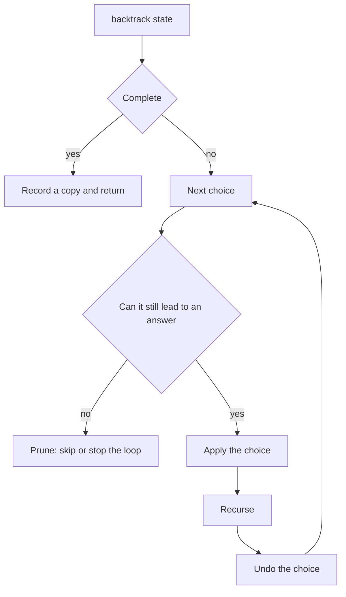

## The hook

You are exploring a cave system with a piece of chalk. At every fork you mark the tunnel you take. If it dead-ends, you walk back to the fork, rub out the mark and try the next tunnel. You never get lost, you never explore the same tunnel twice from the same fork, and when you return to the entrance, the walls are clean again.

That is backtracking, the method behind "generate all valid ...", "find any arrangement that ...", Sudoku, N-Queens, word search and a long list of interview puzzles. They all fit one short template. The skill is not the template itself but choosing the state and cutting dead branches early.

## The intuition

:::analogy
Picture yourself in the cave with chalk. A fork is a decision point. Taking a tunnel means writing a chalk mark: you change your situation. Walking down it is exploring the consequences. Coming back and rubbing the mark out restores the situation exactly as it was, so the next tunnel at the same fork starts from the same place. And if you can see from the entrance of a tunnel that it is blocked, you do not walk in at all.
:::

That walk is [[backtracking]]. The forks and tunnels form a [[search tree]]: the root is "no choices made yet", each edge is one choice, and each leaf is either a complete solution or a dead end. The chalk mark is the [[state]], the information about the current partial solution. Rubbing it out is the "undo" step that makes everything correct.

Seeing that a tunnel is blocked without walking in is [[pruning]]. Pruning does not change the answer; it only avoids exploring subtrees that cannot contain one. Good pruning is often the difference between instant and hours.

## How it works

### The template

```pseudo
backtrack(state):
    if state is a complete solution:
        record a copy of it
        return
    for each choice available in this state:
        if the choice cannot lead to a solution: continue (or break)    # prune
        apply the choice to the state                                   # chalk mark
        backtrack(state)                                                # explore
        undo the choice                                                 # rub it out
```

Four decisions make a specific problem:

| Decision | Question to answer | Example: Combination Sum |
|---|---|---|
| State | What do I need to know about the partial answer? | the chosen numbers and the remaining target |
| Choices | What can I do next from here? | any candidate from the current index onwards |
| Goal | When is the partial answer complete? | remaining target is 0 |
| Prune | When can I stop early? | a candidate is bigger than the remaining target |

### Kinds of pruning

- **Feasibility:** the partial answer already breaks a rule, such as two queens attacking each other or a sum above the target.
- **Ordering:** sort the choices so that once one fails, every later one fails too, and `break` instead of `continue`.
- **Bounds:** even the best possible completion cannot reach the goal or beat the best answer so far.
- **Symmetry:** equal choices at the same level lead to identical subtrees, so try only one of them, as in the duplicate handling of [Take It or Leave It: Generating Every Subset](article:dsa-subsets-permutations).

### Estimating the cost

The work is roughly the number of nodes in the search tree. With [[branching factor]] b and depth d, there are up to about b^d leaves.

Phone keys have at most 4 letters, so a 7-digit number has at most 4⁷ = 16,384 combinations, which is tiny. Permutations of 10 items have 10! = 3,628,800 leaves, fine; of 15 items, about 1.3 × 10¹², hopeless without heavy pruning. Before coding, estimate b^d and compare it with roughly 10⁸ simple steps per second.



:::insight
Every backtracking solution is the same loop: choose, explore, unchoose. Correctness comes from undoing exactly what you did, and speed comes from pruning a branch at the earliest moment it becomes hopeless.
:::

## Walk through an example

### Letter Combinations for "23"

Digit 2 maps to abc and 3 maps to def. The state is the string built so far; the choices at depth i are the letters of digit i.

| Depth 0 choice | Depth 1 choices | Leaves recorded |
|---|---|---|
| a | d, e, f | ad, ae, af |
| b | d, e, f | bd, be, bf |
| c | d, e, f | cd, ce, cf |

Nine combinations, 3 × 3, exactly the leaves of a tree with branching factor 3 and depth 2. After recording "ad", the code pops d (rubs out the chalk) and pushes e, so "ae" is built from the same "a".

### Combination Sum with candidates [2, 3, 5] and target 8

Each candidate may be used any number of times, and combinations are unordered, so the loop starts from the current index to avoid listing 2 + 3 + 3 and 3 + 2 + 3 separately.

| Path | Remaining | What happens |
|---|---|---|
| 2, 2, 2, 2 | 0 | record [2, 2, 2, 2] |
| 2, 2, 2 then 3 | 2 − 3 < 0 | pruned: 3 > 2, and 5 is bigger still, so break |
| 2, 3, 3 | 0 | record [2, 3, 3] |
| 2, 5 | 1 | every candidate from 5 on is too big: break |
| 3, 5 | 0 | record [3, 5] |
| 5, then anything | 3 | 5 > 3: break |

The answer is [2, 2, 2, 2], [2, 3, 3] and [3, 5]. Counting recursive calls shows what pruning buys: with the sorted break, the search makes 13 calls; without any pruning, letting branches go negative before returning, it makes 23. On larger inputs the gap grows exponentially. In cave terms, the sorted candidates let you see from the fork that every remaining tunnel is too narrow.

:::try-this
For Letter Combinations on "79", where 7 maps to pqrs and 9 maps to wxyz, how many combinations are there, and which is the first one the template records? (4 × 4 = 16 combinations, and the first recorded is "pw", because the loops try letters in order.)
:::

:::warning
Common misconception: "Backtracking is just brute force, so pruning is optional." Without pruning, backtracking explores every leaf and often times out on inputs only slightly larger than the examples. The template is the easy part; the real work is finding the earliest test that proves a branch is hopeless and ordering choices so that test fires as soon as possible.
:::

## The code

```pseudo
combination_sum(candidates sorted, remaining, start, path):
    if remaining == 0: record a copy of path; return
    for i from start to n - 1:
        if candidates[i] > remaining: break        # every later one is bigger too
        path.push(candidates[i])
        combination_sum(candidates, remaining - candidates[i], i, path)   # i: reuse allowed
        path.pop()
```

```cpp
#include <bits/stdc++.h>
using namespace std;

vector<string> letterCombinations(const string& digits) {
    static const vector<string> keys = {"", "", "abc", "def", "ghi", "jkl", "mno", "pqrs", "tuv", "wxyz"};
    vector<string> res;
    if (digits.empty()) return res;
    string path;
    function<void(int)> go = [&](int i) {
        if (i == (int)digits.size()) { res.push_back(path); return; }   // complete
        for (char c : keys[digits[i] - '0']) {
            path.push_back(c);                                          // choose
            go(i + 1);                                                  // explore
            path.pop_back();                                            // unchoose
        }
    };
    go(0);
    return res;
}

int calls = 0;

void combinationSum(const vector<int>& c, int remaining, int start, vector<int>& path, vector<vector<int>>& res) {
    calls++;
    if (remaining == 0) { res.push_back(path); return; }
    for (int i = start; i < (int)c.size(); i++) {
        if (c[i] > remaining) break;                    // sorted: every later candidate is too big
        path.push_back(c[i]);
        combinationSum(c, remaining - c[i], i, path, res);   // i, not i + 1: reuse allowed
        path.pop_back();
    }
}

bool canPartitionK(vector<int> a, int k) {               // pruning by bounds and symmetry
    int total = accumulate(a.begin(), a.end(), 0);
    if (total % k) return false;
    int target = total / k;
    sort(a.rbegin(), a.rend());                          // big items first fail fast
    if (a[0] > target) return false;
    vector<int> bucket(k, 0);
    function<bool(int)> go = [&](int i) {
        if (i == (int)a.size()) return true;
        for (int b = 0; b < k; b++) {
            if (bucket[b] + a[i] > target) continue;     // feasibility
            if (b > 0 && bucket[b] == bucket[b - 1]) continue;   // same as a bucket already tried
            bucket[b] += a[i];
            if (go(i + 1)) return true;
            bucket[b] -= a[i];
        }
        return false;
    };
    return go(0);
}

int main() {
    for (auto& s : letterCombinations("23")) cout << s << ' ';
    cout << '\n';                                         // ad ae af bd be bf cd ce cf
    cout << letterCombinations("79").size() << ' ' << letterCombinations("79")[0] << '\n';   // 16 pw

    vector<int> cand = {2, 3, 5}, path;
    vector<vector<int>> res;
    combinationSum(cand, 8, 0, path, res);
    for (auto& r : res) {
        for (int x : r) cout << x;
        cout << ' ';
    }
    cout << "| calls " << calls << '\n';                  // 2222 233 35 | calls 13

    cout << canPartitionK({4, 3, 2, 3, 5, 2, 1}, 4) << canPartitionK({1, 2, 3, 4}, 3) << '\n';   // 10
}
```

`canPartitionK` shows two more pruning ideas. Placing the largest numbers first makes impossible branches fail near the top of the tree, and skipping a bucket whose current sum equals the previous bucket's avoids exploring the same arrangement twice. For [4, 3, 2, 3, 5, 2, 1], the sum 20 splits into four buckets of 5: (5), (4, 1), (3, 2), (3, 2).

## Complexity

- **Time:** proportional to the number of search tree nodes visited, times the work per node. Letter Combinations is O(4ⁿ · n) for n digits; Combination Sum and K equal subsets are exponential in the worst case, and pruning reduces the constant and the effective branching factor rather than the worst-case class.
- **Space:** O(depth) for the recursion and the path, plus the size of the output if you store every solution.
- **Rule of thumb:** if b^d is well under 10⁸, plain backtracking is fine; if it is far over, you need strong pruning, memoisation or a different idea, often dynamic programming.

## Common mistakes

- **Not undoing a change,** such as forgetting `pop_back` or leaving a cell marked as used, which corrupts every later branch.
- **Recording the shared path itself** instead of a copy, in languages where lists are references.
- **Pruning too late:** checking validity only at the leaves, after the whole branch has been built.
- **Using `continue` where `break` is safe** after sorting, which wastes work, or `break` where the choices are not sorted, which loses answers.
- **Wrong start index:** `i + 1` forbids reuse, `i` allows it, and `0` produces reorderings of the same combination.
- **Exploring symmetric branches,** such as identical buckets or equal values at the same level, which multiplies work without new answers.

## Practice problems

Start with *Letter Combinations of a Phone Number*, the template with no pruning at all. *Combination Sum* adds the start index and the sorted break.

*Palindrome Partitioning* chooses where to cut a string and prunes cuts whose piece is not a palindrome. *Word Search* moves the template onto a grid, with chalk marks on visited cells. *Partition to K Equal Sum Subsets* is where pruning by ordering and symmetry becomes essential. The following articles in this track, N-Queens, Sudoku and word search, are all this template with smarter bookkeeping.

## Key takeaways

- Backtracking builds an answer one choice at a time with the same loop body: choose, explore by recursing, then undo the choice.
- Undoing exactly what was changed is what makes the search correct, because every option at a decision point must start from the same state.
- Pruning stops a branch as soon as it cannot lead to an answer, and sorting the choices often lets one failed test cut all the remaining ones.
- The cost is roughly the size of the search tree, about b^d for branching factor b and depth d, so estimate it before coding.
- Choosing the state, the choices, the goal test and the pruning rules turns the same template into a solution for most "generate all" and "find any arrangement" problems.
