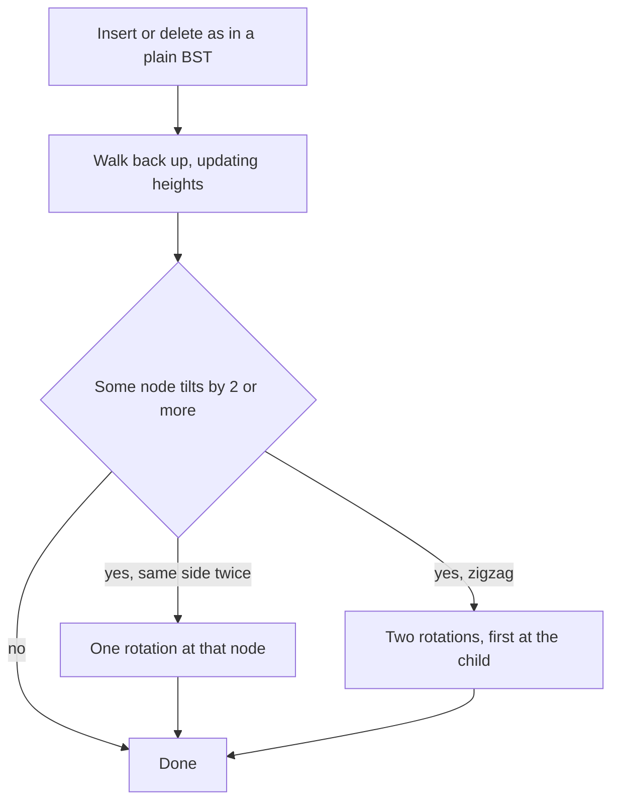

## The hook

A binary search tree promises O(log n) search, insert and delete. Then someone inserts the keys in sorted order: 1, 2, 3, and so on up to a million. Every new key goes to the right of the last one, and the "tree" is a long chain. Searching for the largest key now walks a million nodes, the same as a linked list.

The promise of O(log n) holds only while the tree stays bushy. Self-balancing trees keep that promise automatically, with a small, clever operation called a rotation. You will almost never implement one in an interview, but you should know what it is and why `std::map` stays fast whatever order you insert in.

## The intuition

:::analogy
Picture a hanging mobile: a bar with things dangling from each end, and smaller bars hanging from those. If one side gets too heavy, the whole mobile tilts and the lowest item hangs far below the rest. The fix is not to rebuild the mobile; you lift one bar a level higher and let its partner hang from it instead. The order of the items from left to right does not change, but the mobile hangs level again.
:::

A binary search tree is the mobile. Its depth is how far the lowest item hangs, and every operation costs time proportional to that depth. A [[skewed tree]] is a mobile hanging all to one side. The adjustment, lifting one node above its parent without changing the left-to-right order, is a [[rotation]].

## Let's build it up

### How a tree goes wrong

The shape of a plain BST depends only on the insertion order. Random orders give a height of about a few times log₂ n on average. Sorted or nearly sorted orders, which are common in real data such as timestamps or increasing IDs, give height close to n. The tree is correct but slow.

### Measuring the tilt

For each node, the [[balance factor]] is the height of its left subtree minus the height of its right subtree. A perfectly level node has 0. A node whose right side is two levels deeper than its left has −2: it is tilting.

### The rotation

A left rotation at node x, whose right child is y:

- y moves up to take x's place;
- x becomes y's left child;
- y's old left subtree, whose keys lie between x and y, becomes x's right subtree.

Before and after, the inorder order is the same: x's left subtree, then x, then y's old left subtree, then y, then y's right subtree. So the tree is still a valid BST, but x's side has lost a level and y's has gained one. A right rotation is the mirror image. Each rotation changes only three pointers.

### AVL trees: never tilt by two

An [[AVL tree]], named after its inventors Adelson-Velsky and Landis, keeps every balance factor at −1, 0 or 1. After each insert or delete, it walks back up the path, recomputing heights, and fixes the first node whose factor reaches ±2:

| Shape at the tilting node | Fix |
|---|---|
| heavy on the left, and the left child is heavy on its left | one right rotation |
| heavy on the right, and the right child is heavy on its right | one left rotation |
| heavy on the left, but the left child is heavy on its right (a zigzag) | left rotation at the child, then right rotation at the node |
| heavy on the right, but the right child is heavy on its left | right rotation at the child, then left rotation at the node |

The result is a height of at most about 1.44 log₂ n, so every operation is O(log n) in the worst case.

### Red-black trees: a looser rule, fewer fixes

A [[red-black tree]] colours each node red or black and keeps a few rules: no red node has a red child, and every path from a node down to an empty spot passes the same number of black nodes. Together these guarantee that the longest path is at most twice the shortest, which keeps the height at most 2 log₂(n + 1). The rule is looser than AVL's, so a red-black tree may be a little taller, but it usually needs fewer rotations per update; recolouring does much of the work.

The C++ standard requires `std::map` and `std::set` to keep keys in sorted order with logarithmic operations, and common implementations meet that with a red-black tree. Java's `TreeMap` is documented as a red-black tree too.

:::insight
A rotation lifts one node above its parent while keeping the left-to-right order of all keys, so it fixes height without breaking the search tree. Self-balancing trees apply a few rotations after each update and so guarantee O(log n) operations for every insertion order.
:::

## A tiny example

Insert 30, 20 and 10 into an AVL tree.

| After inserting | Shape | Balance factor of 30 |
|---|---|---|
| 30 | 30 alone | 0 |
| 20 | 30 with left child 20 | +1, fine |
| 10 | 30 → 20 → 10, all on the left | +2, tilting left, and 20 is also left-heavy |

The fix is one right rotation at 30: 20 moves up to the root, 30 becomes its right child, and 10 stays as 20's left child. Inorder before and after: 10, 20, 30. The height dropped from 3 to 2.

Now the zigzag case: insert 10, 30 and 20. Node 10 has a right child 30, which has a left child 20, so 10's balance factor is −2 and its heavy child bends the other way.

One rotation is not enough. First rotate right at 30, which makes 20 the right child of 10 with 30 as 20's right child, a straight line. Then rotate left at 10. The result is again 20 at the root with 10 and 30 as children.

A plain BST receiving 10, 20, 30, 40, 50, 60, 70 builds a chain of height 7. An AVL tree receiving the same keys ends perfectly balanced with height 3, root 40, after a handful of rotations along the way.

:::try-this
Insert 1, 2 and 3 into an AVL tree. Which rotation happens, and what is the root afterwards? (Node 1 gets a right child 2, then 2 gets a right child 3, so 1 has balance factor −2 with a right-heavy child. One left rotation at 1 makes 2 the root, with 1 and 3 as its children.)
:::

:::warning
Common misconception: "Interviews expect me to implement red-black trees." They almost never do. What they expect is that you know plain BSTs can degrade to O(n), that balanced trees fix this with rotations, and that `std::map`, `std::set` and similar library containers give guaranteed O(log n) operations. Use the library, and explain why it is fast.
:::

## Where you'll see this again

- **Ordered containers.** `std::map`, `std::set` and `multiset` are balanced BSTs, which is why they support `lower_bound` and ordered iteration in O(log n), as used in [A Sliding Window That Stays Sorted](article:dsa-ordered-set-windows).
- **Order statistics.** GCC's policy-based tree adds subtree sizes to a red-black tree to find the k-th element; see [A Sorted Shelf That Knows Every Book's Position](article:cp-pbds-ordered-set).
- **Databases and file systems.** Disk-based indexes use B-trees and B+ trees, balanced trees with many keys per node, so each lookup reads only a few disk pages.
- **Alternatives.** Treaps and skip lists reach the same expected O(log n) with randomness instead of strict balance rules; they appear in competitive programming.
- **Building a balanced tree once.** When all keys are known up front, picking the middle element as the root gives a balanced tree directly, with no rotations; that is the next walkthrough in this track.

## Key takeaways

- A plain binary search tree's height depends on insertion order, and sorted inserts turn it into a chain with O(n) operations.
- A rotation lifts a child above its parent and moves one subtree across, changing the shape while keeping the inorder order of the keys.
- AVL trees keep every node's two subtree heights within one of each other, fixing violations with one or two rotations per update.
- Red-black trees use colour rules that keep the longest path at most twice the shortest, giving height at most 2 log₂(n + 1) with fewer rotations.
- Library ordered containers such as std::map are balanced trees in common implementations, which is why their operations stay O(log n) for any insertion order.
