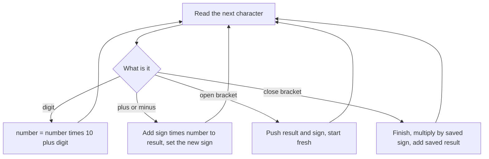

## The hook

Type 3+2*2 into a calculator and it says 7, not 10. Type -(2+3)-(4-(1+2)) and it says −6. Writing the code that gets these right, reading the string one character at a time, is a classic interview problem in several sizes: with multiplication but no brackets, with brackets but no multiplication, and the full version.

None of them needs a parser generator or tree. A stack, a running sign and a habit of finishing one thing before starting the next are enough. The same habit decodes nested strings like 3[a2[c]].

## The problem

Evaluate an arithmetic expression given as a string. It may contain non-negative integers with several digits, the operators + − * /, parentheses and spaces. Integer division truncates towards zero.

| Expression | Value | What makes it tricky |
|---|---|---|
| 3+2*2 | 7 | precedence |
| 14-3/2 | 13 | division truncates, 3 / 2 = 1 |
| 2-(5-6) | 3 | a minus in front of a bracket |
| -(2+3)-(4-(1+2)) | −6 | unary minus and nesting |

*Basic Calculator II* has + − * / without brackets; *Basic Calculator* has + − and brackets, including unary minus.

## The obvious approach

Use the language's `eval`, which interviews forbid. Or convert the whole expression to [[reverse Polish notation]] with the shunting-yard algorithm and then evaluate that with a stack. It works, but it is two algorithms where one short pass will do.

The real difficulty is not the arithmetic but the bookkeeping: what was the last operator, where does a bracket start, and what sign is waiting in front of it.

## The key insight

:::analogy
Picture a waiter taking a table's order. Simple dishes go straight onto the bill. When a guest says "and for the children's table...", the waiter starts a fresh sub-list, but first notes on his pad where the main bill stood and whether this sub-list is an extra or a cancellation. When the guest says "that's all for the children", he totals the sub-list, applies the note, and folds it into the main bill. Sub-lists can nest, and the pad of notes is a stack.
:::

Two ideas cover everything:

- **Precedence by terms.** An expression is a sum of [[term|terms]], and each term is a run of numbers joined by * and /. Keep a stack of finished terms. When the operator before a number is + or −, push the number (or its negative) as a new term. When it is * or /, pop the last term, combine it with the number and push the result. At the end, add up the stack. That is [[operator precedence]] without any precedence table.
- **Brackets by saving state.** Keep a running result and a sign. At "(", push the result and the sign in front of the bracket, then start a fresh result. At ")", finish the inner result, multiply it by the saved sign and add the saved outer result. A [[unary minus]] in front of a bracket is just a sign of −1 waiting on the stack.

Multi-digit numbers are read with the digit loop: number = number × 10 + digit, until a non-digit arrives.



:::insight
Finish the smallest unit before moving on. Numbers are finished at the next non-digit, terms at the next + or −, and brackets at their ")". A stack holds exactly the unfinished outer work, which is why nesting costs nothing extra.
:::

## Walk through an example

### Basic Calculator II: 3+2*2-8/3

The variable op is the operator seen before the current number, starting as +.

| Number read | op before it | Stack action | Stack after |
|---|---|---|---|
| 3 | + | push 3 | 3 |
| 2 | + | push 2 | 3, 2 |
| 2 | * | pop 2, push 2 × 2 | 3, 4 |
| 8 | − | push −8 | 3, 4, −8 |
| 3 | / | pop −8, push −8 / 3 = −2 | 3, 4, −2 |

The sum of the stack is 3 + 4 − 2 = 5. Notice that −8 / 3 truncates to −2, the same as −(8 / 3), because C++ division truncates towards zero. That matches the expression's meaning: 3 + 4 − 2.

### Basic Calculator: -(2+3)-(4-(1+2))

| Character | Action | result | sign | Stack (saved result, saved sign) |
|---|---|---|---|---|
| − | sign = −1 | 0 | −1 | |
| ( | push (0, −1), reset | 0 | +1 | (0, −1) |
| 2, +, 3 | result = 2 + 3 | 5 | +1 | (0, −1) |
| ) | 0 + (−1) × 5 | −5 | | |
| − | sign = −1 | −5 | −1 | |
| ( | push (−5, −1), reset | 0 | +1 | (−5, −1) |
| 4, − | result = 4, sign = −1 | 4 | −1 | (−5, −1) |
| ( | push (4, −1), reset | 0 | +1 | (−5, −1), (4, −1) |
| 1, +, 2 | result = 3 | 3 | +1 | (−5, −1), (4, −1) |
| ) | 4 + (−1) × 3 | 1 | | (−5, −1) |
| ) | −5 + (−1) × 1 | −6 | | |

The answer is −6. Each "(" is the waiter opening a sub-list with a note, and each ")" folds the sub-list back using that note.

### Decode String: 3[a2[c]]

The same idea with strings. At "[", push the string built so far and the repeat count, and start a new string. At "]", repeat the inner string count times and append it to the saved string. Inside out: 2[c] is "cc", a followed by it is "acc", and 3 copies give "accaccacc".

:::try-this
Evaluate 14-3/2 with the term stack, then 2-(5-6) with the bracket method. (Terms: push 14, push −3, then / pops −3 and pushes −3 / 2 = −1; the sum is 13. Brackets: result 2, sign −1, then the bracket computes 5 − 6 = −1, and 2 + (−1) × (−1) = 3.)
:::

:::warning
Common misconception: "Process characters as single digits." Numbers like 123 span several characters. Build the number until the next non-digit, and only then apply the pending operator. Applying the operator after each digit turns 12+3 into 1, then 2, then 3, a classic wrong answer.
:::

## The code

```pseudo
calculate_ii(s):                 # + - * / without brackets
    stack = []; num = 0; op = '+'
    for each character c, plus a final end marker:
        if c is a digit: num = num * 10 + c
        if c is an operator or the end:
            if op == '+': push num
            if op == '-': push -num
            if op == '*': push pop() * num
            if op == '/': push pop() / num      # truncate towards zero
            op = c; num = 0
    return sum of stack

calculate(s):                    # + - and brackets
    result = 0; sign = 1; num = 0; stack = []
    for c in s:
        digit: num = num * 10 + c
        '+' or '-': result += sign * num; num = 0; sign = +1 or -1
        '(': push result, push sign; result = 0; sign = 1
        ')': result += sign * num; num = 0; result = pop_result + pop_sign * result
    return result + sign * num
```

```cpp
#include <bits/stdc++.h>
using namespace std;

long long calculateII(const string& s) {                // + - * /, no brackets
    vector<long long> terms;
    long long num = 0;
    char op = '+';
    for (size_t i = 0; i <= s.size(); i++) {
        char c = i < s.size() ? s[i] : '#';             // '#' marks the end
        if (isdigit((unsigned char)c)) { num = num * 10 + (c - '0'); continue; }
        if (c == ' ') continue;
        if (op == '+') terms.push_back(num);
        else if (op == '-') terms.push_back(-num);
        else if (op == '*') terms.back() *= num;        // combine with the last term
        else terms.back() /= num;                       // C++ truncates towards zero
        op = c, num = 0;
    }
    return accumulate(terms.begin(), terms.end(), 0LL);
}

long long calculate(const string& s) {                  // + - and brackets, unary minus
    long long result = 0, num = 0;
    int sign = 1;
    vector<pair<long long, int>> st;                    // (saved result, sign before the bracket)
    for (char c : s) {
        if (isdigit((unsigned char)c)) num = num * 10 + (c - '0');
        else if (c == '+' || c == '-') {
            result += sign * num, num = 0;
            sign = c == '+' ? 1 : -1;
        } else if (c == '(') {
            st.push_back({result, sign});
            result = 0, sign = 1;
        } else if (c == ')') {
            result += sign * num, num = 0;
            auto [outer, s0] = st.back();
            st.pop_back();
            result = outer + s0 * result;               // fold the sub-list back in
        }
    }
    return result + sign * num;
}

string decodeString(const string& s) {
    vector<pair<string, int>> st;                        // (string before '[', repeat count)
    string cur;
    int k = 0;
    for (char c : s) {
        if (isdigit((unsigned char)c)) k = k * 10 + (c - '0');
        else if (c == '[') { st.push_back({cur, k}); cur.clear(); k = 0; }
        else if (c == ']') {
            auto [prev, times] = st.back();
            st.pop_back();
            string rep;
            while (times--) rep += cur;
            cur = prev + rep;
        } else cur += c;
    }
    return cur;
}

// Recursive descent for + - * / and brackets: expr -> term {(+|-) term}, term -> factor {(*|/) factor}.
struct Parser {
    string s;
    size_t i = 0;
    char peek() { while (i < s.size() && s[i] == ' ') i++; return i < s.size() ? s[i] : '\0'; }
    long long factor() {
        char c = peek();
        if (c == '-') { i++; return -factor(); }        // unary minus
        if (c == '(') { i++; long long v = expr(); peek(); i++; return v; }   // skip ')'
        long long v = 0;
        while (i < s.size() && isdigit((unsigned char)s[i])) v = v * 10 + (s[i++] - '0');
        return v;
    }
    long long term() {
        long long v = factor();
        for (char c = peek(); c == '*' || c == '/'; c = peek()) {
            i++;
            long long r = factor();
            v = c == '*' ? v * r : v / r;
        }
        return v;
    }
    long long expr() {
        long long v = term();
        for (char c = peek(); c == '+' || c == '-'; c = peek()) {
            i++;
            long long r = term();
            v = c == '+' ? v + r : v - r;
        }
        return v;
    }
};

int main() {
    cout << calculateII("3+2*2") << ' ' << calculateII(" 14-3/2 ") << ' ' << calculateII("3+2*2-8/3") << '\n';   // 7 13 5
    cout << calculate("2-(5-6)") << ' ' << calculate("-(2+3)-(4-(1+2))") << '\n';                                  // 3 -6
    cout << decodeString("3[a2[c]]") << ' ' << decodeString("2[ab]3[x]") << '\n';                                  // accaccacc ababxxx
    Parser p{"2*(3+4)-10/(1+1)"};
    cout << p.expr() << '\n';                                                                                     // 9
}
```

The parser shows the [[recursive descent]] alternative: one function per precedence level. `expr` handles + and −, `term` handles * and /, and `factor` handles numbers, brackets and unary minus. The call stack plays the role of the explicit stack, and it extends naturally to the full calculator. For 2*(3+4)−10/(1+1), it computes 2 × 7 − 10 / 2 = 9.

## Complexity

- **All versions: O(n) time,** one pass over the characters.
- **Space: O(n) in the worst case** for the term stack or the bracket stack, for example with deeply nested brackets. The recursive parser uses O(depth) call stack.
- **Decode String: O(output length)** time, since every output character is built once per enclosing level; the stack holds one entry per open bracket.

## Common mistakes

- **Single-digit numbers:** applying operators before the whole number is read.
- **Forgetting the last number,** which has no operator after it; use an end marker or add `sign * num` after the loop.
- **Unary minus at the start or after "(",** which is fine with the sign method but breaks code that expects a number before every operator.
- **Floor division instead of truncation** for negative terms. In C++, `/` already truncates towards zero; in Python, `//` floors, so −8 // 3 is −3.
- **Losing the saved sign** at ")", so 2-(5-6) evaluates to 1 instead of 3.
- **Multi-digit repeat counts** in Decode String, such as 12[a]; build k digit by digit too.

## Practice problems

Start with *Evaluate Reverse Polish Notation*, where the order is already resolved and one stack of numbers does everything. *Basic Calculator II* adds precedence with the term stack. *Decode String* applies the save-and-restore idea to strings. *Basic Calculator* brings brackets and unary minus. For the stack fundamentals, see [The Last Plate In Is the First Plate Out](article:dsa-stack-patterns).

## Key takeaways

- An expression is a sum of terms, so push a new term after + or − and combine with the last term after * or /, then add the stack at the end.
- Build multi-digit numbers digit by digit and apply the pending operator only when a non-digit arrives.
- For brackets, push the result so far and the sign in front of the bracket, then at the closing bracket fold the inner result back in with that sign.
- A unary minus is just a sign of −1 waiting to be applied, which the sign-and-stack method handles without special cases.
- Recursive descent, with one function per precedence level, is the general form of the same idea and extends to the full calculator.
