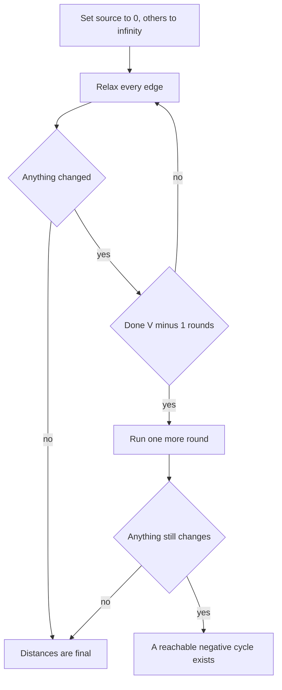

## The hook

A rumour starts with one person. In the first round, everyone who talks to that person hears it. In the second round, their friends hear it, and so on. After enough rounds, the rumour has reached everyone it can reach, and each person heard it along the shortest chain of conversations.

Dijkstra settles one vertex at a time and trusts that nothing later can beat it, which is exactly what fails when edges can be negative. Bellman-Ford trusts nothing: it lets the rumour spread round by round over every edge, and it is slower but correct with negative weights. When you need every pair's distance, Floyd-Warshall does it with three loops.

## The intuition

:::analogy
In every round, every person repeats the cheapest version of the rumour they have heard to every friend: "I heard it at cost 5, and telling you costs 2, so you can hear it at 7." Nobody is ever marked final. A person who hears a cheaper version in round 3 simply passes the cheaper one along in round 4. After enough rounds, the cheapest version has had time to travel along every possible chain.
:::

That is [[Bellman-Ford]]. Each [[round]] relaxes every edge once, in any order. The key fact is about chain length: after round k, every vertex's distance is at least as good as the best path that uses at most k edges. A shortest path that does not repeat a vertex has at most V - 1 edges, so V - 1 rounds are always enough.

Negative edges are no problem, because no distance is ever frozen. The only real danger is a [[negative cycle]]: a loop whose weights add up below zero. Going round it again always makes the rumour cheaper, so there is no shortest path at all, and Bellman-Ford can detect that.

## How it works

### Bellman-Ford

- Set dist[source] = 0, everything else infinity.
- Repeat V - 1 times: for every edge u → v with weight w, if dist[u] is finite and dist[u] + w < dist[v], lower dist[v].
- Stop early if a whole round changes nothing; the distances are final.

### Detecting negative cycles

Run one more round, the V-th. If any distance still drops, some path keeps getting cheaper, which only a reachable negative cycle can cause. To print the cycle, as in CSES *Cycle Finding*, record a parent on every relaxation; take any vertex relaxed in round V, follow parents V times to be sure you are inside the cycle, then walk parents until you return to the same vertex.

*High Score* adds a twist: you want the longest path from 1 to n, which is the shortest path with negated weights, and the answer is "infinite" only if a negative cycle (in negated weights) is reachable from 1 **and** can reach n. A cycle off to the side does not matter.

### Rounds with a snapshot: at most k edges

With in-place updates, one round can carry the rumour along several edges at once, because a vertex updated early in the round can pass its new value on later in the same round. That is harmless for plain shortest paths, and often faster. But when the problem limits the number of edges, as *Cheapest Flights Within K Stops* does, copy the distances at the start of each round and relax only from the copy. Then round k means exactly "at most k edges".

### Floyd-Warshall: every pair at once

[[Floyd-Warshall]] keeps a V × V table d[i][j], starting from the direct edge weights, 0 on the diagonal and infinity elsewhere. It then allows one more [[intermediate vertex]] at a time:

```
for k in 0 .. V-1:          # now allow k as an intermediate vertex
    for i in 0 .. V-1:
        for j in 0 .. V-1:
            d[i][j] = min(d[i][j], d[i][k] + d[k][j])
```

After step k, d[i][j] is the shortest path from i to j whose intermediate vertices all come from 0..k. A best path that uses k either goes through k once, splitting into an i-to-k part and a k-to-j part that only use 0..k-1, or it does not use k at all. That is a dynamic program, and it is why k must be the outer loop: step k needs the step k - 1 table to be complete for every pair. A negative value on the diagonal, d[i][i] < 0, means i lies on a negative cycle.

### Which shortest-path algorithm?

| Situation | Use | Time |
|---|---|---|
| Unweighted, or all weights equal | BFS | O(V + E) |
| Non-negative weights, one source | Dijkstra | O((V + E) log V) |
| Negative weights possible, one source | Bellman-Ford | O(V × E) |
| At most k edges on the path | Bellman-Ford with a snapshot, k rounds | O(k × E) |
| Every pair, V up to about 500 | Floyd-Warshall | O(V³) |
| Graph is a DAG | Relax in topological order | O(V + E) |



:::insight
Bellman-Ford never trusts a distance, so negative edges cannot fool it; it simply waits V - 1 rounds, the longest a simple shortest path can be. Floyd-Warshall turns the same patience into a table, unlocking one intermediate vertex at a time.
:::

## Walk through an example

Directed edges: 0 → 1 weight 4, 0 → 2 weight 5, 1 → 3 weight 3, 2 → 1 weight -3, 3 → 4 weight 2, 2 → 4 weight 6, 4 → 3 weight -1. Source 0. The negative edges create no negative cycle: 3 → 4 → 3 costs 2 - 1 = 1.

### Bellman-Ford with a snapshot each round

| After round | dist[0..4] | New best paths |
|---|---|---|
| 1 | 0, 4, 5, ∞, ∞ | 0 → 1, 0 → 2 |
| 2 | 0, 2, 5, 7, 11 | 0 → 2 → 1 is cheaper than 0 → 1 |
| 3 | 0, 2, 5, 5, 9 | 0 → 2 → 1 → 3 |
| 4 | 0, 2, 5, 5, 7 | 0 → 2 → 1 → 3 → 4 |

Exactly V - 1 = 4 rounds were needed, because the shortest path to 4 uses four edges, and each snapshot round adds one.

With in-place updates in the order the edges are listed, round 1 already gives 0, 2, 5, 7, 9, round 2 reaches the final 0, 2, 5, 5, 7, and round 3 changes nothing, so the loop stops early.

### Adding a negative cycle

Add 3 → 2 with weight -5. Now 2 → 1 → 3 → 2 costs -3 + 3 - 5 = -5. With in-place updates, the distances after rounds 1 to 5 are:

| Round | dist[0..4] |
|---|---|
| 1 | 0, 2, 2, 7, 9 |
| 2 | 0, -1, 0, 5, 7 |
| 3 | 0, -3, -3, 2, 4 |
| 4 | 0, -6, -5, 0, 2 |
| 5, the check | 0, -8, -8, -3, -1 |

Round 5 still lowers distances, so a negative cycle is reachable. The values would keep falling forever.

### Floyd-Warshall on the original graph

Allowing vertex 2 as an intermediate (step k = 2) is where the negative edge pays off for row 0: d[0][1] drops from 4 to 5 + (-3) = 2, and d[0][3] from 7 to 5 + 0 = 5, using the entry d[2][3] = 0 found at step k = 1. The final table:

| from \ to | 0 | 1 | 2 | 3 | 4 |
|---|---|---|---|---|---|
| 0 | 0 | 2 | 5 | 5 | 7 |
| 1 | ∞ | 0 | ∞ | 3 | 5 |
| 2 | ∞ | -3 | 0 | 0 | 2 |
| 3 | ∞ | ∞ | ∞ | 0 | 2 |
| 4 | ∞ | ∞ | ∞ | -1 | 0 |

Row 0 matches Bellman-Ford, as it must. The diagonal is all zero, so there is no negative cycle.

:::try-this
In the original graph, change 4 → 3 from -1 to -3. Is there a negative cycle now, and which round of Bellman-Ford reveals it? (3 → 4 → 3 now costs 2 - 3 = -1, a negative cycle reachable from 0. With snapshot rounds, the first four rounds look exactly like the table above, ending at 0, 2, 5, 5, 7. In the check round, round 5, the loop pays off: dist[3] drops from 5 to 7 - 3 = 4, so the cycle is reported.)
:::

:::warning
Common misconception: "Floyd-Warshall's three loops can go in any order." With k inside, the update d[i][k] + d[k][j] reads entries that have not yet been improved through earlier intermediates, so some shortest paths are never found. Only the order k, then i, then j is correct. The i and j loops can be swapped freely.
:::

## The code

```pseudo
bellman_ford(n, edges, src):
    dist = [inf] * n; dist[src] = 0
    repeat n - 1 times:
        changed = false
        for (u, v, w) in edges:
            if dist[u] != inf and dist[u] + w < dist[v]: dist[v] = dist[u] + w; changed = true
        if not changed: break
    for (u, v, w) in edges:                  # round n: the check
        if dist[u] != inf and dist[u] + w < dist[v]: return "negative cycle"
    return dist

floyd(d):                                    # d[i][i] = 0, d[i][j] = edge weight or inf
    for k: for i: for j:
        if d[i][k] + d[k][j] < d[i][j]: d[i][j] = d[i][k] + d[k][j]
```

```cpp
#include <bits/stdc++.h>
using namespace std;
using ll = long long;
const ll INF = LLONG_MAX / 4;
struct Edge { int u, v; ll w; };

// returns false if a negative cycle is reachable from src
bool bellmanFord(int n, const vector<Edge>& edges, int src, vector<ll>& dist) {
    dist.assign(n, INF);
    dist[src] = 0;
    for (int round = 1; round <= n; round++) {
        bool changed = false;
        for (auto& e : edges)
            if (dist[e.u] != INF && dist[e.u] + e.w < dist[e.v]) dist[e.v] = dist[e.u] + e.w, changed = true;
        if (!changed) return true;                         // settled early
        if (round == n) return false;                      // still improving in round n
    }
    return true;
}

vector<ll> limitedEdges(int n, const vector<Edge>& edges, int src, int k) {   // paths with at most k edges
    vector<ll> dist(n, INF);
    dist[src] = 0;
    for (int round = 0; round < k; round++) {
        vector<ll> prev = dist;                            // snapshot: one more edge per round
        for (auto& e : edges)
            if (prev[e.u] != INF && prev[e.u] + e.w < dist[e.v]) dist[e.v] = prev[e.u] + e.w;
    }
    return dist;
}

vector<vector<ll>> floydWarshall(int n, const vector<Edge>& edges) {
    vector<vector<ll>> d(n, vector<ll>(n, INF));
    for (int i = 0; i < n; i++) d[i][i] = 0;
    for (auto& e : edges) d[e.u][e.v] = min(d[e.u][e.v], e.w);
    for (int k = 0; k < n; k++)                            // k must be outermost
        for (int i = 0; i < n; i++)
            for (int j = 0; j < n; j++)
                if (d[i][k] != INF && d[k][j] != INF) d[i][j] = min(d[i][j], d[i][k] + d[k][j]);
    return d;
}

void print(const vector<ll>& v) {
    for (ll x : v) cout << (x >= INF ? string("inf") : to_string(x)) << ' ';
    cout << '\n';
}

int main() {
    vector<Edge> e = {{0, 1, 4}, {0, 2, 5}, {1, 3, 3}, {2, 1, -3}, {3, 4, 2}, {2, 4, 6}, {4, 3, -1}};
    vector<ll> dist;
    cout << bellmanFord(5, e, 0, dist) << ' ';
    print(dist);                                           // 1 0 2 5 5 7
    print(limitedEdges(5, e, 0, 2));                       // 0 2 5 7 11
    auto withCycle = e;
    withCycle.push_back({3, 2, -5});
    cout << bellmanFord(5, withCycle, 0, dist) << '\n';    // 0
    auto d = floydWarshall(5, e);
    print(d[0]);                                           // 0 2 5 5 7
    print(d[2]);                                           // inf -3 0 0 2
}
```

The `INF` checks matter: without them, "infinity plus a negative weight" looks smaller than infinity, and unreachable vertices would get fake distances. Using `LLONG_MAX / 4` as infinity also keeps sums from overflowing.

## Complexity

- **Bellman-Ford: O(V × E) time,** O(V) space. Early stopping often makes it much faster in practice, but the worst case stays.
- **Negative cycle check: one more O(E) round.**
- **At most k edges: O(k × E) time,** O(V) extra space for the snapshot.
- **Floyd-Warshall: O(V³) time, O(V²) space.** At V = 500 that is 125 million cheap updates, which fits in about a second in C++.

## Common mistakes

- **Relaxing from an infinite distance,** which, with negative edges, creates fake finite distances for unreachable vertices.
- **Updating in place when the edge count is limited,** which lets one round travel several edges.
- **Putting k inside the i and j loops** in Floyd-Warshall.
- **Declaring "negative cycle" for any cycle in the graph,** instead of only one reachable from the source and, in problems like High Score, able to reach the target.
- **Using `INT_MAX` as infinity,** where adding a weight overflows; use a large but safe 64-bit value.
- **Using Bellman-Ford when all weights are non-negative,** where Dijkstra is much faster.

## Practice problems

- *Shortest Routes II* is Floyd-Warshall answering many queries.
- *High Score* is Bellman-Ford on negated weights, with reachability checks in both directions.
- *Cycle Finding* asks you to print a negative cycle using parent pointers.
- *Find the City With the Smallest Number of Neighbors at a Threshold Distance* is Floyd-Warshall followed by counting.
- *Cheapest Flights Within K Stops* is the snapshot version, explored fully in its own walkthrough. When weights are non-negative, prefer [Water Racing Through a Network of Pipes](article:dsa-dijkstra).

## Key takeaways

- Bellman-Ford relaxes every edge in each of V - 1 rounds, which is enough because a shortest simple path has at most V - 1 edges.
- It handles negative edge weights because no distance is ever treated as final.
- If a V-th round still lowers a distance, a negative cycle is reachable from the source and shortest paths through it do not exist.
- Copying the distances at the start of each round makes round k mean "at most k edges", which edge-limited problems require.
- Floyd-Warshall computes all pairs in O(V³) by allowing one more intermediate vertex per step, and the loop over that vertex must be outermost.
