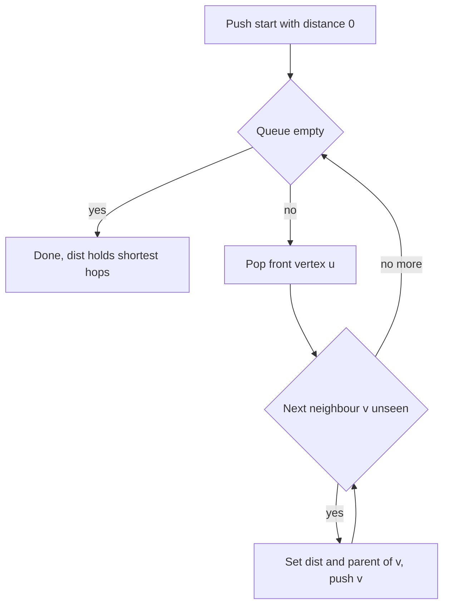
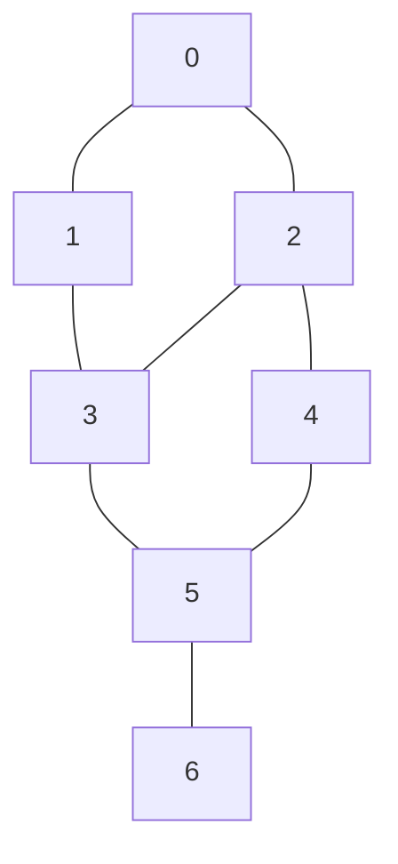

## The hook

You are in a maze of corridors and want the exit in the fewest steps. One plan is to pick a corridor and follow it as deep as it goes, backing up at dead ends. You will find *an* exit, but maybe after a route ten times longer than needed, and you cannot know it was the shortest without trying everything else.

A better plan sounds almost lazy. First check every spot one step away. Then every spot two steps away. Then three. The first time you see the exit, you know no shorter route exists, because you checked all shorter distances already. That plan is breadth-first search, and it is the answer whenever a problem asks for the fewest moves, hops, swaps or minutes in a world where every move costs the same. How do you make a computer search in rings like that?

## The intuition

:::analogy
Drop a stone into a still pond. A ripple spreads outward as a ring. Every point on the first ring is the same distance from where the stone fell; the second ring is one step further; and no ring is skipped. A ripple reaches each lily pad exactly once, and it reaches it at the earliest possible moment. If you dropped several stones at once, the rings would spread from all of them together, and each lily pad would be touched first by the ripple from its nearest stone.
:::

[[Breadth-first search]] is that ripple on a graph. The stone is your starting vertex. Ring 1 is its neighbours, ring 2 is their unvisited neighbours, and so on. The distance at which a vertex is first touched is its shortest distance in edges.

You need [Every Problem Is a Map of Roads](article:dsa-graph-representation) for the adjacency list, which tells you each vertex's neighbours. Everything else is built here.

## How it works

### The one tool: a queue

To spread in rings you must finish ring d before starting ring d + 1. A [[queue]] does exactly that. It is first in, first out, like a line at a ticket counter: you join at the back and are served from the front.

In C++ use `queue<int>` with `push` (join at the back), `front` (look at the first) and `pop` (remove the first). Vertices of ring d are all pushed before any vertex of ring d + 1, so they are all served first. The queue holds the [[frontier]], the edge of the ripple, and it never contains more than two neighbouring rings at a time.

### The algorithm

1. Set `dist[v] = -1` for every vertex, meaning "not reached yet". Set `dist[start] = 0` and push start.
2. While the queue is not empty, pop the front vertex u.
3. For each neighbour v of u with `dist[v] == -1`: set `dist[v] = dist[u] + 1`, set `parent[v] = u`, and push v.

The `dist` array does double duty as the visited marker. Each vertex is pushed once and each edge is looked at once from each side.



:::insight
BFS is shortest-path search for free: because the queue serves vertices in order of distance, the first time you reach a vertex is through a shortest route. Mark it the moment you push it, and you never need to revisit it.
:::

### Reconstructing the path

Distances are often not enough; the problem wants the route. When v is discovered from u, record `parent[v] = u` in a [[parent array]]. To get the path to a target t, follow parents from t back to the start, then reverse. Each vertex has exactly one parent, the one that reached it first, so the result is a shortest path.

### Multi-source BFS

Sometimes there are many stones: all rotten oranges, all gates, all cells holding 0. Push **all** of them at distance 0 before the loop starts. One BFS then gives every vertex its distance to the nearest source. This [[multi-source BFS]] costs the same O(V + E) as a single BFS, while running one BFS per source would multiply the work by the number of sources.

### Grid BFS

A grid is a graph where each cell is a vertex and its 4 (or 8) neighbours are edges. You never build an adjacency list. Instead loop over direction arrays `dr = {1, -1, 0, 0}` and `dc = {0, 0, 1, -1}`, skip cells outside the grid or blocked, and store `dist` as a 2D array. Most "fewest steps in a maze" and "minutes until everything spreads" problems are grid BFS.

### 0-1 BFS

If edges cost either 0 or 1, plain BFS breaks, because a free edge reaches a vertex without moving to the next ring. [[0-1 BFS]] uses a double-ended queue: when relaxing an edge of weight 0, push to the **front**; for weight 1, push to the **back**. The deque still stays sorted by distance, so it gives correct shortest paths in O(V + E). Typical uses: "cost 0 to follow the arrow, cost 1 to change it", or "free move along a road, 1 to break a wall". For general weights you need Dijkstra's algorithm instead.

## Walk through an example

An undirected graph with 7 vertices and edges 0-1, 0-2, 1-3, 2-3, 2-4, 3-5, 4-5, 5-6. Start at 0, neighbours in increasing order.



| Step | Pop | dist of popped | Newly discovered | Queue after | dist[0..6] |
|---|---|---|---|---|---|
| start | none | | 0 | [0] | 0 . . . . . . |
| 1 | 0 | 0 | 1, 2 | [1, 2] | 0 1 1 . . . . |
| 2 | 1 | 1 | 3 | [2, 3] | 0 1 1 2 . . . |
| 3 | 2 | 1 | 4 (3 is already seen) | [3, 4] | 0 1 1 2 2 . . |
| 4 | 3 | 2 | 5 | [4, 5] | 0 1 1 2 2 3 . |
| 5 | 4 | 2 | none (5 is already seen) | [5] | 0 1 1 2 2 3 . |
| 6 | 5 | 3 | 6 | [6] | 0 1 1 2 2 3 4 |
| 7 | 6 | 4 | none | [] | 0 1 1 2 2 3 4 |

The rings are {0}, {1, 2}, {3, 4}, {5}, {6}, just like ripples. The parent array ends as [−1, 0, 0, 1, 2, 3, 5]. Following parents from 6 gives 6 → 5 → 3 → 1 → 0, so the shortest path is **0 → 1 → 3 → 5 → 6**, with 4 edges.

Now see the late-marking bug. If you mark a vertex only when it is popped, step 3 pushes 3 again from vertex 2, and step 5 pushes 5 again from vertex 4. On this tiny graph that is two wasted entries. On a dense graph, the same vertex can enter the queue once per neighbour.

**Multi-source grid.** Rotten oranges are 2, fresh are 1, empty cells are 0. Both rotten oranges start in the queue at minute 0:

| Grid | Minute each orange rots |
|---|---|
| 2 1 1 0 | 0 1 2 . |
| 1 1 0 1 | 1 2 . 1 |
| 0 1 1 2 | . 2 1 0 |

The largest value is 2, so everything is rotten after 2 minutes. If any fresh orange were still unreached, the answer would be −1.

:::try-this
Add an edge 0-5 to the example graph and rerun BFS from 0. What are the new dist[5] and dist[6], and what is the new shortest path to 6? (dist[5] becomes 1 and dist[6] becomes 2; the path is 0 → 5 → 6.)
:::

## The code

```pseudo
bfs(adj, start):
    dist = [-1] * n; parent = [-1] * n
    dist[start] = 0; queue = [start]
    while queue not empty:
        u = pop front of queue
        for v in adj[u]:
            if dist[v] == -1:               // mark on push, not on pop
                dist[v] = dist[u] + 1; parent[v] = u
                push v to back of queue
    return dist, parent

path_to(parent, t):
    path = []
    while t != -1: add t to path; t = parent[t]
    return reversed path

multi_source_grid(grid):
    push every source cell with dist 0
    run the same loop, stepping to the 4 neighbours inside the grid
```

```cpp
#include <bits/stdc++.h>
using namespace std;

pair<vector<int>, vector<int>> bfs(const vector<vector<int>>& adj, int start) {
    int n = adj.size();
    vector<int> dist(n, -1), parent(n, -1);
    queue<int> q;
    dist[start] = 0; q.push(start);
    while (!q.empty()) {
        int u = q.front(); q.pop();
        for (int v : adj[u]) if (dist[v] == -1) {
            dist[v] = dist[u] + 1; parent[v] = u; q.push(v);
        }
    }
    return {dist, parent};
}

vector<int> pathTo(const vector<int>& parent, int t) {
    vector<int> path;
    for (; t != -1; t = parent[t]) path.push_back(t);
    reverse(path.begin(), path.end());
    return path;
}

int rotMinutes(const vector<vector<int>>& g) {           // multi-source grid BFS
    int R = g.size(), C = g[0].size(), best = 0;
    vector<vector<int>> d(R, vector<int>(C, -1));
    queue<pair<int,int>> q;
    for (int r = 0; r < R; r++) for (int c = 0; c < C; c++)
        if (g[r][c] == 2) { d[r][c] = 0; q.push({r, c}); }
    int dr[] = {1, -1, 0, 0}, dc[] = {0, 0, 1, -1};
    while (!q.empty()) {
        auto [r, c] = q.front(); q.pop();
        best = max(best, d[r][c]);
        for (int k = 0; k < 4; k++) {
            int nr = r + dr[k], nc = c + dc[k];
            if (nr < 0 || nc < 0 || nr >= R || nc >= C || g[nr][nc] != 1 || d[nr][nc] != -1) continue;
            d[nr][nc] = d[r][c] + 1; q.push({nr, nc});
        }
    }
    for (int r = 0; r < R; r++) for (int c = 0; c < C; c++)
        if (g[r][c] == 1 && d[r][c] == -1) return -1;
    return best;
}

vector<int> zeroOneBfs(const vector<vector<pair<int,int>>>& adj, int start) {
    vector<int> dist(adj.size(), INT_MAX);
    deque<int> dq;
    dist[start] = 0; dq.push_back(start);
    while (!dq.empty()) {
        int u = dq.front(); dq.pop_front();
        for (auto [v, w] : adj[u]) if (dist[u] + w < dist[v]) {
            dist[v] = dist[u] + w;
            if (w == 0) dq.push_front(v); else dq.push_back(v);
        }
    }
    return dist;
}

int main() {
    vector<vector<int>> adj(7);
    for (auto [u, v] : vector<pair<int,int>>{{0,1},{0,2},{1,3},{2,3},{2,4},{3,5},{4,5},{5,6}}) {
        adj[u].push_back(v); adj[v].push_back(u);
    }
    auto [dist, parent] = bfs(adj, 0);
    for (int d : dist) cout << d << ' ';
    cout << '\n';                                         // 0 1 1 2 2 3 4
    for (int v : pathTo(parent, 6)) cout << v << ' ';
    cout << '\n';                                         // 0 1 3 5 6
    cout << rotMinutes({{2,1,1,0},{1,1,0,1},{0,1,1,2}}) << '\n';   // 2

    vector<vector<pair<int,int>>> wadj(5);
    for (auto [u, v, w] : vector<tuple<int,int,int>>{{0,1,1},{0,2,0},{2,3,1},{1,3,0},{3,4,0},{2,4,1}}) {
        wadj[u].push_back({v, w}); wadj[v].push_back({u, w});
    }
    for (int d : zeroOneBfs(wadj, 0)) cout << d << ' ';
    cout << '\n';                                         // 0 1 0 1 1
}
```

## Complexity

- **Time:** O(V + E). Each vertex is pushed and popped once, and each adjacency list is scanned once, so an undirected edge is looked at twice. On an R × C grid that is O(R × C).
- **Space:** O(V) for `dist`, `parent` and the queue. The adjacency list itself takes O(V + E).
- **0-1 BFS:** also O(V + E). The deque only ever holds two distance values, d and d + 1, so a vertex is pushed at most twice: once at d + 1 and once more if a free edge improves it to d.

## Common mistakes

:::warning
Common misconception: "BFS finds shortest paths in any graph." It finds the fewest *edges*, which equals the cheapest path only when every edge costs the same. With 0 and 1 weights use 0-1 BFS; with general non-negative weights use Dijkstra. Running plain BFS on weighted edges gives confident, wrong answers.
:::

- **Marking visited too late.** Mark when you push, not when you pop. Late marking lets one vertex be queued once per neighbour, which can turn O(V + E) into something far slower and run out of memory on large grids.
- **Forgetting the start.** Set `dist[start] = 0` before the loop, or the start gets rediscovered through a neighbour.
- **Running BFS from each source.** For "distance to the nearest X", push all sources first and run one BFS.
- **Grid bounds and order of checks.** Check `nr` and `nc` are inside the grid before reading `g[nr][nc]`.
- **Counting levels wrong.** If you need the level number without a `dist` array, process the queue one ring at a time: read `q.size()` at the start of the ring and pop exactly that many.
- **Disconnected graphs.** BFS from one start reaches only its component. Unreached vertices keep `dist = -1`; report "impossible" for them.
- **Using DFS for shortest paths.** [Going Deep With a Ball of String](article:dsa-dfs) explores just as completely, but the first time DFS reaches a vertex is not necessarily by a shortest route.

## Practice problems

Begin with *Message Route*, a plain BFS that must also print the path, so it practises the parent array. *Shortest Path in Binary Matrix* is grid BFS with 8 directions. *Rotting Oranges* and *01 Matrix* are multi-source BFS: push every source first. *Labyrinth* combines a grid, a shortest path and path reconstruction as a string of moves. Finish with *Word Ladder*, where the graph is implicit: each word is a vertex, and its neighbours are the dictionary words one letter away, generated on the fly.

## Key takeaways

- Breadth-first search spreads from the start in rings, using a queue so every vertex at distance d is handled before any at distance d + 1.
- In an unweighted graph, the first time BFS reaches a vertex gives its shortest distance in edges.
- Mark a vertex visited when you push it, and record its parent, so each vertex enters the queue once and any shortest path can be rebuilt by walking parents backwards.
- Multi-source BFS pushes every source at distance 0 and answers "distance to the nearest source" for all vertices in one O(V + E) pass.
- Grid problems are BFS over cells with direction arrays, and graphs with only 0 and 1 weights use 0-1 BFS with a deque.
