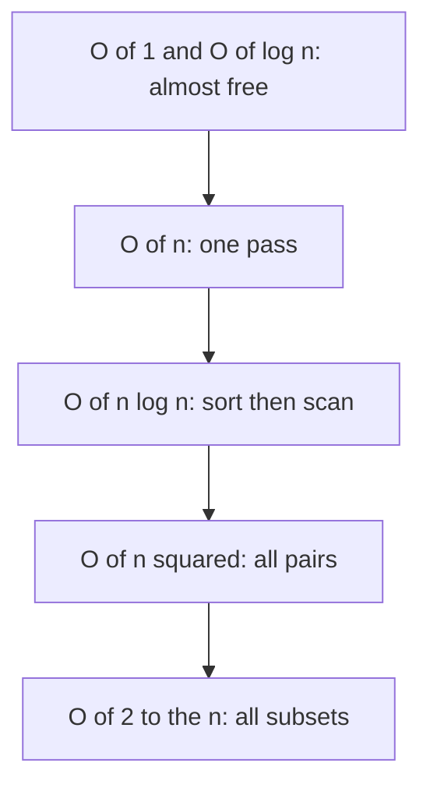

## The hook

Two candidates solve the same interview problem. Both programs are correct. One finishes in a fraction of a second; the other is still running when the interviewer moves on.

The difference was decided before either of them typed a single line. The fast candidate read one sentence in the problem, "n is at most 100,000," and knew instantly which ideas were allowed. This article teaches you to read that sentence the same way.

## The intuition

:::analogy
Imagine running a restaurant. If every guest needs their own chef, doubling the guests doubles the chefs: cost grows in step with the crowd. If every guest must shake hands with every other guest before eating, doubling the guests roughly quadruples the handshakes. A small dinner is fine either way. A wedding with 500 guests is a disaster for the handshake plan.
:::

[[Time complexity]] is about that shape of growth. We do not care whether one handshake takes two seconds or three. We care what happens when the crowd gets big.

[[Big-O]] is the shorthand. "O(n)" means cost grows in step with n, like one chef per guest. "O(n²)" means it grows with the square, like everyone shaking hands with everyone.

## Let's build it up

### Counting steps, roughly

Look at what repeats and how many times.

- One loop over n items: about n steps. **O(n).**
- A loop inside a loop, both over n: about n × n steps. **O(n²).**
- Halving the problem each step, like binary search: about log₂ n steps. **O(log n).** For a million items, that is only about 20 steps.
- Sorting with `std::sort`: about n log n steps. **O(n log n).**
- Trying every subset of n items: 2ⁿ steps. **O(2ⁿ).**

Why is log n so small? Because it counts halvings. Take a phone book of a million names and open it in the middle: you instantly discard half. Do it again and you discard half of what is left. After about 20 halvings, one name remains. Every time the input doubles, log n grows by just one more step, which is why binary search barely notices huge inputs.

We drop constants and smaller terms. A loop doing 3n + 7 steps is still O(n), because for huge n, the "3" and the "7" stop mattering compared with the growth itself.



### The magic number

Here is the rule of thumb competitive programmers use: a typical judge runs **roughly 10⁸ simple operations per second** in C++. It is a rough guide, not a law, but it is good enough to decide.

Now read the [[constraint]] and work backwards:

| Largest n | Steps you can afford | Target complexity |
|---|---|---|
| about 10 to 12 | n! is fine | O(n!) permutations |
| about 20 to 25 | 2ⁿ is fine | O(2ⁿ) subsets |
| about 500 | n³ is about 10⁸ | O(n³) |
| about 5,000 | n² is about 2.5 × 10⁷ | O(n²) |
| about 10⁵ to 10⁶ | n log n is about 2 × 10⁷ | O(n log n) or O(n) |
| about 10⁹ and above | you cannot even read all of it | O(log n) or O(1) maths |

:::insight
The constraint is a hint written by the problem setter. If n is at most 20, they are inviting you to try all subsets. If n is up to 200,000, they are telling you the O(n²) idea will not pass.
:::

### Memory counts too

[[Space complexity]] measures extra memory the same way. An array of n integers is O(n) space. A 2D table of n by n is O(n²), and with n = 100,000 that is 10¹⁰ cells, which no judge will give you. Typical limits are around 256 MB, which holds roughly 64 million 4-byte integers.

### Sometimes the average is what counts

`vector::push_back` occasionally copies the whole array to a bigger block, which is slow. But it doubles the size each time, so those copies are rare. Averaged over many pushes, each one is O(1). That average-over-time view is called [[amortised]] cost.

## A tiny example

The problem: given n up to 100,000 numbers, is there a pair that sums to a target?

**Idea 1: check every pair.**

```pseudo
for i in 0 .. n-1:
    for j in i+1 .. n-1:
        if a[i] + a[j] == target: return true
return false
```

About n²/2 = 5 × 10⁹ checks. Using our magic number, that is around 50 seconds. Too slow.

**Idea 2: remember what you have seen.** Walk once, and for each number ask "have I already seen target minus this?" using a hash set. About n steps, so roughly 10⁵. Instant.

The constraint told us Idea 1 was dead before we wrote it.

:::try-this
Estimate before you code. For each of these, write the complexity and decide whether it passes when n = 10⁵: (a) sort, then one scan; (b) for each element, scan the whole array again; (c) for each element, binary search in a sorted copy. You should get (a) O(n log n) passes, (b) O(n²) fails, (c) O(n log n) passes.
:::

:::warning
Common misconception: "Big-O tells you exactly how long code takes." It does not. It tells you how cost grows. Two O(n) solutions can differ by 10× in real speed. Use Big-O to rule ideas in or out, then let the constant factors matter only when you are close to the limit.
:::

## Where you'll see this again

Every article in this subject lists its complexity, and every practice problem's constraints are your first clue. The next primer, on the C++ STL, gives the cost of each container operation, so you can combine them into an estimate. Your first pattern, [prefix sums](article:dsa-prefix-sums), is a perfect example of trading a little setup time for very fast answers.

## Key takeaways

- Big-O describes how an algorithm's cost grows with input size, ignoring constants and smaller terms.
- Roughly 10⁸ simple operations per second is a practical budget for estimating whether C++ code will pass.
- Reading the constraints first tells you which complexity is required, and therefore which ideas are worth trying.
- Space complexity matters too: tables that grow as n² become impossible for large n.
- Amortised cost averages occasional expensive steps over many cheap ones, which is why vector push_back is O(1) on average.
