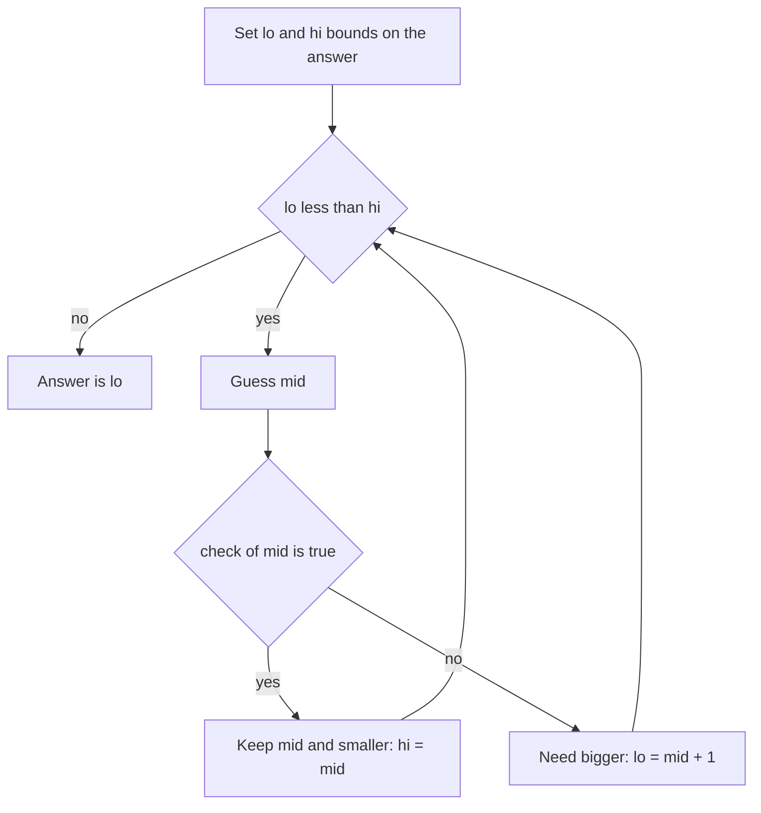

## The hook

A shipping company must move a row of packages, in order, within 5 days. Every day the ship carries packages from the front of the row until the next one would exceed its capacity. What is the smallest capacity that gets the job done?

Computing that capacity directly is awkward. But answering a slightly different question is easy: "would capacity 15 work?" You just simulate the five days. That small shift, from finding the answer to checking a guess, unlocks one of the most powerful patterns in interviews.

## The intuition

:::analogy
Think of setting an oven to bake a cake you have never made. You do not know the perfect temperature, but you can test any guess: too low and the middle stays raw, high enough and it bakes. And if 180 degrees bakes it, 200 certainly does too. So you try the middle of the plausible range, and each test tells you which half to keep, until you find the lowest temperature that still bakes the cake.
:::

That is binary search on the answer. Instead of searching an array, you search the [[answer space]], all values the answer could take. Each guess runs a [[feasibility check]], and because feasibility is [[monotonic]], the answers look like `no no no yes yes yes`. You already know how to find the first yes from [Binary Search Without the Off-by-One Fear](article:dsa-binary-search).

## How it works

Four steps, every time:

1. **Name the answer** you are minimising or maximising (capacity, speed, distance, time).
2. **Bound it**: the smallest value that could possibly work and the largest that surely works.
3. **Write `check(x)`**: usually a [[greedy pass]] that answers "is x enough?" in O(n).
4. **Binary search** for the first x where `check(x)` is true.



:::insight
When a problem says "minimise the maximum" or "maximise the minimum", or asks for "the smallest value such that something is possible", ask yourself: is it easy to check one guess? If yes, and the check is monotonic, binary search on the answer.
:::

Problems phrased as [[minimise the maximum]], like the heaviest day of shipping, or "maximise the minimum", like the closest pair of placed objects, are the classic signals.

### Why the greedy check is safe

For shipping with capacity c, load each day as full as possible before moving on. Loading less on an early day can never help: it only pushes more weight onto later days. So the greedy pass uses the fewest days possible for c, and comparing that count with D answers the question exactly.

## Walk through an example

Weights `[3, 2, 2, 4, 1, 4]`, D = 3 days. Bounds: lo = 4 (heaviest package), hi = 16 (total).

The check, for capacity c, counts days:

| Guess | Day loads with greedy | Days | ≤ 3? | Update |
|---|---|---|---|---|
| mid = 10 | [3,2,2] [4,1,4] | 2 | yes | hi = 10 |
| mid = 7 | [3,2,2] [4,1] [4] | 3 | yes | hi = 7 |
| mid = 5 | [3,2] [2] [4,1] [4] | 4 | no | lo = 6 |
| mid = 6 | [3,2] [2,4] [1,4] | 3 | yes | hi = 6 |
| lo = hi = 6 | | | | answer 6 |

The smallest capacity is 6. Notice that the check never had to be clever; all the cleverness is in realising you only need to check.

:::try-this
Koko eats bananas from piles `[3, 6, 7, 11]` and has 8 hours. At speed k, a pile of size p takes ⌈p / k⌉ hours. Find the minimum k by checking k = 3 and k = 4 by hand. (At k = 3 she needs 1 + 2 + 3 + 4 = 10 hours, too slow. At k = 4 she needs 1 + 2 + 2 + 3 = 8 hours, which works. The answer is 4.)
:::

## The code

```pseudo
can_ship(w, days, cap):
    used = 1, load = 0
    for x in w:
        if load + x > cap:
            used += 1
            load = 0
        load += x
    return used <= days

min_capacity(w, days):
    lo = max(w), hi = sum(w)
    while lo < hi:
        mid = lo + (hi - lo) / 2
        if can_ship(w, days, mid): hi = mid
        else: lo = mid + 1
    return lo
```

```cpp
#include <bits/stdc++.h>
using namespace std;

bool canShip(const vector<int>& w, int days, long long cap) {
    int used = 1;
    long long load = 0;
    for (int x : w) {
        if (load + x > cap) { used++; load = 0; }
        load += x;
    }
    return used <= days;
}

long long minCapacity(const vector<int>& w, int days) {
    long long lo = *max_element(w.begin(), w.end());
    long long hi = accumulate(w.begin(), w.end(), 0LL);
    while (lo < hi) {
        long long mid = lo + (hi - lo) / 2;
        if (canShip(w, days, mid)) hi = mid;
        else lo = mid + 1;
    }
    return lo;
}

int main() {
    cout << minCapacity({3, 2, 2, 4, 1, 4}, 3) << '\n';  // 6
}
```

## Complexity

- **Time:** O(n log R), where R = hi − lo is the size of the answer space. With weights up to 10⁴ and n up to 5·10⁴, R is at most about 5·10⁸, so roughly 29 guesses of O(n) each.
- **Space:** O(1) beyond the input.

## Common mistakes

:::warning
Common misconception: "binary search on the answer needs the input to be sorted." The input order does not matter at all; the shipping problem must keep its order. What must be monotonic is the **check**: if capacity c works, c + 1 must work too.
:::

- **Bad bounds.** A lower bound below the heaviest item makes the check loop forever or lie; an upper bound that does not surely work can miss the answer.
- **Overflow.** Totals and products like "machines × time" exceed 32 bits quickly. Use `long long` for the answer space.
- **Searching the wrong direction** for "maximise the minimum": there the pattern is `yes yes yes no no`, so search for the last yes, or flip the predicate.
- **A non-greedy check that is too slow**, making the total O(n² log R). The check should be one linear pass.

## Practice problems

*Koko Eating Bananas* and *Capacity To Ship Packages* are the template almost verbatim. *Factory Machines* (CSES) searches over time, with a check that sums how many products each machine finishes. *Split Array Largest Sum* is shipping with a new story. *Magnetic Force Between Two Balls* is "maximise the minimum distance": its check places balls greedily and counts how many fit.

## Key takeaways

- When the best value is hard to compute but any guess is easy to check, binary search over the possible answers.
- The check must be monotonic: if a value works, every larger value works too, giving a no-then-yes pattern.
- Bound the answer between the smallest value that could work and the largest that surely works.
- The check is usually a single greedy pass, so the total cost is O(n log R).
- "Minimise the maximum" and "maximise the minimum" are the classic signals for this pattern.
