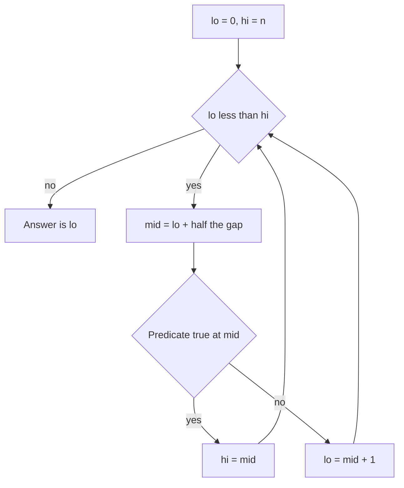

## The hook

Donald Knuth noted that although the first binary search was published in 1946, the first version that worked correctly for every input took many more years to appear. Decades later, a bug was found in the binary search inside Java's standard library: computing `(low + high) / 2` overflowed on very large arrays.

If experts trip over it, the problem is not the idea. The idea is simple. The problem is boundaries: `<` or `<=`, `mid` or `mid + 1`. This article gives you one invariant that makes those choices obvious.

## The intuition

:::analogy
Think of the number-guessing game. A friend picks a number from 1 to 100, and after each guess says "higher" or "lower". You guess 50, then 75 or 25, always the middle of what is left. Seven guesses are enough for any number up to 128. Each answer throws away half of the possibilities.
:::

Binary search is that game on a sorted array. But the most useful way to think about it is not "find x". It is: **find the first position where a yes-or-no question turns true.**

That question is the [[predicate]]. For "first index with `a[i] >= x`" on a sorted array, the answers look like `no no no no yes yes yes`. A predicate that flips from no to yes exactly once is [[monotonic]], and any monotonic predicate can be binary searched.

## How it works

Keep a [[search space]] as a [[half-open interval]] `[lo, hi)` with this invariant:

- everything before `lo` is **no**,
- everything at or after `hi` is **yes**,
- the boundary between them lies somewhere in `[lo, hi]`.

Each step, check the middle:

- if `mid` is **yes**, the first yes is at `mid` or before: set `hi = mid`.
- if `mid` is **no**, the first yes is after `mid`: set `lo = mid + 1`.

When `lo == hi`, the range is empty and `lo` is the first yes (or `n`, meaning there is none).



:::insight
Stop asking "where is x?" and start asking "where does the answer flip from no to yes?". With one template for "first yes", every variant becomes a choice of predicate, not a new set of boundary rules.
:::

### The two predicates you will use most

- **[[Lower bound]]**: first `i` with `a[i] >= x`. If `a[lo] == x` there, x exists; otherwise not.
- **Upper bound**: first `i` with `a[i] > x`. The count of x is `upper − lower`, and the last occurrence is `upper − 1`.

C++ gives you both as `lower_bound` and `upper_bound`, but writing the template yourself is what lets you binary search on things that are not arrays at all.

## Walk through an example

Find the first index with value at least 7 in `a = [2, 4, 7, 7, 9, 12]` (n = 6).

| Step | lo | hi | mid | a[mid] | a[mid] ≥ 7? | Update |
|---|---|---|---|---|---|---|
| 1 | 0 | 6 | 3 | 7 | yes | hi = 3 |
| 2 | 0 | 3 | 1 | 4 | no | lo = 2 |
| 3 | 2 | 3 | 2 | 7 | yes | hi = 2 |
| 4 | 2 | 2 | — | — | stop | answer 2 |

The first 7 is at index 2. Note that step 1 found a 7 at index 3 but kept going, because the question was "first", and the invariant does not stop at any yes; it stops when the range is empty.

:::try-this
Use the same template to find the first index with `a[i] > 7` in the same array. Write the table. (You should end at index 4, the 9. So there are 4 − 2 = 2 sevens.)
:::

## The code

```pseudo
first_true(lo, hi, pred):        // search [lo, hi); pred is no...no yes...yes
    while lo < hi:
        mid = lo + (hi - lo) / 2
        if pred(mid): hi = mid
        else: lo = mid + 1
    return lo                     // hi if every answer is no

lower_bound(a, x) = first_true(0, n, i -> a[i] >= x)
upper_bound(a, x) = first_true(0, n, i -> a[i] > x)
```

```cpp
#include <bits/stdc++.h>
using namespace std;

template <class Pred>
int firstTrue(int lo, int hi, Pred pred) {  // [lo, hi)
    while (lo < hi) {
        int mid = lo + (hi - lo) / 2;
        if (pred(mid)) hi = mid;
        else lo = mid + 1;
    }
    return lo;
}

int main() {
    vector<int> a = {2, 4, 7, 7, 9, 12};
    int n = a.size();
    int lo = firstTrue(0, n, [&](int i) { return a[i] >= 7; });
    int hi = firstTrue(0, n, [&](int i) { return a[i] > 7; });
    cout << lo << ' ' << hi << ' ' << hi - lo << '\n';  // 2 4 2
    // Same answers from the standard library:
    cout << lower_bound(a.begin(), a.end(), 7) - a.begin() << '\n';  // 2
}
```

## Complexity

- **Time:** O(log n). The range halves every step, so about log₂ n steps: 20 for a million elements, 30 for a billion.
- **Space:** O(1).

## Common mistakes

:::warning
Common misconception: "binary search needs a sorted array." It needs a monotonic predicate. A sorted array gives you one, but so does "can we ship all packages in D days with capacity c?", which is false for small c and true for large c. That is binary search on the answer, the next article in this track.
:::

- **Mixing conventions.** Using `hi = n - 1` with `while (lo < hi)` and `hi = mid` silently skips the last element. Pick the half-open template and never mix.
- **Infinite loops.** Writing `lo = mid` instead of `lo = mid + 1` can get stuck when `hi = lo + 1`.
- **Overflow** in `(lo + hi) / 2` when indices or answer ranges are large; use `lo + (hi - lo) / 2`.
- **Forgetting "not found".** When the result is `n`, or `a[result] != x`, the value is absent.
- **Non-monotonic predicates**, such as searching an unsorted array, give wrong answers silently, with no crash to warn you.

## Practice problems

*Binary Search* and *Search Insert Position* are lower bound directly. *First Bad Version* is "first true" with the predicate given to you as a function. *Find First and Last Position* is lower and upper bound together. *Search a 2D Matrix* is the same template over a matrix flattened into one index range. For each one, write the predicate in words before touching code.

## Key takeaways

- Binary search finds the first position where a monotonic yes-or-no predicate becomes true, halving the search space each step.
- Use one half-open template, `[lo, hi)` with `while lo < hi`, `hi = mid` on yes and `lo = mid + 1` on no, so boundaries are never in doubt.
- Lower bound is the first value at least x and upper bound is the first value greater than x; their difference counts x.
- Compute the middle as `lo + (hi - lo) / 2` to avoid overflow.
- Binary search needs monotonicity, not necessarily a sorted array, which opens the door to searching over answers.
