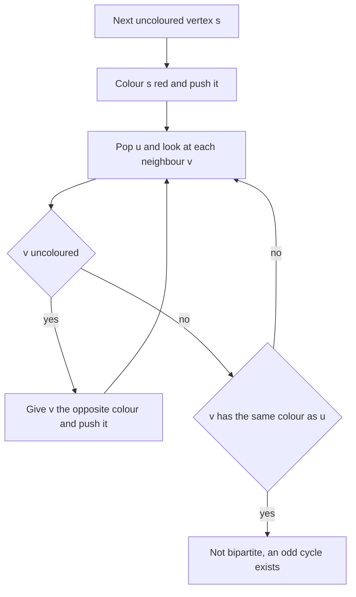

## The hook

A teacher must split a class into two teams for a debate. Some pairs of students are rivals and must not be on the same team; everyone else is happy anywhere. With a dozen students you might juggle names on paper. With thousands of students and rivalries, you want a method that either produces the two teams or proves no split exists.

The method is a breadth-first search with one extra variable. The proof of when it fails is one of the prettiest small facts in graph theory: only an odd cycle can stop you.

## The intuition

:::analogy
Pick any student and send them to the red team. Every rival of theirs must then go to blue. Every rival of those blue students must go to red, and so on, like a rumour that flips colour each time it is passed on. You never have a real choice once the first student is placed. The only way the plan can fail is if the rumour reaches some student twice with different instructions: once "you are red" and once "you are blue".
:::

A graph whose vertices can be split this way is a [[bipartite graph]], and the red and blue labels are a [[two-colouring]]. The rumour is BFS or DFS: colour the start, give each neighbour the opposite colour, and continue.

When can the instructions clash? Walk around any cycle: the colour flips at every edge. After an even number of edges you are back to the starting colour, so the closing edge is fine. After an odd number of edges you are on the opposite colour, and the closing edge joins two vertices that must differ but cannot. So a graph is bipartite exactly when it has no [[odd cycle]].

## How it works

### Colouring with BFS

- Keep colour[v] = 0 for "uncoloured", 1 for red, 2 for blue.
- For every vertex s that is still uncoloured, colour it 1 and run BFS from it.
- When BFS looks at edge u–v: if v is uncoloured, give it 3 - colour[u] and enqueue it; if v already has colour[u], that is a [[conflict edge]], and the graph is not bipartite.

The outer loop over every vertex matters. Colouring spreads only along edges, so each connected component needs its own start; a component that is never visited is never checked. Within one component, the choice of red or blue for the start does not matter, because swapping all colours gives an equally valid split.

### Why BFS finds an odd cycle when it fails

In BFS, the colour of a vertex is the parity of its distance from the start: even distances red, odd distances blue. A conflict edge u–v joins two vertices of the same parity. Follow the BFS tree from u and from v back up to the point where their paths meet. The two paths to that meeting point have the same parity of length, so together with the edge u–v they form a cycle of odd length. So "BFS reports a conflict" and "the graph has an odd cycle" are the same event.

### DFS and union-find versions

DFS works identically: colour the current vertex, recurse into uncoloured neighbours with the opposite colour, and fail on a same-colour neighbour. On very large graphs, prefer BFS or an explicit stack to avoid deep recursion.

Union-find gives a third view, handy when edges arrive one at a time: every neighbour of u must be on the same side as every other neighbour of u. So union all neighbours of u together, and fail if u ends up in the same set as any of its neighbours. That is the [Friend Groups That Merge at a Party](article:dsa-union-find) structure applied to "enemy of my enemy is my friend".

### Where bipartite graphs appear

| Situation | Vertices | Edges | Question |
|---|---|---|---|
| Teams with rivals | Students | Rivalries | Can we split into two teams? |
| Scheduling two shifts | Tasks | Pairs that cannot share a shift | Do two shifts suffice? |
| Jobs and workers | Workers on one side, jobs on the other | "Can do this job" | Naturally bipartite; maximum matching is the next topic |
| Grids | Cells | Neighbouring cells | A chessboard grid is always bipartite: colour by (row + column) parity |



:::insight
Once one vertex of a component is coloured, every other colour in that component is forced. So two-colouring never needs backtracking: it either succeeds in one pass or finds an odd cycle, and checking every component is the only extra care needed.
:::

## Walk through an example

Students 1 to 8 with rivalries 1–2, 1–3, 2–4, 3–4, 4–5, 6–7, 7–8.

| Step | Colour assigned | Reason |
|---|---|---|
| Start component 1 | 1 red | first uncoloured student |
| Neighbours of 1 | 2 blue, 3 blue | rivals of a red student |
| Neighbours of 2 | 4 red | rival of blue 2; 1 is already red, fine |
| Neighbours of 3 | (none new) | 1 red and 4 red, both differ from blue 3 |
| Neighbours of 4 | 5 blue | rival of red 4 |
| Start component 2 | 6 red | 6 is still uncoloured |
| Neighbours of 6, 7 | 7 blue, then 8 red | alternate along the chain |

Teams: red {1, 4, 6, 8} and blue {2, 3, 5, 7}. Every rivalry crosses between them. The cycle 1–2–4–3–1 has four edges, an even number, and caused no trouble.

Now add the rivalry 2–3. BFS colours 2 and 3 blue as neighbours of 1, then reaches the edge 2–3 and finds two blues: a conflict. The odd cycle behind it is the triangle 1–2–3.

:::try-this
A grid of cells, where each cell is a rival of the cells directly above, below, left and right. Is it bipartite, and what are the two teams? (Yes. Colour a cell red when row + column is even and blue when it is odd, like a chessboard. Moving to a neighbour changes row + column by exactly one, so every edge joins different colours.)
:::

:::warning
Common misconception: "If a graph has a cycle, it cannot be bipartite." Only odd cycles break bipartiteness. The four-cycle 1–2–4–3–1 above is perfectly fine, and every grid is full of four-cycles yet bipartite. Confusing the two leads to rejecting valid inputs, especially on grid problems.
:::

## The code

```pseudo
is_bipartite(n, adj):
    colour = [0] * n
    for s in 0 .. n-1:
        if colour[s] != 0: continue            # already in a checked component
        colour[s] = 1; queue = [s]
        while queue:
            u = queue.pop_front()
            for v in adj[u]:
                if colour[v] == 0: colour[v] = 3 - colour[u]; queue.push(v)
                else if colour[v] == colour[u]: return false
    return true
```

```cpp
#include <bits/stdc++.h>
using namespace std;

// returns the colours (1 or 2) for every vertex, or an empty vector if impossible
vector<int> twoColour(int n, const vector<vector<int>>& adj) {
    vector<int> colour(n, 0);
    for (int s = 0; s < n; s++) {
        if (colour[s]) continue;                                // new component
        colour[s] = 1;
        queue<int> q;
        q.push(s);
        while (!q.empty()) {
            int u = q.front(); q.pop();
            for (int v : adj[u]) {
                if (!colour[v]) colour[v] = 3 - colour[u], q.push(v);
                else if (colour[v] == colour[u]) return {};      // conflict edge
            }
        }
    }
    return colour;
}

struct DSU {
    vector<int> p;
    explicit DSU(int n) : p(n) { iota(p.begin(), p.end(), 0); }
    int find(int x) { return p[x] == x ? x : p[x] = find(p[x]); }
    void unite(int a, int b) { p[find(a)] = find(b); }
};

bool bipartiteDSU(int n, const vector<vector<int>>& adj) {
    DSU d(n);
    for (int u = 0; u < n; u++)
        for (int v : adj[u]) {
            if (d.find(u) == d.find(v)) return false;            // u and a rival on one side
            d.unite(adj[u][0], v);                               // all rivals of u share a side
        }
    return true;
}

int main() {
    auto build = [](int n, const vector<pair<int, int>>& e) {
        vector<vector<int>> adj(n);
        for (auto [a, b] : e) adj[a].push_back(b), adj[b].push_back(a);
        return adj;
    };
    vector<pair<int, int>> e = {{0, 1}, {0, 2}, {1, 3}, {2, 3}, {3, 4}, {5, 6}, {6, 7}};   // students 1..8 as 0..7
    auto adj = build(8, e);
    for (int c : twoColour(8, adj)) cout << c << ' ';
    cout << bipartiteDSU(8, adj) << '\n';                        // 1 2 2 1 2 1 2 1 1
    e.push_back({1, 2});                                         // rivalry 2-3 closes a triangle
    auto adj2 = build(8, e);
    cout << twoColour(8, adj2).size() << ' ' << bipartiteDSU(8, adj2) << '\n';   // 0 0
}
```

The output colours match the walkthrough: 1 is red (1), 2 and 3 blue (2), 4 red, 5 blue, 6 red, 7 blue, 8 red. For *Building Teams*, print these colours directly, or IMPOSSIBLE when the vector is empty.

## Complexity

- **BFS or DFS colouring: O(V + E) time,** since each vertex is coloured once and each edge is examined twice; O(V) extra space for colours and the queue.
- **Union-find: O((V + E) α(V)),** effectively linear, with O(V) space.
- **Grid graphs:** O(1) per cell to test, because the chessboard colouring is known in advance.

## Common mistakes

- **Starting from vertex 0 only,** which skips every other component.
- **Rejecting any cycle,** when only odd cycles break bipartiteness.
- **Treating the input as directed.** Rivalry is mutual; add each edge in both directions.
- **Recursing deeply with DFS** on a long path of 10⁵ vertices, which can overflow the stack.
- **Forgetting self-loops,** an edge u–u, which is an odd cycle of length one and makes the graph non-bipartite.

## Practice problems

*Is Graph Bipartite?* hands you an adjacency list that may be disconnected. *Possible Bipartition* builds the graph from a list of dislikes first. *Building Teams* asks for the actual teams, or IMPOSSIBLE. The BFS mechanics are in [Ripples on a Pond: Breadth-First Search](article:dsa-bfs), and the recursive version in [Going Deep With a Ball of String](article:dsa-dfs).

## Key takeaways

- A graph is bipartite when its vertices split into two groups with every edge going between the groups.
- Two-colouring by BFS or DFS gives each neighbour the opposite colour, and a same-coloured edge proves the graph is not bipartite.
- A graph is bipartite exactly when it has no odd cycle, because colours alternate around every cycle and only an odd one returns to a clash.
- Colouring spreads only along edges, so every uncoloured vertex must start a new search to cover every component.
- Grids are always bipartite, coloured by the parity of row plus column, which is why four-cycles never cause trouble.
