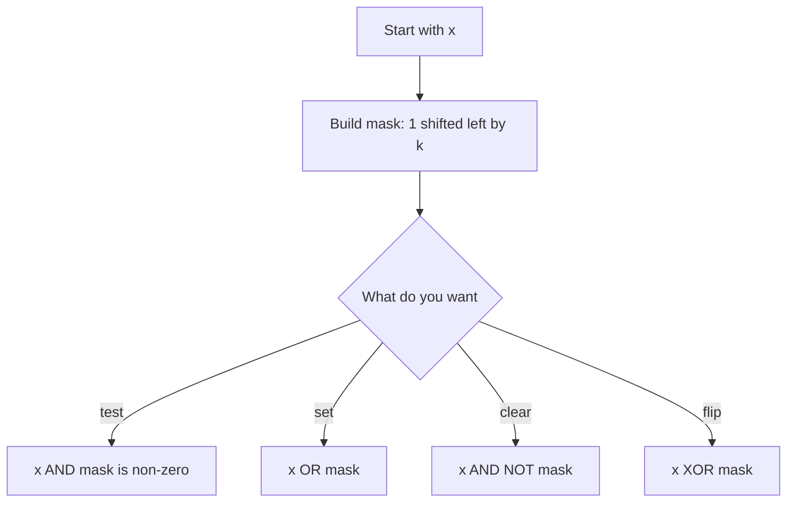

## The hook

Here is a puzzle interviewers love: every number in an array appears twice, except one. Find it, in one pass, with no extra memory. A hash map works but uses memory. Sorting works but is slow.

The real answer is a single line: XOR all the numbers together. Pairs cancel to zero, and the lonely number is all that remains. It feels like magic until you see what is happening inside the number, where every integer is just a row of switches. Once you can see those switches, a whole family of tricks becomes obvious instead of clever.

## The intuition

:::analogy
Picture a control panel with a row of light switches, each either off (0) or on (1). Every integer is one such panel: 13 is the pattern on, on, off, on, reading from the left. Bitwise operations are ways of combining two panels switch by switch, and shifts slide the whole pattern along the row.
:::

Each switch is a [[bit]]. Its position decides its value: the rightmost is worth 1, then 2, 4, 8 and so on. So 1101 in binary is 8 + 4 + 0 + 1 = 13. A [[bitwise operator]] looks at each position independently, which is why bit tricks are so fast: the processor flips all 32 or 64 switches at once.

## Let's build it up

### The four operators

Compare two panels position by position:

| Operator | Rule per position | 1101 (13) with 0110 (6) |
|---|---|---|
| AND `&` | 1 only if both are 1 | 0100 = 4 |
| OR `\|` | 1 if either is 1 | 1111 = 15 |
| XOR `^` | 1 if they differ | 1011 = 11 |
| NOT `~` | flips every switch | ~13 flips all bits of 13 |

XOR has two properties worth memorising: `x ^ x = 0` and `x ^ 0 = x`. That is why XOR-ing a list cancels every pair, and the order does not matter.

### Shifts

A [[shift]] slides the panel. `x << k` moves every bit k places left, filling with zeros, which multiplies by 2ᵏ. `x >> k` moves right, which divides by 2ᵏ and rounds down for non-negative numbers. So `1 << k` is a panel with only switch k on: the number 2ᵏ.

### Reading and writing single switches

Combine a shift with an operator and you get a [[mask]], a number that points at the switches you care about:

- **Is bit k on?** `(x >> k) & 1`
- **Turn bit k on:** `x | (1 << k)`
- **Turn bit k off:** `x & ~(1 << k)`
- **Flip bit k:** `x ^ (1 << k)`
- **Is x odd?** `x & 1` checks the [[least significant bit]].



:::insight
A number is a row of independent yes-or-no switches, and bitwise operators flip all of them in one machine step. Whenever a problem is about subsets, parity or on-off states, think of the number as the switches themselves.
:::

### Counting and powers of two

Two more one-liners come up constantly. A number is a power of two exactly when it has a single switch on, and `x & (x - 1)` turns off the lowest switch that is on, so `x > 0 && (x & (x - 1)) == 0` tests for a power of two. Repeating `x &= x - 1` until x becomes zero counts how many switches are on, one loop step per 1 bit; C++ also offers `__builtin_popcount(x)` for the same job. On the control panel, each step simply flips off the rightmost light that is still on.

### Sizes and limits

An `int` usually has 32 switches, the leftmost acting as the sign, so it holds values up to about 2.1 × 10⁹. A `long long` has 64 and reaches about 9.2 × 10¹⁸. That is why bitmasks over subsets are practical only for about 20 to 25 items: 2²⁰ is already about a million subsets.

### Negative numbers

Computers store negatives in [[two's complement]]: −x equals `~x + 1`. You rarely need the details, but one consequence is useful: `x & -x` keeps only the lowest set bit of x. For 12 (1100), it gives 4 (0100). That trick powers Fenwick trees later in this subject.

:::warning
Common misconception: "1 << 40 gives 2 to the 40." In C++, the literal 1 is an int, usually 32 bits, and shifting it by 32 or more is undefined behaviour. Write `1LL << 40`. Also remember that `&` binds more loosely than `==`, so write `(x & 1) == 0`, with brackets.
:::

## A tiny example

The lonely number puzzle with `[4, 1, 2, 1, 2]`:

| Step | Value | Running XOR (decimal) | Running XOR (binary) |
|---|---|---|---|
| start | | 0 | 000 |
| 1 | 4 | 4 | 100 |
| 2 | 1 | 5 | 101 |
| 3 | 2 | 7 | 111 |
| 4 | 1 | 6 | 110 |
| 5 | 2 | 4 | 100 |

The answer is 4. The two 1s cancelled each other, and so did the two 2s, even though they were interleaved.

```pseudo
lonely(a):
    r = 0
    for x in a: r = r XOR x
    return r
```

### Subsets as numbers

With n items, every subset is a row of n switches: bit i on means item i is in the subset. The numbers 0 to 2ⁿ − 1 list every subset exactly once.

```cpp
#include <bits/stdc++.h>
using namespace std;

int main() {
    vector<string> items = {"chai", "samosa", "jalebi"};
    int n = items.size();
    for (int mask = 0; mask < (1 << n); mask++) {
        cout << "{ ";
        for (int i = 0; i < n; i++)
            if ((mask >> i) & 1) cout << items[i] << ' ';
        cout << "}\n";
    }
}
```

:::try-this
Without running it, write the subset printed for mask = 5 in the loop above. (5 is 101 in binary, so bits 0 and 2 are on: { chai jalebi }.)
:::

## Where you'll see this again

Bits come back constantly: the bit manipulation tricks article (counting bits, power-of-two checks, XOR puzzles), bitmask DP where a subset is the state, Fenwick trees built on `x & -x`, and modular exponentiation in competitive programming, which walks through the bits of the exponent. Even [binary search](article:dsa-binary-search) is, at heart, deciding one bit of the answer at a time.

## Key takeaways

- Every integer is a row of bits, each worth a power of two, and bitwise operators act on all positions at once.
- AND keeps common 1s, OR combines 1s, XOR marks differences, and XOR-ing a value with itself gives zero.
- Shifting left by k multiplies by 2 to the power k, and a mask built with 1 << k tests, sets, clears or flips a single bit.
- The numbers from 0 to 2^n − 1 list every subset of n items, one bit per item.
- Use 1LL for shifts beyond 31 and put brackets around bitwise expressions, because & binds more loosely than ==.
