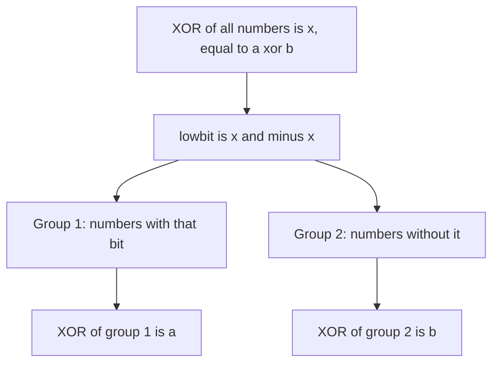

## The hook

A hotel corridor has a panel of light switches. A cleaner walks through and flips switches for every room they visit, and one guest visits twice, flipping the same switch back. At the end, only the rooms visited an odd number of times are lit. Nobody counted anything; the panel itself did the bookkeeping.

That one property of XOR, "flip twice and nothing happened", solves a surprising number of interview questions in O(1) memory. A handful of other bit tricks join it in the toolbox, and each can be explained in one line once you see what it does to the bits.

## The intuition

:::analogy
Picture a panel with one switch for every bit position. XOR-ing a number into the panel flips exactly the switches where that number has a 1. Flip the same number in twice and the panel returns to where it was; flip in zero and nothing moves. The order of the flips never matters, only how many times each switch was flipped: odd means on, even means off.
:::

That is [[XOR cancellation]]: x ^ x = 0, x ^ 0 = x, and XOR is commutative and associative. The other tricks below each target one bit at a time, as in [A Row of Light Switches Inside Every Number](article:dsa-bit-basics):

| Trick | Expression | What it does |
|---|---|---|
| Cancel pairs | XOR of all values | keeps values seen an odd number of times |
| Lowest set bit | x & -x | isolates the rightmost 1 |
| Clear lowest set bit | n & (n - 1) | turns the rightmost 1 into 0 |
| Power of two | n > 0 && (n & (n - 1)) == 0 | true when exactly one bit is set |
| Bits of i from smaller i | bits[i >> 1] + (i & 1) | counting bits by DP |
| Add without + | sum = a ^ b, carry = (a & b) << 1 | repeat until carry is 0 |

## How it works

### Single Number: one value appears once

Every value appears twice except one. XOR all the values: each pair cancels, the single value remains. O(n) time, O(1) space, no hash set.

*Missing Number* is the same trick in disguise: XOR every index 0..n together with every value, and the one index without a matching value survives.

### Single Number III: two values appear once

XOR everything to get x = a ^ b, the two singles combined. They differ somewhere, so x has at least one 1; take the [[differing bit]] lowbit = x & -x. Now split all the numbers by whether they have that bit:

- a and b land in different groups, because they differ at that bit;
- each pair lands in the same group, because equal numbers agree on every bit.

XOR each group separately: one gives a, the other b.

### Single Number II: everything else appears three times

XOR no longer cancels triples. Count, for each bit position, how many numbers have that bit set. Triples contribute multiples of 3, so the count modulo 3 is exactly the single number's bit. Build the answer bit by bit: O(32 × n) time, O(1) space.

### Counting 1 bits: Kernighan's trick

[[Kernighan's trick]]: n - 1 flips the lowest 1 of n to 0 and every 0 below it to 1, so n & (n - 1) clears just that lowest 1. Repeating until n is 0 counts the ones in as many steps as there are ones, often far fewer than 32. The same expression gives the power-of-two test: a power of two has exactly one 1, so n & (n - 1) is 0.

### Counting Bits for every number up to n

i >> 1 drops the last bit of i, and i & 1 is that bit. So bits[i] = bits[i >> 1] + (i & 1), a one-line DP from smaller numbers: O(n) for all of 0..n.

### Sum of Two Integers without + or -

Binary addition column by column: a ^ b adds without carrying, and [[carry bits]] (a & b) << 1 are exactly the carries, shifted to the column they move into. Add those two the same way, again and again, until no carries remain. With negative numbers, do the work in unsigned 32-bit arithmetic, where the carry eventually shifts off the top and the loop ends.

### The signed shift trap

In C++, right-shifting a negative int is an [[arithmetic shift]] on all common compilers, filling the top with 1s, so -8 >> 1 is -4 and a loop such as while (n) { n >>= 1; } on a negative n never ends. Cast to unsigned when you mean "move the bits", and use 1LL << k or 1u << k when k can reach 31.



:::insight
Most bit tricks work one switch at a time: XOR flips switches so pairs cancel, x & -x picks out one switch, n & (n - 1) turns one off. Once you can say which switches an expression changes, the trick explains itself.
:::

## Walk through an example

### Single Number on [7, 3, 5, 3, 7]

| Step | XOR so far (decimal, binary) |
|---|---|
| 7 | 7, 111 |
| ^ 3 | 4, 100 |
| ^ 5 | 1, 001 |
| ^ 3 | 2, 010 |
| ^ 7 | **5**, 101 |

The intermediate values look random, but the 7s and 3s cancel in the end and 5 remains.

### Single Number III on [2, 9, 4, 2, 6, 4]

XOR of all is 9 ^ 6 = 15, binary 1111. The lowest set bit is 1.

| Group | Numbers | XOR |
|---|---|---|
| bit 0 set (odd) | 9 | 9 |
| bit 0 clear (even) | 2, 4, 2, 6, 4 | 6 |

The singles are 9 and 6.

### Single Number II on [5, 3, 5, 5]

| Bit | Numbers with it set | Count mod 3 | Answer bit |
|---|---|---|---|
| 0 | 5, 3, 5, 5 | 4 mod 3 = 1 | 1 |
| 1 | 3 | 1 | 1 |
| 2 | 5, 5, 5 | 0 | 0 |

The answer is binary 011 = 3.

### Kernighan on 44

44 = 101100 → 101000 → 100000 → 0: three steps, three ones.

### Counting Bits for 0 to 8

| i | 0 | 1 | 2 | 3 | 4 | 5 | 6 | 7 | 8 |
|---|---|---|---|---|---|---|---|---|---|
| bits[i >> 1] + (i & 1) | 0 | 0 + 1 | 1 + 0 | 1 + 1 | 1 + 0 | 1 + 1 | 2 + 0 | 2 + 1 | 1 + 0 |
| bits[i] | 0 | 1 | 1 | 2 | 1 | 2 | 2 | 3 | 1 |

### Adding 13 and 9 without +

| Round | a | b | a ^ b | (a & b) << 1 |
|---|---|---|---|---|
| 1 | 13 (1101) | 9 (1001) | 4 (0100) | 18 (10010) |
| 2 | 4 | 18 | 22 (10110) | 0 |

The carry is 0 after round 2, so the sum is 22.

:::try-this
Use the XOR trick to find the missing number in [3, 0, 1, 4], where the numbers should be 0 to 4. (XOR the indices 0 to 4 with the values: 0 ^ 1 ^ 2 ^ 3 ^ 4 ^ 3 ^ 0 ^ 1 ^ 4. Every number except 2 appears twice and cancels, so the answer is 2.)
:::

:::warning
Common misconception: "x & -x and n & (n - 1) are the same trick." They are mirror images. x & -x keeps only the lowest set bit and clears everything else; n & (n - 1) clears only the lowest set bit and keeps everything else. For 12 (1100), x & -x is 4 (0100), while n & (n - 1) is 8 (1000). Mixing them up is a classic Fenwick tree and popcount bug.
:::

## The code

```pseudo
single_number(a): return XOR of all values
single_number_iii(a):
    x = XOR of all; low = x & -x
    p = XOR of values with (v & low) != 0; q = x ^ p
    return p, q
popcount(n): count = 0; while n: n &= n - 1; count += 1
counting_bits(n): bits[0] = 0; for i in 1..n: bits[i] = bits[i >> 1] + (i & 1)
add(a, b):                                    # unsigned 32-bit
    while b: (a, b) = (a ^ b, (a & b) << 1)
    return a
```

```cpp
#include <bits/stdc++.h>
using namespace std;

int singleNumber(const vector<int>& a) {
    int x = 0;
    for (int v : a) x ^= v;                              // pairs cancel
    return x;
}

pair<int, int> singleNumberIII(const vector<int>& a) {
    unsigned x = 0;
    for (int v : a) x ^= v;
    unsigned low = x & (~x + 1);                         // lowest set bit, safe for INT_MIN
    int p = 0;
    for (int v : a) if (v & low) p ^= v;                 // the group holding one single
    return {p, int(x ^ p)};
}

int singleNumberII(const vector<int>& a) {
    unsigned r = 0;
    for (int b = 0; b < 32; b++) {
        int c = 0;
        for (int v : a) c += (unsigned(v) >> b) & 1;
        if (c % 3) r |= 1u << b;                         // the single number's bit
    }
    return int(r);
}

int popcount(unsigned n) {
    int c = 0;
    while (n) n &= n - 1, c++;                           // clear the lowest 1
    return c;
}

vector<int> countingBits(int n) {
    vector<int> bits(n + 1, 0);
    for (int i = 1; i <= n; i++) bits[i] = bits[i >> 1] + (i & 1);
    return bits;
}

int addWithoutPlus(int a, int b) {
    unsigned x = a, y = b;
    while (y) {
        unsigned carry = (x & y) << 1;
        x ^= y, y = carry;
    }
    return int(x);
}

int main() {
    cout << singleNumber({7, 3, 5, 3, 7}) << ' ';
    auto [p, q] = singleNumberIII({2, 9, 4, 2, 6, 4});
    cout << p << ' ' << q << ' ' << singleNumberII({5, 3, 5, 5}) << '\n';           // 5 9 6 3
    cout << popcount(44) << ' ' << popcount(0xFFFFFFFFu) << '\n';                   // 3 32
    for (int b : countingBits(8)) cout << b;
    cout << '\n';                                                                  // 011212231
    cout << addWithoutPlus(13, 9) << ' ' << addWithoutPlus(-3, 5) << '\n';          // 22 2
    int n = 64;
    cout << (n > 0 && (n & (n - 1)) == 0) << ' ' << (12 & -12) << ' ' << (12 & 11) << '\n';   // 1 4 8
}
```

`singleNumberIII` computes the lowest bit as `x & (~x + 1)` on an unsigned value, which is the same as x & -x but avoids negating INT_MIN as a signed int, an overflow in C++.

## Complexity

- **Single Number and Missing Number: O(n) time, O(1) space.**
- **Single Number III: O(n) time,** two passes, O(1) space.
- **Single Number II: O(32 × n) time, O(1) space.**
- **Kernighan popcount: O(number of ones),** at most 32 steps for 32-bit values.
- **Counting Bits: O(n)** for all values up to n.
- **Addition without +: at most 32 rounds** for 32-bit values.

## Common mistakes

- **Using XOR for values that appear three times,** where pairs no longer cancel; count bits modulo 3 instead.
- **Negating INT_MIN** for x & -x on a signed int; work in unsigned.
- **Right-shifting negative numbers** in loops that expect to reach 0.
- **Shifting 1 by 31 or more** as an int; use 1u, 1LL or 1ULL.
- **Confusing x & -x with n & (n - 1).**
- **Forgetting operator precedence:** `n & n - 1 == 0` parses as `n & ((n - 1) == 0)`; always parenthesise.

## Practice problems

*Single Number* is pure XOR cancellation, and *Single Number III* adds the split by a differing bit. *Number of 1 Bits* is Kernighan's trick, and *Counting Bits* the one-line DP. *Sum of Two Integers* is addition with XOR and carries. The operators themselves are explained in [A Row of Light Switches Inside Every Number](article:dsa-bit-basics), and the lowest-set-bit trick powers [A Pyramid of Savings Jars](article:dsa-fenwick-tree).

## Key takeaways

- XOR-ing a list cancels every value that appears an even number of times, which finds a single unpaired value in O(1) space.
- When two values are unpaired, the lowest set bit of their XOR splits the list into two groups, each holding one of them.
- When other values appear three times, counting each bit modulo 3 rebuilds the single value.
- n & (n - 1) clears the lowest set bit, which counts ones and tests for powers of two, while x & -x isolates that bit.
- Addition can be built from XOR for the sum without carries and AND shifted left for the carries, repeated until no carry remains.
