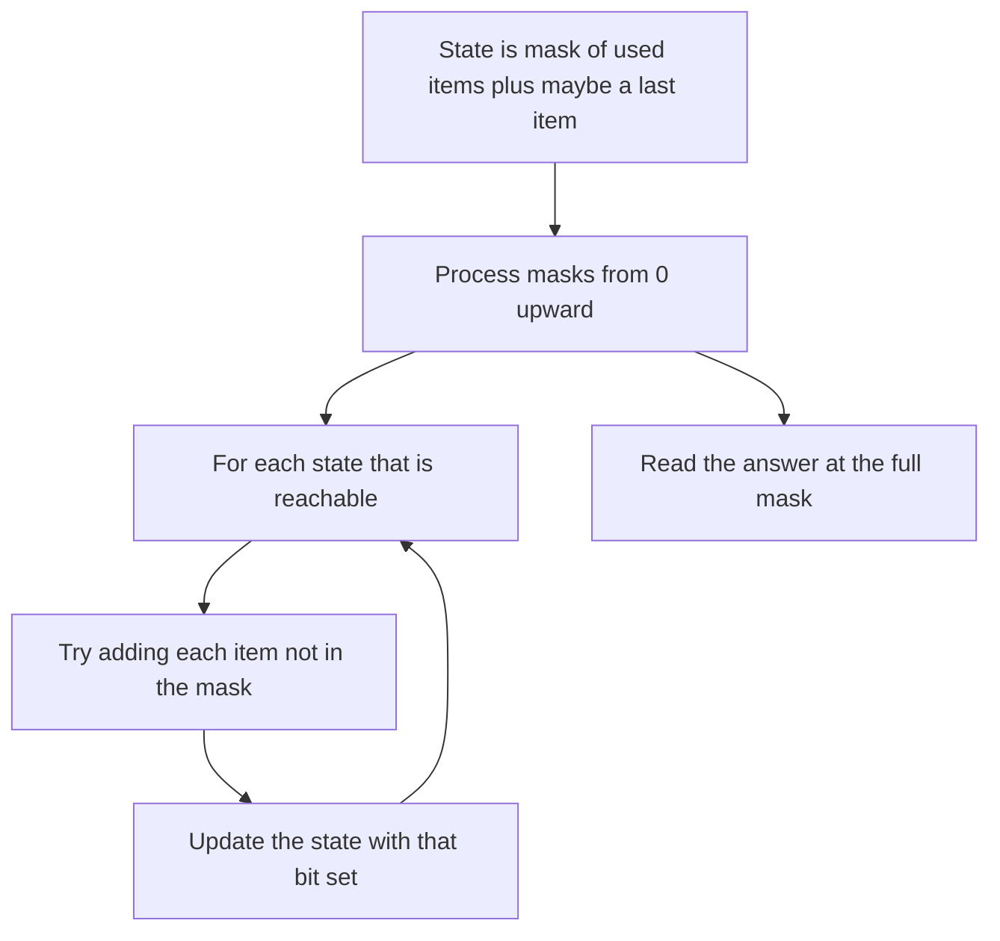

## The hook

A delivery driver must visit 15 shops and return to the depot by the shortest route. Trying every order means 14! routes, about 87 billion. Yet the problem is solvable in well under a second, because most of those orders share their beginnings: the best way to have visited shops {2, 5, 9} and be standing at shop 9 does not depend on which order you will visit the rest.

The key is recording "which shops are done" in a way a computer can index: one bit per shop, packed into a single integer.

## The intuition

:::analogy
Imagine a row of 15 small lights above the driver's dashboard, one per shop. A light turns on when its shop is visited. The pattern of lights is a checklist, and reading it as a binary number gives every possible checklist its own number, from all lights off to all lights on. For each pattern and each shop the driver could be standing at, keep the shortest distance driven so far. Two routes that light the same pattern and end at the same shop are interchangeable from then on, so only the shorter one matters.
:::

The row of lights is a [[bitmask]]: bit i of an integer is 1 when item i is in the set. The basic operations, from [A Row of Light Switches Inside Every Number](article:dsa-bit-basics):

| Operation | Expression |
|---|---|
| Is item i in mask? | `(mask >> i) & 1` |
| Add item i | `mask \| (1 << i)` |
| Remove item i | `mask & ~(1 << i)` |
| How many items? | `__builtin_popcount(mask)` |
| All n items | `(1 << n) - 1`, the [[full mask]] |

[[Mask DP]] uses the mask as part of the state. The number of states is 2ⁿ times whatever else you track, which is why it is the tool for n up to about 20, and hopeless beyond.

## How it works

### Held-Karp for the travelling salesman

[[Held-Karp]]: dp[mask][v] is the shortest path that starts at city 0, visits exactly the cities in mask, and ends at v.

- Base: dp[1][0] = 0, since mask 1 means only city 0.
- Transition: for each unvisited w, dp[mask | 1 << w][w] = min(..., dp[mask][v] + dist[v][w]).
- Answer: the minimum over v of dp[full][v] + dist[v][0].

There are 2ⁿ × n states with n transitions each: O(2ⁿ × n²). For n = 15, that is about 7 million steps, against 87 billion orders.

Masks can be processed in increasing numeric order, because adding a city sets a bit and makes the number larger. Every transition goes upward, so when a mask is processed, all its predecessors are done.

### Counting Hamiltonian paths

CSES *Hamiltonian Flights* counts the routes from city 1 to city n that visit every city exactly once, a [[Hamiltonian path]], in a directed graph. Same states, with counts instead of distances: ways[mask | 1 << w][w] += ways[mask][v] for each flight v → w with w unvisited. One extra rule prunes heavily: do not extend from city n unless the mask is full, because the route must end there.

### BFS over (node, mask)

*Shortest Path Visiting All Nodes* asks for the fewest edges in a walk, which may revisit nodes, that visits every node of an unweighted graph, starting anywhere. The state is (current node, mask of visited nodes). Every edge costs 1, so BFS from all n states (i, 1 << i) at once gives the answer at the first state with the full mask. There are n × 2ⁿ states, just as in Held-Karp, but BFS replaces the min.

### Subsets of items: Partition to K Equal Sum Subsets

Here the mask records which numbers are already placed into buckets. With target = sum / k, keep dp[mask] = how full the current bucket is after placing exactly the numbers in mask, filling buckets one at a time, or -1 if impossible. Adding number i is allowed when dp[mask] + a[i] ≤ target, and the new fill is (dp[mask] + a[i]) mod target. The answer is yes when the full mask is reachable.

| Problem | State | Value | Order |
|---|---|---|---|
| Travelling salesman | (mask, last city) | shortest distance | masks increasing |
| Hamiltonian Flights | (mask, last city) | number of routes | masks increasing |
| Visit all nodes | (node, mask) | fewest steps | BFS |
| K equal subsets | mask | current bucket fill | masks increasing |



:::insight
Whenever the future depends only on which items are used, not on the order they were used in, the set of used items can be a bitmask. That collapses n! orders into 2ⁿ sets, which is the difference between impossible and instant for n up to about 20.
:::

## Walk through an example

### Held-Karp on four cities

Distances:

| | 0 | 1 | 2 | 3 |
|---|---|---|---|---|
| 0 | 0 | 4 | 9 | 5 |
| 1 | 4 | 0 | 3 | 7 |
| 2 | 9 | 3 | 0 | 2 |
| 3 | 5 | 7 | 2 | 0 |

Masks are written with city 3 on the left and city 0 on the right. Only reachable entries are shown.

| Mask | Visited | End at 0 | End at 1 | End at 2 | End at 3 |
|---|---|---|---|---|---|
| 0001 | {0} | 0 | | | |
| 0011 | {0, 1} | | 4 | | |
| 0101 | {0, 2} | | | 9 | |
| 1001 | {0, 3} | | | | 5 |
| 0111 | {0, 1, 2} | | 12 | 7 | |
| 1011 | {0, 1, 3} | | 12 | | 11 |
| 1101 | {0, 2, 3} | | | 7 | 11 |
| 1111 | all | | 10 | 13 | 9 |

For example, dp[0111][2] = 7 comes from 0 → 1 → 2 (4 + 3), beating 0 → 2 directly (9). Closing the tour: min(10 + 4, 13 + 9, 9 + 5) = 14, achieved by 0 → 1 → 2 → 3 → 0 (4 + 3 + 2 + 5) and its reverse. Checking all 6 orders by brute force also gives 14.

### Hamiltonian Flights

Flights 0 → 1, 0 → 2, 1 → 2, 2 → 1, 1 → 3, 2 → 3, from 0 to 3. The routes visiting all four cities are 0 → 1 → 2 → 3 and 0 → 2 → 1 → 3, so the count is 2. The route 0 → 1 → 3 reaches city 3 early with mask {0, 1, 3}; the pruning rule refuses to extend it, because it can never become a full route.

### Visiting all nodes

Edges 0–1, 1–2, 2–3, 1–4. BFS over (node, mask) first reaches the full mask after 5 steps, for example 4 → 1 → 0 → 1 → 2 → 3: node 1 is visited twice, which is allowed and necessary, because 0 and 4 are both dead ends off node 1.

### Partition into equal subsets

Numbers 2, 1, 4, 5, 3, 3 with k = 3: the total is 18, so the target is 6. The DP reaches the full mask, so the answer is yes, for example {1, 5}, {2, 4}, {3, 3}.

:::try-this
How many masks and how many (mask, city) states does Held-Karp use for n = 20, and roughly how many transitions? (2²⁰ = 1,048,576 masks, about 21 million states with 20 cities each, and about 420 million transitions with 20 choices each. That is near the limit of a one-second budget, and the distance table alone needs 21 million entries, about 84 MB as 32-bit integers.)
:::

:::warning
Common misconception: "Bitmask DP is a fast algorithm for the travelling salesman problem." It is much faster than trying every order, but it is still exponential: each extra city doubles the work. It shines for n up to about 20 and is useless for 100 cities, where heuristics or problem-specific structure are needed. Read the constraints: n ≤ 20 is the signal.
:::

## The code

```pseudo
held_karp(dist):
    dp[1][0] = 0; every other dp = inf
    for mask in 1 .. full:
        for v in mask with dp[mask][v] < inf:
            for w not in mask:
                dp[mask | 1<<w][w] = min(dp[mask | 1<<w][w], dp[mask][v] + dist[v][w])
    return min over v of dp[full][v] + dist[v][0]

visit_all(adj):                               # BFS over (node, mask)
    push (i, 1<<i) for every node i, distance 0
    pop (u, mask): if mask == full: return distance
    for v in adj[u]: push (v, mask | 1<<v) if unseen
```

```cpp
#include <bits/stdc++.h>
using namespace std;
const int INF = 1e9;

int heldKarp(const vector<vector<int>>& d) {
    int n = d.size(), full = (1 << n) - 1;
    vector<vector<int>> dp(1 << n, vector<int>(n, INF));
    dp[1][0] = 0;
    for (int mask = 1; mask <= full; mask++)
        for (int v = 0; v < n; v++) {
            if (dp[mask][v] == INF) continue;
            for (int w = 0; w < n; w++) {
                if (mask >> w & 1) continue;                     // already visited
                int nm = mask | 1 << w;
                dp[nm][w] = min(dp[nm][w], dp[mask][v] + d[v][w]);
            }
        }
    int best = INF;
    for (int v = 1; v < n; v++) best = min(best, dp[full][v] + d[v][0]);
    return best;
}

long long hamiltonianFlights(int n, const vector<array<int, 2>>& flights) {   // from 0 to n - 1
    const long long MOD = 1e9 + 7;
    vector<vector<int>> in(n);
    for (auto [a, b] : flights) in[b].push_back(a);
    vector<vector<long long>> ways(1 << n, vector<long long>(n, 0));
    ways[1][0] = 1;
    for (int mask = 1; mask < (1 << n); mask++) {
        if (!(mask & 1)) continue;                              // every route starts at 0
        if ((mask >> (n - 1) & 1) && mask != (1 << n) - 1) continue;   // ended too early
        for (int w = 0; w < n; w++) {
            if (!(mask >> w & 1) || w == 0) continue;
            int prev = mask ^ (1 << w);
            for (int v : in[w])
                if (prev >> v & 1) ways[mask][w] = (ways[mask][w] + ways[prev][v]) % MOD;
        }
    }
    return ways[(1 << n) - 1][n - 1];
}

int visitAll(const vector<vector<int>>& adj) {
    int n = adj.size(), full = (1 << n) - 1;
    vector<vector<int>> dist(n, vector<int>(1 << n, -1));
    queue<pair<int, int>> q;
    for (int i = 0; i < n; i++) dist[i][1 << i] = 0, q.push({i, 1 << i});
    while (!q.empty()) {
        auto [u, m] = q.front(); q.pop();
        if (m == full) return dist[u][m];
        for (int v : adj[u]) {
            int nm = m | 1 << v;
            if (dist[v][nm] == -1) dist[v][nm] = dist[u][m] + 1, q.push({v, nm});
        }
    }
    return -1;
}

bool canPartitionK(const vector<int>& a, int k) {
    int n = a.size(), sum = accumulate(a.begin(), a.end(), 0);
    if (sum % k) return false;
    int target = sum / k;
    vector<int> fill(1 << n, -1);                               // current bucket fill, -1 unreachable
    fill[0] = 0;
    for (int mask = 0; mask < (1 << n); mask++) {
        if (fill[mask] < 0) continue;
        for (int i = 0; i < n; i++)
            if (!(mask >> i & 1) && fill[mask] + a[i] <= target)
                fill[mask | 1 << i] = (fill[mask] + a[i]) % target;
    }
    return fill[(1 << n) - 1] == 0;
}

int main() {
    cout << heldKarp({{0, 4, 9, 5}, {4, 0, 3, 7}, {9, 3, 0, 2}, {5, 7, 2, 0}}) << '\n';   // 14
    cout << hamiltonianFlights(4, {{0, 1}, {0, 2}, {1, 2}, {2, 1}, {1, 3}, {2, 3}}) << '\n';   // 2
    cout << visitAll({{1}, {0, 2, 4}, {1, 3}, {2}, {1}}) << '\n';                         // 5
    cout << canPartitionK({2, 1, 4, 5, 3, 3}, 3) << ' ' << canPartitionK({2, 2, 3, 5}, 2) << '\n';   // 1 0
}
```

`hamiltonianFlights` pulls from predecessors rather than pushing to successors, so it loops over incoming flights; both directions work, and pulling makes the "ended too early" check easy to apply to the mask being filled.

## Complexity

- **Held-Karp and Hamiltonian counting: O(2ⁿ × n²) time, O(2ⁿ × n) space.**
- **BFS over (node, mask): O(2ⁿ × (n + E))** time, O(2ⁿ × n) space.
- **Partition into k subsets: O(2ⁿ × n) time, O(2ⁿ) space.**
- **Practical limit:** n around 20 for O(2ⁿ × n²), a little higher for O(2ⁿ × n).

## Common mistakes

- **Using bitmask DP for n = 30 or more,** where 2ⁿ alone is over a billion.
- **Allocating dp[1 << n][n] with 64-bit values** when 32-bit would do, doubling memory past the limit.
- **Forgetting the start city in the base mask,** such as starting from mask 0 instead of 1.
- **Shift precedence bugs:** in C++, `mask & 1 << w` parses as `mask & (1 << w)`, but `mask >> w & 1` and similar mixes deserve parentheses when in doubt.
- **Counting routes that reach the destination early** in Hamiltonian problems, which wastes time and can give wrong counts if not excluded.

## Practice problems

*Hamiltonian Flights* is counting over (mask, last city). *Shortest Path Visiting All Nodes* is BFS over (node, mask). *Partition to K Equal Sum Subsets* is mask DP over which numbers are placed, also solvable by backtracking with pruning. The bit tricks themselves are in [A Row of Light Switches Inside Every Number](article:dsa-bit-basics), and the general DP framing in [Dynamic Programming Is Just Careful Recursion](article:dsa-dp-intro).

## Key takeaways

- A bitmask stores a subset of up to about 20 items in one integer, with bit i set when item i is in the set.
- Mask DP keeps one value per subset, often paired with a last item, collapsing n! orders into 2ⁿ sets.
- Held-Karp solves the travelling salesman problem in O(2ⁿ × n²) with dp[mask][v], the shortest path visiting mask and ending at v.
- Masks can be processed in increasing numeric order, because adding an item always produces a larger number.
- The 2ⁿ factor is the real limit, so bitmask DP fits constraints with n up to about 20 and no further.
