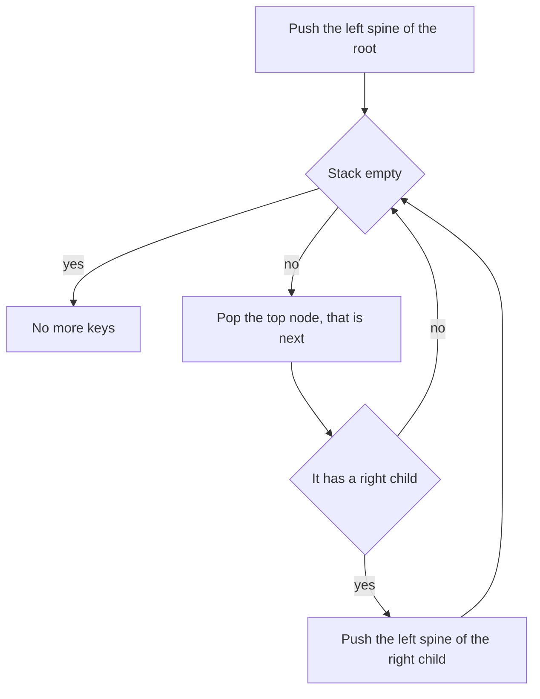

## The hook

A library shelf holds a million books sorted by number, but the catalogue is a binary search tree. A reader wants to browse the books in order, one at a time, stopping whenever they like. Copying a million numbers into an array first costs a million slots of memory just to show the reader the next book.

A bookmark does better. It remembers only where you are and how to get to the next book, using space proportional to the tree's height. That is the *Binary Search Tree Iterator*, and with two bookmarks walking from opposite ends, the tree answers *Two Sum* questions as if it were a sorted array.

## The problem

Design an [[iterator]] over a BST with `next()`, returning the next smallest key, and `hasNext()`. Both should average O(1) time and use O(h) memory, where h is the tree's height.

```text
          8
        /   \
       4     12
      / \   /  \
     2   6 10   14
```

The keys come out as 2, 4, 6, 8, 10, 12, 14. Related questions: the k-th smallest key, and whether two keys add up to a target, which for target 16 is yes (2 + 14, among others) and for target 30 is no.

## The obvious approach

Run a full inorder traversal into an array, then hand out its elements. `next()` is O(1), but the array uses O(n) memory, even if the reader stops after three books. The follow-up asks for O(h) memory.

## The key insight

:::analogy
Picture a bookmark that is really a short stack of sticky notes. Each note says "come back here". To find the smallest book, you walk left from the root, sticking a note at every junction you pass, until you cannot go further left. The top note is the smallest book. After reading it, if that junction has a right branch, you step into it and walk left again, sticking notes as you go. The notes always mark exactly the junctions you still have to return to.
:::

That is a [[controlled inorder]] traversal. The stack holds the path of junctions still to visit:

- **Start:** push the [[left spine]] of the root, every node from the root following left children.
- **next():** pop the top node; that is the answer. Then push the left spine of its right child.
- **hasNext():** the stack is not empty.

Why is the top always the next smallest key? Everything on the stack is a node whose left subtree has been fully visited, and they are stacked from deepest to shallowest. The deepest such node is the smallest unvisited key. After visiting a node, the next larger key is the leftmost node of its right subtree, which is exactly what pushing that spine reaches.

The cost: one `next()` may push a whole spine, but every node is pushed once and popped once over the entire walk. So a full walk costs O(n), [[amortised O(1)]] per call, and the stack never holds more than h nodes.

### Two bookmarks: Two Sum in a BST

On a sorted array, two pointers solve "do two numbers add up to T?" by moving from both ends, as in [Two Fingers on a Sorted List](article:dsa-two-pointers). A BST is a sorted array in disguise. Use a forward iterator for the small end and a [[reverse iterator]] for the large end, following right spines instead of left. If the two keys sum to less than T, advance the forward iterator; if more, advance the reverse one; stop when they meet.



:::insight
A stack holding the unfinished part of the path lets an inorder traversal pause after every key and resume later. Each node enters and leaves the stack once, so the iterator costs amortised O(1) per key with only O(h) memory.
:::

## Walk through an example

The BST above, forward iterator:

| Call | Popped (returned) | Pushed afterwards | Stack after (bottom to top) |
|---|---|---|---|
| start | | 8, 4, 2 | 8 4 2 |
| next | 2 | nothing, no right child | 8 4 |
| next | 4 | 6, the left spine of 4's right child | 8 6 |
| next | 6 | nothing | 8 |
| next | 8 | 12, 10 | 12 10 |
| next | 10 | nothing | 12 |
| next | 12 | 14 | 14 |
| next | 14 | nothing | empty |

The stack never held more than 3 nodes, the height of the tree. On the shelf, the sticky notes always marked exactly the junctions still to come back to.

### Two Sum with target 16

| Forward key | Reverse key | Sum | Move |
|---|---|---|---|
| 2 | 14 | 16 | found |

For target 25: 2 + 14 = 16 is too small, move forward; 4 + 14 = 18, forward; 6 + 14 = 20, forward; 8 + 14 = 22, forward; 10 + 14 = 24, forward; 12 + 14 = 26, too big, move reverse to 12; now both iterators point to 12, they have met, so the answer is no. A pair must use two different nodes.

:::try-this
Use the forward iterator to find the 5th smallest key in the tree above. How many nodes are on the stack when you find it? (The keys come out as 2, 4, 6, 8, 10, so the 5th is 10. Right after popping 10 the stack holds just 12.)
:::

:::warning
Common misconception: "A BST iterator needs parent pointers." The stack replaces them: it stores the ancestors you still need to return to, in the right order. Parent pointers give an O(1)-space alternative, but the stack version is what the problem expects and it works on any BST.
:::

## The code

```pseudo
iterator(root):
    stack = []; push_left(root)
    push_left(node): while node: stack.push(node); node = node.left
    next(): node = stack.pop(); push_left(node.right); return node.value
    hasNext(): return stack is not empty

two_sum(root, target):
    lo = forward iterator; hi = reverse iterator (follows right spines)
    a = lo.next(); b = hi.next()
    while a and b are different nodes:
        if a + b == target: return true
        if a + b < target: a = lo.next() else: b = hi.next()
    return false
```

```cpp
#include <bits/stdc++.h>
using namespace std;

struct Node {
    int val;
    Node *left = nullptr, *right = nullptr;
    Node(int v, Node* l = nullptr, Node* r = nullptr) : val(v), left(l), right(r) {}
};

class BSTIterator {
    vector<Node*> st;
    bool forward;                                          // false: largest first
    void pushSpine(Node* n) {
        while (n) st.push_back(n), n = forward ? n->left : n->right;
    }
public:
    BSTIterator(Node* root, bool fwd = true) : forward(fwd) { pushSpine(root); }
    bool hasNext() const { return !st.empty(); }
    Node* nextNode() {
        Node* n = st.back();
        st.pop_back();
        pushSpine(forward ? n->right : n->left);           // next keys after n
        return n;
    }
    int next() { return nextNode()->val; }
    size_t stackSize() const { return st.size(); }
};

bool findTarget(Node* root, int target) {                 // Two Sum IV
    BSTIterator lo(root, true), hi(root, false);
    Node *a = lo.nextNode(), *b = hi.nextNode();
    while (a != b) {                                       // two different nodes
        int s = a->val + b->val;
        if (s == target) return true;
        if (s < target) a = lo.nextNode();
        else b = hi.nextNode();
    }
    return false;
}

int main() {
    Node* root = new Node(8, new Node(4, new Node(2), new Node(6)), new Node(12, new Node(10), new Node(14)));
    BSTIterator it(root);
    size_t most = 0;
    while (it.hasNext()) { most = max(most, it.stackSize()); cout << it.next() << ' '; }
    cout << "| max stack " << most << '\n';                // 2 4 6 8 10 12 14 | max stack 3
    BSTIterator rev(root, false);
    for (int i = 0; i < 3; i++) cout << rev.next() << ' ';
    cout << '\n';                                          // 14 12 10
    cout << findTarget(root, 16) << findTarget(root, 25) << findTarget(root, 26) << '\n';   // 101
    BSTIterator kth(root);
    int k = 5, ans = 0;
    while (k--) ans = kth.next();
    cout << ans << '\n';                                   // 10
}
```

`findTarget` stops when the two iterators reach the same node, because a pair must use two different keys; it never runs past each other, since the forward keys only grow and the reverse keys only shrink. The BST ordering that makes all of this work is covered in [A Library Where Every Left Shelf Holds Smaller Numbers](article:dsa-bst-operations).

## Complexity

- **next() and hasNext(): amortised O(1) time,** O(h) worst case for a single next.
- **Memory: O(h)** for the stack, O(log n) in a balanced tree and O(n) for a chain.
- **Two Sum IV with two iterators: O(n) time, O(h) space.** A hash-set solution is also O(n) time but uses O(n) space and ignores the ordering.
- **Kth smallest with the iterator: O(h + k).**

## Common mistakes

- **Copying the whole tree into an array** when O(h) memory is required.
- **Pushing the right child itself** instead of the right child's whole left spine.
- **Calling next() when the stack is empty;** check hasNext() first.
- **Letting the two iterators cross or use the same node twice** in Two Sum.
- **Mixing up the directions** in the reverse iterator: follow right spines and push the left child's right spine after popping.
- **Forgetting that the bound is amortised;** a single call can be O(h).

## Practice problems

*Binary Search Tree Iterator* is the walkthrough. *Kth Smallest Element in a BST* is the iterator stopped after k keys, and a natural follow-up is "what if the tree changes often?", where storing subtree sizes helps. *Two Sum IV - Input is a BST* uses a forward and a reverse iterator as two pointers, with O(h) memory instead of a hash set.

## Key takeaways

- A BST iterator keeps a stack of the nodes still to return to, starting with the left spine of the root.
- Each call to next pops the top node, which is the next smallest key, and pushes the left spine of that node's right child.
- Every node is pushed and popped exactly once, so next costs amortised O(1) and the stack never exceeds the tree's height.
- A reverse iterator follows right spines to produce keys from largest to smallest.
- With a forward and a reverse iterator, two-pointer techniques such as Two Sum run directly on a BST in O(n) time and O(h) memory.
