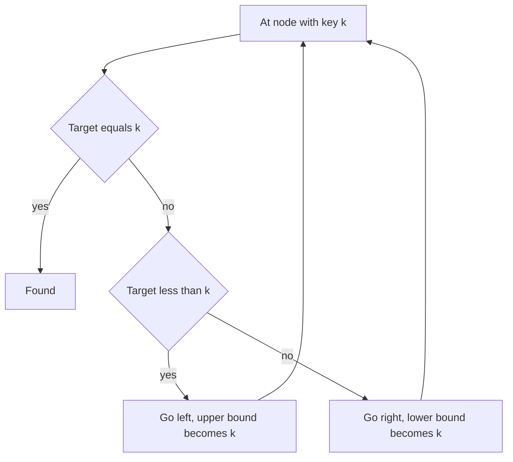

## The hook

A sorted array finds any number in O(log n) with binary search, but inserting a new number means shifting everything after it, O(n). A linked list inserts in O(1) but searches in O(n). A [[binary search tree]] gets fast search and fast insertion at the same time, as long as it stays reasonably balanced.

It is also the structure behind `std::set` and `std::map`, and interviewers love it because its single rule is easy to state and easy to violate. The most common wrong answer to *Validate Binary Search Tree* checks only each parent against its children, and the tree in the quiz above fools it.

## The intuition

:::analogy
Picture a library in a long corridor. At each junction there is a sign with a number: every book on the left branch has a smaller number, every book on the right branch a larger one. To find book 45, you read the first sign, 50, and turn left; the next sign says 30, so you turn right; then 40, right again, and there is 45. You only read one sign per junction, and you never need to look down the other corridors.
:::

The sign at each junction is a node's key, and the rule "left is smaller, right is larger, for everything down that branch" is the [[BST invariant]]. Every operation walks one path from the root, so it costs O([[height]]).

Two consequences follow straight from the rule:

- **Inorder is sorted.** Visiting the left subtree, then the node, then the right subtree lists every smaller key, then the key, then every larger key, at every level. So an inorder traversal of a BST gives the keys in sorted order.
- **The rule is about whole subtrees.** A key deep in the left subtree of node X must be smaller than X, even if it is a right child of something. So every node has an allowed range, its [[bounds]], inherited from all its ancestors.

## How it works

### Search and insert

Start at the root. If the key equals the node's key, done. If it is smaller, go left; if larger, go right. Insert follows the same path and attaches a new leaf where the path falls off the tree.

### Delete: three cases

| Node to delete | What to do |
|---|---|
| a leaf | remove it |
| one child | replace the node with that child |
| two children | copy in its [[inorder successor]], the smallest key in its right subtree, then delete the successor from the right subtree |

The successor works because it is larger than everything in the left subtree and smaller than everything else in the right subtree. And it has no left child, by definition of "smallest", so deleting it falls into one of the first two cases.

### Validate with bounds

Pass down the open interval (low, high) that the node's key must lie in. The root has (−∞, +∞). Going left, the upper bound becomes the node's key; going right, the lower bound becomes the node's key. Any key outside its bounds breaks the BST. Equivalently, an inorder traversal must be strictly increasing.

### Lowest common ancestor in a BST

For two keys p and q, start at the root. If both are smaller than the node, the answer is in the left subtree; if both are larger, it is in the right subtree. Otherwise the node splits them, or equals one of them, so it is the lowest common ancestor. One path, O(h).



:::insight
Every BST operation is one walk from the root that turns left for smaller and right for larger, like reading one sign per junction. Each node's key must lie in the range set by all its ancestors, which is why validation passes bounds down instead of comparing only with the parent.
:::

## Walk through an example

Insert 50, 30, 70, 20, 40, 60, 80, 35 and 45 in that order:

```text
          50
        /    \
      30      70
     /  \    /  \
   20   40  60   80
       /  \
     35    45
```

- **Search for 45:** 50 → left to 30 → right to 40 → right to 45. Three comparisons.
- **Inorder traversal:** 20, 30, 35, 40, 45, 50, 60, 70, 80, sorted.
- **Kth smallest, k = 4:** the fourth key of the inorder traversal, 40. Stop the traversal as soon as you have counted four.
- **Lowest common ancestor of 35 and 45:** both are below 50, so go left; at 30 both are larger, so go right; at 40 one is smaller and one is larger, so 40 is the answer. For 20 and 45, the split happens at 30.

### Deleting 30, a node with two children

| Step | Tree change |
|---|---|
| find 30 | 50 → left |
| find its successor | right subtree of 30 starts at 40; go left as far as possible: 35 |
| copy 35 into the node | the node that held 30 now holds 35 |
| delete 35 from the right subtree | 35 is a leaf, remove it |

Now 50's left child is 35, with children 20 and 40, and 40 keeps its right child 45. The inorder traversal is 20, 35, 40, 45, 50, 60, 70, 80: still sorted, with 30 gone.

### Validating with bounds

For root 10 with left 5 and right 15, where 15 has a left child 6:

| Node | Bounds | Inside? |
|---|---|---|
| 10 | (−∞, +∞) | yes |
| 5 | (−∞, 10) | yes |
| 15 | (10, +∞) | yes |
| 6 | (10, 15) | no, 6 < 10 |

Comparing only with the parent, 6 < 15 looks fine. The bounds catch it, because the lower bound 10 was inherited from the root. In library terms, the book 6 is down a corridor whose first sign promised "everything here is above 10".

:::try-this
In the tree above, before deleting 30, which node is the inorder successor of 40, and which is the lowest common ancestor of 60 and 80? (The successor of 40 is the smallest key in its right subtree, 45. The LCA of 60 and 80 is 70, where they split.)
:::

:::warning
Common misconception: "A BST is valid if every node's left child is smaller and its right child is larger." That only checks direct children. A key can satisfy its parent and still violate an ancestor, as 6 does under 15 and 10. Pass down bounds, or check that the inorder traversal is strictly increasing.
:::

## The code

```pseudo
search(node, x):
    while node and node.key != x:
        node = node.left if x < node.key else node.right
    return node

insert(node, x):
    if node is empty: return new node(x)
    if x < node.key: node.left = insert(node.left, x)
    else if x > node.key: node.right = insert(node.right, x)
    return node

delete(node, x):
    if node is empty: return empty
    if x < node.key: node.left = delete(node.left, x)
    else if x > node.key: node.right = delete(node.right, x)
    else:
        if no left child: return node.right
        if no right child: return node.left
        s = smallest node in node.right
        node.key = s.key; node.right = delete(node.right, s.key)
    return node

valid(node, low, high):
    if node is empty: return true
    if not (low < node.key < high): return false
    return valid(node.left, low, node.key) and valid(node.right, node.key, high)
```

```cpp
#include <bits/stdc++.h>
using namespace std;

struct Node {
    int key;
    Node *left = nullptr, *right = nullptr;
    Node(int k) : key(k) {}
};

Node* insert(Node* n, int x) {
    if (!n) return new Node(x);
    if (x < n->key) n->left = insert(n->left, x);
    else if (x > n->key) n->right = insert(n->right, x);   // ignore duplicates
    return n;
}

Node* search(Node* n, int x) {
    while (n && n->key != x) n = x < n->key ? n->left : n->right;   // one sign per junction
    return n;
}

Node* erase(Node* n, int x) {
    if (!n) return nullptr;
    if (x < n->key) n->left = erase(n->left, x);
    else if (x > n->key) n->right = erase(n->right, x);
    else {
        if (!n->left) return n->right;                   // zero or one child
        if (!n->right) return n->left;
        Node* s = n->right;
        while (s->left) s = s->left;                      // inorder successor
        n->key = s->key;
        n->right = erase(n->right, s->key);
    }
    return n;
}

bool valid(Node* n, long long low, long long high) {
    if (!n) return true;
    if (n->key <= low || n->key >= high) return false;   // outside the inherited bounds
    return valid(n->left, low, n->key) && valid(n->right, n->key, high);
}

void inorder(Node* n, vector<int>& out) {
    if (!n) return;
    inorder(n->left, out), out.push_back(n->key), inorder(n->right, out);
}

int kthSmallest(Node* n, int& k) {                       // stops after k keys
    if (!n) return -1;
    int r = kthSmallest(n->left, k);
    if (r != -1) return r;
    if (--k == 0) return n->key;
    return kthSmallest(n->right, k);
}

Node* lcaBST(Node* n, int p, int q) {
    while (n) {
        if (p < n->key && q < n->key) n = n->left;
        else if (p > n->key && q > n->key) n = n->right;
        else return n;                                   // they split here
    }
    return nullptr;
}

int main() {
    Node* root = nullptr;
    for (int x : {50, 30, 70, 20, 40, 60, 80, 35, 45}) root = insert(root, x);
    vector<int> in;
    inorder(root, in);
    for (int x : in) cout << x << ' ';
    cout << '\n';                                         // 20 30 35 40 45 50 60 70 80
    int k = 4;
    cout << (search(root, 45) != nullptr) << ' ' << kthSmallest(root, k) << ' '
         << lcaBST(root, 35, 45)->key << ' ' << lcaBST(root, 20, 45)->key << '\n';   // 1 40 40 30
    root = erase(root, 30);
    in.clear();
    inorder(root, in);
    for (int x : in) cout << x << ' ';
    cout << "| " << root->left->key << '\n';              // 20 35 40 45 50 60 70 80 | 35
    Node* bad = new Node(10);
    bad->left = new Node(5), bad->right = new Node(15), bad->right->left = new Node(6);
    cout << valid(root, LLONG_MIN, LLONG_MAX) << valid(bad, LLONG_MIN, LLONG_MAX) << '\n';   // 10
}
```

Validation uses 64-bit bounds so that keys equal to INT_MIN or INT_MAX are still checked correctly. The recursion that returns a modified subtree, `n->left = insert(n->left, x)`, is the bottom-up style from [Managers Summarising Their Teams' Reports](article:dsa-tree-recursion).

## Complexity

- **Search, insert, delete, LCA: O(h)** time, one path from the root.
- **For a balanced tree, h = O(log n);** for keys inserted in sorted order, the tree is a chain and h = n, which is why self-balancing trees exist.
- **Validate and inorder: O(n)** time, every node once.
- **Kth smallest: O(h + k),** stopping early after k keys.
- **Space: O(h)** for recursion.

## Common mistakes

- **Validating with parent checks only,** missed by the 10, 15, 6 example.
- **Using int bounds** that cannot represent "below INT_MIN", making keys at the limits fail validation.
- **Deleting a two-child node by attaching subtrees arbitrarily,** breaking the ordering. Use the successor or predecessor.
- **Forgetting to reattach the returned subtree** in recursive insert and delete: write `n->left = insert(n->left, x)`.
- **Assuming O(log n)** without balance; sorted inserts give O(n) operations.
- **Duplicate keys:** decide a rule, such as ignoring them or sending them right, and keep it consistent.

## Practice problems

*Search in a Binary Search Tree* is the one-path walk. *Lowest Common Ancestor of a Binary Search Tree* uses the split point.

*Validate Binary Search Tree* is the bounds check. *Kth Smallest Element in a BST* is an inorder traversal that stops early. *Delete Node in a BST* is the three-case delete. The general LCA problem for any binary tree, without the ordering to guide you, comes next in this track.

## Key takeaways

- In a binary search tree, every key in a node's left subtree is smaller and every key in its right subtree is larger, for all descendants, not just children.
- Search, insert and delete walk a single root-to-leaf path, so they cost O(h): O(log n) when balanced and O(n) for a chain.
- Delete a node with two children by copying in its inorder successor, the smallest key of its right subtree, and deleting that successor instead.
- An inorder traversal of a BST lists the keys in sorted order, which gives the k-th smallest key and a simple validity test.
- Validate a BST by passing down the bounds each node must lie in, because a key can match its parent and still violate an ancestor.
